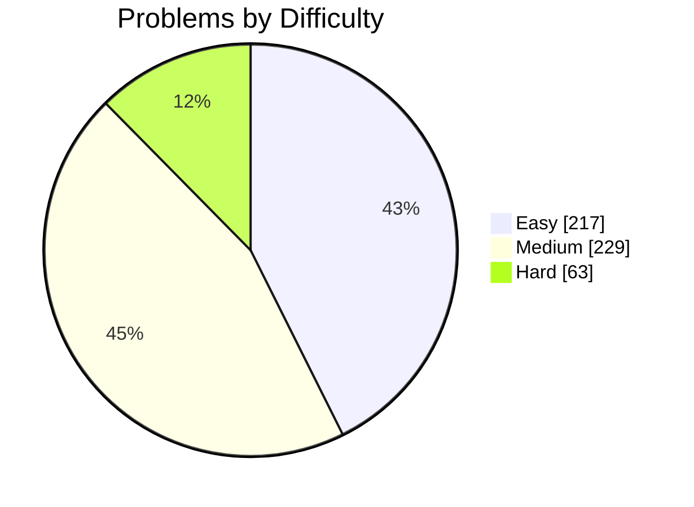

<div align="center">

# 🧩 LeetCode Solutions in Java

**A daily log of Data Structures & Algorithms practice: every problem with its statement, difficulty, topic tags and one or more Java approaches.**


     

</div>

---

## 📑 Table of Contents

- [📊 Progress Dashboard](#-progress-dashboard)
- [🏷️ Topic Breakdown](#-topic-breakdown)
- [🔥 Highlights](#-highlights)
- [🧭 Topic-wise Problem Index](#-topic-wise-problem-index)
- [📋 All Problems](#-all-problems)
- [📁 Repository Structure](#-repository-structure)
- [🚀 How to Use This Repo](#-how-to-use-this-repo)
- [🗺️ Roadmap](#-roadmap)
- [🤝 Contributing](#-contributing)

---

## 📊 Progress Dashboard

| Difficulty | Solved | Share |
|:--|:--:|:--:|
| 🟢 Easy | **217** | `█████████░░░░░░░░░░░` 43% |
| 🟡 Medium | **229** | `█████████░░░░░░░░░░░` 45% |
| 🔴 Hard | **63** | `██░░░░░░░░░░░░░░░░░░` 12% |
| **Total** | **509** | |



- **692** Java solution files across **509** problems
- **112** problems solved with **more than one approach** (brute force → optimized, recursion → memoization → tabulation, and so on)
- **44** major topics covered

---

## 🏷️ Topic Breakdown

A problem can belong to several topics, so these counts add up to more than the total.

| Topic | Problems | Topic | Problems |
|:--|:--:|:--|:--:|
| Array | 304 | Linked List | 17 |
| Hash Table | 124 | Graph | 17 |
| String | 124 | Divide and Conquer | 16 |
| Sorting | 82 | Backtracking | 16 |
| Math | 79 | Design | 14 |
| Dynamic Programming | 76 | Enumeration | 14 |
| Two Pointers | 57 | Union Find | 13 |
| Greedy | 52 | Parentheses | 12 |
| Depth-First Search | 49 | Binary Search Tree | 12 |
| Binary Search | 44 | Recursion | 10 |
| Tree | 40 | Binary Indexed Tree | 9 |
| Binary Tree | 36 | Game Theory | 9 |
| Breadth-First Search | 36 | Queue | 8 |
| Stack | 31 | Minimax | 7 |
| Simulation | 31 | Zero-Sum Game | 7 |
| Matrix | 30 | Monotonic Stack | 7 |
| Counting | 30 | Ordered Set | 7 |
| Prefix Sum | 29 | Quick Sort | 5 |
| Bit Manipulation | 28 | Combinatorics | 5 |
| Heap (Priority Queue) | 24 | Memoization | 5 |
| Sliding Window | 22 | Number Theory | 5 |
| Segment Tree | 20 | Counting Sort | 5 |

---

## 🔥 Highlights

<details>
<summary><b>🔴 All 63 Hard problems</b></summary>

| # | Problem | Topics | Solutions |
|:--:|:--|:--|:--:|
| 4 | [Median of Two Sorted Arrays](https://leetcode.com/problems/median-of-two-sorted-arrays/) | Array, Binary Search, Divide and Conquer | [1 📂](./Median%20of%20Two%20Sorted%20Arrays) |
| 25 | [Reverse Nodes in k-Group](https://leetcode.com/problems/reverse-nodes-in-k-group/) | Recursion, Linked List | [1 📂](./Reverse%20Nodes%20in%20K-Group) |
| 32 | [Longest Valid Parentheses](https://leetcode.com/problems/longest-valid-parentheses/) | Stack, String, Dynamic Programming | [1 📂](./Longest%20Valid%20Parentheses) |
| 37 | [Sudoku Solver](https://leetcode.com/problems/sudoku-solver/) | Array, Hash Table, Backtracking | [1 📂](./Sudoku%20Solver) |
| 41 | [First Missing Positive](https://leetcode.com/problems/first-missing-positive/) | Array, Hash Table | [1 📂](./First%20Missing%20Positive) |
| 51 | [N-Queens](https://leetcode.com/problems/n-queens/) | Array, Backtracking | [1 📂](./N-Queens) |
| 115 | [Distinct Subsequences](https://leetcode.com/problems/distinct-subsequences/) | String, Dynamic Programming | [2 📂](./Distinct%20Subsequences) |
| 124 | [Binary Tree Maximum Path Sum](https://leetcode.com/problems/binary-tree-maximum-path-sum/) | Tree, Depth-First Search, Dynamic Programming | [1 📂](./Binary%20Tree%20Maximum%20Path%20Sum) |
| 132 | [Palindrome Partitioning II](https://leetcode.com/problems/palindrome-partitioning-ii/) | String, Dynamic Programming | [1 📂](./Palindrome%20Partitioning%20II) |
| 174 | [Dungeon Game](https://leetcode.com/problems/dungeon-game/) | Array, Dynamic Programming, Matrix | [2 📂](./Dungeon%20Game) |
| 239 | [Sliding Window Maximum](https://leetcode.com/problems/sliding-window-maximum/) | Queue, Array, Sliding Window | [1 📂](./Sliding%20Window%20Maximum) |
| 301 | [Remove Invalid Parentheses](https://leetcode.com/problems/remove-invalid-parentheses/) | Breadth-First Search, String, Backtracking | [1 📂](./Remove%20Invalid%20Parentheses) |
| 329 | [Longest Increasing Path in a Matrix](https://leetcode.com/problems/longest-increasing-path-in-a-matrix/) | Depth-First Search, Breadth-First Search, Graph | [1 📂](./Longest%20Increasing%20Path%20in%20a%20Matrix) |
| 403 | [Frog Jump](https://leetcode.com/problems/frog-jump/) | Array, Dynamic Programming | [1 📂](./Frog%20Jump) |
| 940 | [Distinct Subsequences II](https://leetcode.com/problems/distinct-subsequences-ii/) | String, Dynamic Programming | [2 📂](./Distinct%20Subsequences%20II) |
| 987 | [Vertical Order Traversal of a Binary Tree](https://leetcode.com/problems/vertical-order-traversal-of-a-binary-tree/) | Tree, Depth-First Search, Breadth-First Search | [1 📂](./Vertical%20Order%20Traversal%20of%20a%20Binary%20Tree) |
| 1074 | [Number of Submatrices That Sum to Target](https://leetcode.com/problems/number-of-submatrices-that-sum-to-target/) | Array, Hash Table, Matrix | [1 📂](./Number%20of%20Submatrices%20That%20Sum%20to%20Target) |
| 1092 | [Shortest Common Supersequence](https://leetcode.com/problems/shortest-common-supersequence/) | String, Dynamic Programming | [1 📂](./Shortest%20Common%20Supersequence) |
| 1096 | [Brace Expansion II](https://leetcode.com/problems/brace-expansion-ii/) | Stack, Breadth-First Search, Hash Table | [1 📂](./Brace%20Expansion%20II) |
| 1192 | [Critical Connections in a Network](https://leetcode.com/problems/critical-connections-in-a-network/) | Depth-First Search, Graph | [1 📂](./Critical%20Connections%20in%20a%20Network) |
| 1312 | [Minimum Insertion Steps to Make a String Palindrome](https://leetcode.com/problems/minimum-insertion-steps-to-make-a-string-palindrome/) | String, Dynamic Programming | [4 📂](./Minimum%20Insertion%20Steps%20to%20Make%20a%20String%20Palindrome) |
| 1406 | [Stone Game III](https://leetcode.com/problems/stone-game-iii/) | Minimax, Array, Math | [1 📂](./Stone%20Game%20III) |
| 1420 | [Build Array Where You Can Find The Maximum Exactly K Comparisons](https://leetcode.com/problems/build-array-where-you-can-find-the-maximum-exactly-k-comparisons/) | Dynamic Programming, Prefix Sum | [1 📂](./Build%20Array%20Where%20You%20Can%20Find%20The%20Maximum%20Exactly%20K%20Comparisons) |
| 1425 | [Constrained Subsequence Sum](https://leetcode.com/problems/constrained-subsequence-sum/) | Queue, Array, Dynamic Programming | [1 📂](./Constrained%20Subsequence%20Sum) |
| 1483 | [Kth Ancestor of a Tree Node](https://leetcode.com/problems/kth-ancestor-of-a-tree-node/) | Bit Manipulation, Tree, Depth-First Search | [1 📂](./Kth%20Ancestor%20of%20a%20Tree%20Node) |
| 1510 | [Stone Game IV](https://leetcode.com/problems/stone-game-iv/) | Minimax, Math, Dynamic Programming | [2 📂](./Stone%20Game%20IV) |
| 1520 | [Maximum Number of Non-Overlapping Substrings](https://leetcode.com/problems/maximum-number-of-non-overlapping-substrings/) | Greedy, Hash Table, String | [1 📂](./Maximum%20Number%20of%20Non-Overlapping%20Substrings) |
| 1563 | [Stone Game V](https://leetcode.com/problems/stone-game-v/) | Array, Math, Dynamic Programming | [1 📂](./Stone%20Game%20V) |
| 1569 | [Number of Ways to Reorder Array to Get Same BST](https://leetcode.com/problems/number-of-ways-to-reorder-array-to-get-same-bst/) | Tree, Union Find, Binary Search Tree | [1 📂](./Number%20of%20Ways%20to%20Reorder%20Array%20to%20Get%20Same%20BST) |
| 1606 | [Find Servers That Handled Most Number of Requests](https://leetcode.com/problems/find-servers-that-handled-most-number-of-requests/) | Array, Ordered Set, Simulation | [1 📂](./Find%20Servers%20That%20Handled%20Most%20Number%20of%20Requests) |
| 1697 | [Checking Existence of Edge Length Limited Paths](https://leetcode.com/problems/checking-existence-of-edge-length-limited-paths/) | Union Find, Graph, Array | [1 📂](./Checking%20Existence%20of%20Edge%20Length%20Limited%20Paths) |
| 1840 | [Maximum Building Height](https://leetcode.com/problems/maximum-building-height/) | Array, Math, Sorting | [1 📂](./Maximum%20Building%20Height) |
| 1872 | [Stone Game VIII](https://leetcode.com/problems/stone-game-viii/) | Minimax, Array, Math | [1 📂](./Stone%20Game%20VIII) |
| 2179 | [Count Good Triplets in an Array](https://leetcode.com/problems/count-good-triplets-in-an-array/) | Binary Indexed Tree, Segment Tree, Array | [1 📂](./Count%20Good%20Triplets%20in%20an%20Array) |
| 2213 | [Longest Substring of One Repeating Character](https://leetcode.com/problems/longest-substring-of-one-repeating-character/) | Segment Tree, Array, String | [1 📂](./Longest%20Substring%20of%20One%20Repeating%20Character) |
| 2267 | [Check if There Is a Valid Parentheses String Path](https://leetcode.com/problems/check-if-there-is-a-valid-parentheses-string-path/) | Array, Dynamic Programming, Matrix | [2 📂](./Check%20if%20There%20Is%20a%20Valid%20Parentheses%20String%20Path) |
| 2360 | [Longest Cycle in a Graph](https://leetcode.com/problems/longest-cycle-in-a-graph/) | Depth-First Search, Breadth-First Search, Graph | [2 📂](./Longest%20Cycle%20in%20a%20Graph) |
| 2472 | [Maximum Number of Non-overlapping Palindrome Substrings](https://leetcode.com/problems/maximum-number-of-non-overlapping-palindrome-substrings/) | Greedy, Two Pointers, String | [6 📂](./Maximum%20Number%20of%20Non-overlapping%20Palindrome%20Substrings) |
| 2897 | [Apply Operations on Array to Maximize Sum of Squares](https://leetcode.com/problems/apply-operations-on-array-to-maximize-sum-of-squares/) | Greedy, Bit Manipulation, Array | [1 📂](./Apply%20Operations%20on%20Array%20to%20Maximize%20Sum%20of%20Squares) |
| 2916 | [Subarrays Distinct Element Sum of Squares II](https://leetcode.com/problems/subarrays-distinct-element-sum-of-squares-ii/) | Binary Indexed Tree, Segment Tree, Array | [1 📂](./Subarrays%20Distinct%20Element%20Sum%20of%20Squares%20II) |
| 2926 | [Maximum Balanced Subsequence Sum](https://leetcode.com/problems/maximum-balanced-subsequence-sum/) | Binary Indexed Tree, Segment Tree, Array | [1 📂](./Maximum%20Balanced%20Subsequence%20Sum) |
| 2940 | [Find Building Where Alice and Bob Can Meet](https://leetcode.com/problems/find-building-where-alice-and-bob-can-meet/) | Stack, Binary Indexed Tree, Segment Tree | [1 📂](./Find%20Building%20Where%20Alice%20and%20Bob%20Can%20Meet) |
| 3072 | [Distribute Elements Into Two Arrays II](https://leetcode.com/problems/distribute-elements-into-two-arrays-ii/) | Binary Indexed Tree, Segment Tree, Array | [1 📂](./Distribute%20Elements%20Into%20Two%20Arrays%20II) |
| 3116 | [Kth Smallest Amount With Single Denomination Combination](https://leetcode.com/problems/kth-smallest-amount-with-single-denomination-combination/) | Bit Manipulation, Array, Math | [1 📂](./Kth%20Smallest%20Amount%20With%20Single%20Denomination%20Combination) |
| 3161 | [Block Placement Queries](https://leetcode.com/problems/block-placement-queries/) | Binary Indexed Tree, Segment Tree, Array | [1 📂](./Block%20Placement%20Queries) |
| 3348 | [Smallest Divisible Digit Product II](https://leetcode.com/problems/smallest-divisible-digit-product-ii/) | Greedy, Math, String | [1 📂](./Smallest%20Divisible%20Digit%20Product%20II) |
| 3363 | [Find the Maximum Number of Fruits Collected](https://leetcode.com/problems/find-the-maximum-number-of-fruits-collected/) | Array, Dynamic Programming, Matrix | [2 📂](./Find%20the%20Maximum%20Number%20of%20Fruits%20Collected) |
| 3414 | [Maximum Score of Non-overlapping Intervals](https://leetcode.com/problems/maximum-score-of-non-overlapping-intervals/) | Array, Binary Search, Dynamic Programming | [2 📂](./Maximum%20Score%20of%20Non-overlapping%20Intervals) |
| 3420 | [Count Non-Decreasing Subarrays After K Operations](https://leetcode.com/problems/count-non-decreasing-subarrays-after-k-operations/) | Stack, Segment Tree, Queue | [0 📂](./Count%20Non-Decreasing%20Subarrays%20After%20K%20Operations) |
| 3501 | [Maximize Active Section with Trade II](https://leetcode.com/problems/maximize-active-section-with-trade-ii/) | Segment Tree, Array, String | [1 📂](./Maximize%20Active%20Section%20with%20Trade%20II) |
| 3505 | [Minimum Operations to Make Elements Within K Subarrays Equal](https://leetcode.com/problems/minimum-operations-to-make-elements-within-k-subarrays-equal/) | Array, Hash Table, Math | [1 📂](./Minimum%20Operations%20to%20Make%20Elements%20Within%20K%20Subarrays%20Equal) |
| 3525 | [Find X Value of Array II](https://leetcode.com/problems/find-x-value-of-array-ii/) | Segment Tree, Array, Math | [1 📂](./Find%20X%20Value%20of%20Array%20II) |
| 3559 | [Number of Ways to Assign Edge Weights II](https://leetcode.com/problems/number-of-ways-to-assign-edge-weights-ii/) | Bit Manipulation, Tree, Depth-First Search | [1 📂](./Number%20of%20Ways%20to%20Assign%20Edge%20Weights%20II) |
| 3614 | [Process String with Special Operations II](https://leetcode.com/problems/process-string-with-special-operations-ii/) | String, Simulation | [1 📂](./Process%20String%20with%20Special%20Operations%20II) |
| 3691 | [Maximum Total Subarray Value II](https://leetcode.com/problems/maximum-total-subarray-value-ii/) | Greedy, Segment Tree, Array | [1 📂](./Maximum%20Total%20Subarray%20Value%20II) |
| 3699 | [Number of ZigZag Arrays I](https://leetcode.com/problems/number-of-zigzag-arrays-i/) |  | [1 📂](./Number%20of%20ZigZag%20Arrays%20I) |
| 3700 | [Number of ZigZag Arrays II](https://leetcode.com/problems/number-of-zigzag-arrays-ii/) |  | [1 📂](./Number%20of%20ZigZag%20Arrays%20II) |
| 3721 | [Longest Balanced Subarray II](https://leetcode.com/problems/longest-balanced-subarray-ii/) | Segment Tree, Array, Hash Table | [1 📂](./Longest%20Balanced%20Subarray%20II) |
| 3734 | [Lexicographically Smallest Palindromic Permutation Greater Than Target](https://leetcode.com/problems/lexicographically-smallest-palindromic-permutation-greater-than-target/) | Two Pointers, String, Enumeration | [1 📂](./Lexicographically%20Smallest%20Palindromic%20Permutation%20Greater%20Than%20Target) |
| 3739 | [Count Subarrays With Majority Element II](https://leetcode.com/problems/count-subarrays-with-majority-element-ii/) | Segment Tree, Array, Hash Table | [1 📂](./Count%20Subarrays%20With%20Majority%20Element%20II) |
| 3753 | [Total Waviness of Numbers in Range II](https://leetcode.com/problems/total-waviness-of-numbers-in-range-ii/) | Math, Dynamic Programming | [1 📂](./Total%20Waviness%20of%20Numbers%20in%20Range%20II) |
| 3841 | [Palindromic Path Queries in a Tree](https://leetcode.com/problems/palindromic-path-queries-in-a-tree/) | Bit Manipulation, Tree, Depth-First Search | [1 📂](./Palindromic%20Path%20Queries%20in%20a%20Tree) |
| 3886 | [Sum of Sortable Integers](https://leetcode.com/problems/sum-of-sortable-integers/) | Array, Math, Enumeration | [1 📂](./Sum%20of%20Sortable%20Integers) |

</details>

<details>
<summary><b>🧠 Problems with the most approaches</b></summary>

Good for seeing how one problem can be solved in different ways.

| # | Problem | Difficulty | Approaches |
|:--:|:--|:--:|:--:|
| 494 | [Target Sum](https://leetcode.com/problems/target-sum/) | 🟡 Medium | [8 📂](./Target%20Sum) |
| 198 | [House Robber](https://leetcode.com/problems/house-robber/) | 🟡 Medium | [6 📂](./House%20Robber) |
| 416 | [Partition Equal Subset Sum](https://leetcode.com/problems/partition-equal-subset-sum/) | 🟡 Medium | [6 📂](./Partition%20Equal%20Subset%20Sum) |
| 2206 | [Divide Array Into Equal Pairs](https://leetcode.com/problems/divide-array-into-equal-pairs/) | 🟢 Easy | [6 📂](./Divide%20Array%20Into%20Equal%20Pairs) |
| 2472 | [Maximum Number of Non-overlapping Palindrome Substrings](https://leetcode.com/problems/maximum-number-of-non-overlapping-palindrome-substrings/) | 🔴 Hard | [6 📂](./Maximum%20Number%20of%20Non-overlapping%20Palindrome%20Substrings) |
| 5 | [Longest Palindromic Substring](https://leetcode.com/problems/longest-palindromic-substring/) | 🟡 Medium | [5 📂](./Longest%20Palindromic%20Substring) |
| 647 | [Palindromic Substrings](https://leetcode.com/problems/palindromic-substrings/) | 🟡 Medium | [5 📂](./Palindromic%20Substrings) |
| 1295 | [Find Numbers with Even Number of Digits](https://leetcode.com/problems/find-numbers-with-even-number-of-digits/) | 🟢 Easy | [5 📂](./Find%20Numbers%20with%20Even%20Number%20of%20Digits) |
| 62 | [Unique Paths](https://leetcode.com/problems/unique-paths/) | 🟡 Medium | [4 📂](./Unique%20Paths) |
| 63 | [Unique Paths II](https://leetcode.com/problems/unique-paths-ii/) | 🟡 Medium | [4 📂](./Unique%20Paths%20II) |
| 72 | [Edit Distance](https://leetcode.com/problems/edit-distance/) | 🟡 Medium | [4 📂](./Edit%20Distance) |
| 231 | [Power of Two](https://leetcode.com/problems/power-of-two/) | 🟢 Easy | [4 📂](./Power%20of%20Two) |
| 409 | [Longest Palindrome](https://leetcode.com/problems/longest-palindrome/) | 🟢 Easy | [4 📂](./Longest%20Palindrome) |
| 516 | [Longest Palindromic Subsequence](https://leetcode.com/problems/longest-palindromic-subsequence/) | 🟡 Medium | [4 📂](./Longest%20Palindromic%20Subsequence) |
| 678 | [Valid Parenthesis String](https://leetcode.com/problems/valid-parenthesis-string/) | 🟡 Medium | [4 📂](./Valid%20Parenthesis%20String) |

</details>

---

## 🧭 Topic-wise Problem Index

Practising by pattern? Expand a topic to see every problem solved in it, from easiest to hardest.

<details>
<summary><b>Array</b> (304)</summary>

| # | Problem | Difficulty | Solutions |
|:--:|:--|:--:|:--:|
| 1 | [Two Sum](https://leetcode.com/problems/two-sum/) | 🟢 Easy | [1 📂](./Two%20Sum) |
| 14 | [Longest Common Prefix](https://leetcode.com/problems/longest-common-prefix/) | 🟢 Easy | [1 📂](./Longest%20Prefix%20Common) |
| 26 | [Remove Duplicates from Sorted Array](https://leetcode.com/problems/remove-duplicates-from-sorted-array/) | 🟢 Easy | [1 📂](./Remove%20Duplicates%20form%20Sorted%20Array) |
| 27 | [Remove Element](https://leetcode.com/problems/remove-element/) | 🟢 Easy | [1 📂](./Remove%20Elements) |
| 35 | [Search Insert Position](https://leetcode.com/problems/search-insert-position/) | 🟢 Easy | [1 📂](./Search%20Insert%20Position) |
| 66 | [Plus One](https://leetcode.com/problems/plus-one/) | 🟢 Easy | [1 📂](./Plus%20One) |
| 88 | [Merge Sorted Array](https://leetcode.com/problems/merge-sorted-array/) | 🟢 Easy | [1 📂](./Merge%20Sorted%20Array) |
| 108 | [Convert Sorted Array to Binary Search Tree](https://leetcode.com/problems/convert-sorted-array-to-binary-search-tree/) | 🟢 Easy | [1 📂](./Convert%20Sorted%20Array%20to%20Binary%20Search%20Tree) |
| 118 | [Pascal's Triangle](https://leetcode.com/problems/pascals-triangle/) | 🟢 Easy | [1 📂](./Pascal%27s%20List) |
| 119 | [Pascal's Triangle II](https://leetcode.com/problems/pascals-triangle-ii/) | 🟢 Easy | [1 📂](./Pascal%27s%20Triangle%20II) |
| 121 | [Best Time to Buy and Sell Stock](https://leetcode.com/problems/best-time-to-buy-and-sell-stock/) | 🟢 Easy | [1 📂](./Best%20Time%20to%20Buy%20and%20Sell%20Stock) |
| 136 | [Single Number](https://leetcode.com/problems/single-number/) | 🟢 Easy | [1 📂](./Single%20Number) |
| 169 | [Majority Element](https://leetcode.com/problems/majority-element/) | 🟢 Easy | [1 📂](./Majority%20Element) |
| 217 | [Contains Duplicate](https://leetcode.com/problems/contains-duplicate/) | 🟢 Easy | [1 📂](./Contains%20Duplicate) |
| 219 | [Contains Duplicate II](https://leetcode.com/problems/contains-duplicate-ii/) | 🟢 Easy | [1 📂](./Contains%20Duplicate%20II) |
| 268 | [Missing Number](https://leetcode.com/problems/missing-number/) | 🟢 Easy | [1 📂](./Missing%20Number) |
| 283 | [Move Zeroes](https://leetcode.com/problems/move-zeroes/) | 🟢 Easy | [1 📂](./Move%20Zeros) |
| 303 | [Range Sum Query - Immutable](https://leetcode.com/problems/range-sum-query-immutable/) | 🟢 Easy | [1 📂](./Range%20Sum%20Query%20Immutable) |
| 349 | [Intersection of Two Arrays](https://leetcode.com/problems/intersection-of-two-arrays/) | 🟢 Easy | [1 📂](./Intersection%20of%20Two%20Arrays) |
| 350 | [Intersection of Two Arrays II](https://leetcode.com/problems/intersection-of-two-arrays-ii/) | 🟢 Easy | [2 📂](./Intersection%20of%20Two%20Arrays%20II) |
| 414 | [Third Maximum Number](https://leetcode.com/problems/third-maximum-number/) | 🟢 Easy | [1 📂](./Third%20Maximum%20Number) |
| 448 | [Find All Numbers Disappeared in an Array](https://leetcode.com/problems/find-all-numbers-disappeared-in-an-array/) | 🟢 Easy | [1 📂](./Find%20All%20Numbers%20Disappeared%20in%20An%20Array) |
| 455 | [Assign Cookies](https://leetcode.com/problems/assign-cookies/) | 🟢 Easy | [1 📂](./Assign%20Cookies) |
| 485 | [Max Consecutive Ones](https://leetcode.com/problems/max-consecutive-ones/) | 🟢 Easy | [1 📂](./Max%20Consecutive%20Ones) |
| 496 | [Next Greater Element I](https://leetcode.com/problems/next-greater-element-i/) | 🟢 Easy | [1 📂](./Next%20Greater%20Element%201) |
| 506 | [Relative Ranks](https://leetcode.com/problems/relative-ranks/) | 🟢 Easy | [3 📂](./Relative%20Ranks) |
| 605 | [Can Place Flowers](https://leetcode.com/problems/can-place-flowers/) | 🟢 Easy | [1 📂](./Can%20Place%20Flowers) |
| 643 | [Maximum Average Subarray I](https://leetcode.com/problems/maximum-average-subarray-i/) | 🟢 Easy | [1 📂](./Maximum%20Average%20Subarray%201) |
| 645 | [Set Mismatch](https://leetcode.com/problems/set-mismatch/) | 🟢 Easy | [1 📂](./Set%20Mismatch) |
| 704 | [Binary Search](https://leetcode.com/problems/binary-search/) | 🟢 Easy | [1 📂](./Binary%20Search) |
| 705 | [Design HashSet](https://leetcode.com/problems/design-hashset/) | 🟢 Easy | [1 📂](./Design%20Hashset) |
| 706 | [Design HashMap](https://leetcode.com/problems/design-hashmap/) | 🟢 Easy | [1 📂](./Design%20HashMap) |
| 724 | [Find Pivot Index](https://leetcode.com/problems/find-pivot-index/) | 🟢 Easy | [1 📂](./Find%20Pivot%20Index) |
| 733 | [Flood Fill](https://leetcode.com/problems/flood-fill/) | 🟢 Easy | [1 📂](./Flood%20Fill) |
| 746 | [Min Cost Climbing Stairs](https://leetcode.com/problems/min-cost-climbing-stairs/) | 🟢 Easy | [3 📂](./Min%20Cost%20Climbing%20Stairs) |
| 860 | [Lemonade Change](https://leetcode.com/problems/lemonade-change/) | 🟢 Easy | [1 📂](./Lemonade%20Change) |
| 867 | [Transpose Matrix](https://leetcode.com/problems/transpose-matrix/) | 🟢 Easy | [1 📂](./Transpose%20Matrix) |
| 896 | [Monotonic Array](https://leetcode.com/problems/monotonic-array/) | 🟢 Easy | [1 📂](./Monotonic%20Array) |
| 905 | [Sort Array By Parity](https://leetcode.com/problems/sort-array-by-parity/) | 🟢 Easy | [1 📂](./Sort%20Array%20By%20Parity) |
| 929 | [Unique Email Addresses](https://leetcode.com/problems/unique-email-addresses/) | 🟢 Easy | [1 📂](./Unique%20Email%20Address) |
| 977 | [Squares of a Sorted Array](https://leetcode.com/problems/squares-of-a-sorted-array/) | 🟢 Easy | [1 📂](./Squares%20of%20Sorted%20Array) |
| 1002 | [Find Common Characters](https://leetcode.com/problems/find-common-characters/) | 🟢 Easy | [1 📂](./Find%20Common%20Characters) |
| 1051 | [Height Checker](https://leetcode.com/problems/height-checker/) | 🟢 Easy | [1 📂](./Height%20Checker) |
| 1122 | [Relative Sort Array](https://leetcode.com/problems/relative-sort-array/) | 🟢 Easy | [1 📂](./Relative%20Sort%20Array) |
| 1128 | [Number of Equivalent Domino Pairs](https://leetcode.com/problems/number-of-equivalent-domino-pairs/) | 🟢 Easy | [4 📂](./Number%20of%20Equivalent%20Domino%20Pairs) |
| 1160 | [Find Words That Can Be Formed by Characters](https://leetcode.com/problems/find-words-that-can-be-formed-by-characters/) | 🟢 Easy | [1 📂](./Find%20Words%20That%20Can%20Be%20Formed%20by%20Characters) |
| 1207 | [Unique Number of Occurrences](https://leetcode.com/problems/unique-number-of-occurrences/) | 🟢 Easy | [3 📂](./Unique%20Number%20of%20Occurrences) |
| 1295 | [Find Numbers with Even Number of Digits](https://leetcode.com/problems/find-numbers-with-even-number-of-digits/) | 🟢 Easy | [5 📂](./Find%20Numbers%20with%20Even%20Number%20of%20Digits) |
| 1299 | [Replace Elements with Greatest Element on Right Side](https://leetcode.com/problems/replace-elements-with-greatest-element-on-right-side/) | 🟢 Easy | [1 📂](./Replace%20Elements%20with%20Greatest%20Element%20on%20Right%20Side) |
| 1346 | [Check If N and Its Double Exist](https://leetcode.com/problems/check-if-n-and-its-double-exist/) | 🟢 Easy | [2 📂](./Check%20If%20N%20and%20Its%20Double%20Exist) |
| 1380 | [Lucky Numbers in a Matrix](https://leetcode.com/problems/lucky-numbers-in-a-matrix/) | 🟢 Easy | [2 📂](./Lucky%20Numbers%20in%20a%20Matrix) |
| 1385 | [Find the Distance Value Between Two Arrays](https://leetcode.com/problems/find-the-distance-value-between-two-arrays/) | 🟢 Easy | [2 📂](./Find%20the%20Distance%20Value%20Between%20Two%20Arrays) |
| 1394 | [Find Lucky Integer in an Array](https://leetcode.com/problems/find-lucky-integer-in-an-array/) | 🟢 Easy | [1 📂](./Find%20Lucky%20Integer%20in%20an%20Array) |
| 1408 | [String Matching in an Array](https://leetcode.com/problems/string-matching-in-an-array/) | 🟢 Easy | [3 📂](./String%20Matching%20in%20an%20Array) |
| 1431 | [Kids With the Greatest Number of Candies](https://leetcode.com/problems/kids-with-the-greatest-number-of-candies/) | 🟢 Easy | [1 📂](./Kids%20With%20the%20Greatest%20Number%20of%20Candies) |
| 1436 | [Destination City](https://leetcode.com/problems/destination-city/) | 🟢 Easy | [1 📂](./Destination%20City) |
| 1460 | [Make Two Arrays Equal by Reversing Subarrays](https://leetcode.com/problems/make-two-arrays-equal-by-reversing-subarrays/) | 🟢 Easy | [2 📂](./Make%20Two%20Arrays%20Equal%20by%20Reversing%20Subarrays) |
| 1464 | [Maximum Product of Two Elements in an Array](https://leetcode.com/problems/maximum-product-of-two-elements-in-an-array/) | 🟢 Easy | [2 📂](./Maximum%20Product%20of%20Two%20Elements%20in%20an%20Array) |
| 1475 | [Final Prices With a Special Discount in a Shop](https://leetcode.com/problems/final-prices-with-a-special-discount-in-a-shop/) | 🟢 Easy | [2 📂](./Final%20Prices%20With%20a%20Special%20Discount%20in%20a%20Shop) |
| 1512 | [Number of Good Pairs](https://leetcode.com/problems/number-of-good-pairs/) | 🟢 Easy | [1 📂](./Number%20of%20Good%20Pairs) |
| 1534 | [Count Good Triplets](https://leetcode.com/problems/count-good-triplets/) | 🟢 Easy | [1 📂](./Count%20Good%20Triplets) |
| 1582 | [Special Positions in a Binary Matrix](https://leetcode.com/problems/special-positions-in-a-binary-matrix/) | 🟢 Easy | [1 📂](./Special%20Positions%20in%20a%20Binary%20Matrix) |
| 1598 | [Crawler Log Folder](https://leetcode.com/problems/crawler-log-folder/) | 🟢 Easy | [2 📂](./Crawler%20Log%20Folder) |
| 1608 | [Special Array With X Elements Greater Than or Equal X](https://leetcode.com/problems/special-array-with-x-elements-greater-than-or-equal-x/) | 🟢 Easy | [1 📂](./Special%20Array%20With%20X%20Elements%20Greater%20Than%20or%20Equal%20X) |
| 1619 | [Mean of Array After Removing Some Elements](https://leetcode.com/problems/mean-of-array-after-removing-some-elements/) | 🟢 Easy | [1 📂](./Mean%20of%20Array%20after%20removing%20Some%20Elements) |
| 1636 | [Sort Array by Increasing Frequency](https://leetcode.com/problems/sort-array-by-increasing-frequency/) | 🟢 Easy | [1 📂](./Sort%20Array%20by%20Increasing%20Frequency) |
| 1652 | [Defuse the Bomb](https://leetcode.com/problems/defuse-the-bomb/) | 🟢 Easy | [2 📂](./Defuse%20the%20Bomb) |
| 1684 | [Count the Number of Consistent Strings](https://leetcode.com/problems/count-the-number-of-consistent-strings/) | 🟢 Easy | [2 📂](./Count%20the%20Number%20of%20Consistent%20Strings) |
| 1700 | [Number of Students Unable to Eat Lunch](https://leetcode.com/problems/number-of-students-unable-to-eat-lunch/) | 🟢 Easy | [1 📂](./Number%20of%20Students%20Unable%20to%20Eat%20Lunch) |
| 1710 | [Maximum Units on a Truck](https://leetcode.com/problems/maximum-units-on-a-truck/) | 🟢 Easy | [1 📂](./Maximum%20Units%20on%20a%20Truck) |
| 1732 | [Find the Highest Altitude](https://leetcode.com/problems/find-the-highest-altitude/) | 🟢 Easy | [1 📂](./Find%20the%20Highest%20Altitude) |
| 1748 | [Sum of Unique Elements](https://leetcode.com/problems/sum-of-unique-elements/) | 🟢 Easy | [1 📂](./Sum%20of%20Unique%20Elements) |
| 1752 | [Check if Array Is Sorted and Rotated](https://leetcode.com/problems/check-if-array-is-sorted-and-rotated/) | 🟢 Easy | [2 📂](./Check%20if%20Array%20Is%20Sorted%20and%20Rotated) |
| 1800 | [Maximum Ascending Subarray Sum](https://leetcode.com/problems/maximum-ascending-subarray-sum/) | 🟢 Easy | [2 📂](./Maximum%20Ascending%20Subarray%20Sum%20) |
| 1822 | [Sign of the Product of an Array](https://leetcode.com/problems/sign-of-the-product-of-an-array/) | 🟢 Easy | [1 📂](./Sign%20of%20the%20Product%20of%20an%20Array) |
| 1863 | [Sum of All Subset XOR Totals](https://leetcode.com/problems/sum-of-all-subset-xor-totals/) | 🟢 Easy | [3 📂](./Sum%20of%20All%20Subset%20XOR%20Totals) |
| 1913 | [Maximum Product Difference Between Two Pairs](https://leetcode.com/problems/maximum-product-difference-between-two-pairs/) | 🟢 Easy | [1 📂](./Maximum%20Product%20Difference%20Between%20Two%20Pairs) |
| 1929 | [Concatenation of Array](https://leetcode.com/problems/concatenation-of-array/) | 🟢 Easy | [1 📂](./Concatenation%20of%20Array) |
| 1967 | [Number of Strings That Appear as Substrings in Word](https://leetcode.com/problems/number-of-strings-that-appear-as-substrings-in-word/) | 🟢 Easy | [1 📂](./Number%20of%20Strings%20That%20Appear%20as%20Substrings%20in%20Word) |
| 2022 | [Convert 1D Array Into 2D Array](https://leetcode.com/problems/convert-1d-array-into-2d-array/) | 🟢 Easy | [2 📂](./Convert%201D%20Array%20Into%202D%20Array) |
| 2037 | [Minimum Number of Moves to Seat Everyone](https://leetcode.com/problems/minimum-number-of-moves-to-seat-everyone/) | 🟢 Easy | [2 📂](./Minimum%20Number%20of%20Moves%20to%20Seat%20Everyone) |
| 2053 | [Kth Distinct String in an Array](https://leetcode.com/problems/kth-distinct-string-in-an-array/) | 🟢 Easy | [1 📂](./Kth%20Distinct%20String%20in%20an%20Array) |
| 2073 | [Time Needed to Buy Tickets](https://leetcode.com/problems/time-needed-to-buy-tickets/) | 🟢 Easy | [1 📂](./Time%20Needed%20to%20Buy%20Tickets) |
| 2089 | [Find Target Indices After Sorting Array](https://leetcode.com/problems/find-target-indices-after-sorting-array/) | 🟢 Easy | [1 📂](./Find%20Target%20Indices%20After%20Sorting%20Array) |
| 2144 | [Minimum Cost of Buying Candies With Discount](https://leetcode.com/problems/minimum-cost-of-buying-candies-with-discount/) | 🟢 Easy | [1 📂](./Minimum%20Cost%20of%20Buying%20Candies%20With%20Discount) |
| 2176 | [Count Equal and Divisible Pairs in an Array](https://leetcode.com/problems/count-equal-and-divisible-pairs-in-an-array/) | 🟢 Easy | [2 📂](./Count%20Equal%20and%20Divisible%20Pairs%20in%20an%20Array) |
| 2206 | [Divide Array Into Equal Pairs](https://leetcode.com/problems/divide-array-into-equal-pairs/) | 🟢 Easy | [6 📂](./Divide%20Array%20Into%20Equal%20Pairs) |
| 2215 | [Find the Difference of Two Arrays](https://leetcode.com/problems/find-the-difference-of-two-arrays/) | 🟢 Easy | [1 📂](./Find%20the%20difference%20of%20Two%20Arrays) |
| 2373 | [Largest Local Values in a Matrix](https://leetcode.com/problems/largest-local-values-in-a-matrix/) | 🟢 Easy | [1 📂](./Largest%20Local%20Values%20in%20a%20Matrix) |
| 2383 | [Minimum Hours of Training to Win a Competition](https://leetcode.com/problems/minimum-hours-of-training-to-win-a-competition/) | 🟢 Easy | [1 📂](./Minimum%20Hours%20of%20Training%20to%20Win%20a%20Competition) |
| 2404 | [Most Frequent Even Element](https://leetcode.com/problems/most-frequent-even-element/) | 🟢 Easy | [1 📂](./Most%20Frequent%20Even%20Element) |
| 2418 | [Sort the People](https://leetcode.com/problems/sort-the-people/) | 🟢 Easy | [1 📂](./Sort%20the%20People) |
| 2441 | [Largest Positive Integer That Exists With Its Negative](https://leetcode.com/problems/largest-positive-integer-that-exists-with-its-negative/) | 🟢 Easy | [4 📂](./Largest%20Positive%20Integer%20That%20Exists%20With%20Its%20Negative) |
| 2460 | [Apply Operations to an Array](https://leetcode.com/problems/apply-operations-to-an-array/) | 🟢 Easy | [3 📂](./Apply%20Operations%20to%20an%20Array) |
| 2540 | [Minimum Common Value](https://leetcode.com/problems/minimum-common-value/) | 🟢 Easy | [1 📂](./Minimum%20Common%20Value) |
| 2558 | [Take Gifts From the Richest Pile](https://leetcode.com/problems/take-gifts-from-the-richest-pile/) | 🟢 Easy | [1 📂](./Take%20Gifts%20From%20the%20Richest%20Pile) |
| 2570 | [Merge Two 2D Arrays by Summing Values](https://leetcode.com/problems/merge-two-2d-arrays-by-summing-values/) | 🟢 Easy | [3 📂](./Merge%20Two%202D%20Arrays%20by%20Summing%20Values) |
| 2574 | [Left and Right Sum Differences](https://leetcode.com/problems/left-and-right-sum-differences/) | 🟢 Easy | [1 📂](./Left%20and%20Right%20Sum%20Differences) |
| 2678 | [Number of Senior Citizens](https://leetcode.com/problems/number-of-senior-citizens/) | 🟢 Easy | [1 📂](./Number%20of%20Senior%20Citizens) |
| 2706 | [Buy Two Chocolates](https://leetcode.com/problems/buy-two-chocolates/) | 🟢 Easy | [2 📂](./Buy%20Two%20Chocolates) |
| 2778 | [Sum of Squares of Special Elements](https://leetcode.com/problems/sum-of-squares-of-special-elements/) | 🟢 Easy | [1 📂](./Sum%20of%20Squares%20of%20Special%20Elements) |
| 2873 | [Maximum Value of an Ordered Triplet I](https://leetcode.com/problems/maximum-value-of-an-ordered-triplet-i/) | 🟢 Easy | [3 📂](./Maximum%20Value%20of%20an%20Ordered%20Triplet%20I) |
| 2913 | [Subarrays Distinct Element Sum of Squares I](https://leetcode.com/problems/subarrays-distinct-element-sum-of-squares-i/) | 🟢 Easy | [1 📂](./Subarrays%20Distinct%20Element%20Sum%20of%20Squares%20I) |
| 2965 | [Find Missing and Repeated Values](https://leetcode.com/problems/find-missing-and-repeated-values/) | 🟢 Easy | [3 📂](./Find%20Missing%20and%20Repeated%20Values) |
| 2996 | [Smallest Missing Integer Greater Than Sequential Prefix Sum](https://leetcode.com/problems/smallest-missing-integer-greater-than-sequential-prefix-sum/) | 🟢 Easy | [1 📂](./Smallest%20Missing%20Integer%20Greater%20Than%20Sequential%20Prefix%20Sum) |
| 3005 | [Count Elements With Maximum Frequency](https://leetcode.com/problems/count-elements-with-maximum-frequency/) | 🟢 Easy | [1 📂](./Count%20Element%20With%20Maximum%20Frequency) |
| 3069 | [Distribute Elements Into Two Arrays I](https://leetcode.com/problems/distribute-elements-into-two-arrays-i/) | 🟢 Easy | [1 📂](./Distribute%20Elements%20Into%20Two%20Arrays%20I) |
| 3105 | [Longest Strictly Increasing or Strictly Decreasing Subarray](https://leetcode.com/problems/longest-strictly-increasing-or-strictly-decreasing-subarray/) | 🟢 Easy | [1 📂](./Longest%20Strictly%20Increasing%20or%20Strictly%20Decreasing%20Subarray%20) |
| 3151 | [Special Array I](https://leetcode.com/problems/special-array-i/) | 🟢 Easy | [1 📂](./Special%20Array%20I) |
| 3264 | [Final Array State After K Multiplication Operations I](https://leetcode.com/problems/final-array-state-after-k-multiplication-operations-i/) | 🟢 Easy | [2 📂](./Final%20Array%20State%20After%20K%20Multiplication%20Operations%20I) |
| 3300 | [Minimum Element After Replacement With Digit Sum](https://leetcode.com/problems/minimum-element-after-replacement-with-digit-sum/) | 🟢 Easy | [1 📂](./Minimum%20Element%20After%20Replacement%20With%20Digit%20Sum) |
| 3375 | [Minimum Operations to Make Array Values Equal to K](https://leetcode.com/problems/minimum-operations-to-make-array-values-equal-to-k/) | 🟢 Easy | [1 📂](./Minimum%20Operations%20to%20Make%20Array%20Values%20Equal%20to%20K) |
| 3392 | [Count Subarrays of Length Three With a Condition](https://leetcode.com/problems/count-subarrays-of-length-three-with-a-condition/) | 🟢 Easy | [1 📂](./Count%20Subarrays%20of%20Length%20Three%20With%20a%20Condition) |
| 3396 | [Minimum Number of Operations to Make Elements in Array Distinct](https://leetcode.com/problems/minimum-number-of-operations-to-make-elements-in-array-distinct/) | 🟢 Easy | [2 📂](./Minimum%20Number%20of%20Operations%20to%20Make%20Elements%20in%20Array%20Distinct) |
| 3471 | [Find the Largest Almost Missing Integer](https://leetcode.com/problems/find-the-largest-almost-missing-integer/) | 🟢 Easy | [1 📂](./Find%20the%20Largest%20Almost%20Missing%20Integer) |
| 3477 | [Fruits Into Baskets II](https://leetcode.com/problems/fruits-into-baskets-ii/) | 🟢 Easy | [2 📂](./Fruits%20Into%20Baskets%20II) |
| 3483 | [Unique 3-Digit Even Numbers](https://leetcode.com/problems/unique-3-digit-even-numbers/) | 🟢 Easy | [2 📂](./Unique%203-Digit%20Even%20Numbers) |
| 3550 | [Smallest Index With Digit Sum Equal to Index](https://leetcode.com/problems/smallest-index-with-digit-sum-equal-to-index/) | 🟢 Easy | [1 📂](./Smallest%20Index%20With%20Digit%20Sum%20Equal%20to%20Index) |
| 3633 | [Earliest Finish Time for Land and Water Rides I](https://leetcode.com/problems/earliest-finish-time-for-land-and-water-rides-i/) | 🟢 Easy | [1 📂](./Earliest%20Finish%20Time%20for%20Land%20and%20Water%20Rides%20I) |
| 3718 | [Smallest Missing Multiple of K](https://leetcode.com/problems/smallest-missing-multiple-of-k/) | 🟢 Easy | [1 📂](./Smallest%20Missing%20Multiple%20of%20K) |
| 3731 | [Find Missing Elements](https://leetcode.com/problems/find-missing-elements/) | 🟢 Easy | [1 📂](./Find%20Missing%20Elements) |
| 3736 | [Minimum Moves to Equal Array Elements III](https://leetcode.com/problems/minimum-moves-to-equal-array-elements-iii/) | 🟢 Easy | [2 📂](./Minimum%20Moves%20to%20Equal%20Array%20Elements%20III) |
| 3838 | [Weighted Word Mapping](https://leetcode.com/problems/weighted-word-mapping/) | 🟢 Easy | [1 📂](./Weighted%20Word%20Mapping) |
| 3875 | [Construct Uniform Parity Array I](https://leetcode.com/problems/construct-uniform-parity-array-i/) | 🟢 Easy | [2 📂](./Construct%20Uniform%20Parity%20Array%20I) |
| 3903 | [Smallest Stable Index I](https://leetcode.com/problems/smallest-stable-index-i/) | 🟢 Easy | [1 📂](./Smallest%20Stable%20Index%20I) |
| 3936 | [Minimum Swaps to Move Zeros to End](https://leetcode.com/problems/minimum-swaps-to-move-zeros-to-end/) | 🟢 Easy | [1 📂](./Minimum%20Swaps%20to%20Move%20Zeros%20to%20End) |
| 4020 | [Elevator Requests I](https://leetcode.com/problems/elevator-requests-i/) | 🟢 Easy | [1 📂](./Elevator%20Requests%20I) |
| 4048 | [Count Values With Equally Spaced Occurrences I](https://leetcode.com/problems/count-values-with-equally-spaced-occurrences-i/) | 🟢 Easy | [1 📂](./Count%20Values%20With%20Equally%20Spaced%20Occurrences%20I) |
| 11 | [Container With Most Water](https://leetcode.com/problems/container-with-most-water/) | 🟡 Medium | [1 📂](./Container%20With%20Most%20water) |
| 15 | [3Sum](https://leetcode.com/problems/3sum/) | 🟡 Medium | [1 📂](./Three%20Sum) |
| 18 | [4Sum](https://leetcode.com/problems/4sum/) | 🟡 Medium | [1 📂](./4Sum) |
| 33 | [Search in Rotated Sorted Array](https://leetcode.com/problems/search-in-rotated-sorted-array/) | 🟡 Medium | [1 📂](./Search%20in%20Rotated%20Sorted%20Array) |
| 36 | [Valid Sudoku](https://leetcode.com/problems/valid-sudoku/) | 🟡 Medium | [1 📂](./Valid%20Sudoku) |
| 39 | [Combination Sum](https://leetcode.com/problems/combination-sum/) | 🟡 Medium | [1 📂](./Combination%20Sum) |
| 46 | [Permutations](https://leetcode.com/problems/permutations/) | 🟡 Medium | [1 📂](./Permutations) |
| 49 | [Group Anagrams](https://leetcode.com/problems/group-anagrams/) | 🟡 Medium | [1 📂](./Group%20Anagrams%20) |
| 53 | [Maximum Subarray](https://leetcode.com/problems/maximum-subarray/) | 🟡 Medium | [1 📂](./Maximum%20Subarray) |
| 56 | [Merge Intervals](https://leetcode.com/problems/merge-intervals/) | 🟡 Medium | [1 📂](./Merge%20Intervals) |
| 63 | [Unique Paths II](https://leetcode.com/problems/unique-paths-ii/) | 🟡 Medium | [4 📂](./Unique%20Paths%20II) |
| 75 | [Sort Colors](https://leetcode.com/problems/sort-colors/) | 🟡 Medium | [1 📂](./Sort%20Colors) |
| 78 | [Subsets](https://leetcode.com/problems/subsets/) | 🟡 Medium | [1 📂](./Subsets) |
| 80 | [Remove Duplicates from Sorted Array II](https://leetcode.com/problems/remove-duplicates-from-sorted-array-ii/) | 🟡 Medium | [1 📂](./Remove%20Duplicates%20from%20Sorted%20Array%20II) |
| 90 | [Subsets II](https://leetcode.com/problems/subsets-ii/) | 🟡 Medium | [1 📂](./Subsets%20II) |
| 105 | [Construct Binary Tree from Preorder and Inorder Traversal](https://leetcode.com/problems/construct-binary-tree-from-preorder-and-inorder-traversal/) | 🟡 Medium | [1 📂](./Construct%20Binary%20Tree%20from%20Preorder%20and%20Inorder%20Traversal) |
| 122 | [Best Time to Buy and Sell Stock II](https://leetcode.com/problems/best-time-to-buy-and-sell-stock-ii/) | 🟡 Medium | [1 📂](./Best%20Time%20to%20Buy%20and%20Sell%20Stock%20%7C%7C) |
| 128 | [Longest Consecutive Sequence](https://leetcode.com/problems/longest-consecutive-sequence/) | 🟡 Medium | [1 📂](./Longest%20Consecutive%20Sequence) |
| 137 | [Single Number II](https://leetcode.com/problems/single-number-ii/) | 🟡 Medium | [1 📂](./Single%20Number%202) |
| 150 | [Evaluate Reverse Polish Notation](https://leetcode.com/problems/evaluate-reverse-polish-notation/) | 🟡 Medium | [1 📂](./Evaluate%20Reverse%20Polish%20Notation) |
| 162 | [Find Peak Element](https://leetcode.com/problems/find-peak-element/) | 🟡 Medium | [1 📂](./Find%20Peak%20Element) |
| 167 | [Two Sum II - Input Array Is Sorted](https://leetcode.com/problems/two-sum-ii-input-array-is-sorted/) | 🟡 Medium | [1 📂](./Two%20Sum%202%20-%20Input%20Array%20is%20Sorted) |
| 179 | [Largest Number](https://leetcode.com/problems/largest-number/) | 🟡 Medium | [1 📂](./Largest%20Number) |
| 189 | [Rotate Array](https://leetcode.com/problems/rotate-array/) | 🟡 Medium | [1 📂](./Rotate%20Array) |
| 198 | [House Robber](https://leetcode.com/problems/house-robber/) | 🟡 Medium | [6 📂](./House%20Robber) |
| 200 | [Number of Islands](https://leetcode.com/problems/number-of-islands/) | 🟡 Medium | [1 📂](./Number%20of%20Islands) |
| 204 | [Count Primes](https://leetcode.com/problems/count-primes/) | 🟡 Medium | [1 📂](./Count%20Primes) |
| 213 | [House Robber II](https://leetcode.com/problems/house-robber-ii/) | 🟡 Medium | [1 📂](./House%20Robber%20II) |
| 215 | [Kth Largest Element in an Array](https://leetcode.com/problems/kth-largest-element-in-an-array/) | 🟡 Medium | [2 📂](./Kth%20Largest%20Element%20in%20an%20Array) |
| 216 | [Combination Sum III](https://leetcode.com/problems/combination-sum-iii/) | 🟡 Medium | [1 📂](./Combination%20Sum%20III) |
| 229 | [Majority Element II](https://leetcode.com/problems/majority-element-ii/) | 🟡 Medium | [1 📂](./Majority%20Element%202) |
| 238 | [Product of Array Except Self](https://leetcode.com/problems/product-of-array-except-self/) | 🟡 Medium | [1 📂](./Product%20Array%20Except%20Self) |
| 300 | [Longest Increasing Subsequence](https://leetcode.com/problems/longest-increasing-subsequence/) | 🟡 Medium | [3 📂](./Longest%20Increasing%20Subsequence) |
| 304 | [Range Sum Query 2D - Immutable](https://leetcode.com/problems/range-sum-query-2d-immutable/) | 🟡 Medium | [1 📂](./Range%20Sum%20Query%202D%20Immutable) |
| 307 | [Range Sum Query - Mutable](https://leetcode.com/problems/range-sum-query-mutable/) | 🟡 Medium | [1 📂](./Range%20Sum%20Query%20-%20Mutable) |
| 309 | [Best Time to Buy and Sell Stock with Cooldown](https://leetcode.com/problems/best-time-to-buy-and-sell-stock-with-cooldown/) | 🟡 Medium | [3 📂](./Best%20Time%20to%20Buy%20and%20Sell%20Stock%20with%20Cooldown) |
| 334 | [Increasing Triplet Subsequence](https://leetcode.com/problems/increasing-triplet-subsequence/) | 🟡 Medium | [1 📂](./Increasing%20Triplet%20Subsequence) |
| 347 | [Top K Frequent Elements](https://leetcode.com/problems/top-k-frequent-elements/) | 🟡 Medium | [1 📂](./Top%20K%20Frequent%20Elements) |
| 368 | [Largest Divisible Subset](https://leetcode.com/problems/largest-divisible-subset/) | 🟡 Medium | [2 📂](./Largest%20Divisible%20Subset) |
| 380 | [Insert Delete GetRandom O(1)](https://leetcode.com/problems/insert-delete-getrandom-o1/) | 🟡 Medium | [1 📂](./Insert%20Delete%20GetRandom%20O%281%29) |
| 396 | [Rotate Function](https://leetcode.com/problems/rotate-function/) | 🟡 Medium | [1 📂](./Rotate%20Function) |
| 399 | [Evaluate Division](https://leetcode.com/problems/evaluate-division/) | 🟡 Medium | [1 📂](./Evaluate%20Division) |
| 416 | [Partition Equal Subset Sum](https://leetcode.com/problems/partition-equal-subset-sum/) | 🟡 Medium | [6 📂](./Partition%20Equal%20Subset%20Sum) |
| 435 | [Non-overlapping Intervals](https://leetcode.com/problems/non-overlapping-intervals/) | 🟡 Medium | [1 📂](./Non-overlapping%20Intervals) |
| 452 | [Minimum Number of Arrows to Burst Balloons](https://leetcode.com/problems/minimum-number-of-arrows-to-burst-balloons/) | 🟡 Medium | [1 📂](./Minimum%20Number%20of%20Arrows%20to%20Burst%20Balloons) |
| 453 | [Minimum Moves to Equal Array Elements](https://leetcode.com/problems/minimum-moves-to-equal-array-elements/) | 🟡 Medium | [2 📂](./Minimum%20Moves%20to%20Equal%20Array%20Elements) |
| 462 | [Minimum Moves to Equal Array Elements II](https://leetcode.com/problems/minimum-moves-to-equal-array-elements-ii/) | 🟡 Medium | [1 📂](./Minimum%20Moves%20to%20Equal%20Array%20Elements%20II) |
| 486 | [Predict the Winner](https://leetcode.com/problems/predict-the-winner/) | 🟡 Medium | [1 📂](./Predict%20the%20Winner) |
| 494 | [Target Sum](https://leetcode.com/problems/target-sum/) | 🟡 Medium | [8 📂](./Target%20Sum) |
| 523 | [Continuous Subarray Sum](https://leetcode.com/problems/continuous-subarray-sum/) | 🟡 Medium | [1 📂](./Continuous%20Subarray%20Sum) |
| 525 | [Contiguous Array](https://leetcode.com/problems/contiguous-array/) | 🟡 Medium | [1 📂](./Contiguous%20Array) |
| 540 | [Single Element in a Sorted Array](https://leetcode.com/problems/single-element-in-a-sorted-array/) | 🟡 Medium | [1 📂](./Single%20Element%20in%20Sorted%20Array) |
| 554 | [Brick Wall](https://leetcode.com/problems/brick-wall/) | 🟡 Medium | [1 📂](./Brick%20Wall) |
| 560 | [Subarray Sum Equals K](https://leetcode.com/problems/subarray-sum-equals-k/) | 🟡 Medium | [1 📂](./Subarray%20Sum%20Equals%20K) |
| 646 | [Maximum Length of Pair Chain](https://leetcode.com/problems/maximum-length-of-pair-chain/) | 🟡 Medium | [2 📂](./Maximum%20Length%20of%20Pair%20Chain) |
| 714 | [Best Time to Buy and Sell Stock with Transaction Fee](https://leetcode.com/problems/best-time-to-buy-and-sell-stock-with-transaction-fee/) | 🟡 Medium | [2 📂](./Best%20Time%20to%20Buy%20and%20Sell%20Stock%20with%20Transaction%20Fee) |
| 720 | [Longest Word in Dictionary](https://leetcode.com/problems/longest-word-in-dictionary/) | 🟡 Medium | [1 📂](./Longest%20Word%20in%20Dictionary) |
| 735 | [Asteroid Collision](https://leetcode.com/problems/asteroid-collision/) | 🟡 Medium | [1 📂](./Asteroid%20Collision) |
| 739 | [Daily Temperatures](https://leetcode.com/problems/daily-temperatures/) | 🟡 Medium | [1 📂](./Daily%20Temperatures) |
| 835 | [Image Overlap](https://leetcode.com/problems/image-overlap/) | 🟡 Medium | [1 📂](./Image%20Overlap) |
| 852 | [Peak Index in a Mountain Array](https://leetcode.com/problems/peak-index-in-a-mountain-array/) | 🟡 Medium | [1 📂](./Peak%20Index%20in%20a%20Mountain%20Array) |
| 875 | [Koko Eating Bananas](https://leetcode.com/problems/koko-eating-bananas/) | 🟡 Medium | [1 📂](./Koko%20Eating%20Bananas) |
| 877 | [Stone Game](https://leetcode.com/problems/stone-game/) | 🟡 Medium | [1 📂](./Stone%20Game) |
| 881 | [Boats to Save People](https://leetcode.com/problems/boats-to-save-people/) | 🟡 Medium | [1 📂](./Boats%20to%20Save%20People) |
| 912 | [Sort an Array](https://leetcode.com/problems/sort-an-array/) | 🟡 Medium | [1 📂](./Sort%20an%20Array) |
| 930 | [Binary Subarrays With Sum](https://leetcode.com/problems/binary-subarrays-with-sum/) | 🟡 Medium | [1 📂](./Binary%20Subarrays%20With%20Sum) |
| 948 | [Bag of Tokens](https://leetcode.com/problems/bag-of-tokens/) | 🟡 Medium | [1 📂](./Bag%20of%20Tokens) |
| 974 | [Subarray Sums Divisible by K](https://leetcode.com/problems/subarray-sums-divisible-by-k/) | 🟡 Medium | [1 📂](./Subarray%20Sums%20Divisible%20by%20K) |
| 994 | [Rotting Oranges](https://leetcode.com/problems/rotting-oranges/) | 🟡 Medium | [2 📂](./Rotting%20Oranges) |
| 1004 | [Max Consecutive Ones III](https://leetcode.com/problems/max-consecutive-ones-iii/) | 🟡 Medium | [1 📂](./Max%20Consecutive%20Ones%20III) |
| 1008 | [Construct Binary Search Tree from Preorder Traversal](https://leetcode.com/problems/construct-binary-search-tree-from-preorder-traversal/) | 🟡 Medium | [1 📂](./Construct%20Binary%20Search%20Tree%20from%20Preorder%20Traversal) |
| 1048 | [Longest String Chain](https://leetcode.com/problems/longest-string-chain/) | 🟡 Medium | [2 📂](./Longest%20String%20Chain) |
| 1140 | [Stone Game II](https://leetcode.com/problems/stone-game-ii/) | 🟡 Medium | [1 📂](./Stone%20Game%20II) |
| 1254 | [Number of Closed Islands](https://leetcode.com/problems/number-of-closed-islands/) | 🟡 Medium | [1 📂](./Number%20of%20Closed%20Islands) |
| 1267 | [Count Servers that Communicate](https://leetcode.com/problems/count-servers-that-communicate/) | 🟡 Medium | [2 📂](./Count%20Servers%20that%20Communicate) |
| 1268 | [Search Suggestions System](https://leetcode.com/problems/search-suggestions-system/) | 🟡 Medium | [2 📂](./Search%20Suggestions%20System) |
| 1386 | [Cinema Seat Allocation](https://leetcode.com/problems/cinema-seat-allocation/) | 🟡 Medium | [2 📂](./Cinema%20Seat%20Allocation) |
| 1477 | [Find Two Non-overlapping Sub-arrays Each With Target Sum](https://leetcode.com/problems/find-two-non-overlapping-sub-arrays-each-with-target-sum/) | 🟡 Medium | [1 📂](./Find%20Two%20Non-overlapping%20Sub-arrays%20Each%20With%20Target%20Sum) |
| 1493 | [Longest Subarray of 1's After Deleting One Element](https://leetcode.com/problems/longest-subarray-of-1s-after-deleting-one-element/) | 🟡 Medium | [1 📂](./Longest%20Subarray%20of%201%27s%20After%20Deleting%20One%20Element) |
| 1498 | [Number of Subsequences That Satisfy the Given Sum Condition](https://leetcode.com/problems/number-of-subsequences-that-satisfy-the-given-sum-condition/) | 🟡 Medium | [1 📂](./Number%20of%20Subsequences%20That%20Satisfy%20the%20Given%20Sum%20Condition) |
| 1514 | [Path with Maximum Probability](https://leetcode.com/problems/path-with-maximum-probability/) | 🟡 Medium | [1 📂](./Path%20with%20Maximum%20Probability) |
| 1584 | [Min Cost to Connect All Points](https://leetcode.com/problems/min-cost-to-connect-all-points/) | 🟡 Medium | [1 📂](./Min%20Cost%20to%20Connect%20All%20Points) |
| 1590 | [Make Sum Divisible by P](https://leetcode.com/problems/make-sum-divisible-by-p/) | 🟡 Medium | [1 📂](./Make%20Sum%20Divisible%20by%20P) |
| 1594 | [Maximum Non Negative Product in a Matrix](https://leetcode.com/problems/maximum-non-negative-product-in-a-matrix/) | 🟡 Medium | [2 📂](./Maximum%20Non%20Negative%20Product%20in%20a%20Matrix) |
| 1658 | [Minimum Operations to Reduce X to Zero](https://leetcode.com/problems/minimum-operations-to-reduce-x-to-zero/) | 🟡 Medium | [2 📂](./Minimum%20Operations%20to%20Reduce%20X%20to%20Zero) |
| 1679 | [Max Number of K-Sum Pairs](https://leetcode.com/problems/max-number-of-k-sum-pairs/) | 🟡 Medium | [1 📂](./Max%20Number%20of%20K-Sum%20Pairs) |
| 1701 | [Average Waiting Time](https://leetcode.com/problems/average-waiting-time/) | 🟡 Medium | [1 📂](./Average%20Waiting%20Time) |
| 1769 | [Minimum Number of Operations to Move All Balls to Each Box](https://leetcode.com/problems/minimum-number-of-operations-to-move-all-balls-to-each-box/) | 🟡 Medium | [1 📂](./Minimum%20Number%20of%20Operations%20to%20Move%20All%20Balls%20to%20Each%20Box) |
| 1807 | [Evaluate the Bracket Pairs of a String](https://leetcode.com/problems/evaluate-the-bracket-pairs-of-a-string/) | 🟡 Medium | [1 📂](./Evaluate%20the%20Bracket%20Pairs%20of%20a%20String) |
| 1833 | [Maximum Ice Cream Bars](https://leetcode.com/problems/maximum-ice-cream-bars/) | 🟡 Medium | [1 📂](./Maximum%20Ice%20Cream%20Bars) |
| 1838 | [Frequency of the Most Frequent Element](https://leetcode.com/problems/frequency-of-the-most-frequent-element/) | 🟡 Medium | [3 📂](./Frequency%20of%20the%20Most%20Frequent%20Element) |
| 1846 | [Maximum Element After Decreasing and Rearranging](https://leetcode.com/problems/maximum-element-after-decreasing-and-rearranging/) | 🟡 Medium | [1 📂](./Maximum%20Element%20After%20Decreasing%20and%20Rearranging) |
| 1882 | [Process Tasks Using Servers](https://leetcode.com/problems/process-tasks-using-servers/) | 🟡 Medium | [1 📂](./Process%20Tasks%20Using%20Servers) |
| 1911 | [Maximum Alternating Subsequence Sum](https://leetcode.com/problems/maximum-alternating-subsequence-sum/) | 🟡 Medium | [2 📂](./Maximum%20Alternating%20Subsequence%20Sum) |
| 1926 | [Nearest Exit from Entrance in Maze](https://leetcode.com/problems/nearest-exit-from-entrance-in-maze/) | 🟡 Medium | [1 📂](./Nearest%20Exit%20from%20Entrance%20in%20Maze) |
| 2029 | [Stone Game IX](https://leetcode.com/problems/stone-game-ix/) | 🟡 Medium | [1 📂](./Stone%20Game%20IX) |
| 2091 | [Removing Minimum and Maximum From Array](https://leetcode.com/problems/removing-minimum-and-maximum-from-array/) | 🟡 Medium | [1 📂](./Removing%20Minimum%20and%20Maximum%20From%20Array) |
| 2126 | [Destroying Asteroids](https://leetcode.com/problems/destroying-asteroids/) | 🟡 Medium | [1 📂](./Destroying%20Asteroids) |
| 2149 | [Rearrange Array Elements by Sign](https://leetcode.com/problems/rearrange-array-elements-by-sign/) | 🟡 Medium | [1 📂](./Rearrange%20Array%20Elements%20by%20Sign) |
| 2161 | [Partition Array According to Given Pivot](https://leetcode.com/problems/partition-array-according-to-given-pivot/) | 🟡 Medium | [1 📂](./Partition%20Array%20According%20to%20Given%20Pivot) |
| 2196 | [Create Binary Tree From Descriptions](https://leetcode.com/problems/create-binary-tree-from-descriptions/) | 🟡 Medium | [1 📂](./Create%20Binary%20Tree%20From%20Descriptions) |
| 2300 | [Successful Pairs of Spells and Potions](https://leetcode.com/problems/successful-pairs-of-spells-and-potions/) | 🟡 Medium | [1 📂](./Successful%20Pairs%20of%20Spells%20and%20Potions) |
| 2333 | [Minimum Sum of Squared Difference](https://leetcode.com/problems/minimum-sum-of-squared-difference/) | 🟡 Medium | [1 📂](./Minimum%20Sum%20of%20Squared%20Difference) |
| 2352 | [Equal Row and Column Pairs](https://leetcode.com/problems/equal-row-and-column-pairs/) | 🟡 Medium | [1 📂](./Equal%20Row%20and%20Column%20Pairs) |
| 2442 | [Count Number of Distinct Integers After Reverse Operations](https://leetcode.com/problems/count-number-of-distinct-integers-after-reverse-operations/) | 🟡 Medium | [1 📂](./Count%20Number%20of%20Distinct%20Integers%20After%20Reverse%20Operations) |
| 2462 | [Total Cost to Hire K Workers](https://leetcode.com/problems/total-cost-to-hire-k-workers/) | 🟡 Medium | [2 📂](./Total%20Cost%20to%20Hire%20K%20Workers) |
| 2542 | [Maximum Subsequence Score](https://leetcode.com/problems/maximum-subsequence-score/) | 🟡 Medium | [1 📂](./Maximum%20Subsequence%20Score) |
| 2559 | [Count Vowel Strings in Ranges](https://leetcode.com/problems/count-vowel-strings-in-ranges/) | 🟡 Medium | [1 📂](./Count%20Vowel%20Strings%20in%20Ranges) |
| 2596 | [Check Knight Tour Configuration](https://leetcode.com/problems/check-knight-tour-configuration/) | 🟡 Medium | [1 📂](./Check%20Knight%20Tour%20Configuration) |
| 2747 | [Count Zero Request Servers](https://leetcode.com/problems/count-zero-request-servers/) | 🟡 Medium | [1 📂](./Count%20Zero%20Request%20Servers) |
| 2780 | [Minimum Index of a Valid Split](https://leetcode.com/problems/minimum-index-of-a-valid-split/) | 🟡 Medium | [1 📂](./Minimum%20Index%20of%20a%20Valid%20Split) |
| 2812 | [Find the Safest Path in a Grid](https://leetcode.com/problems/find-the-safest-path-in-a-grid/) | 🟡 Medium | [1 📂](./Find%20the%20Safest%20Path%20in%20a%20Grid) |
| 2870 | [Minimum Number of Operations to Make Array Empty](https://leetcode.com/problems/minimum-number-of-operations-to-make-array-empty/) | 🟡 Medium | [1 📂](./Minimum%20Number%20of%20Operations%20to%20Make%20Array%20Empty) |
| 2948 | [Make Lexicographically Smallest Array by Swapping Elements](https://leetcode.com/problems/make-lexicographically-smallest-array-by-swapping-elements/) | 🟡 Medium | [1 📂](./Make%20Lexicographically%20Smallest%20Array%20by%20Swapping%20Elements) |
| 2958 | [Length of Longest Subarray With at Most K Frequency](https://leetcode.com/problems/length-of-longest-subarray-with-at-most-k-frequency/) | 🟡 Medium | [1 📂](./Length%20of%20Longest%20Subarray%20With%20at%20Most%20K%20Frequency) |
| 2966 | [Divide Array Into Arrays With Max Difference](https://leetcode.com/problems/divide-array-into-arrays-with-max-difference/) | 🟡 Medium | [1 📂](./Divide%20Array%20Into%20Arrays%20With%20Max%20Difference) |
| 3020 | [Find the Maximum Number of Elements in Subset](https://leetcode.com/problems/find-the-maximum-number-of-elements-in-subset/) | 🟡 Medium | [1 📂](./Find%20the%20Maximum%20Number%20of%20Elements%20in%20Subset) |
| 3115 | [Maximum Prime Difference](https://leetcode.com/problems/maximum-prime-difference/) | 🟡 Medium | [1 📂](./Maximum%20Prime%20Difference) |
| 3479 | [Fruits Into Baskets III](https://leetcode.com/problems/fruits-into-baskets-iii/) | 🟡 Medium | [1 📂](./Fruits%20Into%20Baskets%20III) |
| 3524 | [Find X Value of Array I](https://leetcode.com/problems/find-x-value-of-array-i/) | 🟡 Medium | [1 📂](./Find%20X%20Value%20of%20Array%20I) |
| 3551 | [Minimum Swaps to Sort by Digit Sum](https://leetcode.com/problems/minimum-swaps-to-sort-by-digit-sum/) | 🟡 Medium | [1 📂](./Minimum%20Swaps%20to%20Sort%20by%20Digit%20Sum) |
| 3568 | [Minimum Moves to Clean the Classroom](https://leetcode.com/problems/minimum-moves-to-clean-the-classroom/) | 🟡 Medium | [1 📂](./Minimum%20Moves%20to%20Clean%20the%20Classroom) |
| 3619 | [Count Islands With Total Value Divisible by K](https://leetcode.com/problems/count-islands-with-total-value-divisible-by-k/) | 🟡 Medium | [1 📂](./Count%20Islands%20With%20Total%20Value%20Divisible%20by%20K) |
| 3635 | [Earliest Finish Time for Land and Water Rides II](https://leetcode.com/problems/earliest-finish-time-for-land-and-water-rides-ii/) | 🟡 Medium | [1 📂](./Earliest%20Finish%20Time%20for%20Land%20and%20Water%20Rides%20II) |
| 3644 | [Maximum K to Sort a Permutation](https://leetcode.com/problems/maximum-k-to-sort-a-permutation/) | 🟡 Medium | [1 📂](./Maximum%20K%20to%20Sort%20a%20Permutation) |
| 3665 | [Twisted Mirror Path Count](https://leetcode.com/problems/twisted-mirror-path-count/) | 🟡 Medium | [2 📂](./Twisted%20Mirror%20Path%20Count) |
| 3689 | [Maximum Total Subarray Value I](https://leetcode.com/problems/maximum-total-subarray-value-i/) | 🟡 Medium | [1 📂](./Maximum%20Total%20Subarray%20Value%20I) |
| 3702 | [Longest Subsequence With Non-Zero Bitwise XOR](https://leetcode.com/problems/longest-subsequence-with-non-zero-bitwise-xor/) | 🟡 Medium | [1 📂](./Longest%20Subsequence%20With%20Non-Zero%20Bitwise%20XOR) |
| 3719 | [Longest Balanced Subarray I](https://leetcode.com/problems/longest-balanced-subarray-i/) | 🟡 Medium | [1 📂](./Longest%20Balanced%20Subarray%20I) |
| 3727 | [Maximum Alternating Sum of Squares](https://leetcode.com/problems/maximum-alternating-sum-of-squares/) | 🟡 Medium | [1 📂](./Maximum%20Alternating%20Sum%20of%20Squares) |
| 3737 | [Count Subarrays With Majority Element I](https://leetcode.com/problems/count-subarrays-with-majority-element-i/) | 🟡 Medium | [1 📂](./Count%20Subarrays%20With%20Majority%20Element%20I) |
| 3876 | [Construct Uniform Parity Array II](https://leetcode.com/problems/construct-uniform-parity-array-ii/) | 🟡 Medium | [1 📂](./Construct%20Uniform%20Parity%20Array%20II) |
| 3882 | [Minimum XOR Path in a Grid](https://leetcode.com/problems/minimum-xor-path-in-a-grid/) | 🟡 Medium | [1 📂](./Minimum%20XOR%20Path%20in%20a%20Grid) |
| 3904 | [Smallest Stable Index II](https://leetcode.com/problems/smallest-stable-index-ii/) | 🟡 Medium | [1 📂](./Smallest%20Stable%20Index%20II) |
| 3942 | [Minimum Operations to Sort a Permutation](https://leetcode.com/problems/minimum-operations-to-sort-a-permutation/) | 🟡 Medium | [1 📂](./Minimum%20Operations%20to%20Sort%20a%20Permutation) |
| 3951 | [Minimum Energy to Maintain Brightness](https://leetcode.com/problems/minimum-energy-to-maintain-brightness/) | 🟡 Medium | [1 📂](./Minimum%20Energy%20to%20Maintain%20Brightness) |
| 4049 | [Count Values With Equally Spaced Occurrences II](https://leetcode.com/problems/count-values-with-equally-spaced-occurrences-ii/) | 🟡 Medium | [1 📂](./Count%20Values%20With%20Equally%20Spaced%20Occurrences%20II) |
| 4 | [Median of Two Sorted Arrays](https://leetcode.com/problems/median-of-two-sorted-arrays/) | 🔴 Hard | [1 📂](./Median%20of%20Two%20Sorted%20Arrays) |
| 37 | [Sudoku Solver](https://leetcode.com/problems/sudoku-solver/) | 🔴 Hard | [1 📂](./Sudoku%20Solver) |
| 41 | [First Missing Positive](https://leetcode.com/problems/first-missing-positive/) | 🔴 Hard | [1 📂](./First%20Missing%20Positive) |
| 51 | [N-Queens](https://leetcode.com/problems/n-queens/) | 🔴 Hard | [1 📂](./N-Queens) |
| 174 | [Dungeon Game](https://leetcode.com/problems/dungeon-game/) | 🔴 Hard | [2 📂](./Dungeon%20Game) |
| 239 | [Sliding Window Maximum](https://leetcode.com/problems/sliding-window-maximum/) | 🔴 Hard | [1 📂](./Sliding%20Window%20Maximum) |
| 329 | [Longest Increasing Path in a Matrix](https://leetcode.com/problems/longest-increasing-path-in-a-matrix/) | 🔴 Hard | [1 📂](./Longest%20Increasing%20Path%20in%20a%20Matrix) |
| 403 | [Frog Jump](https://leetcode.com/problems/frog-jump/) | 🔴 Hard | [1 📂](./Frog%20Jump) |
| 1074 | [Number of Submatrices That Sum to Target](https://leetcode.com/problems/number-of-submatrices-that-sum-to-target/) | 🔴 Hard | [1 📂](./Number%20of%20Submatrices%20That%20Sum%20to%20Target) |
| 1406 | [Stone Game III](https://leetcode.com/problems/stone-game-iii/) | 🔴 Hard | [1 📂](./Stone%20Game%20III) |
| 1425 | [Constrained Subsequence Sum](https://leetcode.com/problems/constrained-subsequence-sum/) | 🔴 Hard | [1 📂](./Constrained%20Subsequence%20Sum) |
| 1563 | [Stone Game V](https://leetcode.com/problems/stone-game-v/) | 🔴 Hard | [1 📂](./Stone%20Game%20V) |
| 1569 | [Number of Ways to Reorder Array to Get Same BST](https://leetcode.com/problems/number-of-ways-to-reorder-array-to-get-same-bst/) | 🔴 Hard | [1 📂](./Number%20of%20Ways%20to%20Reorder%20Array%20to%20Get%20Same%20BST) |
| 1606 | [Find Servers That Handled Most Number of Requests](https://leetcode.com/problems/find-servers-that-handled-most-number-of-requests/) | 🔴 Hard | [1 📂](./Find%20Servers%20That%20Handled%20Most%20Number%20of%20Requests) |
| 1697 | [Checking Existence of Edge Length Limited Paths](https://leetcode.com/problems/checking-existence-of-edge-length-limited-paths/) | 🔴 Hard | [1 📂](./Checking%20Existence%20of%20Edge%20Length%20Limited%20Paths) |
| 1840 | [Maximum Building Height](https://leetcode.com/problems/maximum-building-height/) | 🔴 Hard | [1 📂](./Maximum%20Building%20Height) |
| 1872 | [Stone Game VIII](https://leetcode.com/problems/stone-game-viii/) | 🔴 Hard | [1 📂](./Stone%20Game%20VIII) |
| 2179 | [Count Good Triplets in an Array](https://leetcode.com/problems/count-good-triplets-in-an-array/) | 🔴 Hard | [1 📂](./Count%20Good%20Triplets%20in%20an%20Array) |
| 2213 | [Longest Substring of One Repeating Character](https://leetcode.com/problems/longest-substring-of-one-repeating-character/) | 🔴 Hard | [1 📂](./Longest%20Substring%20of%20One%20Repeating%20Character) |
| 2267 | [Check if There Is a Valid Parentheses String Path](https://leetcode.com/problems/check-if-there-is-a-valid-parentheses-string-path/) | 🔴 Hard | [2 📂](./Check%20if%20There%20Is%20a%20Valid%20Parentheses%20String%20Path) |
| 2897 | [Apply Operations on Array to Maximize Sum of Squares](https://leetcode.com/problems/apply-operations-on-array-to-maximize-sum-of-squares/) | 🔴 Hard | [1 📂](./Apply%20Operations%20on%20Array%20to%20Maximize%20Sum%20of%20Squares) |
| 2916 | [Subarrays Distinct Element Sum of Squares II](https://leetcode.com/problems/subarrays-distinct-element-sum-of-squares-ii/) | 🔴 Hard | [1 📂](./Subarrays%20Distinct%20Element%20Sum%20of%20Squares%20II) |
| 2926 | [Maximum Balanced Subsequence Sum](https://leetcode.com/problems/maximum-balanced-subsequence-sum/) | 🔴 Hard | [1 📂](./Maximum%20Balanced%20Subsequence%20Sum) |
| 2940 | [Find Building Where Alice and Bob Can Meet](https://leetcode.com/problems/find-building-where-alice-and-bob-can-meet/) | 🔴 Hard | [1 📂](./Find%20Building%20Where%20Alice%20and%20Bob%20Can%20Meet) |
| 3072 | [Distribute Elements Into Two Arrays II](https://leetcode.com/problems/distribute-elements-into-two-arrays-ii/) | 🔴 Hard | [1 📂](./Distribute%20Elements%20Into%20Two%20Arrays%20II) |
| 3116 | [Kth Smallest Amount With Single Denomination Combination](https://leetcode.com/problems/kth-smallest-amount-with-single-denomination-combination/) | 🔴 Hard | [1 📂](./Kth%20Smallest%20Amount%20With%20Single%20Denomination%20Combination) |
| 3161 | [Block Placement Queries](https://leetcode.com/problems/block-placement-queries/) | 🔴 Hard | [1 📂](./Block%20Placement%20Queries) |
| 3363 | [Find the Maximum Number of Fruits Collected](https://leetcode.com/problems/find-the-maximum-number-of-fruits-collected/) | 🔴 Hard | [2 📂](./Find%20the%20Maximum%20Number%20of%20Fruits%20Collected) |
| 3414 | [Maximum Score of Non-overlapping Intervals](https://leetcode.com/problems/maximum-score-of-non-overlapping-intervals/) | 🔴 Hard | [2 📂](./Maximum%20Score%20of%20Non-overlapping%20Intervals) |
| 3420 | [Count Non-Decreasing Subarrays After K Operations](https://leetcode.com/problems/count-non-decreasing-subarrays-after-k-operations/) | 🔴 Hard | [0 📂](./Count%20Non-Decreasing%20Subarrays%20After%20K%20Operations) |
| 3501 | [Maximize Active Section with Trade II](https://leetcode.com/problems/maximize-active-section-with-trade-ii/) | 🔴 Hard | [1 📂](./Maximize%20Active%20Section%20with%20Trade%20II) |
| 3505 | [Minimum Operations to Make Elements Within K Subarrays Equal](https://leetcode.com/problems/minimum-operations-to-make-elements-within-k-subarrays-equal/) | 🔴 Hard | [1 📂](./Minimum%20Operations%20to%20Make%20Elements%20Within%20K%20Subarrays%20Equal) |
| 3525 | [Find X Value of Array II](https://leetcode.com/problems/find-x-value-of-array-ii/) | 🔴 Hard | [1 📂](./Find%20X%20Value%20of%20Array%20II) |
| 3559 | [Number of Ways to Assign Edge Weights II](https://leetcode.com/problems/number-of-ways-to-assign-edge-weights-ii/) | 🔴 Hard | [1 📂](./Number%20of%20Ways%20to%20Assign%20Edge%20Weights%20II) |
| 3691 | [Maximum Total Subarray Value II](https://leetcode.com/problems/maximum-total-subarray-value-ii/) | 🔴 Hard | [1 📂](./Maximum%20Total%20Subarray%20Value%20II) |
| 3721 | [Longest Balanced Subarray II](https://leetcode.com/problems/longest-balanced-subarray-ii/) | 🔴 Hard | [1 📂](./Longest%20Balanced%20Subarray%20II) |
| 3739 | [Count Subarrays With Majority Element II](https://leetcode.com/problems/count-subarrays-with-majority-element-ii/) | 🔴 Hard | [1 📂](./Count%20Subarrays%20With%20Majority%20Element%20II) |
| 3841 | [Palindromic Path Queries in a Tree](https://leetcode.com/problems/palindromic-path-queries-in-a-tree/) | 🔴 Hard | [1 📂](./Palindromic%20Path%20Queries%20in%20a%20Tree) |
| 3886 | [Sum of Sortable Integers](https://leetcode.com/problems/sum-of-sortable-integers/) | 🔴 Hard | [1 📂](./Sum%20of%20Sortable%20Integers) |

</details>

<details>
<summary><b>Hash Table</b> (124)</summary>

| # | Problem | Difficulty | Solutions |
|:--:|:--|:--:|:--:|
| 1 | [Two Sum](https://leetcode.com/problems/two-sum/) | 🟢 Easy | [1 📂](./Two%20Sum) |
| 141 | [Linked List Cycle](https://leetcode.com/problems/linked-list-cycle/) | 🟢 Easy | [1 📂](./Linked%20List%20Cycle) |
| 169 | [Majority Element](https://leetcode.com/problems/majority-element/) | 🟢 Easy | [1 📂](./Majority%20Element) |
| 205 | [Isomorphic Strings](https://leetcode.com/problems/isomorphic-strings/) | 🟢 Easy | [1 📂](./Ismorphic%20String) |
| 217 | [Contains Duplicate](https://leetcode.com/problems/contains-duplicate/) | 🟢 Easy | [1 📂](./Contains%20Duplicate) |
| 219 | [Contains Duplicate II](https://leetcode.com/problems/contains-duplicate-ii/) | 🟢 Easy | [1 📂](./Contains%20Duplicate%20II) |
| 242 | [Valid Anagram](https://leetcode.com/problems/valid-anagram/) | 🟢 Easy | [1 📂](./Valid%20Anagram) |
| 268 | [Missing Number](https://leetcode.com/problems/missing-number/) | 🟢 Easy | [1 📂](./Missing%20Number) |
| 290 | [Word Pattern](https://leetcode.com/problems/word-pattern/) | 🟢 Easy | [1 📂](./Word%20Pattern) |
| 349 | [Intersection of Two Arrays](https://leetcode.com/problems/intersection-of-two-arrays/) | 🟢 Easy | [1 📂](./Intersection%20of%20Two%20Arrays) |
| 350 | [Intersection of Two Arrays II](https://leetcode.com/problems/intersection-of-two-arrays-ii/) | 🟢 Easy | [2 📂](./Intersection%20of%20Two%20Arrays%20II) |
| 383 | [Ransom Note](https://leetcode.com/problems/ransom-note/) | 🟢 Easy | [1 📂](./Ransom%20Note) |
| 387 | [First Unique Character in a String](https://leetcode.com/problems/first-unique-character-in-a-string/) | 🟢 Easy | [1 📂](./First%20Unique%20Charcter%20in%20a%20String) |
| 389 | [Find the Difference](https://leetcode.com/problems/find-the-difference/) | 🟢 Easy | [1 📂](./Find%20The%20Difference) |
| 409 | [Longest Palindrome](https://leetcode.com/problems/longest-palindrome/) | 🟢 Easy | [4 📂](./Longest%20Palindrome) |
| 448 | [Find All Numbers Disappeared in an Array](https://leetcode.com/problems/find-all-numbers-disappeared-in-an-array/) | 🟢 Easy | [1 📂](./Find%20All%20Numbers%20Disappeared%20in%20An%20Array) |
| 496 | [Next Greater Element I](https://leetcode.com/problems/next-greater-element-i/) | 🟢 Easy | [1 📂](./Next%20Greater%20Element%201) |
| 645 | [Set Mismatch](https://leetcode.com/problems/set-mismatch/) | 🟢 Easy | [1 📂](./Set%20Mismatch) |
| 705 | [Design HashSet](https://leetcode.com/problems/design-hashset/) | 🟢 Easy | [1 📂](./Design%20Hashset) |
| 706 | [Design HashMap](https://leetcode.com/problems/design-hashmap/) | 🟢 Easy | [1 📂](./Design%20HashMap) |
| 884 | [Uncommon Words from Two Sentences](https://leetcode.com/problems/uncommon-words-from-two-sentences/) | 🟢 Easy | [1 📂](./Uncommon%20Words%20from%20Two%20Sentences) |
| 929 | [Unique Email Addresses](https://leetcode.com/problems/unique-email-addresses/) | 🟢 Easy | [1 📂](./Unique%20Email%20Address) |
| 1002 | [Find Common Characters](https://leetcode.com/problems/find-common-characters/) | 🟢 Easy | [1 📂](./Find%20Common%20Characters) |
| 1122 | [Relative Sort Array](https://leetcode.com/problems/relative-sort-array/) | 🟢 Easy | [1 📂](./Relative%20Sort%20Array) |
| 1128 | [Number of Equivalent Domino Pairs](https://leetcode.com/problems/number-of-equivalent-domino-pairs/) | 🟢 Easy | [4 📂](./Number%20of%20Equivalent%20Domino%20Pairs) |
| 1160 | [Find Words That Can Be Formed by Characters](https://leetcode.com/problems/find-words-that-can-be-formed-by-characters/) | 🟢 Easy | [1 📂](./Find%20Words%20That%20Can%20Be%20Formed%20by%20Characters) |
| 1189 | [Maximum Number of Balloons](https://leetcode.com/problems/maximum-number-of-balloons/) | 🟢 Easy | [1 📂](./Maximum%20Number%20of%20Baloons) |
| 1207 | [Unique Number of Occurrences](https://leetcode.com/problems/unique-number-of-occurrences/) | 🟢 Easy | [3 📂](./Unique%20Number%20of%20Occurrences) |
| 1346 | [Check If N and Its Double Exist](https://leetcode.com/problems/check-if-n-and-its-double-exist/) | 🟢 Easy | [2 📂](./Check%20If%20N%20and%20Its%20Double%20Exist) |
| 1394 | [Find Lucky Integer in an Array](https://leetcode.com/problems/find-lucky-integer-in-an-array/) | 🟢 Easy | [1 📂](./Find%20Lucky%20Integer%20in%20an%20Array) |
| 1399 | [Count Largest Group](https://leetcode.com/problems/count-largest-group/) | 🟢 Easy | [2 📂](./Count%20Largest%20Group) |
| 1436 | [Destination City](https://leetcode.com/problems/destination-city/) | 🟢 Easy | [1 📂](./Destination%20City) |
| 1460 | [Make Two Arrays Equal by Reversing Subarrays](https://leetcode.com/problems/make-two-arrays-equal-by-reversing-subarrays/) | 🟢 Easy | [2 📂](./Make%20Two%20Arrays%20Equal%20by%20Reversing%20Subarrays) |
| 1496 | [Path Crossing](https://leetcode.com/problems/path-crossing/) | 🟢 Easy | [1 📂](./Path%20Crossing) |
| 1512 | [Number of Good Pairs](https://leetcode.com/problems/number-of-good-pairs/) | 🟢 Easy | [1 📂](./Number%20of%20Good%20Pairs) |
| 1624 | [Largest Substring Between Two Equal Characters](https://leetcode.com/problems/largest-substring-between-two-equal-characters/) | 🟢 Easy | [1 📂](./Largest%20Substring%20Between%20Two%20Equal%20Characters) |
| 1636 | [Sort Array by Increasing Frequency](https://leetcode.com/problems/sort-array-by-increasing-frequency/) | 🟢 Easy | [1 📂](./Sort%20Array%20by%20Increasing%20Frequency) |
| 1684 | [Count the Number of Consistent Strings](https://leetcode.com/problems/count-the-number-of-consistent-strings/) | 🟢 Easy | [2 📂](./Count%20the%20Number%20of%20Consistent%20Strings) |
| 1748 | [Sum of Unique Elements](https://leetcode.com/problems/sum-of-unique-elements/) | 🟢 Easy | [1 📂](./Sum%20of%20Unique%20Elements) |
| 1790 | [Check if One String Swap Can Make Strings Equal](https://leetcode.com/problems/check-if-one-string-swap-can-make-strings-equal/) | 🟢 Easy | [2 📂](./Check%20if%20One%20String%20Swap%20Can%20Make%20Strings%20Equal) |
| 1897 | [Redistribute Characters to Make All Strings Equal](https://leetcode.com/problems/redistribute-characters-to-make-all-strings-equal/) | 🟢 Easy | [1 📂](./Redistribute%20Characters%20to%20Make%20All%20Strings%20Equal) |
| 2053 | [Kth Distinct String in an Array](https://leetcode.com/problems/kth-distinct-string-in-an-array/) | 🟢 Easy | [1 📂](./Kth%20Distinct%20String%20in%20an%20Array) |
| 2206 | [Divide Array Into Equal Pairs](https://leetcode.com/problems/divide-array-into-equal-pairs/) | 🟢 Easy | [6 📂](./Divide%20Array%20Into%20Equal%20Pairs) |
| 2215 | [Find the Difference of Two Arrays](https://leetcode.com/problems/find-the-difference-of-two-arrays/) | 🟢 Easy | [1 📂](./Find%20the%20difference%20of%20Two%20Arrays) |
| 2404 | [Most Frequent Even Element](https://leetcode.com/problems/most-frequent-even-element/) | 🟢 Easy | [1 📂](./Most%20Frequent%20Even%20Element) |
| 2418 | [Sort the People](https://leetcode.com/problems/sort-the-people/) | 🟢 Easy | [1 📂](./Sort%20the%20People) |
| 2441 | [Largest Positive Integer That Exists With Its Negative](https://leetcode.com/problems/largest-positive-integer-that-exists-with-its-negative/) | 🟢 Easy | [4 📂](./Largest%20Positive%20Integer%20That%20Exists%20With%20Its%20Negative) |
| 2540 | [Minimum Common Value](https://leetcode.com/problems/minimum-common-value/) | 🟢 Easy | [1 📂](./Minimum%20Common%20Value) |
| 2570 | [Merge Two 2D Arrays by Summing Values](https://leetcode.com/problems/merge-two-2d-arrays-by-summing-values/) | 🟢 Easy | [3 📂](./Merge%20Two%202D%20Arrays%20by%20Summing%20Values) |
| 2913 | [Subarrays Distinct Element Sum of Squares I](https://leetcode.com/problems/subarrays-distinct-element-sum-of-squares-i/) | 🟢 Easy | [1 📂](./Subarrays%20Distinct%20Element%20Sum%20of%20Squares%20I) |
| 2965 | [Find Missing and Repeated Values](https://leetcode.com/problems/find-missing-and-repeated-values/) | 🟢 Easy | [3 📂](./Find%20Missing%20and%20Repeated%20Values) |
| 2996 | [Smallest Missing Integer Greater Than Sequential Prefix Sum](https://leetcode.com/problems/smallest-missing-integer-greater-than-sequential-prefix-sum/) | 🟢 Easy | [1 📂](./Smallest%20Missing%20Integer%20Greater%20Than%20Sequential%20Prefix%20Sum) |
| 3005 | [Count Elements With Maximum Frequency](https://leetcode.com/problems/count-elements-with-maximum-frequency/) | 🟢 Easy | [1 📂](./Count%20Element%20With%20Maximum%20Frequency) |
| 3090 | [Maximum Length Substring With Two Occurrences](https://leetcode.com/problems/maximum-length-substring-with-two-occurrences/) | 🟢 Easy | [1 📂](./Maximum%20Length%20Substring%20With%20Two%20Occurrences) |
| 3120 | [Count the Number of Special Characters I](https://leetcode.com/problems/count-the-number-of-special-characters-i/) | 🟢 Easy | [1 📂](./Count%20the%20Number%20of%20Special%20Characters%201) |
| 3375 | [Minimum Operations to Make Array Values Equal to K](https://leetcode.com/problems/minimum-operations-to-make-array-values-equal-to-k/) | 🟢 Easy | [1 📂](./Minimum%20Operations%20to%20Make%20Array%20Values%20Equal%20to%20K) |
| 3396 | [Minimum Number of Operations to Make Elements in Array Distinct](https://leetcode.com/problems/minimum-number-of-operations-to-make-elements-in-array-distinct/) | 🟢 Easy | [2 📂](./Minimum%20Number%20of%20Operations%20to%20Make%20Elements%20in%20Array%20Distinct) |
| 3442 | [Maximum Difference Between Even and Odd Frequency I](https://leetcode.com/problems/maximum-difference-between-even-and-odd-frequency-i/) | 🟢 Easy | [1 📂](./Maximum%20Difference%20Even%20and%20Odd%20Frequency%201) |
| 3471 | [Find the Largest Almost Missing Integer](https://leetcode.com/problems/find-the-largest-almost-missing-integer/) | 🟢 Easy | [1 📂](./Find%20the%20Largest%20Almost%20Missing%20Integer) |
| 3483 | [Unique 3-Digit Even Numbers](https://leetcode.com/problems/unique-3-digit-even-numbers/) | 🟢 Easy | [2 📂](./Unique%203-Digit%20Even%20Numbers) |
| 3718 | [Smallest Missing Multiple of K](https://leetcode.com/problems/smallest-missing-multiple-of-k/) | 🟢 Easy | [1 📂](./Smallest%20Missing%20Multiple%20of%20K) |
| 3731 | [Find Missing Elements](https://leetcode.com/problems/find-missing-elements/) | 🟢 Easy | [1 📂](./Find%20Missing%20Elements) |
| 3945 | [Digit Frequency Score](https://leetcode.com/problems/digit-frequency-score/) | 🟢 Easy | [1 📂](./Digit%20Frequency%20Score) |
| 4048 | [Count Values With Equally Spaced Occurrences I](https://leetcode.com/problems/count-values-with-equally-spaced-occurrences-i/) | 🟢 Easy | [1 📂](./Count%20Values%20With%20Equally%20Spaced%20Occurrences%20I) |
| 3 | [Longest Substring Without Repeating Characters](https://leetcode.com/problems/longest-substring-without-repeating-characters/) | 🟡 Medium | [1 📂](./Longest%20Substring%20without%20repeating%20characters) |
| 17 | [Letter Combinations of a Phone Number](https://leetcode.com/problems/letter-combinations-of-a-phone-number/) | 🟡 Medium | [1 📂](./Letter%20Combinations%20of%20a%20Phone%20Number) |
| 36 | [Valid Sudoku](https://leetcode.com/problems/valid-sudoku/) | 🟡 Medium | [1 📂](./Valid%20Sudoku) |
| 49 | [Group Anagrams](https://leetcode.com/problems/group-anagrams/) | 🟡 Medium | [1 📂](./Group%20Anagrams%20) |
| 105 | [Construct Binary Tree from Preorder and Inorder Traversal](https://leetcode.com/problems/construct-binary-tree-from-preorder-and-inorder-traversal/) | 🟡 Medium | [1 📂](./Construct%20Binary%20Tree%20from%20Preorder%20and%20Inorder%20Traversal) |
| 128 | [Longest Consecutive Sequence](https://leetcode.com/problems/longest-consecutive-sequence/) | 🟡 Medium | [1 📂](./Longest%20Consecutive%20Sequence) |
| 138 | [Copy List with Random Pointer](https://leetcode.com/problems/copy-list-with-random-pointer/) | 🟡 Medium | [1 📂](./Copy%20List%20with%20Random%20Pointer) |
| 142 | [Linked List Cycle II](https://leetcode.com/problems/linked-list-cycle-ii/) | 🟡 Medium | [1 📂](./Linked%20List%20Cycle%202) |
| 146 | [LRU Cache](https://leetcode.com/problems/lru-cache/) | 🟡 Medium | [1 📂](./LRU%20Cache) |
| 208 | [Implement Trie (Prefix Tree)](https://leetcode.com/problems/implement-trie-prefix-tree/) | 🟡 Medium | [1 📂](./Implement%20Trie%20%28Prefix%20Tree%29) |
| 229 | [Majority Element II](https://leetcode.com/problems/majority-element-ii/) | 🟡 Medium | [1 📂](./Majority%20Element%202) |
| 347 | [Top K Frequent Elements](https://leetcode.com/problems/top-k-frequent-elements/) | 🟡 Medium | [1 📂](./Top%20K%20Frequent%20Elements) |
| 380 | [Insert Delete GetRandom O(1)](https://leetcode.com/problems/insert-delete-getrandom-o1/) | 🟡 Medium | [1 📂](./Insert%20Delete%20GetRandom%20O%281%29) |
| 424 | [Longest Repeating Character Replacement](https://leetcode.com/problems/longest-repeating-character-replacement/) | 🟡 Medium | [1 📂](./Longest%20Repeating%20Character%20Replacement) |
| 451 | [Sort Characters By Frequency](https://leetcode.com/problems/sort-characters-by-frequency/) | 🟡 Medium | [1 📂](./Sort%20Characters%20By%20Frequency) |
| 523 | [Continuous Subarray Sum](https://leetcode.com/problems/continuous-subarray-sum/) | 🟡 Medium | [1 📂](./Continuous%20Subarray%20Sum) |
| 525 | [Contiguous Array](https://leetcode.com/problems/contiguous-array/) | 🟡 Medium | [1 📂](./Contiguous%20Array) |
| 535 | [Encode and Decode TinyURL](https://leetcode.com/problems/encode-and-decode-tinyurl/) | 🟡 Medium | [1 📂](./Encode%20and%20Decode%20TinyURL) |
| 554 | [Brick Wall](https://leetcode.com/problems/brick-wall/) | 🟡 Medium | [1 📂](./Brick%20Wall) |
| 560 | [Subarray Sum Equals K](https://leetcode.com/problems/subarray-sum-equals-k/) | 🟡 Medium | [1 📂](./Subarray%20Sum%20Equals%20K) |
| 720 | [Longest Word in Dictionary](https://leetcode.com/problems/longest-word-in-dictionary/) | 🟡 Medium | [1 📂](./Longest%20Word%20in%20Dictionary) |
| 791 | [Custom Sort String](https://leetcode.com/problems/custom-sort-string/) | 🟡 Medium | [1 📂](./Custom%20Sort%20String) |
| 930 | [Binary Subarrays With Sum](https://leetcode.com/problems/binary-subarrays-with-sum/) | 🟡 Medium | [1 📂](./Binary%20Subarrays%20With%20Sum) |
| 974 | [Subarray Sums Divisible by K](https://leetcode.com/problems/subarray-sums-divisible-by-k/) | 🟡 Medium | [1 📂](./Subarray%20Sums%20Divisible%20by%20K) |
| 1048 | [Longest String Chain](https://leetcode.com/problems/longest-string-chain/) | 🟡 Medium | [2 📂](./Longest%20String%20Chain) |
| 1358 | [Number of Substrings Containing All Three Characters](https://leetcode.com/problems/number-of-substrings-containing-all-three-characters/) | 🟡 Medium | [1 📂](./Number%20of%20Substrings%20Containing%20All%20Three%20Characters) |
| 1386 | [Cinema Seat Allocation](https://leetcode.com/problems/cinema-seat-allocation/) | 🟡 Medium | [2 📂](./Cinema%20Seat%20Allocation) |
| 1477 | [Find Two Non-overlapping Sub-arrays Each With Target Sum](https://leetcode.com/problems/find-two-non-overlapping-sub-arrays-each-with-target-sum/) | 🟡 Medium | [1 📂](./Find%20Two%20Non-overlapping%20Sub-arrays%20Each%20With%20Target%20Sum) |
| 1590 | [Make Sum Divisible by P](https://leetcode.com/problems/make-sum-divisible-by-p/) | 🟡 Medium | [1 📂](./Make%20Sum%20Divisible%20by%20P) |
| 1657 | [Determine if Two Strings Are Close](https://leetcode.com/problems/determine-if-two-strings-are-close/) | 🟡 Medium | [1 📂](./Determine%20if%20Two%20Strings%20Are%20Close) |
| 1658 | [Minimum Operations to Reduce X to Zero](https://leetcode.com/problems/minimum-operations-to-reduce-x-to-zero/) | 🟡 Medium | [2 📂](./Minimum%20Operations%20to%20Reduce%20X%20to%20Zero) |
| 1679 | [Max Number of K-Sum Pairs](https://leetcode.com/problems/max-number-of-k-sum-pairs/) | 🟡 Medium | [1 📂](./Max%20Number%20of%20K-Sum%20Pairs) |
| 1781 | [Sum of Beauty of All Substrings](https://leetcode.com/problems/sum-of-beauty-of-all-substrings/) | 🟡 Medium | [1 📂](./Sum%20of%20Beauty%20of%20All%20Substrings) |
| 1807 | [Evaluate the Bracket Pairs of a String](https://leetcode.com/problems/evaluate-the-bracket-pairs-of-a-string/) | 🟡 Medium | [1 📂](./Evaluate%20the%20Bracket%20Pairs%20of%20a%20String) |
| 2196 | [Create Binary Tree From Descriptions](https://leetcode.com/problems/create-binary-tree-from-descriptions/) | 🟡 Medium | [1 📂](./Create%20Binary%20Tree%20From%20Descriptions) |
| 2336 | [Smallest Number in Infinite Set](https://leetcode.com/problems/smallest-number-in-infinite-set/) | 🟡 Medium | [3 📂](./Smallest%20Number%20in%20Infinite%20Set) |
| 2352 | [Equal Row and Column Pairs](https://leetcode.com/problems/equal-row-and-column-pairs/) | 🟡 Medium | [1 📂](./Equal%20Row%20and%20Column%20Pairs) |
| 2442 | [Count Number of Distinct Integers After Reverse Operations](https://leetcode.com/problems/count-number-of-distinct-integers-after-reverse-operations/) | 🟡 Medium | [1 📂](./Count%20Number%20of%20Distinct%20Integers%20After%20Reverse%20Operations) |
| 2747 | [Count Zero Request Servers](https://leetcode.com/problems/count-zero-request-servers/) | 🟡 Medium | [1 📂](./Count%20Zero%20Request%20Servers) |
| 2780 | [Minimum Index of a Valid Split](https://leetcode.com/problems/minimum-index-of-a-valid-split/) | 🟡 Medium | [1 📂](./Minimum%20Index%20of%20a%20Valid%20Split) |
| 2870 | [Minimum Number of Operations to Make Array Empty](https://leetcode.com/problems/minimum-number-of-operations-to-make-array-empty/) | 🟡 Medium | [1 📂](./Minimum%20Number%20of%20Operations%20to%20Make%20Array%20Empty) |
| 2958 | [Length of Longest Subarray With at Most K Frequency](https://leetcode.com/problems/length-of-longest-subarray-with-at-most-k-frequency/) | 🟡 Medium | [1 📂](./Length%20of%20Longest%20Subarray%20With%20at%20Most%20K%20Frequency) |
| 3020 | [Find the Maximum Number of Elements in Subset](https://leetcode.com/problems/find-the-maximum-number-of-elements-in-subset/) | 🟡 Medium | [1 📂](./Find%20the%20Maximum%20Number%20of%20Elements%20in%20Subset) |
| 3551 | [Minimum Swaps to Sort by Digit Sum](https://leetcode.com/problems/minimum-swaps-to-sort-by-digit-sum/) | 🟡 Medium | [1 📂](./Minimum%20Swaps%20to%20Sort%20by%20Digit%20Sum) |
| 3568 | [Minimum Moves to Clean the Classroom](https://leetcode.com/problems/minimum-moves-to-clean-the-classroom/) | 🟡 Medium | [1 📂](./Minimum%20Moves%20to%20Clean%20the%20Classroom) |
| 3719 | [Longest Balanced Subarray I](https://leetcode.com/problems/longest-balanced-subarray-i/) | 🟡 Medium | [1 📂](./Longest%20Balanced%20Subarray%20I) |
| 3720 | [Lexicographically Smallest Permutation Greater Than Target](https://leetcode.com/problems/lexicographically-smallest-permutation-greater-than-target/) | 🟡 Medium | [1 📂](./Lexicographically%20Smallest%20Permutation%20Greater%20Than%20Target) |
| 3737 | [Count Subarrays With Majority Element I](https://leetcode.com/problems/count-subarrays-with-majority-element-i/) | 🟡 Medium | [1 📂](./Count%20Subarrays%20With%20Majority%20Element%20I) |
| 4049 | [Count Values With Equally Spaced Occurrences II](https://leetcode.com/problems/count-values-with-equally-spaced-occurrences-ii/) | 🟡 Medium | [1 📂](./Count%20Values%20With%20Equally%20Spaced%20Occurrences%20II) |
| 37 | [Sudoku Solver](https://leetcode.com/problems/sudoku-solver/) | 🔴 Hard | [1 📂](./Sudoku%20Solver) |
| 41 | [First Missing Positive](https://leetcode.com/problems/first-missing-positive/) | 🔴 Hard | [1 📂](./First%20Missing%20Positive) |
| 987 | [Vertical Order Traversal of a Binary Tree](https://leetcode.com/problems/vertical-order-traversal-of-a-binary-tree/) | 🔴 Hard | [1 📂](./Vertical%20Order%20Traversal%20of%20a%20Binary%20Tree) |
| 1074 | [Number of Submatrices That Sum to Target](https://leetcode.com/problems/number-of-submatrices-that-sum-to-target/) | 🔴 Hard | [1 📂](./Number%20of%20Submatrices%20That%20Sum%20to%20Target) |
| 1096 | [Brace Expansion II](https://leetcode.com/problems/brace-expansion-ii/) | 🔴 Hard | [1 📂](./Brace%20Expansion%20II) |
| 1520 | [Maximum Number of Non-Overlapping Substrings](https://leetcode.com/problems/maximum-number-of-non-overlapping-substrings/) | 🔴 Hard | [1 📂](./Maximum%20Number%20of%20Non-Overlapping%20Substrings) |
| 2897 | [Apply Operations on Array to Maximize Sum of Squares](https://leetcode.com/problems/apply-operations-on-array-to-maximize-sum-of-squares/) | 🔴 Hard | [1 📂](./Apply%20Operations%20on%20Array%20to%20Maximize%20Sum%20of%20Squares) |
| 2916 | [Subarrays Distinct Element Sum of Squares II](https://leetcode.com/problems/subarrays-distinct-element-sum-of-squares-ii/) | 🔴 Hard | [1 📂](./Subarrays%20Distinct%20Element%20Sum%20of%20Squares%20II) |
| 3505 | [Minimum Operations to Make Elements Within K Subarrays Equal](https://leetcode.com/problems/minimum-operations-to-make-elements-within-k-subarrays-equal/) | 🔴 Hard | [1 📂](./Minimum%20Operations%20to%20Make%20Elements%20Within%20K%20Subarrays%20Equal) |
| 3721 | [Longest Balanced Subarray II](https://leetcode.com/problems/longest-balanced-subarray-ii/) | 🔴 Hard | [1 📂](./Longest%20Balanced%20Subarray%20II) |
| 3739 | [Count Subarrays With Majority Element II](https://leetcode.com/problems/count-subarrays-with-majority-element-ii/) | 🔴 Hard | [1 📂](./Count%20Subarrays%20With%20Majority%20Element%20II) |

</details>

<details>
<summary><b>String</b> (124)</summary>

| # | Problem | Difficulty | Solutions |
|:--:|:--|:--:|:--:|
| 14 | [Longest Common Prefix](https://leetcode.com/problems/longest-common-prefix/) | 🟢 Easy | [1 📂](./Longest%20Prefix%20Common) |
| 20 | [Valid Parentheses](https://leetcode.com/problems/valid-parentheses/) | 🟢 Easy | [1 📂](./Valid%20Parentheses) |
| 28 | [Find the Index of the First Occurrence in a String](https://leetcode.com/problems/find-the-index-of-the-first-occurrence-in-a-string/) | 🟢 Easy | [1 📂](./Find%20the%20Index%20of%20the%20First%20Occurrence%20in%20a%20String) |
| 58 | [Length of Last Word](https://leetcode.com/problems/length-of-last-word/) | 🟢 Easy | [1 📂](./Length%20of%20Last%20Word) |
| 125 | [Valid Palindrome](https://leetcode.com/problems/valid-palindrome/) | 🟢 Easy | [1 📂](./Valid%20Palindrome) |
| 205 | [Isomorphic Strings](https://leetcode.com/problems/isomorphic-strings/) | 🟢 Easy | [1 📂](./Ismorphic%20String) |
| 242 | [Valid Anagram](https://leetcode.com/problems/valid-anagram/) | 🟢 Easy | [1 📂](./Valid%20Anagram) |
| 257 | [Binary Tree Paths](https://leetcode.com/problems/binary-tree-paths/) | 🟢 Easy | [1 📂](./Binary%20Tree%20Paths) |
| 290 | [Word Pattern](https://leetcode.com/problems/word-pattern/) | 🟢 Easy | [1 📂](./Word%20Pattern) |
| 344 | [Reverse String](https://leetcode.com/problems/reverse-string/) | 🟢 Easy | [1 📂](./Reverse%20String.) |
| 345 | [Reverse Vowels of a String](https://leetcode.com/problems/reverse-vowels-of-a-string/) | 🟢 Easy | [1 📂](./Reverse%20Vowels%20of%20String) |
| 383 | [Ransom Note](https://leetcode.com/problems/ransom-note/) | 🟢 Easy | [1 📂](./Ransom%20Note) |
| 387 | [First Unique Character in a String](https://leetcode.com/problems/first-unique-character-in-a-string/) | 🟢 Easy | [1 📂](./First%20Unique%20Charcter%20in%20a%20String) |
| 389 | [Find the Difference](https://leetcode.com/problems/find-the-difference/) | 🟢 Easy | [1 📂](./Find%20The%20Difference) |
| 392 | [Is Subsequence](https://leetcode.com/problems/is-subsequence/) | 🟢 Easy | [1 📂](./Is%20Subsequences) |
| 409 | [Longest Palindrome](https://leetcode.com/problems/longest-palindrome/) | 🟢 Easy | [4 📂](./Longest%20Palindrome) |
| 680 | [Valid Palindrome II](https://leetcode.com/problems/valid-palindrome-ii/) | 🟢 Easy | [1 📂](./Valid%20Palindrome%20II) |
| 796 | [Rotate String](https://leetcode.com/problems/rotate-string/) | 🟢 Easy | [2 📂](./Rotate%20String) |
| 884 | [Uncommon Words from Two Sentences](https://leetcode.com/problems/uncommon-words-from-two-sentences/) | 🟢 Easy | [1 📂](./Uncommon%20Words%20from%20Two%20Sentences) |
| 929 | [Unique Email Addresses](https://leetcode.com/problems/unique-email-addresses/) | 🟢 Easy | [1 📂](./Unique%20Email%20Address) |
| 1002 | [Find Common Characters](https://leetcode.com/problems/find-common-characters/) | 🟢 Easy | [1 📂](./Find%20Common%20Characters) |
| 1021 | [Remove Outermost Parentheses](https://leetcode.com/problems/remove-outermost-parentheses/) | 🟢 Easy | [1 📂](./Remove%20Outermost%20Parentheses) |
| 1071 | [Greatest Common Divisor of Strings](https://leetcode.com/problems/greatest-common-divisor-of-strings/) | 🟢 Easy | [1 📂](./Greatest%20Common%20Divisor%20of%20Strings) |
| 1160 | [Find Words That Can Be Formed by Characters](https://leetcode.com/problems/find-words-that-can-be-formed-by-characters/) | 🟢 Easy | [1 📂](./Find%20Words%20That%20Can%20Be%20Formed%20by%20Characters) |
| 1189 | [Maximum Number of Balloons](https://leetcode.com/problems/maximum-number-of-balloons/) | 🟢 Easy | [1 📂](./Maximum%20Number%20of%20Baloons) |
| 1408 | [String Matching in an Array](https://leetcode.com/problems/string-matching-in-an-array/) | 🟢 Easy | [3 📂](./String%20Matching%20in%20an%20Array) |
| 1422 | [Maximum Score After Splitting a String](https://leetcode.com/problems/maximum-score-after-splitting-a-string/) | 🟢 Easy | [1 📂](./Maximum%20Score%20After%20Splitting%20a%20String) |
| 1436 | [Destination City](https://leetcode.com/problems/destination-city/) | 🟢 Easy | [1 📂](./Destination%20City) |
| 1496 | [Path Crossing](https://leetcode.com/problems/path-crossing/) | 🟢 Easy | [1 📂](./Path%20Crossing) |
| 1598 | [Crawler Log Folder](https://leetcode.com/problems/crawler-log-folder/) | 🟢 Easy | [2 📂](./Crawler%20Log%20Folder) |
| 1614 | [Maximum Nesting Depth of the Parentheses](https://leetcode.com/problems/maximum-nesting-depth-of-the-parentheses/) | 🟢 Easy | [2 📂](./Maximum%20Nesting%20Depth%20of%20the%20Parentheses) |
| 1624 | [Largest Substring Between Two Equal Characters](https://leetcode.com/problems/largest-substring-between-two-equal-characters/) | 🟢 Easy | [1 📂](./Largest%20Substring%20Between%20Two%20Equal%20Characters) |
| 1684 | [Count the Number of Consistent Strings](https://leetcode.com/problems/count-the-number-of-consistent-strings/) | 🟢 Easy | [2 📂](./Count%20the%20Number%20of%20Consistent%20Strings) |
| 1758 | [Minimum Changes To Make Alternating Binary String](https://leetcode.com/problems/minimum-changes-to-make-alternating-binary-string/) | 🟢 Easy | [1 📂](./Minimum%20Changes%20To%20Make%20Alternating%20Binary%20String) |
| 1768 | [Merge Strings Alternately](https://leetcode.com/problems/merge-strings-alternately/) | 🟢 Easy | [1 📂](./Merge%20String%20Alternately) |
| 1790 | [Check if One String Swap Can Make Strings Equal](https://leetcode.com/problems/check-if-one-string-swap-can-make-strings-equal/) | 🟢 Easy | [2 📂](./Check%20if%20One%20String%20Swap%20Can%20Make%20Strings%20Equal) |
| 1859 | [Sorting the Sentence](https://leetcode.com/problems/sorting-the-sentence/) | 🟢 Easy | [1 📂](./Sorting%20the%20Sentence) |
| 1897 | [Redistribute Characters to Make All Strings Equal](https://leetcode.com/problems/redistribute-characters-to-make-all-strings-equal/) | 🟢 Easy | [1 📂](./Redistribute%20Characters%20to%20Make%20All%20Strings%20Equal) |
| 1903 | [Largest Odd Number in String](https://leetcode.com/problems/largest-odd-number-in-string/) | 🟢 Easy | [1 📂](./Largest%20Odd%20Number%20in%20String) |
| 1957 | [Delete Characters to Make Fancy String](https://leetcode.com/problems/delete-characters-to-make-fancy-string/) | 🟢 Easy | [1 📂](./Delete%20Characters%20to%20Make%20Fancy%20String) |
| 1967 | [Number of Strings That Appear as Substrings in Word](https://leetcode.com/problems/number-of-strings-that-appear-as-substrings-in-word/) | 🟢 Easy | [1 📂](./Number%20of%20Strings%20That%20Appear%20as%20Substrings%20in%20Word) |
| 2000 | [Reverse Prefix of Word](https://leetcode.com/problems/reverse-prefix-of-word/) | 🟢 Easy | [1 📂](./Reverse%20Prefix%20of%20Word) |
| 2053 | [Kth Distinct String in an Array](https://leetcode.com/problems/kth-distinct-string-in-an-array/) | 🟢 Easy | [1 📂](./Kth%20Distinct%20String%20in%20an%20Array) |
| 2264 | [Largest 3-Same-Digit Number in String](https://leetcode.com/problems/largest-3-same-digit-number-in-string/) | 🟢 Easy | [1 📂](./Largest%203-Same-Digit%20Number%20in%20String) |
| 2379 | [Minimum Recolors to Get K Consecutive Black Blocks](https://leetcode.com/problems/minimum-recolors-to-get-k-consecutive-black-blocks/) | 🟢 Easy | [2 📂](./Minimum%20Recolors%20to%20Get%20K%20Consecutive%20Black%20Blocks) |
| 2409 | [Count Days Spent Together](https://leetcode.com/problems/count-days-spent-together/) | 🟢 Easy | [1 📂](./Count%20Days%20Spent%20Together) |
| 2418 | [Sort the People](https://leetcode.com/problems/sort-the-people/) | 🟢 Easy | [1 📂](./Sort%20the%20People) |
| 2490 | [Circular Sentence](https://leetcode.com/problems/circular-sentence/) | 🟢 Easy | [1 📂](./Circular%20Sentence) |
| 2678 | [Number of Senior Citizens](https://leetcode.com/problems/number-of-senior-citizens/) | 🟢 Easy | [1 📂](./Number%20of%20Senior%20Citizens) |
| 2696 | [Minimum String Length After Removing Substrings](https://leetcode.com/problems/minimum-string-length-after-removing-substrings/) | 🟢 Easy | [3 📂](./Minimum%20String%20Length%20After%20Removing%20Substrings) |
| 2864 | [Maximum Odd Binary Number](https://leetcode.com/problems/maximum-odd-binary-number/) | 🟢 Easy | [1 📂](./Maximum%20Odd%20Binary%20Number) |
| 3090 | [Maximum Length Substring With Two Occurrences](https://leetcode.com/problems/maximum-length-substring-with-two-occurrences/) | 🟢 Easy | [1 📂](./Maximum%20Length%20Substring%20With%20Two%20Occurrences) |
| 3110 | [Score of a String](https://leetcode.com/problems/score-of-a-string/) | 🟢 Easy | [1 📂](./Score%20of%20a%20String) |
| 3120 | [Count the Number of Special Characters I](https://leetcode.com/problems/count-the-number-of-special-characters-i/) | 🟢 Easy | [1 📂](./Count%20the%20Number%20of%20Special%20Characters%201) |
| 3174 | [Clear Digits](https://leetcode.com/problems/clear-digits/) | 🟢 Easy | [4 📂](./Clear%20Digits) |
| 3442 | [Maximum Difference Between Even and Odd Frequency I](https://leetcode.com/problems/maximum-difference-between-even-and-odd-frequency-i/) | 🟢 Easy | [1 📂](./Maximum%20Difference%20Even%20and%20Odd%20Frequency%201) |
| 3498 | [Reverse Degree of a String](https://leetcode.com/problems/reverse-degree-of-a-string/) | 🟢 Easy | [1 📂](./Reverse%20Degree%20of%20a%20String) |
| 3798 | [Largest Even Number](https://leetcode.com/problems/largest-even-number/) | 🟢 Easy | [1 📂](./Largest%20Even%20Number) |
| 3838 | [Weighted Word Mapping](https://leetcode.com/problems/weighted-word-mapping/) | 🟢 Easy | [1 📂](./Weighted%20Word%20Mapping) |
| 3 | [Longest Substring Without Repeating Characters](https://leetcode.com/problems/longest-substring-without-repeating-characters/) | 🟡 Medium | [1 📂](./Longest%20Substring%20without%20repeating%20characters) |
| 5 | [Longest Palindromic Substring](https://leetcode.com/problems/longest-palindromic-substring/) | 🟡 Medium | [5 📂](./Longest%20Palindromic%20Substring) |
| 8 | [String to Integer (atoi)](https://leetcode.com/problems/string-to-integer-atoi/) | 🟡 Medium | [1 📂](./String%20to%20Integer%20%28ATOI%29) |
| 17 | [Letter Combinations of a Phone Number](https://leetcode.com/problems/letter-combinations-of-a-phone-number/) | 🟡 Medium | [1 📂](./Letter%20Combinations%20of%20a%20Phone%20Number) |
| 22 | [Generate Parentheses](https://leetcode.com/problems/generate-parentheses/) | 🟡 Medium | [2 📂](./Generate%20Parentheses) |
| 49 | [Group Anagrams](https://leetcode.com/problems/group-anagrams/) | 🟡 Medium | [1 📂](./Group%20Anagrams%20) |
| 72 | [Edit Distance](https://leetcode.com/problems/edit-distance/) | 🟡 Medium | [4 📂](./Edit%20Distance) |
| 131 | [Palindrome Partitioning](https://leetcode.com/problems/palindrome-partitioning/) | 🟡 Medium | [2 📂](./Palindrome%20Partitioning) |
| 151 | [Reverse Words in a String](https://leetcode.com/problems/reverse-words-in-a-string/) | 🟡 Medium | [1 📂](./Reverse%20words%20in%20a%20String) |
| 179 | [Largest Number](https://leetcode.com/problems/largest-number/) | 🟡 Medium | [1 📂](./Largest%20Number) |
| 208 | [Implement Trie (Prefix Tree)](https://leetcode.com/problems/implement-trie-prefix-tree/) | 🟡 Medium | [1 📂](./Implement%20Trie%20%28Prefix%20Tree%29) |
| 394 | [Decode String](https://leetcode.com/problems/decode-string/) | 🟡 Medium | [1 📂](./Decode%20String) |
| 399 | [Evaluate Division](https://leetcode.com/problems/evaluate-division/) | 🟡 Medium | [1 📂](./Evaluate%20Division) |
| 424 | [Longest Repeating Character Replacement](https://leetcode.com/problems/longest-repeating-character-replacement/) | 🟡 Medium | [1 📂](./Longest%20Repeating%20Character%20Replacement) |
| 443 | [String Compression](https://leetcode.com/problems/string-compression/) | 🟡 Medium | [1 📂](./String%20Compression) |
| 451 | [Sort Characters By Frequency](https://leetcode.com/problems/sort-characters-by-frequency/) | 🟡 Medium | [1 📂](./Sort%20Characters%20By%20Frequency) |
| 516 | [Longest Palindromic Subsequence](https://leetcode.com/problems/longest-palindromic-subsequence/) | 🟡 Medium | [4 📂](./Longest%20Palindromic%20Subsequence) |
| 535 | [Encode and Decode TinyURL](https://leetcode.com/problems/encode-and-decode-tinyurl/) | 🟡 Medium | [1 📂](./Encode%20and%20Decode%20TinyURL) |
| 647 | [Palindromic Substrings](https://leetcode.com/problems/palindromic-substrings/) | 🟡 Medium | [5 📂](./Palindromic%20Substrings) |
| 649 | [Dota2 Senate](https://leetcode.com/problems/dota2-senate/) | 🟡 Medium | [2 📂](./Dota2%20Senate) |
| 678 | [Valid Parenthesis String](https://leetcode.com/problems/valid-parenthesis-string/) | 🟡 Medium | [4 📂](./Valid%20Parenthesis%20String) |
| 720 | [Longest Word in Dictionary](https://leetcode.com/problems/longest-word-in-dictionary/) | 🟡 Medium | [1 📂](./Longest%20Word%20in%20Dictionary) |
| 791 | [Custom Sort String](https://leetcode.com/problems/custom-sort-string/) | 🟡 Medium | [1 📂](./Custom%20Sort%20String) |
| 856 | [Score of Parentheses](https://leetcode.com/problems/score-of-parentheses/) | 🟡 Medium | [2 📂](./Score%20of%20Parentheses) |
| 921 | [Minimum Add to Make Parentheses Valid](https://leetcode.com/problems/minimum-add-to-make-parentheses-valid/) | 🟡 Medium | [2 📂](./Minimum%20Add%20to%20Make%20Parentheses%20Valid) |
| 1048 | [Longest String Chain](https://leetcode.com/problems/longest-string-chain/) | 🟡 Medium | [2 📂](./Longest%20String%20Chain) |
| 1111 | [Maximum Nesting Depth of Two Valid Parentheses Strings](https://leetcode.com/problems/maximum-nesting-depth-of-two-valid-parentheses-strings/) | 🟡 Medium | [1 📂](./Maximum%20Nesting%20Depth%20of%20Two%20Valid%20Parentheses%20Strings) |
| 1143 | [Longest Common Subsequence](https://leetcode.com/problems/longest-common-subsequence/) | 🟡 Medium | [4 📂](./Longest%20Common%20Subsequence) |
| 1190 | [Reverse Substrings Between Each Pair of Parentheses](https://leetcode.com/problems/reverse-substrings-between-each-pair-of-parentheses/) | 🟡 Medium | [1 📂](./Reverse%20Substrings%20Between%20Each%20Pair%20of%20Parentheses) |
| 1249 | [Minimum Remove to Make Valid Parentheses](https://leetcode.com/problems/minimum-remove-to-make-valid-parentheses/) | 🟡 Medium | [1 📂](./Minimum%20Remove%20to%20Make%20Valid%20Parentheses) |
| 1268 | [Search Suggestions System](https://leetcode.com/problems/search-suggestions-system/) | 🟡 Medium | [2 📂](./Search%20Suggestions%20System) |
| 1358 | [Number of Substrings Containing All Three Characters](https://leetcode.com/problems/number-of-substrings-containing-all-three-characters/) | 🟡 Medium | [1 📂](./Number%20of%20Substrings%20Containing%20All%20Three%20Characters) |
| 1456 | [Maximum Number of Vowels in a Substring of Given Length](https://leetcode.com/problems/maximum-number-of-vowels-in-a-substring-of-given-length/) | 🟡 Medium | [1 📂](./Maximum%20Number%20of%20Vowels%20in%20a%20Substring%20of%20Given%20Length) |
| 1541 | [Minimum Insertions to Balance a Parentheses String](https://leetcode.com/problems/minimum-insertions-to-balance-a-parentheses-string/) | 🟡 Medium | [2 📂](./Minimum%20Insertions%20to%20Balance%20a%20Parentheses%20String) |
| 1657 | [Determine if Two Strings Are Close](https://leetcode.com/problems/determine-if-two-strings-are-close/) | 🟡 Medium | [1 📂](./Determine%20if%20Two%20Strings%20Are%20Close) |
| 1769 | [Minimum Number of Operations to Move All Balls to Each Box](https://leetcode.com/problems/minimum-number-of-operations-to-move-all-balls-to-each-box/) | 🟡 Medium | [1 📂](./Minimum%20Number%20of%20Operations%20to%20Move%20All%20Balls%20to%20Each%20Box) |
| 1781 | [Sum of Beauty of All Substrings](https://leetcode.com/problems/sum-of-beauty-of-all-substrings/) | 🟡 Medium | [1 📂](./Sum%20of%20Beauty%20of%20All%20Substrings) |
| 1807 | [Evaluate the Bracket Pairs of a String](https://leetcode.com/problems/evaluate-the-bracket-pairs-of-a-string/) | 🟡 Medium | [1 📂](./Evaluate%20the%20Bracket%20Pairs%20of%20a%20String) |
| 1927 | [Sum Game](https://leetcode.com/problems/sum-game/) | 🟡 Medium | [1 📂](./Sum%20Game) |
| 2390 | [Removing Stars From a String](https://leetcode.com/problems/removing-stars-from-a-string/) | 🟡 Medium | [1 📂](./Removing%20Stars%20From%20a%20String) |
| 2486 | [Append Characters to String to Make Subsequence](https://leetcode.com/problems/append-characters-to-string-to-make-subsequence/) | 🟡 Medium | [1 📂](./Append%20Characters%20to%20String%20to%20make%20Subsequence) |
| 2559 | [Count Vowel Strings in Ranges](https://leetcode.com/problems/count-vowel-strings-in-ranges/) | 🟡 Medium | [1 📂](./Count%20Vowel%20Strings%20in%20Ranges) |
| 2904 | [Shortest and Lexicographically Smallest Beautiful String](https://leetcode.com/problems/shortest-and-lexicographically-smallest-beautiful-string/) | 🟡 Medium | [2 📂](./Shortest%20and%20Lexicographically%20Smallest%20Beautiful%20String) |
| 3302 | [Find the Lexicographically Smallest Valid Sequence](https://leetcode.com/problems/find-the-lexicographically-smallest-valid-sequence/) | 🟡 Medium | [1 📂](./Find%20the%20Lexicographically%20Smallest%20Valid%20Sequence) |
| 3499 | [Maximize Active Section with Trade I](https://leetcode.com/problems/maximize-active-section-with-trade-i/) | 🟡 Medium | [1 📂](./Maximize%20Active%20Section%20with%20Trade%20I) |
| 3612 | [Process String with Special Operations I](https://leetcode.com/problems/process-string-with-special-operations-i/) | 🟡 Medium | [1 📂](./Process%20String%20with%20Special%20Operations%20I) |
| 3720 | [Lexicographically Smallest Permutation Greater Than Target](https://leetcode.com/problems/lexicographically-smallest-permutation-greater-than-target/) | 🟡 Medium | [1 📂](./Lexicographically%20Smallest%20Permutation%20Greater%20Than%20Target) |
| 3863 | [Minimum Operations to Sort a String](https://leetcode.com/problems/minimum-operations-to-sort-a-string/) | 🟡 Medium | [1 📂](./Minimum%20Operations%20to%20Sort%20a%20String) |
| 3970 | [Shortest Path With At Most K Consecutive Identical Characters](https://leetcode.com/problems/shortest-path-with-at-most-k-consecutive-identical-characters/) | 🟡 Medium | [1 📂](./Shortest%20Path%20With%20At%20Most%20K%20Consecutive%20Identical%20Characters) |
| 32 | [Longest Valid Parentheses](https://leetcode.com/problems/longest-valid-parentheses/) | 🔴 Hard | [1 📂](./Longest%20Valid%20Parentheses) |
| 115 | [Distinct Subsequences](https://leetcode.com/problems/distinct-subsequences/) | 🔴 Hard | [2 📂](./Distinct%20Subsequences) |
| 132 | [Palindrome Partitioning II](https://leetcode.com/problems/palindrome-partitioning-ii/) | 🔴 Hard | [1 📂](./Palindrome%20Partitioning%20II) |
| 301 | [Remove Invalid Parentheses](https://leetcode.com/problems/remove-invalid-parentheses/) | 🔴 Hard | [1 📂](./Remove%20Invalid%20Parentheses) |
| 940 | [Distinct Subsequences II](https://leetcode.com/problems/distinct-subsequences-ii/) | 🔴 Hard | [2 📂](./Distinct%20Subsequences%20II) |
| 1092 | [Shortest Common Supersequence](https://leetcode.com/problems/shortest-common-supersequence/) | 🔴 Hard | [1 📂](./Shortest%20Common%20Supersequence) |
| 1096 | [Brace Expansion II](https://leetcode.com/problems/brace-expansion-ii/) | 🔴 Hard | [1 📂](./Brace%20Expansion%20II) |
| 1312 | [Minimum Insertion Steps to Make a String Palindrome](https://leetcode.com/problems/minimum-insertion-steps-to-make-a-string-palindrome/) | 🔴 Hard | [4 📂](./Minimum%20Insertion%20Steps%20to%20Make%20a%20String%20Palindrome) |
| 1520 | [Maximum Number of Non-Overlapping Substrings](https://leetcode.com/problems/maximum-number-of-non-overlapping-substrings/) | 🔴 Hard | [1 📂](./Maximum%20Number%20of%20Non-Overlapping%20Substrings) |
| 2213 | [Longest Substring of One Repeating Character](https://leetcode.com/problems/longest-substring-of-one-repeating-character/) | 🔴 Hard | [1 📂](./Longest%20Substring%20of%20One%20Repeating%20Character) |
| 2472 | [Maximum Number of Non-overlapping Palindrome Substrings](https://leetcode.com/problems/maximum-number-of-non-overlapping-palindrome-substrings/) | 🔴 Hard | [6 📂](./Maximum%20Number%20of%20Non-overlapping%20Palindrome%20Substrings) |
| 3348 | [Smallest Divisible Digit Product II](https://leetcode.com/problems/smallest-divisible-digit-product-ii/) | 🔴 Hard | [1 📂](./Smallest%20Divisible%20Digit%20Product%20II) |
| 3501 | [Maximize Active Section with Trade II](https://leetcode.com/problems/maximize-active-section-with-trade-ii/) | 🔴 Hard | [1 📂](./Maximize%20Active%20Section%20with%20Trade%20II) |
| 3614 | [Process String with Special Operations II](https://leetcode.com/problems/process-string-with-special-operations-ii/) | 🔴 Hard | [1 📂](./Process%20String%20with%20Special%20Operations%20II) |
| 3734 | [Lexicographically Smallest Palindromic Permutation Greater Than Target](https://leetcode.com/problems/lexicographically-smallest-palindromic-permutation-greater-than-target/) | 🔴 Hard | [1 📂](./Lexicographically%20Smallest%20Palindromic%20Permutation%20Greater%20Than%20Target) |
| 3841 | [Palindromic Path Queries in a Tree](https://leetcode.com/problems/palindromic-path-queries-in-a-tree/) | 🔴 Hard | [1 📂](./Palindromic%20Path%20Queries%20in%20a%20Tree) |

</details>

<details>
<summary><b>Sorting</b> (82)</summary>

| # | Problem | Difficulty | Solutions |
|:--:|:--|:--:|:--:|
| 88 | [Merge Sorted Array](https://leetcode.com/problems/merge-sorted-array/) | 🟢 Easy | [1 📂](./Merge%20Sorted%20Array) |
| 169 | [Majority Element](https://leetcode.com/problems/majority-element/) | 🟢 Easy | [1 📂](./Majority%20Element) |
| 217 | [Contains Duplicate](https://leetcode.com/problems/contains-duplicate/) | 🟢 Easy | [1 📂](./Contains%20Duplicate) |
| 242 | [Valid Anagram](https://leetcode.com/problems/valid-anagram/) | 🟢 Easy | [1 📂](./Valid%20Anagram) |
| 268 | [Missing Number](https://leetcode.com/problems/missing-number/) | 🟢 Easy | [1 📂](./Missing%20Number) |
| 349 | [Intersection of Two Arrays](https://leetcode.com/problems/intersection-of-two-arrays/) | 🟢 Easy | [1 📂](./Intersection%20of%20Two%20Arrays) |
| 350 | [Intersection of Two Arrays II](https://leetcode.com/problems/intersection-of-two-arrays-ii/) | 🟢 Easy | [2 📂](./Intersection%20of%20Two%20Arrays%20II) |
| 389 | [Find the Difference](https://leetcode.com/problems/find-the-difference/) | 🟢 Easy | [1 📂](./Find%20The%20Difference) |
| 414 | [Third Maximum Number](https://leetcode.com/problems/third-maximum-number/) | 🟢 Easy | [1 📂](./Third%20Maximum%20Number) |
| 455 | [Assign Cookies](https://leetcode.com/problems/assign-cookies/) | 🟢 Easy | [1 📂](./Assign%20Cookies) |
| 506 | [Relative Ranks](https://leetcode.com/problems/relative-ranks/) | 🟢 Easy | [3 📂](./Relative%20Ranks) |
| 645 | [Set Mismatch](https://leetcode.com/problems/set-mismatch/) | 🟢 Easy | [1 📂](./Set%20Mismatch) |
| 905 | [Sort Array By Parity](https://leetcode.com/problems/sort-array-by-parity/) | 🟢 Easy | [1 📂](./Sort%20Array%20By%20Parity) |
| 977 | [Squares of a Sorted Array](https://leetcode.com/problems/squares-of-a-sorted-array/) | 🟢 Easy | [1 📂](./Squares%20of%20Sorted%20Array) |
| 1051 | [Height Checker](https://leetcode.com/problems/height-checker/) | 🟢 Easy | [1 📂](./Height%20Checker) |
| 1122 | [Relative Sort Array](https://leetcode.com/problems/relative-sort-array/) | 🟢 Easy | [1 📂](./Relative%20Sort%20Array) |
| 1346 | [Check If N and Its Double Exist](https://leetcode.com/problems/check-if-n-and-its-double-exist/) | 🟢 Easy | [2 📂](./Check%20If%20N%20and%20Its%20Double%20Exist) |
| 1385 | [Find the Distance Value Between Two Arrays](https://leetcode.com/problems/find-the-distance-value-between-two-arrays/) | 🟢 Easy | [2 📂](./Find%20the%20Distance%20Value%20Between%20Two%20Arrays) |
| 1460 | [Make Two Arrays Equal by Reversing Subarrays](https://leetcode.com/problems/make-two-arrays-equal-by-reversing-subarrays/) | 🟢 Easy | [2 📂](./Make%20Two%20Arrays%20Equal%20by%20Reversing%20Subarrays) |
| 1464 | [Maximum Product of Two Elements in an Array](https://leetcode.com/problems/maximum-product-of-two-elements-in-an-array/) | 🟢 Easy | [2 📂](./Maximum%20Product%20of%20Two%20Elements%20in%20an%20Array) |
| 1608 | [Special Array With X Elements Greater Than or Equal X](https://leetcode.com/problems/special-array-with-x-elements-greater-than-or-equal-x/) | 🟢 Easy | [1 📂](./Special%20Array%20With%20X%20Elements%20Greater%20Than%20or%20Equal%20X) |
| 1619 | [Mean of Array After Removing Some Elements](https://leetcode.com/problems/mean-of-array-after-removing-some-elements/) | 🟢 Easy | [1 📂](./Mean%20of%20Array%20after%20removing%20Some%20Elements) |
| 1636 | [Sort Array by Increasing Frequency](https://leetcode.com/problems/sort-array-by-increasing-frequency/) | 🟢 Easy | [1 📂](./Sort%20Array%20by%20Increasing%20Frequency) |
| 1710 | [Maximum Units on a Truck](https://leetcode.com/problems/maximum-units-on-a-truck/) | 🟢 Easy | [1 📂](./Maximum%20Units%20on%20a%20Truck) |
| 1859 | [Sorting the Sentence](https://leetcode.com/problems/sorting-the-sentence/) | 🟢 Easy | [1 📂](./Sorting%20the%20Sentence) |
| 1913 | [Maximum Product Difference Between Two Pairs](https://leetcode.com/problems/maximum-product-difference-between-two-pairs/) | 🟢 Easy | [1 📂](./Maximum%20Product%20Difference%20Between%20Two%20Pairs) |
| 2037 | [Minimum Number of Moves to Seat Everyone](https://leetcode.com/problems/minimum-number-of-moves-to-seat-everyone/) | 🟢 Easy | [2 📂](./Minimum%20Number%20of%20Moves%20to%20Seat%20Everyone) |
| 2089 | [Find Target Indices After Sorting Array](https://leetcode.com/problems/find-target-indices-after-sorting-array/) | 🟢 Easy | [1 📂](./Find%20Target%20Indices%20After%20Sorting%20Array) |
| 2144 | [Minimum Cost of Buying Candies With Discount](https://leetcode.com/problems/minimum-cost-of-buying-candies-with-discount/) | 🟢 Easy | [1 📂](./Minimum%20Cost%20of%20Buying%20Candies%20With%20Discount) |
| 2418 | [Sort the People](https://leetcode.com/problems/sort-the-people/) | 🟢 Easy | [1 📂](./Sort%20the%20People) |
| 2441 | [Largest Positive Integer That Exists With Its Negative](https://leetcode.com/problems/largest-positive-integer-that-exists-with-its-negative/) | 🟢 Easy | [4 📂](./Largest%20Positive%20Integer%20That%20Exists%20With%20Its%20Negative) |
| 2706 | [Buy Two Chocolates](https://leetcode.com/problems/buy-two-chocolates/) | 🟢 Easy | [2 📂](./Buy%20Two%20Chocolates) |
| 2996 | [Smallest Missing Integer Greater Than Sequential Prefix Sum](https://leetcode.com/problems/smallest-missing-integer-greater-than-sequential-prefix-sum/) | 🟢 Easy | [1 📂](./Smallest%20Missing%20Integer%20Greater%20Than%20Sequential%20Prefix%20Sum) |
| 3633 | [Earliest Finish Time for Land and Water Rides I](https://leetcode.com/problems/earliest-finish-time-for-land-and-water-rides-i/) | 🟢 Easy | [1 📂](./Earliest%20Finish%20Time%20for%20Land%20and%20Water%20Rides%20I) |
| 3731 | [Find Missing Elements](https://leetcode.com/problems/find-missing-elements/) | 🟢 Easy | [1 📂](./Find%20Missing%20Elements) |
| 15 | [3Sum](https://leetcode.com/problems/3sum/) | 🟡 Medium | [1 📂](./Three%20Sum) |
| 18 | [4Sum](https://leetcode.com/problems/4sum/) | 🟡 Medium | [1 📂](./4Sum) |
| 49 | [Group Anagrams](https://leetcode.com/problems/group-anagrams/) | 🟡 Medium | [1 📂](./Group%20Anagrams%20) |
| 56 | [Merge Intervals](https://leetcode.com/problems/merge-intervals/) | 🟡 Medium | [1 📂](./Merge%20Intervals) |
| 75 | [Sort Colors](https://leetcode.com/problems/sort-colors/) | 🟡 Medium | [1 📂](./Sort%20Colors) |
| 179 | [Largest Number](https://leetcode.com/problems/largest-number/) | 🟡 Medium | [1 📂](./Largest%20Number) |
| 215 | [Kth Largest Element in an Array](https://leetcode.com/problems/kth-largest-element-in-an-array/) | 🟡 Medium | [2 📂](./Kth%20Largest%20Element%20in%20an%20Array) |
| 229 | [Majority Element II](https://leetcode.com/problems/majority-element-ii/) | 🟡 Medium | [1 📂](./Majority%20Element%202) |
| 347 | [Top K Frequent Elements](https://leetcode.com/problems/top-k-frequent-elements/) | 🟡 Medium | [1 📂](./Top%20K%20Frequent%20Elements) |
| 368 | [Largest Divisible Subset](https://leetcode.com/problems/largest-divisible-subset/) | 🟡 Medium | [2 📂](./Largest%20Divisible%20Subset) |
| 435 | [Non-overlapping Intervals](https://leetcode.com/problems/non-overlapping-intervals/) | 🟡 Medium | [1 📂](./Non-overlapping%20Intervals) |
| 451 | [Sort Characters By Frequency](https://leetcode.com/problems/sort-characters-by-frequency/) | 🟡 Medium | [1 📂](./Sort%20Characters%20By%20Frequency) |
| 452 | [Minimum Number of Arrows to Burst Balloons](https://leetcode.com/problems/minimum-number-of-arrows-to-burst-balloons/) | 🟡 Medium | [1 📂](./Minimum%20Number%20of%20Arrows%20to%20Burst%20Balloons) |
| 462 | [Minimum Moves to Equal Array Elements II](https://leetcode.com/problems/minimum-moves-to-equal-array-elements-ii/) | 🟡 Medium | [1 📂](./Minimum%20Moves%20to%20Equal%20Array%20Elements%20II) |
| 646 | [Maximum Length of Pair Chain](https://leetcode.com/problems/maximum-length-of-pair-chain/) | 🟡 Medium | [2 📂](./Maximum%20Length%20of%20Pair%20Chain) |
| 720 | [Longest Word in Dictionary](https://leetcode.com/problems/longest-word-in-dictionary/) | 🟡 Medium | [1 📂](./Longest%20Word%20in%20Dictionary) |
| 791 | [Custom Sort String](https://leetcode.com/problems/custom-sort-string/) | 🟡 Medium | [1 📂](./Custom%20Sort%20String) |
| 881 | [Boats to Save People](https://leetcode.com/problems/boats-to-save-people/) | 🟡 Medium | [1 📂](./Boats%20to%20Save%20People) |
| 912 | [Sort an Array](https://leetcode.com/problems/sort-an-array/) | 🟡 Medium | [1 📂](./Sort%20an%20Array) |
| 948 | [Bag of Tokens](https://leetcode.com/problems/bag-of-tokens/) | 🟡 Medium | [1 📂](./Bag%20of%20Tokens) |
| 1048 | [Longest String Chain](https://leetcode.com/problems/longest-string-chain/) | 🟡 Medium | [2 📂](./Longest%20String%20Chain) |
| 1268 | [Search Suggestions System](https://leetcode.com/problems/search-suggestions-system/) | 🟡 Medium | [2 📂](./Search%20Suggestions%20System) |
| 1498 | [Number of Subsequences That Satisfy the Given Sum Condition](https://leetcode.com/problems/number-of-subsequences-that-satisfy-the-given-sum-condition/) | 🟡 Medium | [1 📂](./Number%20of%20Subsequences%20That%20Satisfy%20the%20Given%20Sum%20Condition) |
| 1657 | [Determine if Two Strings Are Close](https://leetcode.com/problems/determine-if-two-strings-are-close/) | 🟡 Medium | [1 📂](./Determine%20if%20Two%20Strings%20Are%20Close) |
| 1679 | [Max Number of K-Sum Pairs](https://leetcode.com/problems/max-number-of-k-sum-pairs/) | 🟡 Medium | [1 📂](./Max%20Number%20of%20K-Sum%20Pairs) |
| 1833 | [Maximum Ice Cream Bars](https://leetcode.com/problems/maximum-ice-cream-bars/) | 🟡 Medium | [1 📂](./Maximum%20Ice%20Cream%20Bars) |
| 1838 | [Frequency of the Most Frequent Element](https://leetcode.com/problems/frequency-of-the-most-frequent-element/) | 🟡 Medium | [3 📂](./Frequency%20of%20the%20Most%20Frequent%20Element) |
| 1846 | [Maximum Element After Decreasing and Rearranging](https://leetcode.com/problems/maximum-element-after-decreasing-and-rearranging/) | 🟡 Medium | [1 📂](./Maximum%20Element%20After%20Decreasing%20and%20Rearranging) |
| 2126 | [Destroying Asteroids](https://leetcode.com/problems/destroying-asteroids/) | 🟡 Medium | [1 📂](./Destroying%20Asteroids) |
| 2300 | [Successful Pairs of Spells and Potions](https://leetcode.com/problems/successful-pairs-of-spells-and-potions/) | 🟡 Medium | [1 📂](./Successful%20Pairs%20of%20Spells%20and%20Potions) |
| 2333 | [Minimum Sum of Squared Difference](https://leetcode.com/problems/minimum-sum-of-squared-difference/) | 🟡 Medium | [1 📂](./Minimum%20Sum%20of%20Squared%20Difference) |
| 2542 | [Maximum Subsequence Score](https://leetcode.com/problems/maximum-subsequence-score/) | 🟡 Medium | [1 📂](./Maximum%20Subsequence%20Score) |
| 2747 | [Count Zero Request Servers](https://leetcode.com/problems/count-zero-request-servers/) | 🟡 Medium | [1 📂](./Count%20Zero%20Request%20Servers) |
| 2780 | [Minimum Index of a Valid Split](https://leetcode.com/problems/minimum-index-of-a-valid-split/) | 🟡 Medium | [1 📂](./Minimum%20Index%20of%20a%20Valid%20Split) |
| 2948 | [Make Lexicographically Smallest Array by Swapping Elements](https://leetcode.com/problems/make-lexicographically-smallest-array-by-swapping-elements/) | 🟡 Medium | [1 📂](./Make%20Lexicographically%20Smallest%20Array%20by%20Swapping%20Elements) |
| 2966 | [Divide Array Into Arrays With Max Difference](https://leetcode.com/problems/divide-array-into-arrays-with-max-difference/) | 🟡 Medium | [1 📂](./Divide%20Array%20Into%20Arrays%20With%20Max%20Difference) |
| 3551 | [Minimum Swaps to Sort by Digit Sum](https://leetcode.com/problems/minimum-swaps-to-sort-by-digit-sum/) | 🟡 Medium | [1 📂](./Minimum%20Swaps%20to%20Sort%20by%20Digit%20Sum) |
| 3635 | [Earliest Finish Time for Land and Water Rides II](https://leetcode.com/problems/earliest-finish-time-for-land-and-water-rides-ii/) | 🟡 Medium | [1 📂](./Earliest%20Finish%20Time%20for%20Land%20and%20Water%20Rides%20II) |
| 3727 | [Maximum Alternating Sum of Squares](https://leetcode.com/problems/maximum-alternating-sum-of-squares/) | 🟡 Medium | [1 📂](./Maximum%20Alternating%20Sum%20of%20Squares) |
| 3951 | [Minimum Energy to Maintain Brightness](https://leetcode.com/problems/minimum-energy-to-maintain-brightness/) | 🟡 Medium | [1 📂](./Minimum%20Energy%20to%20Maintain%20Brightness) |
| 987 | [Vertical Order Traversal of a Binary Tree](https://leetcode.com/problems/vertical-order-traversal-of-a-binary-tree/) | 🔴 Hard | [1 📂](./Vertical%20Order%20Traversal%20of%20a%20Binary%20Tree) |
| 1096 | [Brace Expansion II](https://leetcode.com/problems/brace-expansion-ii/) | 🔴 Hard | [1 📂](./Brace%20Expansion%20II) |
| 1520 | [Maximum Number of Non-Overlapping Substrings](https://leetcode.com/problems/maximum-number-of-non-overlapping-substrings/) | 🔴 Hard | [1 📂](./Maximum%20Number%20of%20Non-Overlapping%20Substrings) |
| 1697 | [Checking Existence of Edge Length Limited Paths](https://leetcode.com/problems/checking-existence-of-edge-length-limited-paths/) | 🔴 Hard | [1 📂](./Checking%20Existence%20of%20Edge%20Length%20Limited%20Paths) |
| 1840 | [Maximum Building Height](https://leetcode.com/problems/maximum-building-height/) | 🔴 Hard | [1 📂](./Maximum%20Building%20Height) |
| 3414 | [Maximum Score of Non-overlapping Intervals](https://leetcode.com/problems/maximum-score-of-non-overlapping-intervals/) | 🔴 Hard | [2 📂](./Maximum%20Score%20of%20Non-overlapping%20Intervals) |
| 3886 | [Sum of Sortable Integers](https://leetcode.com/problems/sum-of-sortable-integers/) | 🔴 Hard | [1 📂](./Sum%20of%20Sortable%20Integers) |

</details>

<details>
<summary><b>Math</b> (79)</summary>

| # | Problem | Difficulty | Solutions |
|:--:|:--|:--:|:--:|
| 9 | [Palindrome Number](https://leetcode.com/problems/palindrome-number/) | 🟢 Easy | [1 📂](./Palindrome%20Number) |
| 66 | [Plus One](https://leetcode.com/problems/plus-one/) | 🟢 Easy | [1 📂](./Plus%20One) |
| 69 | [Sqrt(x)](https://leetcode.com/problems/sqrtx/) | 🟢 Easy | [1 📂](./sqrt%28x%29) |
| 70 | [Climbing Stairs](https://leetcode.com/problems/climbing-stairs/) | 🟢 Easy | [2 📂](./Climbing%20Stairs) |
| 231 | [Power of Two](https://leetcode.com/problems/power-of-two/) | 🟢 Easy | [4 📂](./Power%20of%20Two) |
| 268 | [Missing Number](https://leetcode.com/problems/missing-number/) | 🟢 Easy | [1 📂](./Missing%20Number) |
| 367 | [Valid Perfect Square](https://leetcode.com/problems/valid-perfect-square/) | 🟢 Easy | [1 📂](./Valid%20Perfect%20Square) |
| 441 | [Arranging Coins](https://leetcode.com/problems/arranging-coins/) | 🟢 Easy | [2 📂](./Arranging%20Coins) |
| 509 | [Fibonacci Number](https://leetcode.com/problems/fibonacci-number/) | 🟢 Easy | [1 📂](./Fibonacci%20Number) |
| 836 | [Rectangle Overlap](https://leetcode.com/problems/rectangle-overlap/) | 🟢 Easy | [1 📂](./Rectangle%20Overlap) |
| 1071 | [Greatest Common Divisor of Strings](https://leetcode.com/problems/greatest-common-divisor-of-strings/) | 🟢 Easy | [1 📂](./Greatest%20Common%20Divisor%20of%20Strings) |
| 1137 | [N-th Tribonacci Number](https://leetcode.com/problems/n-th-tribonacci-number/) | 🟢 Easy | [3 📂](./N-th%20Tribonacci%20Number) |
| 1295 | [Find Numbers with Even Number of Digits](https://leetcode.com/problems/find-numbers-with-even-number-of-digits/) | 🟢 Easy | [5 📂](./Find%20Numbers%20with%20Even%20Number%20of%20Digits) |
| 1399 | [Count Largest Group](https://leetcode.com/problems/count-largest-group/) | 🟢 Easy | [2 📂](./Count%20Largest%20Group) |
| 1512 | [Number of Good Pairs](https://leetcode.com/problems/number-of-good-pairs/) | 🟢 Easy | [1 📂](./Number%20of%20Good%20Pairs) |
| 1518 | [Water Bottles](https://leetcode.com/problems/water-bottles/) | 🟢 Easy | [2 📂](./Water%20Bottles) |
| 1688 | [Count of Matches in Tournament](https://leetcode.com/problems/count-of-matches-in-tournament/) | 🟢 Easy | [2 📂](./Count%20of%20Matches%20in%20Tournament) |
| 1822 | [Sign of the Product of an Array](https://leetcode.com/problems/sign-of-the-product-of-an-array/) | 🟢 Easy | [1 📂](./Sign%20of%20the%20Product%20of%20an%20Array) |
| 1863 | [Sum of All Subset XOR Totals](https://leetcode.com/problems/sum-of-all-subset-xor-totals/) | 🟢 Easy | [3 📂](./Sum%20of%20All%20Subset%20XOR%20Totals) |
| 1903 | [Largest Odd Number in String](https://leetcode.com/problems/largest-odd-number-in-string/) | 🟢 Easy | [1 📂](./Largest%20Odd%20Number%20in%20String) |
| 2409 | [Count Days Spent Together](https://leetcode.com/problems/count-days-spent-together/) | 🟢 Easy | [1 📂](./Count%20Days%20Spent%20Together) |
| 2582 | [Pass the Pillow](https://leetcode.com/problems/pass-the-pillow/) | 🟢 Easy | [2 📂](./Pass%20the%20Pillow) |
| 2843 | [Count Symmetric Integers](https://leetcode.com/problems/count-symmetric-integers/) | 🟢 Easy | [2 📂](./Count%20Symmetric%20Integers) |
| 2864 | [Maximum Odd Binary Number](https://leetcode.com/problems/maximum-odd-binary-number/) | 🟢 Easy | [1 📂](./Maximum%20Odd%20Binary%20Number) |
| 2965 | [Find Missing and Repeated Values](https://leetcode.com/problems/find-missing-and-repeated-values/) | 🟢 Easy | [3 📂](./Find%20Missing%20and%20Repeated%20Values) |
| 3178 | [Find the Child Who Has the Ball After K Seconds](https://leetcode.com/problems/find-the-child-who-has-the-ball-after-k-seconds/) | 🟢 Easy | [2 📂](./Find%20the%20Child%20Who%20Has%20the%20Ball%20After%20K%20Seconds) |
| 3264 | [Final Array State After K Multiplication Operations I](https://leetcode.com/problems/final-array-state-after-k-multiplication-operations-i/) | 🟢 Easy | [2 📂](./Final%20Array%20State%20After%20K%20Multiplication%20Operations%20I) |
| 3300 | [Minimum Element After Replacement With Digit Sum](https://leetcode.com/problems/minimum-element-after-replacement-with-digit-sum/) | 🟢 Easy | [1 📂](./Minimum%20Element%20After%20Replacement%20With%20Digit%20Sum) |
| 3345 | [Smallest Divisible Digit Product I](https://leetcode.com/problems/smallest-divisible-digit-product-i/) | 🟢 Easy | [1 📂](./Smallest%20Divisible%20Digit%20Product%20I) |
| 3550 | [Smallest Index With Digit Sum Equal to Index](https://leetcode.com/problems/smallest-index-with-digit-sum-equal-to-index/) | 🟢 Easy | [1 📂](./Smallest%20Index%20With%20Digit%20Sum%20Equal%20to%20Index) |
| 3622 | [Check Divisibility by Digit Sum and Product](https://leetcode.com/problems/check-divisibility-by-digit-sum-and-product/) | 🟢 Easy | [1 📂](./Check%20Divisibility%20by%20Digit%20Sum%20and%20Product) |
| 3736 | [Minimum Moves to Equal Array Elements III](https://leetcode.com/problems/minimum-moves-to-equal-array-elements-iii/) | 🟢 Easy | [2 📂](./Minimum%20Moves%20to%20Equal%20Array%20Elements%20III) |
| 3870 | [Count Commas in Range](https://leetcode.com/problems/count-commas-in-range/) | 🟢 Easy | [1 📂](./Count%20Commas%20in%20Range) |
| 3875 | [Construct Uniform Parity Array I](https://leetcode.com/problems/construct-uniform-parity-array-i/) | 🟢 Easy | [2 📂](./Construct%20Uniform%20Parity%20Array%20I) |
| 3945 | [Digit Frequency Score](https://leetcode.com/problems/digit-frequency-score/) | 🟢 Easy | [1 📂](./Digit%20Frequency%20Score) |
| 7 | [Reverse Integer](https://leetcode.com/problems/reverse-integer/) | 🟡 Medium | [1 📂](./Reverse%20Integer) |
| 50 | [Pow(x, n)](https://leetcode.com/problems/powx-n/) | 🟡 Medium | [1 📂](./Pow%28x%2C%20n%29%20) |
| 62 | [Unique Paths](https://leetcode.com/problems/unique-paths/) | 🟡 Medium | [4 📂](./Unique%20Paths) |
| 150 | [Evaluate Reverse Polish Notation](https://leetcode.com/problems/evaluate-reverse-polish-notation/) | 🟡 Medium | [1 📂](./Evaluate%20Reverse%20Polish%20Notation) |
| 189 | [Rotate Array](https://leetcode.com/problems/rotate-array/) | 🟡 Medium | [1 📂](./Rotate%20Array) |
| 204 | [Count Primes](https://leetcode.com/problems/count-primes/) | 🟡 Medium | [1 📂](./Count%20Primes) |
| 368 | [Largest Divisible Subset](https://leetcode.com/problems/largest-divisible-subset/) | 🟡 Medium | [2 📂](./Largest%20Divisible%20Subset) |
| 371 | [Sum of Two Integers](https://leetcode.com/problems/sum-of-two-integers/) | 🟡 Medium | [1 📂](./Sum%20of%20Two%20Integer) |
| 380 | [Insert Delete GetRandom O(1)](https://leetcode.com/problems/insert-delete-getrandom-o1/) | 🟡 Medium | [1 📂](./Insert%20Delete%20GetRandom%20O%281%29) |
| 396 | [Rotate Function](https://leetcode.com/problems/rotate-function/) | 🟡 Medium | [1 📂](./Rotate%20Function) |
| 453 | [Minimum Moves to Equal Array Elements](https://leetcode.com/problems/minimum-moves-to-equal-array-elements/) | 🟡 Medium | [2 📂](./Minimum%20Moves%20to%20Equal%20Array%20Elements) |
| 462 | [Minimum Moves to Equal Array Elements II](https://leetcode.com/problems/minimum-moves-to-equal-array-elements-ii/) | 🟡 Medium | [1 📂](./Minimum%20Moves%20to%20Equal%20Array%20Elements%20II) |
| 486 | [Predict the Winner](https://leetcode.com/problems/predict-the-winner/) | 🟡 Medium | [1 📂](./Predict%20the%20Winner) |
| 523 | [Continuous Subarray Sum](https://leetcode.com/problems/continuous-subarray-sum/) | 🟡 Medium | [1 📂](./Continuous%20Subarray%20Sum) |
| 866 | [Prime Palindrome](https://leetcode.com/problems/prime-palindrome/) | 🟡 Medium | [1 📂](./Prime%20Palindrome) |
| 877 | [Stone Game](https://leetcode.com/problems/stone-game/) | 🟡 Medium | [1 📂](./Stone%20Game) |
| 1140 | [Stone Game II](https://leetcode.com/problems/stone-game-ii/) | 🟡 Medium | [1 📂](./Stone%20Game%20II) |
| 1344 | [Angle Between Hands of a Clock](https://leetcode.com/problems/angle-between-hands-of-a-clock/) | 🟡 Medium | [1 📂](./Angle%20Between%20Hands%20of%20a%20Clock) |
| 1401 | [Circle and Rectangle Overlapping](https://leetcode.com/problems/circle-and-rectangle-overlapping/) | 🟡 Medium | [1 📂](./Circle%20and%20Rectangle%20Overlapping) |
| 1621 | [Number of Sets of K Non-Overlapping Line Segments](https://leetcode.com/problems/number-of-sets-of-k-non-overlapping-line-segments/) | 🟡 Medium | [2 📂](./Number%20of%20Sets%20of%20K%20Non-Overlapping%20Line%20Segments) |
| 1927 | [Sum Game](https://leetcode.com/problems/sum-game/) | 🟡 Medium | [1 📂](./Sum%20Game) |
| 2029 | [Stone Game IX](https://leetcode.com/problems/stone-game-ix/) | 🟡 Medium | [1 📂](./Stone%20Game%20IX) |
| 2442 | [Count Number of Distinct Integers After Reverse Operations](https://leetcode.com/problems/count-number-of-distinct-integers-after-reverse-operations/) | 🟡 Medium | [1 📂](./Count%20Number%20of%20Distinct%20Integers%20After%20Reverse%20Operations) |
| 3115 | [Maximum Prime Difference](https://leetcode.com/problems/maximum-prime-difference/) | 🟡 Medium | [1 📂](./Maximum%20Prime%20Difference) |
| 3524 | [Find X Value of Array I](https://leetcode.com/problems/find-x-value-of-array-i/) | 🟡 Medium | [1 📂](./Find%20X%20Value%20of%20Array%20I) |
| 3558 | [Number of Ways to Assign Edge Weights I](https://leetcode.com/problems/number-of-ways-to-assign-edge-weights-i/) | 🟡 Medium | [1 📂](./Number%20of%20Ways%20to%20Assign%20Edge%20Weights%20I) |
| 3723 | [Maximize Sum of Squares of Digits](https://leetcode.com/problems/maximize-sum-of-squares-of-digits/) | 🟡 Medium | [2 📂](./Maximize%20Sum%20of%20Squares%20of%20Digits) |
| 3751 | [Total Waviness of Numbers in Range I](https://leetcode.com/problems/total-waviness-of-numbers-in-range-i/) | 🟡 Medium | [1 📂](./Total%20Waviness%20of%20Numbers%20in%20Range%20I) |
| 3789 | [Minimum Cost to Acquire Required Items](https://leetcode.com/problems/minimum-cost-to-acquire-required-items/) | 🟡 Medium | [1 📂](./Minimum%20Cost%20to%20Acquire%20Required%20Items) |
| 3871 | [Count Commas in Range II](https://leetcode.com/problems/count-commas-in-range-ii/) | 🟡 Medium | [2 📂](./Count%20Commas%20in%20Range%20II) |
| 3876 | [Construct Uniform Parity Array II](https://leetcode.com/problems/construct-uniform-parity-array-ii/) | 🟡 Medium | [1 📂](./Construct%20Uniform%20Parity%20Array%20II) |
| 1406 | [Stone Game III](https://leetcode.com/problems/stone-game-iii/) | 🔴 Hard | [1 📂](./Stone%20Game%20III) |
| 1510 | [Stone Game IV](https://leetcode.com/problems/stone-game-iv/) | 🔴 Hard | [2 📂](./Stone%20Game%20IV) |
| 1563 | [Stone Game V](https://leetcode.com/problems/stone-game-v/) | 🔴 Hard | [1 📂](./Stone%20Game%20V) |
| 1569 | [Number of Ways to Reorder Array to Get Same BST](https://leetcode.com/problems/number-of-ways-to-reorder-array-to-get-same-bst/) | 🔴 Hard | [1 📂](./Number%20of%20Ways%20to%20Reorder%20Array%20to%20Get%20Same%20BST) |
| 1840 | [Maximum Building Height](https://leetcode.com/problems/maximum-building-height/) | 🔴 Hard | [1 📂](./Maximum%20Building%20Height) |
| 1872 | [Stone Game VIII](https://leetcode.com/problems/stone-game-viii/) | 🔴 Hard | [1 📂](./Stone%20Game%20VIII) |
| 3116 | [Kth Smallest Amount With Single Denomination Combination](https://leetcode.com/problems/kth-smallest-amount-with-single-denomination-combination/) | 🔴 Hard | [1 📂](./Kth%20Smallest%20Amount%20With%20Single%20Denomination%20Combination) |
| 3348 | [Smallest Divisible Digit Product II](https://leetcode.com/problems/smallest-divisible-digit-product-ii/) | 🔴 Hard | [1 📂](./Smallest%20Divisible%20Digit%20Product%20II) |
| 3505 | [Minimum Operations to Make Elements Within K Subarrays Equal](https://leetcode.com/problems/minimum-operations-to-make-elements-within-k-subarrays-equal/) | 🔴 Hard | [1 📂](./Minimum%20Operations%20to%20Make%20Elements%20Within%20K%20Subarrays%20Equal) |
| 3525 | [Find X Value of Array II](https://leetcode.com/problems/find-x-value-of-array-ii/) | 🔴 Hard | [1 📂](./Find%20X%20Value%20of%20Array%20II) |
| 3559 | [Number of Ways to Assign Edge Weights II](https://leetcode.com/problems/number-of-ways-to-assign-edge-weights-ii/) | 🔴 Hard | [1 📂](./Number%20of%20Ways%20to%20Assign%20Edge%20Weights%20II) |
| 3753 | [Total Waviness of Numbers in Range II](https://leetcode.com/problems/total-waviness-of-numbers-in-range-ii/) | 🔴 Hard | [1 📂](./Total%20Waviness%20of%20Numbers%20in%20Range%20II) |
| 3886 | [Sum of Sortable Integers](https://leetcode.com/problems/sum-of-sortable-integers/) | 🔴 Hard | [1 📂](./Sum%20of%20Sortable%20Integers) |

</details>

<details>
<summary><b>Dynamic Programming</b> (76)</summary>

| # | Problem | Difficulty | Solutions |
|:--:|:--|:--:|:--:|
| 70 | [Climbing Stairs](https://leetcode.com/problems/climbing-stairs/) | 🟢 Easy | [2 📂](./Climbing%20Stairs) |
| 118 | [Pascal's Triangle](https://leetcode.com/problems/pascals-triangle/) | 🟢 Easy | [1 📂](./Pascal%27s%20List) |
| 119 | [Pascal's Triangle II](https://leetcode.com/problems/pascals-triangle-ii/) | 🟢 Easy | [1 📂](./Pascal%27s%20Triangle%20II) |
| 121 | [Best Time to Buy and Sell Stock](https://leetcode.com/problems/best-time-to-buy-and-sell-stock/) | 🟢 Easy | [1 📂](./Best%20Time%20to%20Buy%20and%20Sell%20Stock) |
| 338 | [Counting Bits](https://leetcode.com/problems/counting-bits/) | 🟢 Easy | [2 📂](./Counting%20Bits) |
| 392 | [Is Subsequence](https://leetcode.com/problems/is-subsequence/) | 🟢 Easy | [1 📂](./Is%20Subsequences) |
| 509 | [Fibonacci Number](https://leetcode.com/problems/fibonacci-number/) | 🟢 Easy | [1 📂](./Fibonacci%20Number) |
| 746 | [Min Cost Climbing Stairs](https://leetcode.com/problems/min-cost-climbing-stairs/) | 🟢 Easy | [3 📂](./Min%20Cost%20Climbing%20Stairs) |
| 1137 | [N-th Tribonacci Number](https://leetcode.com/problems/n-th-tribonacci-number/) | 🟢 Easy | [3 📂](./N-th%20Tribonacci%20Number) |
| 3954 | [Sum of Compatible Numbers in Range I](https://leetcode.com/problems/sum-of-compatible-numbers-in-range-i/) | 🟢 Easy | [1 📂](./Sum%20of%20Compatible%20Numbers%20in%20Range%20I) |
| 5 | [Longest Palindromic Substring](https://leetcode.com/problems/longest-palindromic-substring/) | 🟡 Medium | [5 📂](./Longest%20Palindromic%20Substring) |
| 22 | [Generate Parentheses](https://leetcode.com/problems/generate-parentheses/) | 🟡 Medium | [2 📂](./Generate%20Parentheses) |
| 53 | [Maximum Subarray](https://leetcode.com/problems/maximum-subarray/) | 🟡 Medium | [1 📂](./Maximum%20Subarray) |
| 62 | [Unique Paths](https://leetcode.com/problems/unique-paths/) | 🟡 Medium | [4 📂](./Unique%20Paths) |
| 63 | [Unique Paths II](https://leetcode.com/problems/unique-paths-ii/) | 🟡 Medium | [4 📂](./Unique%20Paths%20II) |
| 72 | [Edit Distance](https://leetcode.com/problems/edit-distance/) | 🟡 Medium | [4 📂](./Edit%20Distance) |
| 122 | [Best Time to Buy and Sell Stock II](https://leetcode.com/problems/best-time-to-buy-and-sell-stock-ii/) | 🟡 Medium | [1 📂](./Best%20Time%20to%20Buy%20and%20Sell%20Stock%20%7C%7C) |
| 131 | [Palindrome Partitioning](https://leetcode.com/problems/palindrome-partitioning/) | 🟡 Medium | [2 📂](./Palindrome%20Partitioning) |
| 198 | [House Robber](https://leetcode.com/problems/house-robber/) | 🟡 Medium | [6 📂](./House%20Robber) |
| 213 | [House Robber II](https://leetcode.com/problems/house-robber-ii/) | 🟡 Medium | [1 📂](./House%20Robber%20II) |
| 300 | [Longest Increasing Subsequence](https://leetcode.com/problems/longest-increasing-subsequence/) | 🟡 Medium | [3 📂](./Longest%20Increasing%20Subsequence) |
| 309 | [Best Time to Buy and Sell Stock with Cooldown](https://leetcode.com/problems/best-time-to-buy-and-sell-stock-with-cooldown/) | 🟡 Medium | [3 📂](./Best%20Time%20to%20Buy%20and%20Sell%20Stock%20with%20Cooldown) |
| 368 | [Largest Divisible Subset](https://leetcode.com/problems/largest-divisible-subset/) | 🟡 Medium | [2 📂](./Largest%20Divisible%20Subset) |
| 396 | [Rotate Function](https://leetcode.com/problems/rotate-function/) | 🟡 Medium | [1 📂](./Rotate%20Function) |
| 416 | [Partition Equal Subset Sum](https://leetcode.com/problems/partition-equal-subset-sum/) | 🟡 Medium | [6 📂](./Partition%20Equal%20Subset%20Sum) |
| 435 | [Non-overlapping Intervals](https://leetcode.com/problems/non-overlapping-intervals/) | 🟡 Medium | [1 📂](./Non-overlapping%20Intervals) |
| 486 | [Predict the Winner](https://leetcode.com/problems/predict-the-winner/) | 🟡 Medium | [1 📂](./Predict%20the%20Winner) |
| 494 | [Target Sum](https://leetcode.com/problems/target-sum/) | 🟡 Medium | [8 📂](./Target%20Sum) |
| 516 | [Longest Palindromic Subsequence](https://leetcode.com/problems/longest-palindromic-subsequence/) | 🟡 Medium | [4 📂](./Longest%20Palindromic%20Subsequence) |
| 646 | [Maximum Length of Pair Chain](https://leetcode.com/problems/maximum-length-of-pair-chain/) | 🟡 Medium | [2 📂](./Maximum%20Length%20of%20Pair%20Chain) |
| 647 | [Palindromic Substrings](https://leetcode.com/problems/palindromic-substrings/) | 🟡 Medium | [5 📂](./Palindromic%20Substrings) |
| 678 | [Valid Parenthesis String](https://leetcode.com/problems/valid-parenthesis-string/) | 🟡 Medium | [4 📂](./Valid%20Parenthesis%20String) |
| 714 | [Best Time to Buy and Sell Stock with Transaction Fee](https://leetcode.com/problems/best-time-to-buy-and-sell-stock-with-transaction-fee/) | 🟡 Medium | [2 📂](./Best%20Time%20to%20Buy%20and%20Sell%20Stock%20with%20Transaction%20Fee) |
| 787 | [Cheapest Flights Within K Stops](https://leetcode.com/problems/cheapest-flights-within-k-stops/) | 🟡 Medium | [2 📂](./Cheapest%20Flights%20Within%20K%20Stops) |
| 790 | [Domino and Tromino Tiling](https://leetcode.com/problems/domino-and-tromino-tiling/) | 🟡 Medium | [3 📂](./Domino%20and%20Tromino%20Tiling) |
| 877 | [Stone Game](https://leetcode.com/problems/stone-game/) | 🟡 Medium | [1 📂](./Stone%20Game) |
| 1048 | [Longest String Chain](https://leetcode.com/problems/longest-string-chain/) | 🟡 Medium | [2 📂](./Longest%20String%20Chain) |
| 1140 | [Stone Game II](https://leetcode.com/problems/stone-game-ii/) | 🟡 Medium | [1 📂](./Stone%20Game%20II) |
| 1143 | [Longest Common Subsequence](https://leetcode.com/problems/longest-common-subsequence/) | 🟡 Medium | [4 📂](./Longest%20Common%20Subsequence) |
| 1372 | [Longest ZigZag Path in a Binary Tree](https://leetcode.com/problems/longest-zigzag-path-in-a-binary-tree/) | 🟡 Medium | [2 📂](./Longest%20ZigZag%20Path%20in%20a%20Binary%20Tree) |
| 1477 | [Find Two Non-overlapping Sub-arrays Each With Target Sum](https://leetcode.com/problems/find-two-non-overlapping-sub-arrays-each-with-target-sum/) | 🟡 Medium | [1 📂](./Find%20Two%20Non-overlapping%20Sub-arrays%20Each%20With%20Target%20Sum) |
| 1493 | [Longest Subarray of 1's After Deleting One Element](https://leetcode.com/problems/longest-subarray-of-1s-after-deleting-one-element/) | 🟡 Medium | [1 📂](./Longest%20Subarray%20of%201%27s%20After%20Deleting%20One%20Element) |
| 1594 | [Maximum Non Negative Product in a Matrix](https://leetcode.com/problems/maximum-non-negative-product-in-a-matrix/) | 🟡 Medium | [2 📂](./Maximum%20Non%20Negative%20Product%20in%20a%20Matrix) |
| 1621 | [Number of Sets of K Non-Overlapping Line Segments](https://leetcode.com/problems/number-of-sets-of-k-non-overlapping-line-segments/) | 🟡 Medium | [2 📂](./Number%20of%20Sets%20of%20K%20Non-Overlapping%20Line%20Segments) |
| 1911 | [Maximum Alternating Subsequence Sum](https://leetcode.com/problems/maximum-alternating-subsequence-sum/) | 🟡 Medium | [2 📂](./Maximum%20Alternating%20Subsequence%20Sum) |
| 3302 | [Find the Lexicographically Smallest Valid Sequence](https://leetcode.com/problems/find-the-lexicographically-smallest-valid-sequence/) | 🟡 Medium | [1 📂](./Find%20the%20Lexicographically%20Smallest%20Valid%20Sequence) |
| 3524 | [Find X Value of Array I](https://leetcode.com/problems/find-x-value-of-array-i/) | 🟡 Medium | [1 📂](./Find%20X%20Value%20of%20Array%20I) |
| 3665 | [Twisted Mirror Path Count](https://leetcode.com/problems/twisted-mirror-path-count/) | 🟡 Medium | [2 📂](./Twisted%20Mirror%20Path%20Count) |
| 3751 | [Total Waviness of Numbers in Range I](https://leetcode.com/problems/total-waviness-of-numbers-in-range-i/) | 🟡 Medium | [1 📂](./Total%20Waviness%20of%20Numbers%20in%20Range%20I) |
| 3882 | [Minimum XOR Path in a Grid](https://leetcode.com/problems/minimum-xor-path-in-a-grid/) | 🟡 Medium | [1 📂](./Minimum%20XOR%20Path%20in%20a%20Grid) |
| 32 | [Longest Valid Parentheses](https://leetcode.com/problems/longest-valid-parentheses/) | 🔴 Hard | [1 📂](./Longest%20Valid%20Parentheses) |
| 115 | [Distinct Subsequences](https://leetcode.com/problems/distinct-subsequences/) | 🔴 Hard | [2 📂](./Distinct%20Subsequences) |
| 124 | [Binary Tree Maximum Path Sum](https://leetcode.com/problems/binary-tree-maximum-path-sum/) | 🔴 Hard | [1 📂](./Binary%20Tree%20Maximum%20Path%20Sum) |
| 132 | [Palindrome Partitioning II](https://leetcode.com/problems/palindrome-partitioning-ii/) | 🔴 Hard | [1 📂](./Palindrome%20Partitioning%20II) |
| 174 | [Dungeon Game](https://leetcode.com/problems/dungeon-game/) | 🔴 Hard | [2 📂](./Dungeon%20Game) |
| 329 | [Longest Increasing Path in a Matrix](https://leetcode.com/problems/longest-increasing-path-in-a-matrix/) | 🔴 Hard | [1 📂](./Longest%20Increasing%20Path%20in%20a%20Matrix) |
| 403 | [Frog Jump](https://leetcode.com/problems/frog-jump/) | 🔴 Hard | [1 📂](./Frog%20Jump) |
| 940 | [Distinct Subsequences II](https://leetcode.com/problems/distinct-subsequences-ii/) | 🔴 Hard | [2 📂](./Distinct%20Subsequences%20II) |
| 1092 | [Shortest Common Supersequence](https://leetcode.com/problems/shortest-common-supersequence/) | 🔴 Hard | [1 📂](./Shortest%20Common%20Supersequence) |
| 1312 | [Minimum Insertion Steps to Make a String Palindrome](https://leetcode.com/problems/minimum-insertion-steps-to-make-a-string-palindrome/) | 🔴 Hard | [4 📂](./Minimum%20Insertion%20Steps%20to%20Make%20a%20String%20Palindrome) |
| 1406 | [Stone Game III](https://leetcode.com/problems/stone-game-iii/) | 🔴 Hard | [1 📂](./Stone%20Game%20III) |
| 1420 | [Build Array Where You Can Find The Maximum Exactly K Comparisons](https://leetcode.com/problems/build-array-where-you-can-find-the-maximum-exactly-k-comparisons/) | 🔴 Hard | [1 📂](./Build%20Array%20Where%20You%20Can%20Find%20The%20Maximum%20Exactly%20K%20Comparisons) |
| 1425 | [Constrained Subsequence Sum](https://leetcode.com/problems/constrained-subsequence-sum/) | 🔴 Hard | [1 📂](./Constrained%20Subsequence%20Sum) |
| 1483 | [Kth Ancestor of a Tree Node](https://leetcode.com/problems/kth-ancestor-of-a-tree-node/) | 🔴 Hard | [1 📂](./Kth%20Ancestor%20of%20a%20Tree%20Node) |
| 1510 | [Stone Game IV](https://leetcode.com/problems/stone-game-iv/) | 🔴 Hard | [2 📂](./Stone%20Game%20IV) |
| 1563 | [Stone Game V](https://leetcode.com/problems/stone-game-v/) | 🔴 Hard | [1 📂](./Stone%20Game%20V) |
| 1569 | [Number of Ways to Reorder Array to Get Same BST](https://leetcode.com/problems/number-of-ways-to-reorder-array-to-get-same-bst/) | 🔴 Hard | [1 📂](./Number%20of%20Ways%20to%20Reorder%20Array%20to%20Get%20Same%20BST) |
| 1872 | [Stone Game VIII](https://leetcode.com/problems/stone-game-viii/) | 🔴 Hard | [1 📂](./Stone%20Game%20VIII) |
| 2267 | [Check if There Is a Valid Parentheses String Path](https://leetcode.com/problems/check-if-there-is-a-valid-parentheses-string-path/) | 🔴 Hard | [2 📂](./Check%20if%20There%20Is%20a%20Valid%20Parentheses%20String%20Path) |
| 2472 | [Maximum Number of Non-overlapping Palindrome Substrings](https://leetcode.com/problems/maximum-number-of-non-overlapping-palindrome-substrings/) | 🔴 Hard | [6 📂](./Maximum%20Number%20of%20Non-overlapping%20Palindrome%20Substrings) |
| 2926 | [Maximum Balanced Subsequence Sum](https://leetcode.com/problems/maximum-balanced-subsequence-sum/) | 🔴 Hard | [1 📂](./Maximum%20Balanced%20Subsequence%20Sum) |
| 3363 | [Find the Maximum Number of Fruits Collected](https://leetcode.com/problems/find-the-maximum-number-of-fruits-collected/) | 🔴 Hard | [2 📂](./Find%20the%20Maximum%20Number%20of%20Fruits%20Collected) |
| 3414 | [Maximum Score of Non-overlapping Intervals](https://leetcode.com/problems/maximum-score-of-non-overlapping-intervals/) | 🔴 Hard | [2 📂](./Maximum%20Score%20of%20Non-overlapping%20Intervals) |
| 3505 | [Minimum Operations to Make Elements Within K Subarrays Equal](https://leetcode.com/problems/minimum-operations-to-make-elements-within-k-subarrays-equal/) | 🔴 Hard | [1 📂](./Minimum%20Operations%20to%20Make%20Elements%20Within%20K%20Subarrays%20Equal) |
| 3559 | [Number of Ways to Assign Edge Weights II](https://leetcode.com/problems/number-of-ways-to-assign-edge-weights-ii/) | 🔴 Hard | [1 📂](./Number%20of%20Ways%20to%20Assign%20Edge%20Weights%20II) |
| 3753 | [Total Waviness of Numbers in Range II](https://leetcode.com/problems/total-waviness-of-numbers-in-range-ii/) | 🔴 Hard | [1 📂](./Total%20Waviness%20of%20Numbers%20in%20Range%20II) |

</details>

<details>
<summary><b>Two Pointers</b> (57)</summary>

| # | Problem | Difficulty | Solutions |
|:--:|:--|:--:|:--:|
| 26 | [Remove Duplicates from Sorted Array](https://leetcode.com/problems/remove-duplicates-from-sorted-array/) | 🟢 Easy | [1 📂](./Remove%20Duplicates%20form%20Sorted%20Array) |
| 27 | [Remove Element](https://leetcode.com/problems/remove-element/) | 🟢 Easy | [1 📂](./Remove%20Elements) |
| 28 | [Find the Index of the First Occurrence in a String](https://leetcode.com/problems/find-the-index-of-the-first-occurrence-in-a-string/) | 🟢 Easy | [1 📂](./Find%20the%20Index%20of%20the%20First%20Occurrence%20in%20a%20String) |
| 88 | [Merge Sorted Array](https://leetcode.com/problems/merge-sorted-array/) | 🟢 Easy | [1 📂](./Merge%20Sorted%20Array) |
| 125 | [Valid Palindrome](https://leetcode.com/problems/valid-palindrome/) | 🟢 Easy | [1 📂](./Valid%20Palindrome) |
| 141 | [Linked List Cycle](https://leetcode.com/problems/linked-list-cycle/) | 🟢 Easy | [1 📂](./Linked%20List%20Cycle) |
| 283 | [Move Zeroes](https://leetcode.com/problems/move-zeroes/) | 🟢 Easy | [1 📂](./Move%20Zeros) |
| 344 | [Reverse String](https://leetcode.com/problems/reverse-string/) | 🟢 Easy | [1 📂](./Reverse%20String.) |
| 345 | [Reverse Vowels of a String](https://leetcode.com/problems/reverse-vowels-of-a-string/) | 🟢 Easy | [1 📂](./Reverse%20Vowels%20of%20String) |
| 349 | [Intersection of Two Arrays](https://leetcode.com/problems/intersection-of-two-arrays/) | 🟢 Easy | [1 📂](./Intersection%20of%20Two%20Arrays) |
| 350 | [Intersection of Two Arrays II](https://leetcode.com/problems/intersection-of-two-arrays-ii/) | 🟢 Easy | [2 📂](./Intersection%20of%20Two%20Arrays%20II) |
| 392 | [Is Subsequence](https://leetcode.com/problems/is-subsequence/) | 🟢 Easy | [1 📂](./Is%20Subsequences) |
| 455 | [Assign Cookies](https://leetcode.com/problems/assign-cookies/) | 🟢 Easy | [1 📂](./Assign%20Cookies) |
| 680 | [Valid Palindrome II](https://leetcode.com/problems/valid-palindrome-ii/) | 🟢 Easy | [1 📂](./Valid%20Palindrome%20II) |
| 876 | [Middle of the Linked List](https://leetcode.com/problems/middle-of-the-linked-list/) | 🟢 Easy | [1 📂](./Middle%20Of%20Linked%20List) |
| 905 | [Sort Array By Parity](https://leetcode.com/problems/sort-array-by-parity/) | 🟢 Easy | [1 📂](./Sort%20Array%20By%20Parity) |
| 977 | [Squares of a Sorted Array](https://leetcode.com/problems/squares-of-a-sorted-array/) | 🟢 Easy | [1 📂](./Squares%20of%20Sorted%20Array) |
| 1346 | [Check If N and Its Double Exist](https://leetcode.com/problems/check-if-n-and-its-double-exist/) | 🟢 Easy | [2 📂](./Check%20If%20N%20and%20Its%20Double%20Exist) |
| 1385 | [Find the Distance Value Between Two Arrays](https://leetcode.com/problems/find-the-distance-value-between-two-arrays/) | 🟢 Easy | [2 📂](./Find%20the%20Distance%20Value%20Between%20Two%20Arrays) |
| 1768 | [Merge Strings Alternately](https://leetcode.com/problems/merge-strings-alternately/) | 🟢 Easy | [1 📂](./Merge%20String%20Alternately) |
| 2000 | [Reverse Prefix of Word](https://leetcode.com/problems/reverse-prefix-of-word/) | 🟢 Easy | [1 📂](./Reverse%20Prefix%20of%20Word) |
| 2441 | [Largest Positive Integer That Exists With Its Negative](https://leetcode.com/problems/largest-positive-integer-that-exists-with-its-negative/) | 🟢 Easy | [4 📂](./Largest%20Positive%20Integer%20That%20Exists%20With%20Its%20Negative) |
| 2460 | [Apply Operations to an Array](https://leetcode.com/problems/apply-operations-to-an-array/) | 🟢 Easy | [3 📂](./Apply%20Operations%20to%20an%20Array) |
| 2540 | [Minimum Common Value](https://leetcode.com/problems/minimum-common-value/) | 🟢 Easy | [1 📂](./Minimum%20Common%20Value) |
| 2570 | [Merge Two 2D Arrays by Summing Values](https://leetcode.com/problems/merge-two-2d-arrays-by-summing-values/) | 🟢 Easy | [3 📂](./Merge%20Two%202D%20Arrays%20by%20Summing%20Values) |
| 3069 | [Distribute Elements Into Two Arrays I](https://leetcode.com/problems/distribute-elements-into-two-arrays-i/) | 🟢 Easy | [1 📂](./Distribute%20Elements%20Into%20Two%20Arrays%20I) |
| 3633 | [Earliest Finish Time for Land and Water Rides I](https://leetcode.com/problems/earliest-finish-time-for-land-and-water-rides-i/) | 🟢 Easy | [1 📂](./Earliest%20Finish%20Time%20for%20Land%20and%20Water%20Rides%20I) |
| 3936 | [Minimum Swaps to Move Zeros to End](https://leetcode.com/problems/minimum-swaps-to-move-zeros-to-end/) | 🟢 Easy | [1 📂](./Minimum%20Swaps%20to%20Move%20Zeros%20to%20End) |
| 5 | [Longest Palindromic Substring](https://leetcode.com/problems/longest-palindromic-substring/) | 🟡 Medium | [5 📂](./Longest%20Palindromic%20Substring) |
| 11 | [Container With Most Water](https://leetcode.com/problems/container-with-most-water/) | 🟡 Medium | [1 📂](./Container%20With%20Most%20water) |
| 15 | [3Sum](https://leetcode.com/problems/3sum/) | 🟡 Medium | [1 📂](./Three%20Sum) |
| 18 | [4Sum](https://leetcode.com/problems/4sum/) | 🟡 Medium | [1 📂](./4Sum) |
| 75 | [Sort Colors](https://leetcode.com/problems/sort-colors/) | 🟡 Medium | [1 📂](./Sort%20Colors) |
| 80 | [Remove Duplicates from Sorted Array II](https://leetcode.com/problems/remove-duplicates-from-sorted-array-ii/) | 🟡 Medium | [1 📂](./Remove%20Duplicates%20from%20Sorted%20Array%20II) |
| 142 | [Linked List Cycle II](https://leetcode.com/problems/linked-list-cycle-ii/) | 🟡 Medium | [1 📂](./Linked%20List%20Cycle%202) |
| 151 | [Reverse Words in a String](https://leetcode.com/problems/reverse-words-in-a-string/) | 🟡 Medium | [1 📂](./Reverse%20words%20in%20a%20String) |
| 167 | [Two Sum II - Input Array Is Sorted](https://leetcode.com/problems/two-sum-ii-input-array-is-sorted/) | 🟡 Medium | [1 📂](./Two%20Sum%202%20-%20Input%20Array%20is%20Sorted) |
| 189 | [Rotate Array](https://leetcode.com/problems/rotate-array/) | 🟡 Medium | [1 📂](./Rotate%20Array) |
| 443 | [String Compression](https://leetcode.com/problems/string-compression/) | 🟡 Medium | [1 📂](./String%20Compression) |
| 647 | [Palindromic Substrings](https://leetcode.com/problems/palindromic-substrings/) | 🟡 Medium | [5 📂](./Palindromic%20Substrings) |
| 881 | [Boats to Save People](https://leetcode.com/problems/boats-to-save-people/) | 🟡 Medium | [1 📂](./Boats%20to%20Save%20People) |
| 948 | [Bag of Tokens](https://leetcode.com/problems/bag-of-tokens/) | 🟡 Medium | [1 📂](./Bag%20of%20Tokens) |
| 1048 | [Longest String Chain](https://leetcode.com/problems/longest-string-chain/) | 🟡 Medium | [2 📂](./Longest%20String%20Chain) |
| 1498 | [Number of Subsequences That Satisfy the Given Sum Condition](https://leetcode.com/problems/number-of-subsequences-that-satisfy-the-given-sum-condition/) | 🟡 Medium | [1 📂](./Number%20of%20Subsequences%20That%20Satisfy%20the%20Given%20Sum%20Condition) |
| 1679 | [Max Number of K-Sum Pairs](https://leetcode.com/problems/max-number-of-k-sum-pairs/) | 🟡 Medium | [1 📂](./Max%20Number%20of%20K-Sum%20Pairs) |
| 2095 | [Delete the Middle Node of a Linked List](https://leetcode.com/problems/delete-the-middle-node-of-a-linked-list/) | 🟡 Medium | [1 📂](./Delete%20the%20Middle%20Node%20of%20a%20Linked%20List) |
| 2130 | [Maximum Twin Sum of a Linked List](https://leetcode.com/problems/maximum-twin-sum-of-a-linked-list/) | 🟡 Medium | [1 📂](./Maximum%20Twin%20Sum%20of%20a%20Linked%20List) |
| 2149 | [Rearrange Array Elements by Sign](https://leetcode.com/problems/rearrange-array-elements-by-sign/) | 🟡 Medium | [1 📂](./Rearrange%20Array%20Elements%20by%20Sign) |
| 2161 | [Partition Array According to Given Pivot](https://leetcode.com/problems/partition-array-according-to-given-pivot/) | 🟡 Medium | [1 📂](./Partition%20Array%20According%20to%20Given%20Pivot) |
| 2300 | [Successful Pairs of Spells and Potions](https://leetcode.com/problems/successful-pairs-of-spells-and-potions/) | 🟡 Medium | [1 📂](./Successful%20Pairs%20of%20Spells%20and%20Potions) |
| 2462 | [Total Cost to Hire K Workers](https://leetcode.com/problems/total-cost-to-hire-k-workers/) | 🟡 Medium | [2 📂](./Total%20Cost%20to%20Hire%20K%20Workers) |
| 2486 | [Append Characters to String to Make Subsequence](https://leetcode.com/problems/append-characters-to-string-to-make-subsequence/) | 🟡 Medium | [1 📂](./Append%20Characters%20to%20String%20to%20make%20Subsequence) |
| 3302 | [Find the Lexicographically Smallest Valid Sequence](https://leetcode.com/problems/find-the-lexicographically-smallest-valid-sequence/) | 🟡 Medium | [1 📂](./Find%20the%20Lexicographically%20Smallest%20Valid%20Sequence) |
| 3635 | [Earliest Finish Time for Land and Water Rides II](https://leetcode.com/problems/earliest-finish-time-for-land-and-water-rides-ii/) | 🟡 Medium | [1 📂](./Earliest%20Finish%20Time%20for%20Land%20and%20Water%20Rides%20II) |
| 1697 | [Checking Existence of Edge Length Limited Paths](https://leetcode.com/problems/checking-existence-of-edge-length-limited-paths/) | 🔴 Hard | [1 📂](./Checking%20Existence%20of%20Edge%20Length%20Limited%20Paths) |
| 2472 | [Maximum Number of Non-overlapping Palindrome Substrings](https://leetcode.com/problems/maximum-number-of-non-overlapping-palindrome-substrings/) | 🔴 Hard | [6 📂](./Maximum%20Number%20of%20Non-overlapping%20Palindrome%20Substrings) |
| 3734 | [Lexicographically Smallest Palindromic Permutation Greater Than Target](https://leetcode.com/problems/lexicographically-smallest-palindromic-permutation-greater-than-target/) | 🔴 Hard | [1 📂](./Lexicographically%20Smallest%20Palindromic%20Permutation%20Greater%20Than%20Target) |

</details>

<details>
<summary><b>Greedy</b> (52)</summary>

| # | Problem | Difficulty | Solutions |
|:--:|:--|:--:|:--:|
| 409 | [Longest Palindrome](https://leetcode.com/problems/longest-palindrome/) | 🟢 Easy | [4 📂](./Longest%20Palindrome) |
| 455 | [Assign Cookies](https://leetcode.com/problems/assign-cookies/) | 🟢 Easy | [1 📂](./Assign%20Cookies) |
| 605 | [Can Place Flowers](https://leetcode.com/problems/can-place-flowers/) | 🟢 Easy | [1 📂](./Can%20Place%20Flowers) |
| 680 | [Valid Palindrome II](https://leetcode.com/problems/valid-palindrome-ii/) | 🟢 Easy | [1 📂](./Valid%20Palindrome%20II) |
| 860 | [Lemonade Change](https://leetcode.com/problems/lemonade-change/) | 🟢 Easy | [1 📂](./Lemonade%20Change) |
| 1710 | [Maximum Units on a Truck](https://leetcode.com/problems/maximum-units-on-a-truck/) | 🟢 Easy | [1 📂](./Maximum%20Units%20on%20a%20Truck) |
| 1903 | [Largest Odd Number in String](https://leetcode.com/problems/largest-odd-number-in-string/) | 🟢 Easy | [1 📂](./Largest%20Odd%20Number%20in%20String) |
| 2037 | [Minimum Number of Moves to Seat Everyone](https://leetcode.com/problems/minimum-number-of-moves-to-seat-everyone/) | 🟢 Easy | [2 📂](./Minimum%20Number%20of%20Moves%20to%20Seat%20Everyone) |
| 2144 | [Minimum Cost of Buying Candies With Discount](https://leetcode.com/problems/minimum-cost-of-buying-candies-with-discount/) | 🟢 Easy | [1 📂](./Minimum%20Cost%20of%20Buying%20Candies%20With%20Discount) |
| 2383 | [Minimum Hours of Training to Win a Competition](https://leetcode.com/problems/minimum-hours-of-training-to-win-a-competition/) | 🟢 Easy | [1 📂](./Minimum%20Hours%20of%20Training%20to%20Win%20a%20Competition) |
| 2706 | [Buy Two Chocolates](https://leetcode.com/problems/buy-two-chocolates/) | 🟢 Easy | [2 📂](./Buy%20Two%20Chocolates) |
| 2864 | [Maximum Odd Binary Number](https://leetcode.com/problems/maximum-odd-binary-number/) | 🟢 Easy | [1 📂](./Maximum%20Odd%20Binary%20Number) |
| 3633 | [Earliest Finish Time for Land and Water Rides I](https://leetcode.com/problems/earliest-finish-time-for-land-and-water-rides-i/) | 🟢 Easy | [1 📂](./Earliest%20Finish%20Time%20for%20Land%20and%20Water%20Rides%20I) |
| 11 | [Container With Most Water](https://leetcode.com/problems/container-with-most-water/) | 🟡 Medium | [1 📂](./Container%20With%20Most%20water) |
| 122 | [Best Time to Buy and Sell Stock II](https://leetcode.com/problems/best-time-to-buy-and-sell-stock-ii/) | 🟡 Medium | [1 📂](./Best%20Time%20to%20Buy%20and%20Sell%20Stock%20%7C%7C) |
| 179 | [Largest Number](https://leetcode.com/problems/largest-number/) | 🟡 Medium | [1 📂](./Largest%20Number) |
| 334 | [Increasing Triplet Subsequence](https://leetcode.com/problems/increasing-triplet-subsequence/) | 🟡 Medium | [1 📂](./Increasing%20Triplet%20Subsequence) |
| 435 | [Non-overlapping Intervals](https://leetcode.com/problems/non-overlapping-intervals/) | 🟡 Medium | [1 📂](./Non-overlapping%20Intervals) |
| 452 | [Minimum Number of Arrows to Burst Balloons](https://leetcode.com/problems/minimum-number-of-arrows-to-burst-balloons/) | 🟡 Medium | [1 📂](./Minimum%20Number%20of%20Arrows%20to%20Burst%20Balloons) |
| 646 | [Maximum Length of Pair Chain](https://leetcode.com/problems/maximum-length-of-pair-chain/) | 🟡 Medium | [2 📂](./Maximum%20Length%20of%20Pair%20Chain) |
| 649 | [Dota2 Senate](https://leetcode.com/problems/dota2-senate/) | 🟡 Medium | [2 📂](./Dota2%20Senate) |
| 678 | [Valid Parenthesis String](https://leetcode.com/problems/valid-parenthesis-string/) | 🟡 Medium | [4 📂](./Valid%20Parenthesis%20String) |
| 714 | [Best Time to Buy and Sell Stock with Transaction Fee](https://leetcode.com/problems/best-time-to-buy-and-sell-stock-with-transaction-fee/) | 🟡 Medium | [2 📂](./Best%20Time%20to%20Buy%20and%20Sell%20Stock%20with%20Transaction%20Fee) |
| 881 | [Boats to Save People](https://leetcode.com/problems/boats-to-save-people/) | 🟡 Medium | [1 📂](./Boats%20to%20Save%20People) |
| 921 | [Minimum Add to Make Parentheses Valid](https://leetcode.com/problems/minimum-add-to-make-parentheses-valid/) | 🟡 Medium | [2 📂](./Minimum%20Add%20to%20Make%20Parentheses%20Valid) |
| 948 | [Bag of Tokens](https://leetcode.com/problems/bag-of-tokens/) | 🟡 Medium | [1 📂](./Bag%20of%20Tokens) |
| 1386 | [Cinema Seat Allocation](https://leetcode.com/problems/cinema-seat-allocation/) | 🟡 Medium | [2 📂](./Cinema%20Seat%20Allocation) |
| 1541 | [Minimum Insertions to Balance a Parentheses String](https://leetcode.com/problems/minimum-insertions-to-balance-a-parentheses-string/) | 🟡 Medium | [2 📂](./Minimum%20Insertions%20to%20Balance%20a%20Parentheses%20String) |
| 1833 | [Maximum Ice Cream Bars](https://leetcode.com/problems/maximum-ice-cream-bars/) | 🟡 Medium | [1 📂](./Maximum%20Ice%20Cream%20Bars) |
| 1838 | [Frequency of the Most Frequent Element](https://leetcode.com/problems/frequency-of-the-most-frequent-element/) | 🟡 Medium | [3 📂](./Frequency%20of%20the%20Most%20Frequent%20Element) |
| 1846 | [Maximum Element After Decreasing and Rearranging](https://leetcode.com/problems/maximum-element-after-decreasing-and-rearranging/) | 🟡 Medium | [1 📂](./Maximum%20Element%20After%20Decreasing%20and%20Rearranging) |
| 1927 | [Sum Game](https://leetcode.com/problems/sum-game/) | 🟡 Medium | [1 📂](./Sum%20Game) |
| 2029 | [Stone Game IX](https://leetcode.com/problems/stone-game-ix/) | 🟡 Medium | [1 📂](./Stone%20Game%20IX) |
| 2091 | [Removing Minimum and Maximum From Array](https://leetcode.com/problems/removing-minimum-and-maximum-from-array/) | 🟡 Medium | [1 📂](./Removing%20Minimum%20and%20Maximum%20From%20Array) |
| 2126 | [Destroying Asteroids](https://leetcode.com/problems/destroying-asteroids/) | 🟡 Medium | [1 📂](./Destroying%20Asteroids) |
| 2333 | [Minimum Sum of Squared Difference](https://leetcode.com/problems/minimum-sum-of-squared-difference/) | 🟡 Medium | [1 📂](./Minimum%20Sum%20of%20Squared%20Difference) |
| 2486 | [Append Characters to String to Make Subsequence](https://leetcode.com/problems/append-characters-to-string-to-make-subsequence/) | 🟡 Medium | [1 📂](./Append%20Characters%20to%20String%20to%20make%20Subsequence) |
| 2542 | [Maximum Subsequence Score](https://leetcode.com/problems/maximum-subsequence-score/) | 🟡 Medium | [1 📂](./Maximum%20Subsequence%20Score) |
| 2870 | [Minimum Number of Operations to Make Array Empty](https://leetcode.com/problems/minimum-number-of-operations-to-make-array-empty/) | 🟡 Medium | [1 📂](./Minimum%20Number%20of%20Operations%20to%20Make%20Array%20Empty) |
| 2966 | [Divide Array Into Arrays With Max Difference](https://leetcode.com/problems/divide-array-into-arrays-with-max-difference/) | 🟡 Medium | [1 📂](./Divide%20Array%20Into%20Arrays%20With%20Max%20Difference) |
| 3302 | [Find the Lexicographically Smallest Valid Sequence](https://leetcode.com/problems/find-the-lexicographically-smallest-valid-sequence/) | 🟡 Medium | [1 📂](./Find%20the%20Lexicographically%20Smallest%20Valid%20Sequence) |
| 3635 | [Earliest Finish Time for Land and Water Rides II](https://leetcode.com/problems/earliest-finish-time-for-land-and-water-rides-ii/) | 🟡 Medium | [1 📂](./Earliest%20Finish%20Time%20for%20Land%20and%20Water%20Rides%20II) |
| 3689 | [Maximum Total Subarray Value I](https://leetcode.com/problems/maximum-total-subarray-value-i/) | 🟡 Medium | [1 📂](./Maximum%20Total%20Subarray%20Value%20I) |
| 3720 | [Lexicographically Smallest Permutation Greater Than Target](https://leetcode.com/problems/lexicographically-smallest-permutation-greater-than-target/) | 🟡 Medium | [1 📂](./Lexicographically%20Smallest%20Permutation%20Greater%20Than%20Target) |
| 3723 | [Maximize Sum of Squares of Digits](https://leetcode.com/problems/maximize-sum-of-squares-of-digits/) | 🟡 Medium | [2 📂](./Maximize%20Sum%20of%20Squares%20of%20Digits) |
| 3727 | [Maximum Alternating Sum of Squares](https://leetcode.com/problems/maximum-alternating-sum-of-squares/) | 🟡 Medium | [1 📂](./Maximum%20Alternating%20Sum%20of%20Squares) |
| 3789 | [Minimum Cost to Acquire Required Items](https://leetcode.com/problems/minimum-cost-to-acquire-required-items/) | 🟡 Medium | [1 📂](./Minimum%20Cost%20to%20Acquire%20Required%20Items) |
| 1520 | [Maximum Number of Non-Overlapping Substrings](https://leetcode.com/problems/maximum-number-of-non-overlapping-substrings/) | 🔴 Hard | [1 📂](./Maximum%20Number%20of%20Non-Overlapping%20Substrings) |
| 2472 | [Maximum Number of Non-overlapping Palindrome Substrings](https://leetcode.com/problems/maximum-number-of-non-overlapping-palindrome-substrings/) | 🔴 Hard | [6 📂](./Maximum%20Number%20of%20Non-overlapping%20Palindrome%20Substrings) |
| 2897 | [Apply Operations on Array to Maximize Sum of Squares](https://leetcode.com/problems/apply-operations-on-array-to-maximize-sum-of-squares/) | 🔴 Hard | [1 📂](./Apply%20Operations%20on%20Array%20to%20Maximize%20Sum%20of%20Squares) |
| 3348 | [Smallest Divisible Digit Product II](https://leetcode.com/problems/smallest-divisible-digit-product-ii/) | 🔴 Hard | [1 📂](./Smallest%20Divisible%20Digit%20Product%20II) |
| 3691 | [Maximum Total Subarray Value II](https://leetcode.com/problems/maximum-total-subarray-value-ii/) | 🔴 Hard | [1 📂](./Maximum%20Total%20Subarray%20Value%20II) |

</details>

<details>
<summary><b>Depth-First Search</b> (49)</summary>

| # | Problem | Difficulty | Solutions |
|:--:|:--|:--:|:--:|
| 94 | [Binary Tree Inorder Traversal](https://leetcode.com/problems/binary-tree-inorder-traversal/) | 🟢 Easy | [1 📂](./Binary%20Tree%20Inorder%20Traversal) |
| 100 | [Same Tree](https://leetcode.com/problems/same-tree/) | 🟢 Easy | [1 📂](./Same%20Tree) |
| 104 | [Maximum Depth of Binary Tree](https://leetcode.com/problems/maximum-depth-of-binary-tree/) | 🟢 Easy | [1 📂](./Maximum%20Depth%20of%20Binary%20Tree) |
| 257 | [Binary Tree Paths](https://leetcode.com/problems/binary-tree-paths/) | 🟢 Easy | [1 📂](./Binary%20Tree%20Paths) |
| 404 | [Sum of Left Leaves](https://leetcode.com/problems/sum-of-left-leaves/) | 🟢 Easy | [2 📂](./Sum%20of%20Left%20Leaves) |
| 530 | [Minimum Absolute Difference in BST](https://leetcode.com/problems/minimum-absolute-difference-in-bst/) | 🟢 Easy | [1 📂](./Minimum%20Absolute%20Difference%20in%20BST) |
| 543 | [Diameter of Binary Tree](https://leetcode.com/problems/diameter-of-binary-tree/) | 🟢 Easy | [1 📂](./Diameter%20Of%20Binary%20Tree) |
| 572 | [Subtree of Another Tree](https://leetcode.com/problems/subtree-of-another-tree/) | 🟢 Easy | [1 📂](./Subtree%20of%20Another%20Tree) |
| 733 | [Flood Fill](https://leetcode.com/problems/flood-fill/) | 🟢 Easy | [1 📂](./Flood%20Fill) |
| 783 | [Minimum Distance Between BST Nodes](https://leetcode.com/problems/minimum-distance-between-bst-nodes/) | 🟢 Easy | [1 📂](./Minimum%20Distance%20between%20BST%20Nodes) |
| 872 | [Leaf-Similar Trees](https://leetcode.com/problems/leaf-similar-trees/) | 🟢 Easy | [1 📂](./Leaf-Similar%20Trees) |
| 2331 | [Evaluate Boolean Binary Tree](https://leetcode.com/problems/evaluate-boolean-binary-tree/) | 🟢 Easy | [1 📂](./Evaluate%20Boolean%20Binary%20Tree) |
| 98 | [Validate Binary Search Tree](https://leetcode.com/problems/validate-binary-search-tree/) | 🟡 Medium | [1 📂](./Valid%20Binary%20Search%20Tree) |
| 99 | [Recover Binary Search Tree](https://leetcode.com/problems/recover-binary-search-tree/) | 🟡 Medium | [1 📂](./Recover%20Binary%20Search%20Tree) |
| 116 | [Populating Next Right Pointers in Each Node](https://leetcode.com/problems/populating-next-right-pointers-in-each-node/) | 🟡 Medium | [1 📂](./Populating%20Next%20Right%20Pointers%20in%20Each%20Node) |
| 199 | [Binary Tree Right Side View](https://leetcode.com/problems/binary-tree-right-side-view/) | 🟡 Medium | [1 📂](./Binary%20Tree%20Right%20Side%20View) |
| 200 | [Number of Islands](https://leetcode.com/problems/number-of-islands/) | 🟡 Medium | [1 📂](./Number%20of%20Islands) |
| 207 | [Course Schedule](https://leetcode.com/problems/course-schedule/) | 🟡 Medium | [1 📂](./Course%20Schedule) |
| 210 | [Course Schedule II](https://leetcode.com/problems/course-schedule-ii/) | 🟡 Medium | [1 📂](./Course%20Schedule%20II) |
| 230 | [Kth Smallest Element in a BST](https://leetcode.com/problems/kth-smallest-element-in-a-bst/) | 🟡 Medium | [1 📂](./Kth%20Smallest%20Integer%20in%20BST) |
| 235 | [Lowest Common Ancestor of a Binary Search Tree](https://leetcode.com/problems/lowest-common-ancestor-of-a-binary-search-tree/) | 🟡 Medium | [1 📂](./Lowest%20Common%20Ancestor%20in%20Binary%20Search%20Tree) |
| 236 | [Lowest Common Ancestor of a Binary Tree](https://leetcode.com/problems/lowest-common-ancestor-of-a-binary-tree/) | 🟡 Medium | [1 📂](./Lowest%20Common%20Ancestor%20of%20a%20Binary%20Tree) |
| 399 | [Evaluate Division](https://leetcode.com/problems/evaluate-division/) | 🟡 Medium | [1 📂](./Evaluate%20Division) |
| 430 | [Flatten a Multilevel Doubly Linked List](https://leetcode.com/problems/flatten-a-multilevel-doubly-linked-list/) | 🟡 Medium | [1 📂](./Flatten%20a%20Multilevel%20Doubly%20Linked%20List) |
| 437 | [Path Sum III](https://leetcode.com/problems/path-sum-iii/) | 🟡 Medium | [1 📂](./Path%20Sum%20III) |
| 547 | [Number of Provinces](https://leetcode.com/problems/number-of-provinces/) | 🟡 Medium | [1 📂](./Number%20of%20Provinces) |
| 662 | [Maximum Width of Binary Tree](https://leetcode.com/problems/maximum-width-of-binary-tree/) | 🟡 Medium | [1 📂](./Maximum%20Width%20of%20Binary%20Tree) |
| 684 | [Redundant Connection](https://leetcode.com/problems/redundant-connection/) | 🟡 Medium | [1 📂](./Redundant%20Connection) |
| 787 | [Cheapest Flights Within K Stops](https://leetcode.com/problems/cheapest-flights-within-k-stops/) | 🟡 Medium | [2 📂](./Cheapest%20Flights%20Within%20K%20Stops) |
| 841 | [Keys and Rooms](https://leetcode.com/problems/keys-and-rooms/) | 🟡 Medium | [1 📂](./Keys%20and%20Rooms) |
| 1161 | [Maximum Level Sum of a Binary Tree](https://leetcode.com/problems/maximum-level-sum-of-a-binary-tree/) | 🟡 Medium | [1 📂](./Maximum%20Level%20Sum%20of%20a%20Binary%20Tree) |
| 1254 | [Number of Closed Islands](https://leetcode.com/problems/number-of-closed-islands/) | 🟡 Medium | [1 📂](./Number%20of%20Closed%20Islands) |
| 1267 | [Count Servers that Communicate](https://leetcode.com/problems/count-servers-that-communicate/) | 🟡 Medium | [2 📂](./Count%20Servers%20that%20Communicate) |
| 1372 | [Longest ZigZag Path in a Binary Tree](https://leetcode.com/problems/longest-zigzag-path-in-a-binary-tree/) | 🟡 Medium | [2 📂](./Longest%20ZigZag%20Path%20in%20a%20Binary%20Tree) |
| 1448 | [Count Good Nodes in Binary Tree](https://leetcode.com/problems/count-good-nodes-in-binary-tree/) | 🟡 Medium | [1 📂](./Count%20Good%20Nodes%20in%20Binary%20Tree) |
| 1466 | [Reorder Routes to Make All Paths Lead to the City Zero](https://leetcode.com/problems/reorder-routes-to-make-all-paths-lead-to-the-city-zero/) | 🟡 Medium | [1 📂](./Reorder%20Routes%20to%20Make%20All%20Paths%20Lead%20to%20the%20City%20Zero) |
| 2265 | [Count Nodes Equal to Average of Subtree](https://leetcode.com/problems/count-nodes-equal-to-average-of-subtree/) | 🟡 Medium | [2 📂](./Count%20Nodes%20Equal%20to%20Average%20of%20Subtree) |
| 2596 | [Check Knight Tour Configuration](https://leetcode.com/problems/check-knight-tour-configuration/) | 🟡 Medium | [1 📂](./Check%20Knight%20Tour%20Configuration) |
| 3310 | [Remove Methods From Project](https://leetcode.com/problems/remove-methods-from-project/) | 🟡 Medium | [1 📂](./Remove%20Methods%20From%20Project) |
| 3558 | [Number of Ways to Assign Edge Weights I](https://leetcode.com/problems/number-of-ways-to-assign-edge-weights-i/) | 🟡 Medium | [1 📂](./Number%20of%20Ways%20to%20Assign%20Edge%20Weights%20I) |
| 3619 | [Count Islands With Total Value Divisible by K](https://leetcode.com/problems/count-islands-with-total-value-divisible-by-k/) | 🟡 Medium | [1 📂](./Count%20Islands%20With%20Total%20Value%20Divisible%20by%20K) |
| 124 | [Binary Tree Maximum Path Sum](https://leetcode.com/problems/binary-tree-maximum-path-sum/) | 🔴 Hard | [1 📂](./Binary%20Tree%20Maximum%20Path%20Sum) |
| 329 | [Longest Increasing Path in a Matrix](https://leetcode.com/problems/longest-increasing-path-in-a-matrix/) | 🔴 Hard | [1 📂](./Longest%20Increasing%20Path%20in%20a%20Matrix) |
| 987 | [Vertical Order Traversal of a Binary Tree](https://leetcode.com/problems/vertical-order-traversal-of-a-binary-tree/) | 🔴 Hard | [1 📂](./Vertical%20Order%20Traversal%20of%20a%20Binary%20Tree) |
| 1192 | [Critical Connections in a Network](https://leetcode.com/problems/critical-connections-in-a-network/) | 🔴 Hard | [1 📂](./Critical%20Connections%20in%20a%20Network) |
| 1483 | [Kth Ancestor of a Tree Node](https://leetcode.com/problems/kth-ancestor-of-a-tree-node/) | 🔴 Hard | [1 📂](./Kth%20Ancestor%20of%20a%20Tree%20Node) |
| 2360 | [Longest Cycle in a Graph](https://leetcode.com/problems/longest-cycle-in-a-graph/) | 🔴 Hard | [2 📂](./Longest%20Cycle%20in%20a%20Graph) |
| 3559 | [Number of Ways to Assign Edge Weights II](https://leetcode.com/problems/number-of-ways-to-assign-edge-weights-ii/) | 🔴 Hard | [1 📂](./Number%20of%20Ways%20to%20Assign%20Edge%20Weights%20II) |
| 3841 | [Palindromic Path Queries in a Tree](https://leetcode.com/problems/palindromic-path-queries-in-a-tree/) | 🔴 Hard | [1 📂](./Palindromic%20Path%20Queries%20in%20a%20Tree) |

</details>

<details>
<summary><b>Binary Search</b> (44)</summary>

| # | Problem | Difficulty | Solutions |
|:--:|:--|:--:|:--:|
| 35 | [Search Insert Position](https://leetcode.com/problems/search-insert-position/) | 🟢 Easy | [1 📂](./Search%20Insert%20Position) |
| 69 | [Sqrt(x)](https://leetcode.com/problems/sqrtx/) | 🟢 Easy | [1 📂](./sqrt%28x%29) |
| 268 | [Missing Number](https://leetcode.com/problems/missing-number/) | 🟢 Easy | [1 📂](./Missing%20Number) |
| 349 | [Intersection of Two Arrays](https://leetcode.com/problems/intersection-of-two-arrays/) | 🟢 Easy | [1 📂](./Intersection%20of%20Two%20Arrays) |
| 350 | [Intersection of Two Arrays II](https://leetcode.com/problems/intersection-of-two-arrays-ii/) | 🟢 Easy | [2 📂](./Intersection%20of%20Two%20Arrays%20II) |
| 367 | [Valid Perfect Square](https://leetcode.com/problems/valid-perfect-square/) | 🟢 Easy | [1 📂](./Valid%20Perfect%20Square) |
| 374 | [Guess Number Higher or Lower](https://leetcode.com/problems/guess-number-higher-or-lower/) | 🟢 Easy | [1 📂](./Guess%20Number%20Higher%20or%20Lower) |
| 441 | [Arranging Coins](https://leetcode.com/problems/arranging-coins/) | 🟢 Easy | [2 📂](./Arranging%20Coins) |
| 704 | [Binary Search](https://leetcode.com/problems/binary-search/) | 🟢 Easy | [1 📂](./Binary%20Search) |
| 1346 | [Check If N and Its Double Exist](https://leetcode.com/problems/check-if-n-and-its-double-exist/) | 🟢 Easy | [2 📂](./Check%20If%20N%20and%20Its%20Double%20Exist) |
| 1385 | [Find the Distance Value Between Two Arrays](https://leetcode.com/problems/find-the-distance-value-between-two-arrays/) | 🟢 Easy | [2 📂](./Find%20the%20Distance%20Value%20Between%20Two%20Arrays) |
| 1608 | [Special Array With X Elements Greater Than or Equal X](https://leetcode.com/problems/special-array-with-x-elements-greater-than-or-equal-x/) | 🟢 Easy | [1 📂](./Special%20Array%20With%20X%20Elements%20Greater%20Than%20or%20Equal%20X) |
| 2089 | [Find Target Indices After Sorting Array](https://leetcode.com/problems/find-target-indices-after-sorting-array/) | 🟢 Easy | [1 📂](./Find%20Target%20Indices%20After%20Sorting%20Array) |
| 2540 | [Minimum Common Value](https://leetcode.com/problems/minimum-common-value/) | 🟢 Easy | [1 📂](./Minimum%20Common%20Value) |
| 3477 | [Fruits Into Baskets II](https://leetcode.com/problems/fruits-into-baskets-ii/) | 🟢 Easy | [2 📂](./Fruits%20Into%20Baskets%20II) |
| 3633 | [Earliest Finish Time for Land and Water Rides I](https://leetcode.com/problems/earliest-finish-time-for-land-and-water-rides-i/) | 🟢 Easy | [1 📂](./Earliest%20Finish%20Time%20for%20Land%20and%20Water%20Rides%20I) |
| 33 | [Search in Rotated Sorted Array](https://leetcode.com/problems/search-in-rotated-sorted-array/) | 🟡 Medium | [1 📂](./Search%20in%20Rotated%20Sorted%20Array) |
| 162 | [Find Peak Element](https://leetcode.com/problems/find-peak-element/) | 🟡 Medium | [1 📂](./Find%20Peak%20Element) |
| 167 | [Two Sum II - Input Array Is Sorted](https://leetcode.com/problems/two-sum-ii-input-array-is-sorted/) | 🟡 Medium | [1 📂](./Two%20Sum%202%20-%20Input%20Array%20is%20Sorted) |
| 222 | [Count Complete Tree Nodes](https://leetcode.com/problems/count-complete-tree-nodes/) | 🟡 Medium | [1 📂](./Count%20the%20Complete%20Tree%20Nodes) |
| 300 | [Longest Increasing Subsequence](https://leetcode.com/problems/longest-increasing-subsequence/) | 🟡 Medium | [3 📂](./Longest%20Increasing%20Subsequence) |
| 540 | [Single Element in a Sorted Array](https://leetcode.com/problems/single-element-in-a-sorted-array/) | 🟡 Medium | [1 📂](./Single%20Element%20in%20Sorted%20Array) |
| 852 | [Peak Index in a Mountain Array](https://leetcode.com/problems/peak-index-in-a-mountain-array/) | 🟡 Medium | [1 📂](./Peak%20Index%20in%20a%20Mountain%20Array) |
| 875 | [Koko Eating Bananas](https://leetcode.com/problems/koko-eating-bananas/) | 🟡 Medium | [1 📂](./Koko%20Eating%20Bananas) |
| 1004 | [Max Consecutive Ones III](https://leetcode.com/problems/max-consecutive-ones-iii/) | 🟡 Medium | [1 📂](./Max%20Consecutive%20Ones%20III) |
| 1268 | [Search Suggestions System](https://leetcode.com/problems/search-suggestions-system/) | 🟡 Medium | [2 📂](./Search%20Suggestions%20System) |
| 1477 | [Find Two Non-overlapping Sub-arrays Each With Target Sum](https://leetcode.com/problems/find-two-non-overlapping-sub-arrays-each-with-target-sum/) | 🟡 Medium | [1 📂](./Find%20Two%20Non-overlapping%20Sub-arrays%20Each%20With%20Target%20Sum) |
| 1498 | [Number of Subsequences That Satisfy the Given Sum Condition](https://leetcode.com/problems/number-of-subsequences-that-satisfy-the-given-sum-condition/) | 🟡 Medium | [1 📂](./Number%20of%20Subsequences%20That%20Satisfy%20the%20Given%20Sum%20Condition) |
| 1658 | [Minimum Operations to Reduce X to Zero](https://leetcode.com/problems/minimum-operations-to-reduce-x-to-zero/) | 🟡 Medium | [2 📂](./Minimum%20Operations%20to%20Reduce%20X%20to%20Zero) |
| 1838 | [Frequency of the Most Frequent Element](https://leetcode.com/problems/frequency-of-the-most-frequent-element/) | 🟡 Medium | [3 📂](./Frequency%20of%20the%20Most%20Frequent%20Element) |
| 2300 | [Successful Pairs of Spells and Potions](https://leetcode.com/problems/successful-pairs-of-spells-and-potions/) | 🟡 Medium | [1 📂](./Successful%20Pairs%20of%20Spells%20and%20Potions) |
| 2333 | [Minimum Sum of Squared Difference](https://leetcode.com/problems/minimum-sum-of-squared-difference/) | 🟡 Medium | [1 📂](./Minimum%20Sum%20of%20Squared%20Difference) |
| 2812 | [Find the Safest Path in a Grid](https://leetcode.com/problems/find-the-safest-path-in-a-grid/) | 🟡 Medium | [1 📂](./Find%20the%20Safest%20Path%20in%20a%20Grid) |
| 3479 | [Fruits Into Baskets III](https://leetcode.com/problems/fruits-into-baskets-iii/) | 🟡 Medium | [1 📂](./Fruits%20Into%20Baskets%20III) |
| 3635 | [Earliest Finish Time for Land and Water Rides II](https://leetcode.com/problems/earliest-finish-time-for-land-and-water-rides-ii/) | 🟡 Medium | [1 📂](./Earliest%20Finish%20Time%20for%20Land%20and%20Water%20Rides%20II) |
| 4 | [Median of Two Sorted Arrays](https://leetcode.com/problems/median-of-two-sorted-arrays/) | 🔴 Hard | [1 📂](./Median%20of%20Two%20Sorted%20Arrays) |
| 1483 | [Kth Ancestor of a Tree Node](https://leetcode.com/problems/kth-ancestor-of-a-tree-node/) | 🔴 Hard | [1 📂](./Kth%20Ancestor%20of%20a%20Tree%20Node) |
| 2179 | [Count Good Triplets in an Array](https://leetcode.com/problems/count-good-triplets-in-an-array/) | 🔴 Hard | [1 📂](./Count%20Good%20Triplets%20in%20an%20Array) |
| 2926 | [Maximum Balanced Subsequence Sum](https://leetcode.com/problems/maximum-balanced-subsequence-sum/) | 🔴 Hard | [1 📂](./Maximum%20Balanced%20Subsequence%20Sum) |
| 2940 | [Find Building Where Alice and Bob Can Meet](https://leetcode.com/problems/find-building-where-alice-and-bob-can-meet/) | 🔴 Hard | [1 📂](./Find%20Building%20Where%20Alice%20and%20Bob%20Can%20Meet) |
| 3116 | [Kth Smallest Amount With Single Denomination Combination](https://leetcode.com/problems/kth-smallest-amount-with-single-denomination-combination/) | 🔴 Hard | [1 📂](./Kth%20Smallest%20Amount%20With%20Single%20Denomination%20Combination) |
| 3161 | [Block Placement Queries](https://leetcode.com/problems/block-placement-queries/) | 🔴 Hard | [1 📂](./Block%20Placement%20Queries) |
| 3414 | [Maximum Score of Non-overlapping Intervals](https://leetcode.com/problems/maximum-score-of-non-overlapping-intervals/) | 🔴 Hard | [2 📂](./Maximum%20Score%20of%20Non-overlapping%20Intervals) |
| 3501 | [Maximize Active Section with Trade II](https://leetcode.com/problems/maximize-active-section-with-trade-ii/) | 🔴 Hard | [1 📂](./Maximize%20Active%20Section%20with%20Trade%20II) |

</details>

<details>
<summary><b>Tree</b> (40)</summary>

| # | Problem | Difficulty | Solutions |
|:--:|:--|:--:|:--:|
| 94 | [Binary Tree Inorder Traversal](https://leetcode.com/problems/binary-tree-inorder-traversal/) | 🟢 Easy | [1 📂](./Binary%20Tree%20Inorder%20Traversal) |
| 100 | [Same Tree](https://leetcode.com/problems/same-tree/) | 🟢 Easy | [1 📂](./Same%20Tree) |
| 104 | [Maximum Depth of Binary Tree](https://leetcode.com/problems/maximum-depth-of-binary-tree/) | 🟢 Easy | [1 📂](./Maximum%20Depth%20of%20Binary%20Tree) |
| 108 | [Convert Sorted Array to Binary Search Tree](https://leetcode.com/problems/convert-sorted-array-to-binary-search-tree/) | 🟢 Easy | [1 📂](./Convert%20Sorted%20Array%20to%20Binary%20Search%20Tree) |
| 257 | [Binary Tree Paths](https://leetcode.com/problems/binary-tree-paths/) | 🟢 Easy | [1 📂](./Binary%20Tree%20Paths) |
| 404 | [Sum of Left Leaves](https://leetcode.com/problems/sum-of-left-leaves/) | 🟢 Easy | [2 📂](./Sum%20of%20Left%20Leaves) |
| 530 | [Minimum Absolute Difference in BST](https://leetcode.com/problems/minimum-absolute-difference-in-bst/) | 🟢 Easy | [1 📂](./Minimum%20Absolute%20Difference%20in%20BST) |
| 543 | [Diameter of Binary Tree](https://leetcode.com/problems/diameter-of-binary-tree/) | 🟢 Easy | [1 📂](./Diameter%20Of%20Binary%20Tree) |
| 572 | [Subtree of Another Tree](https://leetcode.com/problems/subtree-of-another-tree/) | 🟢 Easy | [1 📂](./Subtree%20of%20Another%20Tree) |
| 700 | [Search in a Binary Search Tree](https://leetcode.com/problems/search-in-a-binary-search-tree/) | 🟢 Easy | [1 📂](./Search%20in%20a%20Binary%20Search%20Tree) |
| 783 | [Minimum Distance Between BST Nodes](https://leetcode.com/problems/minimum-distance-between-bst-nodes/) | 🟢 Easy | [1 📂](./Minimum%20Distance%20between%20BST%20Nodes) |
| 872 | [Leaf-Similar Trees](https://leetcode.com/problems/leaf-similar-trees/) | 🟢 Easy | [1 📂](./Leaf-Similar%20Trees) |
| 2331 | [Evaluate Boolean Binary Tree](https://leetcode.com/problems/evaluate-boolean-binary-tree/) | 🟢 Easy | [1 📂](./Evaluate%20Boolean%20Binary%20Tree) |
| 98 | [Validate Binary Search Tree](https://leetcode.com/problems/validate-binary-search-tree/) | 🟡 Medium | [1 📂](./Valid%20Binary%20Search%20Tree) |
| 99 | [Recover Binary Search Tree](https://leetcode.com/problems/recover-binary-search-tree/) | 🟡 Medium | [1 📂](./Recover%20Binary%20Search%20Tree) |
| 102 | [Binary Tree Level Order Traversal](https://leetcode.com/problems/binary-tree-level-order-traversal/) | 🟡 Medium | [1 📂](./Binary%20Tree%20Level%20Order%20Traversal) |
| 105 | [Construct Binary Tree from Preorder and Inorder Traversal](https://leetcode.com/problems/construct-binary-tree-from-preorder-and-inorder-traversal/) | 🟡 Medium | [1 📂](./Construct%20Binary%20Tree%20from%20Preorder%20and%20Inorder%20Traversal) |
| 116 | [Populating Next Right Pointers in Each Node](https://leetcode.com/problems/populating-next-right-pointers-in-each-node/) | 🟡 Medium | [1 📂](./Populating%20Next%20Right%20Pointers%20in%20Each%20Node) |
| 173 | [Binary Search Tree Iterator](https://leetcode.com/problems/binary-search-tree-iterator/) | 🟡 Medium | [1 📂](./Binary%20Search%20Tree%20Iterator) |
| 199 | [Binary Tree Right Side View](https://leetcode.com/problems/binary-tree-right-side-view/) | 🟡 Medium | [1 📂](./Binary%20Tree%20Right%20Side%20View) |
| 222 | [Count Complete Tree Nodes](https://leetcode.com/problems/count-complete-tree-nodes/) | 🟡 Medium | [1 📂](./Count%20the%20Complete%20Tree%20Nodes) |
| 230 | [Kth Smallest Element in a BST](https://leetcode.com/problems/kth-smallest-element-in-a-bst/) | 🟡 Medium | [1 📂](./Kth%20Smallest%20Integer%20in%20BST) |
| 235 | [Lowest Common Ancestor of a Binary Search Tree](https://leetcode.com/problems/lowest-common-ancestor-of-a-binary-search-tree/) | 🟡 Medium | [1 📂](./Lowest%20Common%20Ancestor%20in%20Binary%20Search%20Tree) |
| 236 | [Lowest Common Ancestor of a Binary Tree](https://leetcode.com/problems/lowest-common-ancestor-of-a-binary-tree/) | 🟡 Medium | [1 📂](./Lowest%20Common%20Ancestor%20of%20a%20Binary%20Tree) |
| 437 | [Path Sum III](https://leetcode.com/problems/path-sum-iii/) | 🟡 Medium | [1 📂](./Path%20Sum%20III) |
| 450 | [Delete Node in a BST](https://leetcode.com/problems/delete-node-in-a-bst/) | 🟡 Medium | [1 📂](./Delete%20Node%20in%20a%20BST) |
| 662 | [Maximum Width of Binary Tree](https://leetcode.com/problems/maximum-width-of-binary-tree/) | 🟡 Medium | [1 📂](./Maximum%20Width%20of%20Binary%20Tree) |
| 1008 | [Construct Binary Search Tree from Preorder Traversal](https://leetcode.com/problems/construct-binary-search-tree-from-preorder-traversal/) | 🟡 Medium | [1 📂](./Construct%20Binary%20Search%20Tree%20from%20Preorder%20Traversal) |
| 1161 | [Maximum Level Sum of a Binary Tree](https://leetcode.com/problems/maximum-level-sum-of-a-binary-tree/) | 🟡 Medium | [1 📂](./Maximum%20Level%20Sum%20of%20a%20Binary%20Tree) |
| 1372 | [Longest ZigZag Path in a Binary Tree](https://leetcode.com/problems/longest-zigzag-path-in-a-binary-tree/) | 🟡 Medium | [2 📂](./Longest%20ZigZag%20Path%20in%20a%20Binary%20Tree) |
| 1448 | [Count Good Nodes in Binary Tree](https://leetcode.com/problems/count-good-nodes-in-binary-tree/) | 🟡 Medium | [1 📂](./Count%20Good%20Nodes%20in%20Binary%20Tree) |
| 2196 | [Create Binary Tree From Descriptions](https://leetcode.com/problems/create-binary-tree-from-descriptions/) | 🟡 Medium | [1 📂](./Create%20Binary%20Tree%20From%20Descriptions) |
| 2265 | [Count Nodes Equal to Average of Subtree](https://leetcode.com/problems/count-nodes-equal-to-average-of-subtree/) | 🟡 Medium | [2 📂](./Count%20Nodes%20Equal%20to%20Average%20of%20Subtree) |
| 3558 | [Number of Ways to Assign Edge Weights I](https://leetcode.com/problems/number-of-ways-to-assign-edge-weights-i/) | 🟡 Medium | [1 📂](./Number%20of%20Ways%20to%20Assign%20Edge%20Weights%20I) |
| 124 | [Binary Tree Maximum Path Sum](https://leetcode.com/problems/binary-tree-maximum-path-sum/) | 🔴 Hard | [1 📂](./Binary%20Tree%20Maximum%20Path%20Sum) |
| 987 | [Vertical Order Traversal of a Binary Tree](https://leetcode.com/problems/vertical-order-traversal-of-a-binary-tree/) | 🔴 Hard | [1 📂](./Vertical%20Order%20Traversal%20of%20a%20Binary%20Tree) |
| 1483 | [Kth Ancestor of a Tree Node](https://leetcode.com/problems/kth-ancestor-of-a-tree-node/) | 🔴 Hard | [1 📂](./Kth%20Ancestor%20of%20a%20Tree%20Node) |
| 1569 | [Number of Ways to Reorder Array to Get Same BST](https://leetcode.com/problems/number-of-ways-to-reorder-array-to-get-same-bst/) | 🔴 Hard | [1 📂](./Number%20of%20Ways%20to%20Reorder%20Array%20to%20Get%20Same%20BST) |
| 3559 | [Number of Ways to Assign Edge Weights II](https://leetcode.com/problems/number-of-ways-to-assign-edge-weights-ii/) | 🔴 Hard | [1 📂](./Number%20of%20Ways%20to%20Assign%20Edge%20Weights%20II) |
| 3841 | [Palindromic Path Queries in a Tree](https://leetcode.com/problems/palindromic-path-queries-in-a-tree/) | 🔴 Hard | [1 📂](./Palindromic%20Path%20Queries%20in%20a%20Tree) |

</details>

<details>
<summary><b>Binary Tree</b> (36)</summary>

| # | Problem | Difficulty | Solutions |
|:--:|:--|:--:|:--:|
| 94 | [Binary Tree Inorder Traversal](https://leetcode.com/problems/binary-tree-inorder-traversal/) | 🟢 Easy | [1 📂](./Binary%20Tree%20Inorder%20Traversal) |
| 100 | [Same Tree](https://leetcode.com/problems/same-tree/) | 🟢 Easy | [1 📂](./Same%20Tree) |
| 104 | [Maximum Depth of Binary Tree](https://leetcode.com/problems/maximum-depth-of-binary-tree/) | 🟢 Easy | [1 📂](./Maximum%20Depth%20of%20Binary%20Tree) |
| 108 | [Convert Sorted Array to Binary Search Tree](https://leetcode.com/problems/convert-sorted-array-to-binary-search-tree/) | 🟢 Easy | [1 📂](./Convert%20Sorted%20Array%20to%20Binary%20Search%20Tree) |
| 257 | [Binary Tree Paths](https://leetcode.com/problems/binary-tree-paths/) | 🟢 Easy | [1 📂](./Binary%20Tree%20Paths) |
| 404 | [Sum of Left Leaves](https://leetcode.com/problems/sum-of-left-leaves/) | 🟢 Easy | [2 📂](./Sum%20of%20Left%20Leaves) |
| 530 | [Minimum Absolute Difference in BST](https://leetcode.com/problems/minimum-absolute-difference-in-bst/) | 🟢 Easy | [1 📂](./Minimum%20Absolute%20Difference%20in%20BST) |
| 543 | [Diameter of Binary Tree](https://leetcode.com/problems/diameter-of-binary-tree/) | 🟢 Easy | [1 📂](./Diameter%20Of%20Binary%20Tree) |
| 572 | [Subtree of Another Tree](https://leetcode.com/problems/subtree-of-another-tree/) | 🟢 Easy | [1 📂](./Subtree%20of%20Another%20Tree) |
| 700 | [Search in a Binary Search Tree](https://leetcode.com/problems/search-in-a-binary-search-tree/) | 🟢 Easy | [1 📂](./Search%20in%20a%20Binary%20Search%20Tree) |
| 783 | [Minimum Distance Between BST Nodes](https://leetcode.com/problems/minimum-distance-between-bst-nodes/) | 🟢 Easy | [1 📂](./Minimum%20Distance%20between%20BST%20Nodes) |
| 872 | [Leaf-Similar Trees](https://leetcode.com/problems/leaf-similar-trees/) | 🟢 Easy | [1 📂](./Leaf-Similar%20Trees) |
| 2331 | [Evaluate Boolean Binary Tree](https://leetcode.com/problems/evaluate-boolean-binary-tree/) | 🟢 Easy | [1 📂](./Evaluate%20Boolean%20Binary%20Tree) |
| 98 | [Validate Binary Search Tree](https://leetcode.com/problems/validate-binary-search-tree/) | 🟡 Medium | [1 📂](./Valid%20Binary%20Search%20Tree) |
| 99 | [Recover Binary Search Tree](https://leetcode.com/problems/recover-binary-search-tree/) | 🟡 Medium | [1 📂](./Recover%20Binary%20Search%20Tree) |
| 102 | [Binary Tree Level Order Traversal](https://leetcode.com/problems/binary-tree-level-order-traversal/) | 🟡 Medium | [1 📂](./Binary%20Tree%20Level%20Order%20Traversal) |
| 105 | [Construct Binary Tree from Preorder and Inorder Traversal](https://leetcode.com/problems/construct-binary-tree-from-preorder-and-inorder-traversal/) | 🟡 Medium | [1 📂](./Construct%20Binary%20Tree%20from%20Preorder%20and%20Inorder%20Traversal) |
| 116 | [Populating Next Right Pointers in Each Node](https://leetcode.com/problems/populating-next-right-pointers-in-each-node/) | 🟡 Medium | [1 📂](./Populating%20Next%20Right%20Pointers%20in%20Each%20Node) |
| 173 | [Binary Search Tree Iterator](https://leetcode.com/problems/binary-search-tree-iterator/) | 🟡 Medium | [1 📂](./Binary%20Search%20Tree%20Iterator) |
| 199 | [Binary Tree Right Side View](https://leetcode.com/problems/binary-tree-right-side-view/) | 🟡 Medium | [1 📂](./Binary%20Tree%20Right%20Side%20View) |
| 222 | [Count Complete Tree Nodes](https://leetcode.com/problems/count-complete-tree-nodes/) | 🟡 Medium | [1 📂](./Count%20the%20Complete%20Tree%20Nodes) |
| 230 | [Kth Smallest Element in a BST](https://leetcode.com/problems/kth-smallest-element-in-a-bst/) | 🟡 Medium | [1 📂](./Kth%20Smallest%20Integer%20in%20BST) |
| 235 | [Lowest Common Ancestor of a Binary Search Tree](https://leetcode.com/problems/lowest-common-ancestor-of-a-binary-search-tree/) | 🟡 Medium | [1 📂](./Lowest%20Common%20Ancestor%20in%20Binary%20Search%20Tree) |
| 236 | [Lowest Common Ancestor of a Binary Tree](https://leetcode.com/problems/lowest-common-ancestor-of-a-binary-tree/) | 🟡 Medium | [1 📂](./Lowest%20Common%20Ancestor%20of%20a%20Binary%20Tree) |
| 437 | [Path Sum III](https://leetcode.com/problems/path-sum-iii/) | 🟡 Medium | [1 📂](./Path%20Sum%20III) |
| 450 | [Delete Node in a BST](https://leetcode.com/problems/delete-node-in-a-bst/) | 🟡 Medium | [1 📂](./Delete%20Node%20in%20a%20BST) |
| 662 | [Maximum Width of Binary Tree](https://leetcode.com/problems/maximum-width-of-binary-tree/) | 🟡 Medium | [1 📂](./Maximum%20Width%20of%20Binary%20Tree) |
| 1008 | [Construct Binary Search Tree from Preorder Traversal](https://leetcode.com/problems/construct-binary-search-tree-from-preorder-traversal/) | 🟡 Medium | [1 📂](./Construct%20Binary%20Search%20Tree%20from%20Preorder%20Traversal) |
| 1161 | [Maximum Level Sum of a Binary Tree](https://leetcode.com/problems/maximum-level-sum-of-a-binary-tree/) | 🟡 Medium | [1 📂](./Maximum%20Level%20Sum%20of%20a%20Binary%20Tree) |
| 1372 | [Longest ZigZag Path in a Binary Tree](https://leetcode.com/problems/longest-zigzag-path-in-a-binary-tree/) | 🟡 Medium | [2 📂](./Longest%20ZigZag%20Path%20in%20a%20Binary%20Tree) |
| 1448 | [Count Good Nodes in Binary Tree](https://leetcode.com/problems/count-good-nodes-in-binary-tree/) | 🟡 Medium | [1 📂](./Count%20Good%20Nodes%20in%20Binary%20Tree) |
| 2196 | [Create Binary Tree From Descriptions](https://leetcode.com/problems/create-binary-tree-from-descriptions/) | 🟡 Medium | [1 📂](./Create%20Binary%20Tree%20From%20Descriptions) |
| 2265 | [Count Nodes Equal to Average of Subtree](https://leetcode.com/problems/count-nodes-equal-to-average-of-subtree/) | 🟡 Medium | [2 📂](./Count%20Nodes%20Equal%20to%20Average%20of%20Subtree) |
| 124 | [Binary Tree Maximum Path Sum](https://leetcode.com/problems/binary-tree-maximum-path-sum/) | 🔴 Hard | [1 📂](./Binary%20Tree%20Maximum%20Path%20Sum) |
| 987 | [Vertical Order Traversal of a Binary Tree](https://leetcode.com/problems/vertical-order-traversal-of-a-binary-tree/) | 🔴 Hard | [1 📂](./Vertical%20Order%20Traversal%20of%20a%20Binary%20Tree) |
| 1569 | [Number of Ways to Reorder Array to Get Same BST](https://leetcode.com/problems/number-of-ways-to-reorder-array-to-get-same-bst/) | 🔴 Hard | [1 📂](./Number%20of%20Ways%20to%20Reorder%20Array%20to%20Get%20Same%20BST) |

</details>

<details>
<summary><b>Breadth-First Search</b> (36)</summary>

| # | Problem | Difficulty | Solutions |
|:--:|:--|:--:|:--:|
| 100 | [Same Tree](https://leetcode.com/problems/same-tree/) | 🟢 Easy | [1 📂](./Same%20Tree) |
| 104 | [Maximum Depth of Binary Tree](https://leetcode.com/problems/maximum-depth-of-binary-tree/) | 🟢 Easy | [1 📂](./Maximum%20Depth%20of%20Binary%20Tree) |
| 404 | [Sum of Left Leaves](https://leetcode.com/problems/sum-of-left-leaves/) | 🟢 Easy | [2 📂](./Sum%20of%20Left%20Leaves) |
| 530 | [Minimum Absolute Difference in BST](https://leetcode.com/problems/minimum-absolute-difference-in-bst/) | 🟢 Easy | [1 📂](./Minimum%20Absolute%20Difference%20in%20BST) |
| 733 | [Flood Fill](https://leetcode.com/problems/flood-fill/) | 🟢 Easy | [1 📂](./Flood%20Fill) |
| 783 | [Minimum Distance Between BST Nodes](https://leetcode.com/problems/minimum-distance-between-bst-nodes/) | 🟢 Easy | [1 📂](./Minimum%20Distance%20between%20BST%20Nodes) |
| 102 | [Binary Tree Level Order Traversal](https://leetcode.com/problems/binary-tree-level-order-traversal/) | 🟡 Medium | [1 📂](./Binary%20Tree%20Level%20Order%20Traversal) |
| 116 | [Populating Next Right Pointers in Each Node](https://leetcode.com/problems/populating-next-right-pointers-in-each-node/) | 🟡 Medium | [1 📂](./Populating%20Next%20Right%20Pointers%20in%20Each%20Node) |
| 199 | [Binary Tree Right Side View](https://leetcode.com/problems/binary-tree-right-side-view/) | 🟡 Medium | [1 📂](./Binary%20Tree%20Right%20Side%20View) |
| 200 | [Number of Islands](https://leetcode.com/problems/number-of-islands/) | 🟡 Medium | [1 📂](./Number%20of%20Islands) |
| 207 | [Course Schedule](https://leetcode.com/problems/course-schedule/) | 🟡 Medium | [1 📂](./Course%20Schedule) |
| 210 | [Course Schedule II](https://leetcode.com/problems/course-schedule-ii/) | 🟡 Medium | [1 📂](./Course%20Schedule%20II) |
| 399 | [Evaluate Division](https://leetcode.com/problems/evaluate-division/) | 🟡 Medium | [1 📂](./Evaluate%20Division) |
| 547 | [Number of Provinces](https://leetcode.com/problems/number-of-provinces/) | 🟡 Medium | [1 📂](./Number%20of%20Provinces) |
| 662 | [Maximum Width of Binary Tree](https://leetcode.com/problems/maximum-width-of-binary-tree/) | 🟡 Medium | [1 📂](./Maximum%20Width%20of%20Binary%20Tree) |
| 684 | [Redundant Connection](https://leetcode.com/problems/redundant-connection/) | 🟡 Medium | [1 📂](./Redundant%20Connection) |
| 787 | [Cheapest Flights Within K Stops](https://leetcode.com/problems/cheapest-flights-within-k-stops/) | 🟡 Medium | [2 📂](./Cheapest%20Flights%20Within%20K%20Stops) |
| 841 | [Keys and Rooms](https://leetcode.com/problems/keys-and-rooms/) | 🟡 Medium | [1 📂](./Keys%20and%20Rooms) |
| 994 | [Rotting Oranges](https://leetcode.com/problems/rotting-oranges/) | 🟡 Medium | [2 📂](./Rotting%20Oranges) |
| 1161 | [Maximum Level Sum of a Binary Tree](https://leetcode.com/problems/maximum-level-sum-of-a-binary-tree/) | 🟡 Medium | [1 📂](./Maximum%20Level%20Sum%20of%20a%20Binary%20Tree) |
| 1254 | [Number of Closed Islands](https://leetcode.com/problems/number-of-closed-islands/) | 🟡 Medium | [1 📂](./Number%20of%20Closed%20Islands) |
| 1267 | [Count Servers that Communicate](https://leetcode.com/problems/count-servers-that-communicate/) | 🟡 Medium | [2 📂](./Count%20Servers%20that%20Communicate) |
| 1448 | [Count Good Nodes in Binary Tree](https://leetcode.com/problems/count-good-nodes-in-binary-tree/) | 🟡 Medium | [1 📂](./Count%20Good%20Nodes%20in%20Binary%20Tree) |
| 1466 | [Reorder Routes to Make All Paths Lead to the City Zero](https://leetcode.com/problems/reorder-routes-to-make-all-paths-lead-to-the-city-zero/) | 🟡 Medium | [1 📂](./Reorder%20Routes%20to%20Make%20All%20Paths%20Lead%20to%20the%20City%20Zero) |
| 1926 | [Nearest Exit from Entrance in Maze](https://leetcode.com/problems/nearest-exit-from-entrance-in-maze/) | 🟡 Medium | [1 📂](./Nearest%20Exit%20from%20Entrance%20in%20Maze) |
| 2596 | [Check Knight Tour Configuration](https://leetcode.com/problems/check-knight-tour-configuration/) | 🟡 Medium | [1 📂](./Check%20Knight%20Tour%20Configuration) |
| 2812 | [Find the Safest Path in a Grid](https://leetcode.com/problems/find-the-safest-path-in-a-grid/) | 🟡 Medium | [1 📂](./Find%20the%20Safest%20Path%20in%20a%20Grid) |
| 3310 | [Remove Methods From Project](https://leetcode.com/problems/remove-methods-from-project/) | 🟡 Medium | [1 📂](./Remove%20Methods%20From%20Project) |
| 3568 | [Minimum Moves to Clean the Classroom](https://leetcode.com/problems/minimum-moves-to-clean-the-classroom/) | 🟡 Medium | [1 📂](./Minimum%20Moves%20to%20Clean%20the%20Classroom) |
| 3619 | [Count Islands With Total Value Divisible by K](https://leetcode.com/problems/count-islands-with-total-value-divisible-by-k/) | 🟡 Medium | [1 📂](./Count%20Islands%20With%20Total%20Value%20Divisible%20by%20K) |
| 301 | [Remove Invalid Parentheses](https://leetcode.com/problems/remove-invalid-parentheses/) | 🔴 Hard | [1 📂](./Remove%20Invalid%20Parentheses) |
| 329 | [Longest Increasing Path in a Matrix](https://leetcode.com/problems/longest-increasing-path-in-a-matrix/) | 🔴 Hard | [1 📂](./Longest%20Increasing%20Path%20in%20a%20Matrix) |
| 987 | [Vertical Order Traversal of a Binary Tree](https://leetcode.com/problems/vertical-order-traversal-of-a-binary-tree/) | 🔴 Hard | [1 📂](./Vertical%20Order%20Traversal%20of%20a%20Binary%20Tree) |
| 1096 | [Brace Expansion II](https://leetcode.com/problems/brace-expansion-ii/) | 🔴 Hard | [1 📂](./Brace%20Expansion%20II) |
| 1483 | [Kth Ancestor of a Tree Node](https://leetcode.com/problems/kth-ancestor-of-a-tree-node/) | 🔴 Hard | [1 📂](./Kth%20Ancestor%20of%20a%20Tree%20Node) |
| 2360 | [Longest Cycle in a Graph](https://leetcode.com/problems/longest-cycle-in-a-graph/) | 🔴 Hard | [2 📂](./Longest%20Cycle%20in%20a%20Graph) |

</details>

<details>
<summary><b>Stack</b> (31)</summary>

| # | Problem | Difficulty | Solutions |
|:--:|:--|:--:|:--:|
| 20 | [Valid Parentheses](https://leetcode.com/problems/valid-parentheses/) | 🟢 Easy | [1 📂](./Valid%20Parentheses) |
| 94 | [Binary Tree Inorder Traversal](https://leetcode.com/problems/binary-tree-inorder-traversal/) | 🟢 Easy | [1 📂](./Binary%20Tree%20Inorder%20Traversal) |
| 496 | [Next Greater Element I](https://leetcode.com/problems/next-greater-element-i/) | 🟢 Easy | [1 📂](./Next%20Greater%20Element%201) |
| 1021 | [Remove Outermost Parentheses](https://leetcode.com/problems/remove-outermost-parentheses/) | 🟢 Easy | [1 📂](./Remove%20Outermost%20Parentheses) |
| 1475 | [Final Prices With a Special Discount in a Shop](https://leetcode.com/problems/final-prices-with-a-special-discount-in-a-shop/) | 🟢 Easy | [2 📂](./Final%20Prices%20With%20a%20Special%20Discount%20in%20a%20Shop) |
| 1598 | [Crawler Log Folder](https://leetcode.com/problems/crawler-log-folder/) | 🟢 Easy | [2 📂](./Crawler%20Log%20Folder) |
| 1614 | [Maximum Nesting Depth of the Parentheses](https://leetcode.com/problems/maximum-nesting-depth-of-the-parentheses/) | 🟢 Easy | [2 📂](./Maximum%20Nesting%20Depth%20of%20the%20Parentheses) |
| 1700 | [Number of Students Unable to Eat Lunch](https://leetcode.com/problems/number-of-students-unable-to-eat-lunch/) | 🟢 Easy | [1 📂](./Number%20of%20Students%20Unable%20to%20Eat%20Lunch) |
| 2000 | [Reverse Prefix of Word](https://leetcode.com/problems/reverse-prefix-of-word/) | 🟢 Easy | [1 📂](./Reverse%20Prefix%20of%20Word) |
| 2696 | [Minimum String Length After Removing Substrings](https://leetcode.com/problems/minimum-string-length-after-removing-substrings/) | 🟢 Easy | [3 📂](./Minimum%20String%20Length%20After%20Removing%20Substrings) |
| 3174 | [Clear Digits](https://leetcode.com/problems/clear-digits/) | 🟢 Easy | [4 📂](./Clear%20Digits) |
| 150 | [Evaluate Reverse Polish Notation](https://leetcode.com/problems/evaluate-reverse-polish-notation/) | 🟡 Medium | [1 📂](./Evaluate%20Reverse%20Polish%20Notation) |
| 173 | [Binary Search Tree Iterator](https://leetcode.com/problems/binary-search-tree-iterator/) | 🟡 Medium | [1 📂](./Binary%20Search%20Tree%20Iterator) |
| 394 | [Decode String](https://leetcode.com/problems/decode-string/) | 🟡 Medium | [1 📂](./Decode%20String) |
| 678 | [Valid Parenthesis String](https://leetcode.com/problems/valid-parenthesis-string/) | 🟡 Medium | [4 📂](./Valid%20Parenthesis%20String) |
| 735 | [Asteroid Collision](https://leetcode.com/problems/asteroid-collision/) | 🟡 Medium | [1 📂](./Asteroid%20Collision) |
| 739 | [Daily Temperatures](https://leetcode.com/problems/daily-temperatures/) | 🟡 Medium | [1 📂](./Daily%20Temperatures) |
| 856 | [Score of Parentheses](https://leetcode.com/problems/score-of-parentheses/) | 🟡 Medium | [2 📂](./Score%20of%20Parentheses) |
| 901 | [Online Stock Span](https://leetcode.com/problems/online-stock-span/) | 🟡 Medium | [1 📂](./Online%20Stock%20Span) |
| 921 | [Minimum Add to Make Parentheses Valid](https://leetcode.com/problems/minimum-add-to-make-parentheses-valid/) | 🟡 Medium | [2 📂](./Minimum%20Add%20to%20Make%20Parentheses%20Valid) |
| 1008 | [Construct Binary Search Tree from Preorder Traversal](https://leetcode.com/problems/construct-binary-search-tree-from-preorder-traversal/) | 🟡 Medium | [1 📂](./Construct%20Binary%20Search%20Tree%20from%20Preorder%20Traversal) |
| 1111 | [Maximum Nesting Depth of Two Valid Parentheses Strings](https://leetcode.com/problems/maximum-nesting-depth-of-two-valid-parentheses-strings/) | 🟡 Medium | [1 📂](./Maximum%20Nesting%20Depth%20of%20Two%20Valid%20Parentheses%20Strings) |
| 1190 | [Reverse Substrings Between Each Pair of Parentheses](https://leetcode.com/problems/reverse-substrings-between-each-pair-of-parentheses/) | 🟡 Medium | [1 📂](./Reverse%20Substrings%20Between%20Each%20Pair%20of%20Parentheses) |
| 1249 | [Minimum Remove to Make Valid Parentheses](https://leetcode.com/problems/minimum-remove-to-make-valid-parentheses/) | 🟡 Medium | [1 📂](./Minimum%20Remove%20to%20Make%20Valid%20Parentheses) |
| 1541 | [Minimum Insertions to Balance a Parentheses String](https://leetcode.com/problems/minimum-insertions-to-balance-a-parentheses-string/) | 🟡 Medium | [2 📂](./Minimum%20Insertions%20to%20Balance%20a%20Parentheses%20String) |
| 2130 | [Maximum Twin Sum of a Linked List](https://leetcode.com/problems/maximum-twin-sum-of-a-linked-list/) | 🟡 Medium | [1 📂](./Maximum%20Twin%20Sum%20of%20a%20Linked%20List) |
| 2390 | [Removing Stars From a String](https://leetcode.com/problems/removing-stars-from-a-string/) | 🟡 Medium | [1 📂](./Removing%20Stars%20From%20a%20String) |
| 32 | [Longest Valid Parentheses](https://leetcode.com/problems/longest-valid-parentheses/) | 🔴 Hard | [1 📂](./Longest%20Valid%20Parentheses) |
| 1096 | [Brace Expansion II](https://leetcode.com/problems/brace-expansion-ii/) | 🔴 Hard | [1 📂](./Brace%20Expansion%20II) |
| 2940 | [Find Building Where Alice and Bob Can Meet](https://leetcode.com/problems/find-building-where-alice-and-bob-can-meet/) | 🔴 Hard | [1 📂](./Find%20Building%20Where%20Alice%20and%20Bob%20Can%20Meet) |
| 3420 | [Count Non-Decreasing Subarrays After K Operations](https://leetcode.com/problems/count-non-decreasing-subarrays-after-k-operations/) | 🔴 Hard | [0 📂](./Count%20Non-Decreasing%20Subarrays%20After%20K%20Operations) |

</details>

<details>
<summary><b>Simulation</b> (31)</summary>

| # | Problem | Difficulty | Solutions |
|:--:|:--|:--:|:--:|
| 867 | [Transpose Matrix](https://leetcode.com/problems/transpose-matrix/) | 🟢 Easy | [1 📂](./Transpose%20Matrix) |
| 1518 | [Water Bottles](https://leetcode.com/problems/water-bottles/) | 🟢 Easy | [2 📂](./Water%20Bottles) |
| 1688 | [Count of Matches in Tournament](https://leetcode.com/problems/count-of-matches-in-tournament/) | 🟢 Easy | [2 📂](./Count%20of%20Matches%20in%20Tournament) |
| 1700 | [Number of Students Unable to Eat Lunch](https://leetcode.com/problems/number-of-students-unable-to-eat-lunch/) | 🟢 Easy | [1 📂](./Number%20of%20Students%20Unable%20to%20Eat%20Lunch) |
| 1929 | [Concatenation of Array](https://leetcode.com/problems/concatenation-of-array/) | 🟢 Easy | [1 📂](./Concatenation%20of%20Array) |
| 2022 | [Convert 1D Array Into 2D Array](https://leetcode.com/problems/convert-1d-array-into-2d-array/) | 🟢 Easy | [2 📂](./Convert%201D%20Array%20Into%202D%20Array) |
| 2073 | [Time Needed to Buy Tickets](https://leetcode.com/problems/time-needed-to-buy-tickets/) | 🟢 Easy | [1 📂](./Time%20Needed%20to%20Buy%20Tickets) |
| 2460 | [Apply Operations to an Array](https://leetcode.com/problems/apply-operations-to-an-array/) | 🟢 Easy | [3 📂](./Apply%20Operations%20to%20an%20Array) |
| 2558 | [Take Gifts From the Richest Pile](https://leetcode.com/problems/take-gifts-from-the-richest-pile/) | 🟢 Easy | [1 📂](./Take%20Gifts%20From%20the%20Richest%20Pile) |
| 2582 | [Pass the Pillow](https://leetcode.com/problems/pass-the-pillow/) | 🟢 Easy | [2 📂](./Pass%20the%20Pillow) |
| 2696 | [Minimum String Length After Removing Substrings](https://leetcode.com/problems/minimum-string-length-after-removing-substrings/) | 🟢 Easy | [3 📂](./Minimum%20String%20Length%20After%20Removing%20Substrings) |
| 3069 | [Distribute Elements Into Two Arrays I](https://leetcode.com/problems/distribute-elements-into-two-arrays-i/) | 🟢 Easy | [1 📂](./Distribute%20Elements%20Into%20Two%20Arrays%20I) |
| 3174 | [Clear Digits](https://leetcode.com/problems/clear-digits/) | 🟢 Easy | [4 📂](./Clear%20Digits) |
| 3178 | [Find the Child Who Has the Ball After K Seconds](https://leetcode.com/problems/find-the-child-who-has-the-ball-after-k-seconds/) | 🟢 Easy | [2 📂](./Find%20the%20Child%20Who%20Has%20the%20Ball%20After%20K%20Seconds) |
| 3264 | [Final Array State After K Multiplication Operations I](https://leetcode.com/problems/final-array-state-after-k-multiplication-operations-i/) | 🟢 Easy | [2 📂](./Final%20Array%20State%20After%20K%20Multiplication%20Operations%20I) |
| 3477 | [Fruits Into Baskets II](https://leetcode.com/problems/fruits-into-baskets-ii/) | 🟢 Easy | [2 📂](./Fruits%20Into%20Baskets%20II) |
| 3498 | [Reverse Degree of a String](https://leetcode.com/problems/reverse-degree-of-a-string/) | 🟢 Easy | [1 📂](./Reverse%20Degree%20of%20a%20String) |
| 3838 | [Weighted Word Mapping](https://leetcode.com/problems/weighted-word-mapping/) | 🟢 Easy | [1 📂](./Weighted%20Word%20Mapping) |
| 4020 | [Elevator Requests I](https://leetcode.com/problems/elevator-requests-i/) | 🟢 Easy | [1 📂](./Elevator%20Requests%20I) |
| 735 | [Asteroid Collision](https://leetcode.com/problems/asteroid-collision/) | 🟡 Medium | [1 📂](./Asteroid%20Collision) |
| 1701 | [Average Waiting Time](https://leetcode.com/problems/average-waiting-time/) | 🟡 Medium | [1 📂](./Average%20Waiting%20Time) |
| 2149 | [Rearrange Array Elements by Sign](https://leetcode.com/problems/rearrange-array-elements-by-sign/) | 🟡 Medium | [1 📂](./Rearrange%20Array%20Elements%20by%20Sign) |
| 2161 | [Partition Array According to Given Pivot](https://leetcode.com/problems/partition-array-according-to-given-pivot/) | 🟡 Medium | [1 📂](./Partition%20Array%20According%20to%20Given%20Pivot) |
| 2352 | [Equal Row and Column Pairs](https://leetcode.com/problems/equal-row-and-column-pairs/) | 🟡 Medium | [1 📂](./Equal%20Row%20and%20Column%20Pairs) |
| 2390 | [Removing Stars From a String](https://leetcode.com/problems/removing-stars-from-a-string/) | 🟡 Medium | [1 📂](./Removing%20Stars%20From%20a%20String) |
| 2462 | [Total Cost to Hire K Workers](https://leetcode.com/problems/total-cost-to-hire-k-workers/) | 🟡 Medium | [2 📂](./Total%20Cost%20to%20Hire%20K%20Workers) |
| 2596 | [Check Knight Tour Configuration](https://leetcode.com/problems/check-knight-tour-configuration/) | 🟡 Medium | [1 📂](./Check%20Knight%20Tour%20Configuration) |
| 3612 | [Process String with Special Operations I](https://leetcode.com/problems/process-string-with-special-operations-i/) | 🟡 Medium | [1 📂](./Process%20String%20with%20Special%20Operations%20I) |
| 1606 | [Find Servers That Handled Most Number of Requests](https://leetcode.com/problems/find-servers-that-handled-most-number-of-requests/) | 🔴 Hard | [1 📂](./Find%20Servers%20That%20Handled%20Most%20Number%20of%20Requests) |
| 3072 | [Distribute Elements Into Two Arrays II](https://leetcode.com/problems/distribute-elements-into-two-arrays-ii/) | 🔴 Hard | [1 📂](./Distribute%20Elements%20Into%20Two%20Arrays%20II) |
| 3614 | [Process String with Special Operations II](https://leetcode.com/problems/process-string-with-special-operations-ii/) | 🔴 Hard | [1 📂](./Process%20String%20with%20Special%20Operations%20II) |

</details>

<details>
<summary><b>Matrix</b> (30)</summary>

| # | Problem | Difficulty | Solutions |
|:--:|:--|:--:|:--:|
| 733 | [Flood Fill](https://leetcode.com/problems/flood-fill/) | 🟢 Easy | [1 📂](./Flood%20Fill) |
| 867 | [Transpose Matrix](https://leetcode.com/problems/transpose-matrix/) | 🟢 Easy | [1 📂](./Transpose%20Matrix) |
| 1380 | [Lucky Numbers in a Matrix](https://leetcode.com/problems/lucky-numbers-in-a-matrix/) | 🟢 Easy | [2 📂](./Lucky%20Numbers%20in%20a%20Matrix) |
| 1582 | [Special Positions in a Binary Matrix](https://leetcode.com/problems/special-positions-in-a-binary-matrix/) | 🟢 Easy | [1 📂](./Special%20Positions%20in%20a%20Binary%20Matrix) |
| 2022 | [Convert 1D Array Into 2D Array](https://leetcode.com/problems/convert-1d-array-into-2d-array/) | 🟢 Easy | [2 📂](./Convert%201D%20Array%20Into%202D%20Array) |
| 2373 | [Largest Local Values in a Matrix](https://leetcode.com/problems/largest-local-values-in-a-matrix/) | 🟢 Easy | [1 📂](./Largest%20Local%20Values%20in%20a%20Matrix) |
| 2965 | [Find Missing and Repeated Values](https://leetcode.com/problems/find-missing-and-repeated-values/) | 🟢 Easy | [3 📂](./Find%20Missing%20and%20Repeated%20Values) |
| 36 | [Valid Sudoku](https://leetcode.com/problems/valid-sudoku/) | 🟡 Medium | [1 📂](./Valid%20Sudoku) |
| 63 | [Unique Paths II](https://leetcode.com/problems/unique-paths-ii/) | 🟡 Medium | [4 📂](./Unique%20Paths%20II) |
| 200 | [Number of Islands](https://leetcode.com/problems/number-of-islands/) | 🟡 Medium | [1 📂](./Number%20of%20Islands) |
| 304 | [Range Sum Query 2D - Immutable](https://leetcode.com/problems/range-sum-query-2d-immutable/) | 🟡 Medium | [1 📂](./Range%20Sum%20Query%202D%20Immutable) |
| 835 | [Image Overlap](https://leetcode.com/problems/image-overlap/) | 🟡 Medium | [1 📂](./Image%20Overlap) |
| 994 | [Rotting Oranges](https://leetcode.com/problems/rotting-oranges/) | 🟡 Medium | [2 📂](./Rotting%20Oranges) |
| 1254 | [Number of Closed Islands](https://leetcode.com/problems/number-of-closed-islands/) | 🟡 Medium | [1 📂](./Number%20of%20Closed%20Islands) |
| 1267 | [Count Servers that Communicate](https://leetcode.com/problems/count-servers-that-communicate/) | 🟡 Medium | [2 📂](./Count%20Servers%20that%20Communicate) |
| 1594 | [Maximum Non Negative Product in a Matrix](https://leetcode.com/problems/maximum-non-negative-product-in-a-matrix/) | 🟡 Medium | [2 📂](./Maximum%20Non%20Negative%20Product%20in%20a%20Matrix) |
| 1926 | [Nearest Exit from Entrance in Maze](https://leetcode.com/problems/nearest-exit-from-entrance-in-maze/) | 🟡 Medium | [1 📂](./Nearest%20Exit%20from%20Entrance%20in%20Maze) |
| 2352 | [Equal Row and Column Pairs](https://leetcode.com/problems/equal-row-and-column-pairs/) | 🟡 Medium | [1 📂](./Equal%20Row%20and%20Column%20Pairs) |
| 2596 | [Check Knight Tour Configuration](https://leetcode.com/problems/check-knight-tour-configuration/) | 🟡 Medium | [1 📂](./Check%20Knight%20Tour%20Configuration) |
| 2812 | [Find the Safest Path in a Grid](https://leetcode.com/problems/find-the-safest-path-in-a-grid/) | 🟡 Medium | [1 📂](./Find%20the%20Safest%20Path%20in%20a%20Grid) |
| 3568 | [Minimum Moves to Clean the Classroom](https://leetcode.com/problems/minimum-moves-to-clean-the-classroom/) | 🟡 Medium | [1 📂](./Minimum%20Moves%20to%20Clean%20the%20Classroom) |
| 3619 | [Count Islands With Total Value Divisible by K](https://leetcode.com/problems/count-islands-with-total-value-divisible-by-k/) | 🟡 Medium | [1 📂](./Count%20Islands%20With%20Total%20Value%20Divisible%20by%20K) |
| 3665 | [Twisted Mirror Path Count](https://leetcode.com/problems/twisted-mirror-path-count/) | 🟡 Medium | [2 📂](./Twisted%20Mirror%20Path%20Count) |
| 3882 | [Minimum XOR Path in a Grid](https://leetcode.com/problems/minimum-xor-path-in-a-grid/) | 🟡 Medium | [1 📂](./Minimum%20XOR%20Path%20in%20a%20Grid) |
| 37 | [Sudoku Solver](https://leetcode.com/problems/sudoku-solver/) | 🔴 Hard | [1 📂](./Sudoku%20Solver) |
| 174 | [Dungeon Game](https://leetcode.com/problems/dungeon-game/) | 🔴 Hard | [2 📂](./Dungeon%20Game) |
| 329 | [Longest Increasing Path in a Matrix](https://leetcode.com/problems/longest-increasing-path-in-a-matrix/) | 🔴 Hard | [1 📂](./Longest%20Increasing%20Path%20in%20a%20Matrix) |
| 1074 | [Number of Submatrices That Sum to Target](https://leetcode.com/problems/number-of-submatrices-that-sum-to-target/) | 🔴 Hard | [1 📂](./Number%20of%20Submatrices%20That%20Sum%20to%20Target) |
| 2267 | [Check if There Is a Valid Parentheses String Path](https://leetcode.com/problems/check-if-there-is-a-valid-parentheses-string-path/) | 🔴 Hard | [2 📂](./Check%20if%20There%20Is%20a%20Valid%20Parentheses%20String%20Path) |
| 3363 | [Find the Maximum Number of Fruits Collected](https://leetcode.com/problems/find-the-maximum-number-of-fruits-collected/) | 🔴 Hard | [2 📂](./Find%20the%20Maximum%20Number%20of%20Fruits%20Collected) |

</details>

<details>
<summary><b>Counting</b> (30)</summary>

| # | Problem | Difficulty | Solutions |
|:--:|:--|:--:|:--:|
| 169 | [Majority Element](https://leetcode.com/problems/majority-element/) | 🟢 Easy | [1 📂](./Majority%20Element) |
| 383 | [Ransom Note](https://leetcode.com/problems/ransom-note/) | 🟢 Easy | [1 📂](./Ransom%20Note) |
| 387 | [First Unique Character in a String](https://leetcode.com/problems/first-unique-character-in-a-string/) | 🟢 Easy | [1 📂](./First%20Unique%20Charcter%20in%20a%20String) |
| 884 | [Uncommon Words from Two Sentences](https://leetcode.com/problems/uncommon-words-from-two-sentences/) | 🟢 Easy | [1 📂](./Uncommon%20Words%20from%20Two%20Sentences) |
| 1128 | [Number of Equivalent Domino Pairs](https://leetcode.com/problems/number-of-equivalent-domino-pairs/) | 🟢 Easy | [4 📂](./Number%20of%20Equivalent%20Domino%20Pairs) |
| 1160 | [Find Words That Can Be Formed by Characters](https://leetcode.com/problems/find-words-that-can-be-formed-by-characters/) | 🟢 Easy | [1 📂](./Find%20Words%20That%20Can%20Be%20Formed%20by%20Characters) |
| 1189 | [Maximum Number of Balloons](https://leetcode.com/problems/maximum-number-of-balloons/) | 🟢 Easy | [1 📂](./Maximum%20Number%20of%20Baloons) |
| 1394 | [Find Lucky Integer in an Array](https://leetcode.com/problems/find-lucky-integer-in-an-array/) | 🟢 Easy | [1 📂](./Find%20Lucky%20Integer%20in%20an%20Array) |
| 1399 | [Count Largest Group](https://leetcode.com/problems/count-largest-group/) | 🟢 Easy | [2 📂](./Count%20Largest%20Group) |
| 1512 | [Number of Good Pairs](https://leetcode.com/problems/number-of-good-pairs/) | 🟢 Easy | [1 📂](./Number%20of%20Good%20Pairs) |
| 1684 | [Count the Number of Consistent Strings](https://leetcode.com/problems/count-the-number-of-consistent-strings/) | 🟢 Easy | [2 📂](./Count%20the%20Number%20of%20Consistent%20Strings) |
| 1748 | [Sum of Unique Elements](https://leetcode.com/problems/sum-of-unique-elements/) | 🟢 Easy | [1 📂](./Sum%20of%20Unique%20Elements) |
| 1790 | [Check if One String Swap Can Make Strings Equal](https://leetcode.com/problems/check-if-one-string-swap-can-make-strings-equal/) | 🟢 Easy | [2 📂](./Check%20if%20One%20String%20Swap%20Can%20Make%20Strings%20Equal) |
| 1897 | [Redistribute Characters to Make All Strings Equal](https://leetcode.com/problems/redistribute-characters-to-make-all-strings-equal/) | 🟢 Easy | [1 📂](./Redistribute%20Characters%20to%20Make%20All%20Strings%20Equal) |
| 2053 | [Kth Distinct String in an Array](https://leetcode.com/problems/kth-distinct-string-in-an-array/) | 🟢 Easy | [1 📂](./Kth%20Distinct%20String%20in%20an%20Array) |
| 2206 | [Divide Array Into Equal Pairs](https://leetcode.com/problems/divide-array-into-equal-pairs/) | 🟢 Easy | [6 📂](./Divide%20Array%20Into%20Equal%20Pairs) |
| 2404 | [Most Frequent Even Element](https://leetcode.com/problems/most-frequent-even-element/) | 🟢 Easy | [1 📂](./Most%20Frequent%20Even%20Element) |
| 3005 | [Count Elements With Maximum Frequency](https://leetcode.com/problems/count-elements-with-maximum-frequency/) | 🟢 Easy | [1 📂](./Count%20Element%20With%20Maximum%20Frequency) |
| 3442 | [Maximum Difference Between Even and Odd Frequency I](https://leetcode.com/problems/maximum-difference-between-even-and-odd-frequency-i/) | 🟢 Easy | [1 📂](./Maximum%20Difference%20Even%20and%20Odd%20Frequency%201) |
| 229 | [Majority Element II](https://leetcode.com/problems/majority-element-ii/) | 🟡 Medium | [1 📂](./Majority%20Element%202) |
| 347 | [Top K Frequent Elements](https://leetcode.com/problems/top-k-frequent-elements/) | 🟡 Medium | [1 📂](./Top%20K%20Frequent%20Elements) |
| 451 | [Sort Characters By Frequency](https://leetcode.com/problems/sort-characters-by-frequency/) | 🟡 Medium | [1 📂](./Sort%20Characters%20By%20Frequency) |
| 1267 | [Count Servers that Communicate](https://leetcode.com/problems/count-servers-that-communicate/) | 🟡 Medium | [2 📂](./Count%20Servers%20that%20Communicate) |
| 1657 | [Determine if Two Strings Are Close](https://leetcode.com/problems/determine-if-two-strings-are-close/) | 🟡 Medium | [1 📂](./Determine%20if%20Two%20Strings%20Are%20Close) |
| 1781 | [Sum of Beauty of All Substrings](https://leetcode.com/problems/sum-of-beauty-of-all-substrings/) | 🟡 Medium | [1 📂](./Sum%20of%20Beauty%20of%20All%20Substrings) |
| 2029 | [Stone Game IX](https://leetcode.com/problems/stone-game-ix/) | 🟡 Medium | [1 📂](./Stone%20Game%20IX) |
| 2442 | [Count Number of Distinct Integers After Reverse Operations](https://leetcode.com/problems/count-number-of-distinct-integers-after-reverse-operations/) | 🟡 Medium | [1 📂](./Count%20Number%20of%20Distinct%20Integers%20After%20Reverse%20Operations) |
| 2870 | [Minimum Number of Operations to Make Array Empty](https://leetcode.com/problems/minimum-number-of-operations-to-make-array-empty/) | 🟡 Medium | [1 📂](./Minimum%20Number%20of%20Operations%20to%20Make%20Array%20Empty) |
| 3720 | [Lexicographically Smallest Permutation Greater Than Target](https://leetcode.com/problems/lexicographically-smallest-permutation-greater-than-target/) | 🟡 Medium | [1 📂](./Lexicographically%20Smallest%20Permutation%20Greater%20Than%20Target) |
| 3737 | [Count Subarrays With Majority Element I](https://leetcode.com/problems/count-subarrays-with-majority-element-i/) | 🟡 Medium | [1 📂](./Count%20Subarrays%20With%20Majority%20Element%20I) |

</details>

<details>
<summary><b>Prefix Sum</b> (29)</summary>

| # | Problem | Difficulty | Solutions |
|:--:|:--|:--:|:--:|
| 303 | [Range Sum Query - Immutable](https://leetcode.com/problems/range-sum-query-immutable/) | 🟢 Easy | [1 📂](./Range%20Sum%20Query%20Immutable) |
| 724 | [Find Pivot Index](https://leetcode.com/problems/find-pivot-index/) | 🟢 Easy | [1 📂](./Find%20Pivot%20Index) |
| 1422 | [Maximum Score After Splitting a String](https://leetcode.com/problems/maximum-score-after-splitting-a-string/) | 🟢 Easy | [1 📂](./Maximum%20Score%20After%20Splitting%20a%20String) |
| 1732 | [Find the Highest Altitude](https://leetcode.com/problems/find-the-highest-altitude/) | 🟢 Easy | [1 📂](./Find%20the%20Highest%20Altitude) |
| 2574 | [Left and Right Sum Differences](https://leetcode.com/problems/left-and-right-sum-differences/) | 🟢 Easy | [1 📂](./Left%20and%20Right%20Sum%20Differences) |
| 3903 | [Smallest Stable Index I](https://leetcode.com/problems/smallest-stable-index-i/) | 🟢 Easy | [1 📂](./Smallest%20Stable%20Index%20I) |
| 238 | [Product of Array Except Self](https://leetcode.com/problems/product-of-array-except-self/) | 🟡 Medium | [1 📂](./Product%20Array%20Except%20Self) |
| 304 | [Range Sum Query 2D - Immutable](https://leetcode.com/problems/range-sum-query-2d-immutable/) | 🟡 Medium | [1 📂](./Range%20Sum%20Query%202D%20Immutable) |
| 523 | [Continuous Subarray Sum](https://leetcode.com/problems/continuous-subarray-sum/) | 🟡 Medium | [1 📂](./Continuous%20Subarray%20Sum) |
| 525 | [Contiguous Array](https://leetcode.com/problems/contiguous-array/) | 🟡 Medium | [1 📂](./Contiguous%20Array) |
| 560 | [Subarray Sum Equals K](https://leetcode.com/problems/subarray-sum-equals-k/) | 🟡 Medium | [1 📂](./Subarray%20Sum%20Equals%20K) |
| 930 | [Binary Subarrays With Sum](https://leetcode.com/problems/binary-subarrays-with-sum/) | 🟡 Medium | [1 📂](./Binary%20Subarrays%20With%20Sum) |
| 974 | [Subarray Sums Divisible by K](https://leetcode.com/problems/subarray-sums-divisible-by-k/) | 🟡 Medium | [1 📂](./Subarray%20Sums%20Divisible%20by%20K) |
| 1004 | [Max Consecutive Ones III](https://leetcode.com/problems/max-consecutive-ones-iii/) | 🟡 Medium | [1 📂](./Max%20Consecutive%20Ones%20III) |
| 1140 | [Stone Game II](https://leetcode.com/problems/stone-game-ii/) | 🟡 Medium | [1 📂](./Stone%20Game%20II) |
| 1590 | [Make Sum Divisible by P](https://leetcode.com/problems/make-sum-divisible-by-p/) | 🟡 Medium | [1 📂](./Make%20Sum%20Divisible%20by%20P) |
| 1621 | [Number of Sets of K Non-Overlapping Line Segments](https://leetcode.com/problems/number-of-sets-of-k-non-overlapping-line-segments/) | 🟡 Medium | [2 📂](./Number%20of%20Sets%20of%20K%20Non-Overlapping%20Line%20Segments) |
| 1658 | [Minimum Operations to Reduce X to Zero](https://leetcode.com/problems/minimum-operations-to-reduce-x-to-zero/) | 🟡 Medium | [2 📂](./Minimum%20Operations%20to%20Reduce%20X%20to%20Zero) |
| 1769 | [Minimum Number of Operations to Move All Balls to Each Box](https://leetcode.com/problems/minimum-number-of-operations-to-move-all-balls-to-each-box/) | 🟡 Medium | [1 📂](./Minimum%20Number%20of%20Operations%20to%20Move%20All%20Balls%20to%20Each%20Box) |
| 1838 | [Frequency of the Most Frequent Element](https://leetcode.com/problems/frequency-of-the-most-frequent-element/) | 🟡 Medium | [3 📂](./Frequency%20of%20the%20Most%20Frequent%20Element) |
| 2559 | [Count Vowel Strings in Ranges](https://leetcode.com/problems/count-vowel-strings-in-ranges/) | 🟡 Medium | [1 📂](./Count%20Vowel%20Strings%20in%20Ranges) |
| 3719 | [Longest Balanced Subarray I](https://leetcode.com/problems/longest-balanced-subarray-i/) | 🟡 Medium | [1 📂](./Longest%20Balanced%20Subarray%20I) |
| 3737 | [Count Subarrays With Majority Element I](https://leetcode.com/problems/count-subarrays-with-majority-element-i/) | 🟡 Medium | [1 📂](./Count%20Subarrays%20With%20Majority%20Element%20I) |
| 3904 | [Smallest Stable Index II](https://leetcode.com/problems/smallest-stable-index-ii/) | 🟡 Medium | [1 📂](./Smallest%20Stable%20Index%20II) |
| 1074 | [Number of Submatrices That Sum to Target](https://leetcode.com/problems/number-of-submatrices-that-sum-to-target/) | 🔴 Hard | [1 📂](./Number%20of%20Submatrices%20That%20Sum%20to%20Target) |
| 1420 | [Build Array Where You Can Find The Maximum Exactly K Comparisons](https://leetcode.com/problems/build-array-where-you-can-find-the-maximum-exactly-k-comparisons/) | 🔴 Hard | [1 📂](./Build%20Array%20Where%20You%20Can%20Find%20The%20Maximum%20Exactly%20K%20Comparisons) |
| 1872 | [Stone Game VIII](https://leetcode.com/problems/stone-game-viii/) | 🔴 Hard | [1 📂](./Stone%20Game%20VIII) |
| 3721 | [Longest Balanced Subarray II](https://leetcode.com/problems/longest-balanced-subarray-ii/) | 🔴 Hard | [1 📂](./Longest%20Balanced%20Subarray%20II) |
| 3739 | [Count Subarrays With Majority Element II](https://leetcode.com/problems/count-subarrays-with-majority-element-ii/) | 🔴 Hard | [1 📂](./Count%20Subarrays%20With%20Majority%20Element%20II) |

</details>

<details>
<summary><b>Bit Manipulation</b> (28)</summary>

| # | Problem | Difficulty | Solutions |
|:--:|:--|:--:|:--:|
| 136 | [Single Number](https://leetcode.com/problems/single-number/) | 🟢 Easy | [1 📂](./Single%20Number) |
| 231 | [Power of Two](https://leetcode.com/problems/power-of-two/) | 🟢 Easy | [4 📂](./Power%20of%20Two) |
| 268 | [Missing Number](https://leetcode.com/problems/missing-number/) | 🟢 Easy | [1 📂](./Missing%20Number) |
| 338 | [Counting Bits](https://leetcode.com/problems/counting-bits/) | 🟢 Easy | [2 📂](./Counting%20Bits) |
| 389 | [Find the Difference](https://leetcode.com/problems/find-the-difference/) | 🟢 Easy | [1 📂](./Find%20The%20Difference) |
| 476 | [Number Complement](https://leetcode.com/problems/number-complement/) | 🟢 Easy | [3 📂](./Number%20Complement) |
| 645 | [Set Mismatch](https://leetcode.com/problems/set-mismatch/) | 🟢 Easy | [1 📂](./Set%20Mismatch) |
| 1684 | [Count the Number of Consistent Strings](https://leetcode.com/problems/count-the-number-of-consistent-strings/) | 🟢 Easy | [2 📂](./Count%20the%20Number%20of%20Consistent%20Strings) |
| 1863 | [Sum of All Subset XOR Totals](https://leetcode.com/problems/sum-of-all-subset-xor-totals/) | 🟢 Easy | [3 📂](./Sum%20of%20All%20Subset%20XOR%20Totals) |
| 2206 | [Divide Array Into Equal Pairs](https://leetcode.com/problems/divide-array-into-equal-pairs/) | 🟢 Easy | [6 📂](./Divide%20Array%20Into%20Equal%20Pairs) |
| 3950 | [Exactly One Consecutive Set Bits Pair](https://leetcode.com/problems/exactly-one-consecutive-set-bits-pair/) | 🟢 Easy | [1 📂](./Exactly%20One%20Consecutive%20Set%20Bits%20Pair) |
| 3954 | [Sum of Compatible Numbers in Range I](https://leetcode.com/problems/sum-of-compatible-numbers-in-range-i/) | 🟢 Easy | [1 📂](./Sum%20of%20Compatible%20Numbers%20in%20Range%20I) |
| 78 | [Subsets](https://leetcode.com/problems/subsets/) | 🟡 Medium | [1 📂](./Subsets) |
| 90 | [Subsets II](https://leetcode.com/problems/subsets-ii/) | 🟡 Medium | [1 📂](./Subsets%20II) |
| 137 | [Single Number II](https://leetcode.com/problems/single-number-ii/) | 🟡 Medium | [1 📂](./Single%20Number%202) |
| 222 | [Count Complete Tree Nodes](https://leetcode.com/problems/count-complete-tree-nodes/) | 🟡 Medium | [1 📂](./Count%20the%20Complete%20Tree%20Nodes) |
| 371 | [Sum of Two Integers](https://leetcode.com/problems/sum-of-two-integers/) | 🟡 Medium | [1 📂](./Sum%20of%20Two%20Integer) |
| 1318 | [Minimum Flips to Make a OR b Equal to c](https://leetcode.com/problems/minimum-flips-to-make-a-or-b-equal-to-c/) | 🟡 Medium | [2 📂](./Minimum%20Flips%20to%20Make%20a%20OR%20b%20Equal%20to%20c) |
| 1386 | [Cinema Seat Allocation](https://leetcode.com/problems/cinema-seat-allocation/) | 🟡 Medium | [2 📂](./Cinema%20Seat%20Allocation) |
| 3568 | [Minimum Moves to Clean the Classroom](https://leetcode.com/problems/minimum-moves-to-clean-the-classroom/) | 🟡 Medium | [1 📂](./Minimum%20Moves%20to%20Clean%20the%20Classroom) |
| 3644 | [Maximum K to Sort a Permutation](https://leetcode.com/problems/maximum-k-to-sort-a-permutation/) | 🟡 Medium | [1 📂](./Maximum%20K%20to%20Sort%20a%20Permutation) |
| 3702 | [Longest Subsequence With Non-Zero Bitwise XOR](https://leetcode.com/problems/longest-subsequence-with-non-zero-bitwise-xor/) | 🟡 Medium | [1 📂](./Longest%20Subsequence%20With%20Non-Zero%20Bitwise%20XOR) |
| 3882 | [Minimum XOR Path in a Grid](https://leetcode.com/problems/minimum-xor-path-in-a-grid/) | 🟡 Medium | [1 📂](./Minimum%20XOR%20Path%20in%20a%20Grid) |
| 1483 | [Kth Ancestor of a Tree Node](https://leetcode.com/problems/kth-ancestor-of-a-tree-node/) | 🔴 Hard | [1 📂](./Kth%20Ancestor%20of%20a%20Tree%20Node) |
| 2897 | [Apply Operations on Array to Maximize Sum of Squares](https://leetcode.com/problems/apply-operations-on-array-to-maximize-sum-of-squares/) | 🔴 Hard | [1 📂](./Apply%20Operations%20on%20Array%20to%20Maximize%20Sum%20of%20Squares) |
| 3116 | [Kth Smallest Amount With Single Denomination Combination](https://leetcode.com/problems/kth-smallest-amount-with-single-denomination-combination/) | 🔴 Hard | [1 📂](./Kth%20Smallest%20Amount%20With%20Single%20Denomination%20Combination) |
| 3559 | [Number of Ways to Assign Edge Weights II](https://leetcode.com/problems/number-of-ways-to-assign-edge-weights-ii/) | 🔴 Hard | [1 📂](./Number%20of%20Ways%20to%20Assign%20Edge%20Weights%20II) |
| 3841 | [Palindromic Path Queries in a Tree](https://leetcode.com/problems/palindromic-path-queries-in-a-tree/) | 🔴 Hard | [1 📂](./Palindromic%20Path%20Queries%20in%20a%20Tree) |

</details>

<details>
<summary><b>Heap (Priority Queue)</b> (24)</summary>

| # | Problem | Difficulty | Solutions |
|:--:|:--|:--:|:--:|
| 506 | [Relative Ranks](https://leetcode.com/problems/relative-ranks/) | 🟢 Easy | [3 📂](./Relative%20Ranks) |
| 1464 | [Maximum Product of Two Elements in an Array](https://leetcode.com/problems/maximum-product-of-two-elements-in-an-array/) | 🟢 Easy | [2 📂](./Maximum%20Product%20of%20Two%20Elements%20in%20an%20Array) |
| 2558 | [Take Gifts From the Richest Pile](https://leetcode.com/problems/take-gifts-from-the-richest-pile/) | 🟢 Easy | [1 📂](./Take%20Gifts%20From%20the%20Richest%20Pile) |
| 3264 | [Final Array State After K Multiplication Operations I](https://leetcode.com/problems/final-array-state-after-k-multiplication-operations-i/) | 🟢 Easy | [2 📂](./Final%20Array%20State%20After%20K%20Multiplication%20Operations%20I) |
| 215 | [Kth Largest Element in an Array](https://leetcode.com/problems/kth-largest-element-in-an-array/) | 🟡 Medium | [2 📂](./Kth%20Largest%20Element%20in%20an%20Array) |
| 347 | [Top K Frequent Elements](https://leetcode.com/problems/top-k-frequent-elements/) | 🟡 Medium | [1 📂](./Top%20K%20Frequent%20Elements) |
| 451 | [Sort Characters By Frequency](https://leetcode.com/problems/sort-characters-by-frequency/) | 🟡 Medium | [1 📂](./Sort%20Characters%20By%20Frequency) |
| 787 | [Cheapest Flights Within K Stops](https://leetcode.com/problems/cheapest-flights-within-k-stops/) | 🟡 Medium | [2 📂](./Cheapest%20Flights%20Within%20K%20Stops) |
| 912 | [Sort an Array](https://leetcode.com/problems/sort-an-array/) | 🟡 Medium | [1 📂](./Sort%20an%20Array) |
| 1268 | [Search Suggestions System](https://leetcode.com/problems/search-suggestions-system/) | 🟡 Medium | [2 📂](./Search%20Suggestions%20System) |
| 1514 | [Path with Maximum Probability](https://leetcode.com/problems/path-with-maximum-probability/) | 🟡 Medium | [1 📂](./Path%20with%20Maximum%20Probability) |
| 1882 | [Process Tasks Using Servers](https://leetcode.com/problems/process-tasks-using-servers/) | 🟡 Medium | [1 📂](./Process%20Tasks%20Using%20Servers) |
| 2333 | [Minimum Sum of Squared Difference](https://leetcode.com/problems/minimum-sum-of-squared-difference/) | 🟡 Medium | [1 📂](./Minimum%20Sum%20of%20Squared%20Difference) |
| 2336 | [Smallest Number in Infinite Set](https://leetcode.com/problems/smallest-number-in-infinite-set/) | 🟡 Medium | [3 📂](./Smallest%20Number%20in%20Infinite%20Set) |
| 2462 | [Total Cost to Hire K Workers](https://leetcode.com/problems/total-cost-to-hire-k-workers/) | 🟡 Medium | [2 📂](./Total%20Cost%20to%20Hire%20K%20Workers) |
| 2542 | [Maximum Subsequence Score](https://leetcode.com/problems/maximum-subsequence-score/) | 🟡 Medium | [1 📂](./Maximum%20Subsequence%20Score) |
| 2812 | [Find the Safest Path in a Grid](https://leetcode.com/problems/find-the-safest-path-in-a-grid/) | 🟡 Medium | [1 📂](./Find%20the%20Safest%20Path%20in%20a%20Grid) |
| 3970 | [Shortest Path With At Most K Consecutive Identical Characters](https://leetcode.com/problems/shortest-path-with-at-most-k-consecutive-identical-characters/) | 🟡 Medium | [1 📂](./Shortest%20Path%20With%20At%20Most%20K%20Consecutive%20Identical%20Characters) |
| 239 | [Sliding Window Maximum](https://leetcode.com/problems/sliding-window-maximum/) | 🔴 Hard | [1 📂](./Sliding%20Window%20Maximum) |
| 1425 | [Constrained Subsequence Sum](https://leetcode.com/problems/constrained-subsequence-sum/) | 🔴 Hard | [1 📂](./Constrained%20Subsequence%20Sum) |
| 1606 | [Find Servers That Handled Most Number of Requests](https://leetcode.com/problems/find-servers-that-handled-most-number-of-requests/) | 🔴 Hard | [1 📂](./Find%20Servers%20That%20Handled%20Most%20Number%20of%20Requests) |
| 2940 | [Find Building Where Alice and Bob Can Meet](https://leetcode.com/problems/find-building-where-alice-and-bob-can-meet/) | 🔴 Hard | [1 📂](./Find%20Building%20Where%20Alice%20and%20Bob%20Can%20Meet) |
| 3505 | [Minimum Operations to Make Elements Within K Subarrays Equal](https://leetcode.com/problems/minimum-operations-to-make-elements-within-k-subarrays-equal/) | 🔴 Hard | [1 📂](./Minimum%20Operations%20to%20Make%20Elements%20Within%20K%20Subarrays%20Equal) |
| 3691 | [Maximum Total Subarray Value II](https://leetcode.com/problems/maximum-total-subarray-value-ii/) | 🔴 Hard | [1 📂](./Maximum%20Total%20Subarray%20Value%20II) |

</details>

<details>
<summary><b>Sliding Window</b> (22)</summary>

| # | Problem | Difficulty | Solutions |
|:--:|:--|:--:|:--:|
| 219 | [Contains Duplicate II](https://leetcode.com/problems/contains-duplicate-ii/) | 🟢 Easy | [1 📂](./Contains%20Duplicate%20II) |
| 643 | [Maximum Average Subarray I](https://leetcode.com/problems/maximum-average-subarray-i/) | 🟢 Easy | [1 📂](./Maximum%20Average%20Subarray%201) |
| 1652 | [Defuse the Bomb](https://leetcode.com/problems/defuse-the-bomb/) | 🟢 Easy | [2 📂](./Defuse%20the%20Bomb) |
| 2379 | [Minimum Recolors to Get K Consecutive Black Blocks](https://leetcode.com/problems/minimum-recolors-to-get-k-consecutive-black-blocks/) | 🟢 Easy | [2 📂](./Minimum%20Recolors%20to%20Get%20K%20Consecutive%20Black%20Blocks) |
| 3090 | [Maximum Length Substring With Two Occurrences](https://leetcode.com/problems/maximum-length-substring-with-two-occurrences/) | 🟢 Easy | [1 📂](./Maximum%20Length%20Substring%20With%20Two%20Occurrences) |
| 3 | [Longest Substring Without Repeating Characters](https://leetcode.com/problems/longest-substring-without-repeating-characters/) | 🟡 Medium | [1 📂](./Longest%20Substring%20without%20repeating%20characters) |
| 424 | [Longest Repeating Character Replacement](https://leetcode.com/problems/longest-repeating-character-replacement/) | 🟡 Medium | [1 📂](./Longest%20Repeating%20Character%20Replacement) |
| 930 | [Binary Subarrays With Sum](https://leetcode.com/problems/binary-subarrays-with-sum/) | 🟡 Medium | [1 📂](./Binary%20Subarrays%20With%20Sum) |
| 1004 | [Max Consecutive Ones III](https://leetcode.com/problems/max-consecutive-ones-iii/) | 🟡 Medium | [1 📂](./Max%20Consecutive%20Ones%20III) |
| 1358 | [Number of Substrings Containing All Three Characters](https://leetcode.com/problems/number-of-substrings-containing-all-three-characters/) | 🟡 Medium | [1 📂](./Number%20of%20Substrings%20Containing%20All%20Three%20Characters) |
| 1456 | [Maximum Number of Vowels in a Substring of Given Length](https://leetcode.com/problems/maximum-number-of-vowels-in-a-substring-of-given-length/) | 🟡 Medium | [1 📂](./Maximum%20Number%20of%20Vowels%20in%20a%20Substring%20of%20Given%20Length) |
| 1477 | [Find Two Non-overlapping Sub-arrays Each With Target Sum](https://leetcode.com/problems/find-two-non-overlapping-sub-arrays-each-with-target-sum/) | 🟡 Medium | [1 📂](./Find%20Two%20Non-overlapping%20Sub-arrays%20Each%20With%20Target%20Sum) |
| 1493 | [Longest Subarray of 1's After Deleting One Element](https://leetcode.com/problems/longest-subarray-of-1s-after-deleting-one-element/) | 🟡 Medium | [1 📂](./Longest%20Subarray%20of%201%27s%20After%20Deleting%20One%20Element) |
| 1658 | [Minimum Operations to Reduce X to Zero](https://leetcode.com/problems/minimum-operations-to-reduce-x-to-zero/) | 🟡 Medium | [2 📂](./Minimum%20Operations%20to%20Reduce%20X%20to%20Zero) |
| 1838 | [Frequency of the Most Frequent Element](https://leetcode.com/problems/frequency-of-the-most-frequent-element/) | 🟡 Medium | [3 📂](./Frequency%20of%20the%20Most%20Frequent%20Element) |
| 2747 | [Count Zero Request Servers](https://leetcode.com/problems/count-zero-request-servers/) | 🟡 Medium | [1 📂](./Count%20Zero%20Request%20Servers) |
| 2904 | [Shortest and Lexicographically Smallest Beautiful String](https://leetcode.com/problems/shortest-and-lexicographically-smallest-beautiful-string/) | 🟡 Medium | [2 📂](./Shortest%20and%20Lexicographically%20Smallest%20Beautiful%20String) |
| 2958 | [Length of Longest Subarray With at Most K Frequency](https://leetcode.com/problems/length-of-longest-subarray-with-at-most-k-frequency/) | 🟡 Medium | [1 📂](./Length%20of%20Longest%20Subarray%20With%20at%20Most%20K%20Frequency) |
| 239 | [Sliding Window Maximum](https://leetcode.com/problems/sliding-window-maximum/) | 🔴 Hard | [1 📂](./Sliding%20Window%20Maximum) |
| 1425 | [Constrained Subsequence Sum](https://leetcode.com/problems/constrained-subsequence-sum/) | 🔴 Hard | [1 📂](./Constrained%20Subsequence%20Sum) |
| 3420 | [Count Non-Decreasing Subarrays After K Operations](https://leetcode.com/problems/count-non-decreasing-subarrays-after-k-operations/) | 🔴 Hard | [0 📂](./Count%20Non-Decreasing%20Subarrays%20After%20K%20Operations) |
| 3505 | [Minimum Operations to Make Elements Within K Subarrays Equal](https://leetcode.com/problems/minimum-operations-to-make-elements-within-k-subarrays-equal/) | 🔴 Hard | [1 📂](./Minimum%20Operations%20to%20Make%20Elements%20Within%20K%20Subarrays%20Equal) |

</details>

<details>
<summary><b>Segment Tree</b> (20)</summary>

| # | Problem | Difficulty | Solutions |
|:--:|:--|:--:|:--:|
| 2913 | [Subarrays Distinct Element Sum of Squares I](https://leetcode.com/problems/subarrays-distinct-element-sum-of-squares-i/) | 🟢 Easy | [1 📂](./Subarrays%20Distinct%20Element%20Sum%20of%20Squares%20I) |
| 3477 | [Fruits Into Baskets II](https://leetcode.com/problems/fruits-into-baskets-ii/) | 🟢 Easy | [2 📂](./Fruits%20Into%20Baskets%20II) |
| 307 | [Range Sum Query - Mutable](https://leetcode.com/problems/range-sum-query-mutable/) | 🟡 Medium | [1 📂](./Range%20Sum%20Query%20-%20Mutable) |
| 3479 | [Fruits Into Baskets III](https://leetcode.com/problems/fruits-into-baskets-iii/) | 🟡 Medium | [1 📂](./Fruits%20Into%20Baskets%20III) |
| 3719 | [Longest Balanced Subarray I](https://leetcode.com/problems/longest-balanced-subarray-i/) | 🟡 Medium | [1 📂](./Longest%20Balanced%20Subarray%20I) |
| 3737 | [Count Subarrays With Majority Element I](https://leetcode.com/problems/count-subarrays-with-majority-element-i/) | 🟡 Medium | [1 📂](./Count%20Subarrays%20With%20Majority%20Element%20I) |
| 2179 | [Count Good Triplets in an Array](https://leetcode.com/problems/count-good-triplets-in-an-array/) | 🔴 Hard | [1 📂](./Count%20Good%20Triplets%20in%20an%20Array) |
| 2213 | [Longest Substring of One Repeating Character](https://leetcode.com/problems/longest-substring-of-one-repeating-character/) | 🔴 Hard | [1 📂](./Longest%20Substring%20of%20One%20Repeating%20Character) |
| 2916 | [Subarrays Distinct Element Sum of Squares II](https://leetcode.com/problems/subarrays-distinct-element-sum-of-squares-ii/) | 🔴 Hard | [1 📂](./Subarrays%20Distinct%20Element%20Sum%20of%20Squares%20II) |
| 2926 | [Maximum Balanced Subsequence Sum](https://leetcode.com/problems/maximum-balanced-subsequence-sum/) | 🔴 Hard | [1 📂](./Maximum%20Balanced%20Subsequence%20Sum) |
| 2940 | [Find Building Where Alice and Bob Can Meet](https://leetcode.com/problems/find-building-where-alice-and-bob-can-meet/) | 🔴 Hard | [1 📂](./Find%20Building%20Where%20Alice%20and%20Bob%20Can%20Meet) |
| 3072 | [Distribute Elements Into Two Arrays II](https://leetcode.com/problems/distribute-elements-into-two-arrays-ii/) | 🔴 Hard | [1 📂](./Distribute%20Elements%20Into%20Two%20Arrays%20II) |
| 3161 | [Block Placement Queries](https://leetcode.com/problems/block-placement-queries/) | 🔴 Hard | [1 📂](./Block%20Placement%20Queries) |
| 3420 | [Count Non-Decreasing Subarrays After K Operations](https://leetcode.com/problems/count-non-decreasing-subarrays-after-k-operations/) | 🔴 Hard | [0 📂](./Count%20Non-Decreasing%20Subarrays%20After%20K%20Operations) |
| 3501 | [Maximize Active Section with Trade II](https://leetcode.com/problems/maximize-active-section-with-trade-ii/) | 🔴 Hard | [1 📂](./Maximize%20Active%20Section%20with%20Trade%20II) |
| 3525 | [Find X Value of Array II](https://leetcode.com/problems/find-x-value-of-array-ii/) | 🔴 Hard | [1 📂](./Find%20X%20Value%20of%20Array%20II) |
| 3691 | [Maximum Total Subarray Value II](https://leetcode.com/problems/maximum-total-subarray-value-ii/) | 🔴 Hard | [1 📂](./Maximum%20Total%20Subarray%20Value%20II) |
| 3721 | [Longest Balanced Subarray II](https://leetcode.com/problems/longest-balanced-subarray-ii/) | 🔴 Hard | [1 📂](./Longest%20Balanced%20Subarray%20II) |
| 3739 | [Count Subarrays With Majority Element II](https://leetcode.com/problems/count-subarrays-with-majority-element-ii/) | 🔴 Hard | [1 📂](./Count%20Subarrays%20With%20Majority%20Element%20II) |
| 3841 | [Palindromic Path Queries in a Tree](https://leetcode.com/problems/palindromic-path-queries-in-a-tree/) | 🔴 Hard | [1 📂](./Palindromic%20Path%20Queries%20in%20a%20Tree) |

</details>

<details>
<summary><b>Linked List</b> (17)</summary>

| # | Problem | Difficulty | Solutions |
|:--:|:--|:--:|:--:|
| 21 | [Merge Two Sorted Lists](https://leetcode.com/problems/merge-two-sorted-lists/) | 🟢 Easy | [1 📂](./Merge%20Two%20Sorted%20Lists) |
| 141 | [Linked List Cycle](https://leetcode.com/problems/linked-list-cycle/) | 🟢 Easy | [1 📂](./Linked%20List%20Cycle) |
| 206 | [Reverse Linked List](https://leetcode.com/problems/reverse-linked-list/) | 🟢 Easy | [1 📂](./Reverse%20Linked%20List) |
| 705 | [Design HashSet](https://leetcode.com/problems/design-hashset/) | 🟢 Easy | [1 📂](./Design%20Hashset) |
| 706 | [Design HashMap](https://leetcode.com/problems/design-hashmap/) | 🟢 Easy | [1 📂](./Design%20HashMap) |
| 876 | [Middle of the Linked List](https://leetcode.com/problems/middle-of-the-linked-list/) | 🟢 Easy | [1 📂](./Middle%20Of%20Linked%20List) |
| 24 | [Swap Nodes in Pairs](https://leetcode.com/problems/swap-nodes-in-pairs/) | 🟡 Medium | [1 📂](./Swap%20Node%20in%20Pairs) |
| 116 | [Populating Next Right Pointers in Each Node](https://leetcode.com/problems/populating-next-right-pointers-in-each-node/) | 🟡 Medium | [1 📂](./Populating%20Next%20Right%20Pointers%20in%20Each%20Node) |
| 138 | [Copy List with Random Pointer](https://leetcode.com/problems/copy-list-with-random-pointer/) | 🟡 Medium | [1 📂](./Copy%20List%20with%20Random%20Pointer) |
| 142 | [Linked List Cycle II](https://leetcode.com/problems/linked-list-cycle-ii/) | 🟡 Medium | [1 📂](./Linked%20List%20Cycle%202) |
| 146 | [LRU Cache](https://leetcode.com/problems/lru-cache/) | 🟡 Medium | [1 📂](./LRU%20Cache) |
| 328 | [Odd Even Linked List](https://leetcode.com/problems/odd-even-linked-list/) | 🟡 Medium | [1 📂](./Odd%20Even%20Linked%20List) |
| 430 | [Flatten a Multilevel Doubly Linked List](https://leetcode.com/problems/flatten-a-multilevel-doubly-linked-list/) | 🟡 Medium | [1 📂](./Flatten%20a%20Multilevel%20Doubly%20Linked%20List) |
| 2058 | [Find the Minimum and Maximum Number of Nodes Between Critical Points](https://leetcode.com/problems/find-the-minimum-and-maximum-number-of-nodes-between-critical-points/) | 🟡 Medium | [1 📂](./Find%20the%20Minimum%20and%20Maximum%20Number%20of%20Nodes%20Between%20Critical%20Points) |
| 2095 | [Delete the Middle Node of a Linked List](https://leetcode.com/problems/delete-the-middle-node-of-a-linked-list/) | 🟡 Medium | [1 📂](./Delete%20the%20Middle%20Node%20of%20a%20Linked%20List) |
| 2130 | [Maximum Twin Sum of a Linked List](https://leetcode.com/problems/maximum-twin-sum-of-a-linked-list/) | 🟡 Medium | [1 📂](./Maximum%20Twin%20Sum%20of%20a%20Linked%20List) |
| 25 | [Reverse Nodes in k-Group](https://leetcode.com/problems/reverse-nodes-in-k-group/) | 🔴 Hard | [1 📂](./Reverse%20Nodes%20in%20K-Group) |

</details>

<details>
<summary><b>Graph</b> (17)</summary>

| # | Problem | Difficulty | Solutions |
|:--:|:--|:--:|:--:|
| 1791 | [Find Center of Star Graph](https://leetcode.com/problems/find-center-of-star-graph/) | 🟢 Easy | [2 📂](./Find%20Center%20of%20Star%20Graph) |
| 207 | [Course Schedule](https://leetcode.com/problems/course-schedule/) | 🟡 Medium | [1 📂](./Course%20Schedule) |
| 210 | [Course Schedule II](https://leetcode.com/problems/course-schedule-ii/) | 🟡 Medium | [1 📂](./Course%20Schedule%20II) |
| 399 | [Evaluate Division](https://leetcode.com/problems/evaluate-division/) | 🟡 Medium | [1 📂](./Evaluate%20Division) |
| 547 | [Number of Provinces](https://leetcode.com/problems/number-of-provinces/) | 🟡 Medium | [1 📂](./Number%20of%20Provinces) |
| 684 | [Redundant Connection](https://leetcode.com/problems/redundant-connection/) | 🟡 Medium | [1 📂](./Redundant%20Connection) |
| 787 | [Cheapest Flights Within K Stops](https://leetcode.com/problems/cheapest-flights-within-k-stops/) | 🟡 Medium | [2 📂](./Cheapest%20Flights%20Within%20K%20Stops) |
| 841 | [Keys and Rooms](https://leetcode.com/problems/keys-and-rooms/) | 🟡 Medium | [1 📂](./Keys%20and%20Rooms) |
| 1466 | [Reorder Routes to Make All Paths Lead to the City Zero](https://leetcode.com/problems/reorder-routes-to-make-all-paths-lead-to-the-city-zero/) | 🟡 Medium | [1 📂](./Reorder%20Routes%20to%20Make%20All%20Paths%20Lead%20to%20the%20City%20Zero) |
| 1514 | [Path with Maximum Probability](https://leetcode.com/problems/path-with-maximum-probability/) | 🟡 Medium | [1 📂](./Path%20with%20Maximum%20Probability) |
| 1584 | [Min Cost to Connect All Points](https://leetcode.com/problems/min-cost-to-connect-all-points/) | 🟡 Medium | [1 📂](./Min%20Cost%20to%20Connect%20All%20Points) |
| 3310 | [Remove Methods From Project](https://leetcode.com/problems/remove-methods-from-project/) | 🟡 Medium | [1 📂](./Remove%20Methods%20From%20Project) |
| 3970 | [Shortest Path With At Most K Consecutive Identical Characters](https://leetcode.com/problems/shortest-path-with-at-most-k-consecutive-identical-characters/) | 🟡 Medium | [1 📂](./Shortest%20Path%20With%20At%20Most%20K%20Consecutive%20Identical%20Characters) |
| 329 | [Longest Increasing Path in a Matrix](https://leetcode.com/problems/longest-increasing-path-in-a-matrix/) | 🔴 Hard | [1 📂](./Longest%20Increasing%20Path%20in%20a%20Matrix) |
| 1192 | [Critical Connections in a Network](https://leetcode.com/problems/critical-connections-in-a-network/) | 🔴 Hard | [1 📂](./Critical%20Connections%20in%20a%20Network) |
| 1697 | [Checking Existence of Edge Length Limited Paths](https://leetcode.com/problems/checking-existence-of-edge-length-limited-paths/) | 🔴 Hard | [1 📂](./Checking%20Existence%20of%20Edge%20Length%20Limited%20Paths) |
| 2360 | [Longest Cycle in a Graph](https://leetcode.com/problems/longest-cycle-in-a-graph/) | 🔴 Hard | [2 📂](./Longest%20Cycle%20in%20a%20Graph) |

</details>

<details>
<summary><b>Divide and Conquer</b> (16)</summary>

| # | Problem | Difficulty | Solutions |
|:--:|:--|:--:|:--:|
| 108 | [Convert Sorted Array to Binary Search Tree](https://leetcode.com/problems/convert-sorted-array-to-binary-search-tree/) | 🟢 Easy | [1 📂](./Convert%20Sorted%20Array%20to%20Binary%20Search%20Tree) |
| 169 | [Majority Element](https://leetcode.com/problems/majority-element/) | 🟢 Easy | [1 📂](./Majority%20Element) |
| 53 | [Maximum Subarray](https://leetcode.com/problems/maximum-subarray/) | 🟡 Medium | [1 📂](./Maximum%20Subarray) |
| 105 | [Construct Binary Tree from Preorder and Inorder Traversal](https://leetcode.com/problems/construct-binary-tree-from-preorder-and-inorder-traversal/) | 🟡 Medium | [1 📂](./Construct%20Binary%20Tree%20from%20Preorder%20and%20Inorder%20Traversal) |
| 215 | [Kth Largest Element in an Array](https://leetcode.com/problems/kth-largest-element-in-an-array/) | 🟡 Medium | [2 📂](./Kth%20Largest%20Element%20in%20an%20Array) |
| 307 | [Range Sum Query - Mutable](https://leetcode.com/problems/range-sum-query-mutable/) | 🟡 Medium | [1 📂](./Range%20Sum%20Query%20-%20Mutable) |
| 347 | [Top K Frequent Elements](https://leetcode.com/problems/top-k-frequent-elements/) | 🟡 Medium | [1 📂](./Top%20K%20Frequent%20Elements) |
| 912 | [Sort an Array](https://leetcode.com/problems/sort-an-array/) | 🟡 Medium | [1 📂](./Sort%20an%20Array) |
| 3719 | [Longest Balanced Subarray I](https://leetcode.com/problems/longest-balanced-subarray-i/) | 🟡 Medium | [1 📂](./Longest%20Balanced%20Subarray%20I) |
| 3737 | [Count Subarrays With Majority Element I](https://leetcode.com/problems/count-subarrays-with-majority-element-i/) | 🟡 Medium | [1 📂](./Count%20Subarrays%20With%20Majority%20Element%20I) |
| 4 | [Median of Two Sorted Arrays](https://leetcode.com/problems/median-of-two-sorted-arrays/) | 🔴 Hard | [1 📂](./Median%20of%20Two%20Sorted%20Arrays) |
| 1569 | [Number of Ways to Reorder Array to Get Same BST](https://leetcode.com/problems/number-of-ways-to-reorder-array-to-get-same-bst/) | 🔴 Hard | [1 📂](./Number%20of%20Ways%20to%20Reorder%20Array%20to%20Get%20Same%20BST) |
| 2179 | [Count Good Triplets in an Array](https://leetcode.com/problems/count-good-triplets-in-an-array/) | 🔴 Hard | [1 📂](./Count%20Good%20Triplets%20in%20an%20Array) |
| 3721 | [Longest Balanced Subarray II](https://leetcode.com/problems/longest-balanced-subarray-ii/) | 🔴 Hard | [1 📂](./Longest%20Balanced%20Subarray%20II) |
| 3739 | [Count Subarrays With Majority Element II](https://leetcode.com/problems/count-subarrays-with-majority-element-ii/) | 🔴 Hard | [1 📂](./Count%20Subarrays%20With%20Majority%20Element%20II) |
| 3841 | [Palindromic Path Queries in a Tree](https://leetcode.com/problems/palindromic-path-queries-in-a-tree/) | 🔴 Hard | [1 📂](./Palindromic%20Path%20Queries%20in%20a%20Tree) |

</details>

<details>
<summary><b>Backtracking</b> (16)</summary>

| # | Problem | Difficulty | Solutions |
|:--:|:--|:--:|:--:|
| 257 | [Binary Tree Paths](https://leetcode.com/problems/binary-tree-paths/) | 🟢 Easy | [1 📂](./Binary%20Tree%20Paths) |
| 1863 | [Sum of All Subset XOR Totals](https://leetcode.com/problems/sum-of-all-subset-xor-totals/) | 🟢 Easy | [3 📂](./Sum%20of%20All%20Subset%20XOR%20Totals) |
| 17 | [Letter Combinations of a Phone Number](https://leetcode.com/problems/letter-combinations-of-a-phone-number/) | 🟡 Medium | [1 📂](./Letter%20Combinations%20of%20a%20Phone%20Number) |
| 22 | [Generate Parentheses](https://leetcode.com/problems/generate-parentheses/) | 🟡 Medium | [2 📂](./Generate%20Parentheses) |
| 39 | [Combination Sum](https://leetcode.com/problems/combination-sum/) | 🟡 Medium | [1 📂](./Combination%20Sum) |
| 46 | [Permutations](https://leetcode.com/problems/permutations/) | 🟡 Medium | [1 📂](./Permutations) |
| 78 | [Subsets](https://leetcode.com/problems/subsets/) | 🟡 Medium | [1 📂](./Subsets) |
| 90 | [Subsets II](https://leetcode.com/problems/subsets-ii/) | 🟡 Medium | [1 📂](./Subsets%20II) |
| 131 | [Palindrome Partitioning](https://leetcode.com/problems/palindrome-partitioning/) | 🟡 Medium | [2 📂](./Palindrome%20Partitioning) |
| 216 | [Combination Sum III](https://leetcode.com/problems/combination-sum-iii/) | 🟡 Medium | [1 📂](./Combination%20Sum%20III) |
| 494 | [Target Sum](https://leetcode.com/problems/target-sum/) | 🟡 Medium | [8 📂](./Target%20Sum) |
| 37 | [Sudoku Solver](https://leetcode.com/problems/sudoku-solver/) | 🔴 Hard | [1 📂](./Sudoku%20Solver) |
| 51 | [N-Queens](https://leetcode.com/problems/n-queens/) | 🔴 Hard | [1 📂](./N-Queens) |
| 301 | [Remove Invalid Parentheses](https://leetcode.com/problems/remove-invalid-parentheses/) | 🔴 Hard | [1 📂](./Remove%20Invalid%20Parentheses) |
| 1096 | [Brace Expansion II](https://leetcode.com/problems/brace-expansion-ii/) | 🔴 Hard | [1 📂](./Brace%20Expansion%20II) |
| 3348 | [Smallest Divisible Digit Product II](https://leetcode.com/problems/smallest-divisible-digit-product-ii/) | 🔴 Hard | [1 📂](./Smallest%20Divisible%20Digit%20Product%20II) |

</details>

<details>
<summary><b>Design</b> (14)</summary>

| # | Problem | Difficulty | Solutions |
|:--:|:--|:--:|:--:|
| 303 | [Range Sum Query - Immutable](https://leetcode.com/problems/range-sum-query-immutable/) | 🟢 Easy | [1 📂](./Range%20Sum%20Query%20Immutable) |
| 705 | [Design HashSet](https://leetcode.com/problems/design-hashset/) | 🟢 Easy | [1 📂](./Design%20Hashset) |
| 706 | [Design HashMap](https://leetcode.com/problems/design-hashmap/) | 🟢 Easy | [1 📂](./Design%20HashMap) |
| 933 | [Number of Recent Calls](https://leetcode.com/problems/number-of-recent-calls/) | 🟢 Easy | [1 📂](./Number%20of%20Recent%20Calls) |
| 146 | [LRU Cache](https://leetcode.com/problems/lru-cache/) | 🟡 Medium | [1 📂](./LRU%20Cache) |
| 173 | [Binary Search Tree Iterator](https://leetcode.com/problems/binary-search-tree-iterator/) | 🟡 Medium | [1 📂](./Binary%20Search%20Tree%20Iterator) |
| 208 | [Implement Trie (Prefix Tree)](https://leetcode.com/problems/implement-trie-prefix-tree/) | 🟡 Medium | [1 📂](./Implement%20Trie%20%28Prefix%20Tree%29) |
| 304 | [Range Sum Query 2D - Immutable](https://leetcode.com/problems/range-sum-query-2d-immutable/) | 🟡 Medium | [1 📂](./Range%20Sum%20Query%202D%20Immutable) |
| 307 | [Range Sum Query - Mutable](https://leetcode.com/problems/range-sum-query-mutable/) | 🟡 Medium | [1 📂](./Range%20Sum%20Query%20-%20Mutable) |
| 380 | [Insert Delete GetRandom O(1)](https://leetcode.com/problems/insert-delete-getrandom-o1/) | 🟡 Medium | [1 📂](./Insert%20Delete%20GetRandom%20O%281%29) |
| 535 | [Encode and Decode TinyURL](https://leetcode.com/problems/encode-and-decode-tinyurl/) | 🟡 Medium | [1 📂](./Encode%20and%20Decode%20TinyURL) |
| 901 | [Online Stock Span](https://leetcode.com/problems/online-stock-span/) | 🟡 Medium | [1 📂](./Online%20Stock%20Span) |
| 2336 | [Smallest Number in Infinite Set](https://leetcode.com/problems/smallest-number-in-infinite-set/) | 🟡 Medium | [3 📂](./Smallest%20Number%20in%20Infinite%20Set) |
| 1483 | [Kth Ancestor of a Tree Node](https://leetcode.com/problems/kth-ancestor-of-a-tree-node/) | 🔴 Hard | [1 📂](./Kth%20Ancestor%20of%20a%20Tree%20Node) |

</details>

<details>
<summary><b>Enumeration</b> (14)</summary>

| # | Problem | Difficulty | Solutions |
|:--:|:--|:--:|:--:|
| 1534 | [Count Good Triplets](https://leetcode.com/problems/count-good-triplets/) | 🟢 Easy | [1 📂](./Count%20Good%20Triplets) |
| 1863 | [Sum of All Subset XOR Totals](https://leetcode.com/problems/sum-of-all-subset-xor-totals/) | 🟢 Easy | [3 📂](./Sum%20of%20All%20Subset%20XOR%20Totals) |
| 2778 | [Sum of Squares of Special Elements](https://leetcode.com/problems/sum-of-squares-of-special-elements/) | 🟢 Easy | [1 📂](./Sum%20of%20Squares%20of%20Special%20Elements) |
| 2843 | [Count Symmetric Integers](https://leetcode.com/problems/count-symmetric-integers/) | 🟢 Easy | [2 📂](./Count%20Symmetric%20Integers) |
| 3345 | [Smallest Divisible Digit Product I](https://leetcode.com/problems/smallest-divisible-digit-product-i/) | 🟢 Easy | [1 📂](./Smallest%20Divisible%20Digit%20Product%20I) |
| 3483 | [Unique 3-Digit Even Numbers](https://leetcode.com/problems/unique-3-digit-even-numbers/) | 🟢 Easy | [2 📂](./Unique%203-Digit%20Even%20Numbers) |
| 3954 | [Sum of Compatible Numbers in Range I](https://leetcode.com/problems/sum-of-compatible-numbers-in-range-i/) | 🟢 Easy | [1 📂](./Sum%20of%20Compatible%20Numbers%20in%20Range%20I) |
| 204 | [Count Primes](https://leetcode.com/problems/count-primes/) | 🟡 Medium | [1 📂](./Count%20Primes) |
| 3020 | [Find the Maximum Number of Elements in Subset](https://leetcode.com/problems/find-the-maximum-number-of-elements-in-subset/) | 🟡 Medium | [1 📂](./Find%20the%20Maximum%20Number%20of%20Elements%20in%20Subset) |
| 3499 | [Maximize Active Section with Trade I](https://leetcode.com/problems/maximize-active-section-with-trade-i/) | 🟡 Medium | [1 📂](./Maximize%20Active%20Section%20with%20Trade%20I) |
| 3720 | [Lexicographically Smallest Permutation Greater Than Target](https://leetcode.com/problems/lexicographically-smallest-permutation-greater-than-target/) | 🟡 Medium | [1 📂](./Lexicographically%20Smallest%20Permutation%20Greater%20Than%20Target) |
| 3751 | [Total Waviness of Numbers in Range I](https://leetcode.com/problems/total-waviness-of-numbers-in-range-i/) | 🟡 Medium | [1 📂](./Total%20Waviness%20of%20Numbers%20in%20Range%20I) |
| 3734 | [Lexicographically Smallest Palindromic Permutation Greater Than Target](https://leetcode.com/problems/lexicographically-smallest-palindromic-permutation-greater-than-target/) | 🔴 Hard | [1 📂](./Lexicographically%20Smallest%20Palindromic%20Permutation%20Greater%20Than%20Target) |
| 3886 | [Sum of Sortable Integers](https://leetcode.com/problems/sum-of-sortable-integers/) | 🔴 Hard | [1 📂](./Sum%20of%20Sortable%20Integers) |

</details>

<details>
<summary><b>Union Find</b> (13)</summary>

| # | Problem | Difficulty | Solutions |
|:--:|:--|:--:|:--:|
| 128 | [Longest Consecutive Sequence](https://leetcode.com/problems/longest-consecutive-sequence/) | 🟡 Medium | [1 📂](./Longest%20Consecutive%20Sequence) |
| 200 | [Number of Islands](https://leetcode.com/problems/number-of-islands/) | 🟡 Medium | [1 📂](./Number%20of%20Islands) |
| 399 | [Evaluate Division](https://leetcode.com/problems/evaluate-division/) | 🟡 Medium | [1 📂](./Evaluate%20Division) |
| 547 | [Number of Provinces](https://leetcode.com/problems/number-of-provinces/) | 🟡 Medium | [1 📂](./Number%20of%20Provinces) |
| 684 | [Redundant Connection](https://leetcode.com/problems/redundant-connection/) | 🟡 Medium | [1 📂](./Redundant%20Connection) |
| 1254 | [Number of Closed Islands](https://leetcode.com/problems/number-of-closed-islands/) | 🟡 Medium | [1 📂](./Number%20of%20Closed%20Islands) |
| 1267 | [Count Servers that Communicate](https://leetcode.com/problems/count-servers-that-communicate/) | 🟡 Medium | [2 📂](./Count%20Servers%20that%20Communicate) |
| 1584 | [Min Cost to Connect All Points](https://leetcode.com/problems/min-cost-to-connect-all-points/) | 🟡 Medium | [1 📂](./Min%20Cost%20to%20Connect%20All%20Points) |
| 2812 | [Find the Safest Path in a Grid](https://leetcode.com/problems/find-the-safest-path-in-a-grid/) | 🟡 Medium | [1 📂](./Find%20the%20Safest%20Path%20in%20a%20Grid) |
| 2948 | [Make Lexicographically Smallest Array by Swapping Elements](https://leetcode.com/problems/make-lexicographically-smallest-array-by-swapping-elements/) | 🟡 Medium | [1 📂](./Make%20Lexicographically%20Smallest%20Array%20by%20Swapping%20Elements) |
| 3619 | [Count Islands With Total Value Divisible by K](https://leetcode.com/problems/count-islands-with-total-value-divisible-by-k/) | 🟡 Medium | [1 📂](./Count%20Islands%20With%20Total%20Value%20Divisible%20by%20K) |
| 1569 | [Number of Ways to Reorder Array to Get Same BST](https://leetcode.com/problems/number-of-ways-to-reorder-array-to-get-same-bst/) | 🔴 Hard | [1 📂](./Number%20of%20Ways%20to%20Reorder%20Array%20to%20Get%20Same%20BST) |
| 1697 | [Checking Existence of Edge Length Limited Paths](https://leetcode.com/problems/checking-existence-of-edge-length-limited-paths/) | 🔴 Hard | [1 📂](./Checking%20Existence%20of%20Edge%20Length%20Limited%20Paths) |

</details>

<details>
<summary><b>Parentheses</b> (12)</summary>

| # | Problem | Difficulty | Solutions |
|:--:|:--|:--:|:--:|
| 20 | [Valid Parentheses](https://leetcode.com/problems/valid-parentheses/) | 🟢 Easy | [1 📂](./Valid%20Parentheses) |
| 1021 | [Remove Outermost Parentheses](https://leetcode.com/problems/remove-outermost-parentheses/) | 🟢 Easy | [1 📂](./Remove%20Outermost%20Parentheses) |
| 1614 | [Maximum Nesting Depth of the Parentheses](https://leetcode.com/problems/maximum-nesting-depth-of-the-parentheses/) | 🟢 Easy | [2 📂](./Maximum%20Nesting%20Depth%20of%20the%20Parentheses) |
| 22 | [Generate Parentheses](https://leetcode.com/problems/generate-parentheses/) | 🟡 Medium | [2 📂](./Generate%20Parentheses) |
| 678 | [Valid Parenthesis String](https://leetcode.com/problems/valid-parenthesis-string/) | 🟡 Medium | [4 📂](./Valid%20Parenthesis%20String) |
| 856 | [Score of Parentheses](https://leetcode.com/problems/score-of-parentheses/) | 🟡 Medium | [2 📂](./Score%20of%20Parentheses) |
| 921 | [Minimum Add to Make Parentheses Valid](https://leetcode.com/problems/minimum-add-to-make-parentheses-valid/) | 🟡 Medium | [2 📂](./Minimum%20Add%20to%20Make%20Parentheses%20Valid) |
| 1111 | [Maximum Nesting Depth of Two Valid Parentheses Strings](https://leetcode.com/problems/maximum-nesting-depth-of-two-valid-parentheses-strings/) | 🟡 Medium | [1 📂](./Maximum%20Nesting%20Depth%20of%20Two%20Valid%20Parentheses%20Strings) |
| 1190 | [Reverse Substrings Between Each Pair of Parentheses](https://leetcode.com/problems/reverse-substrings-between-each-pair-of-parentheses/) | 🟡 Medium | [1 📂](./Reverse%20Substrings%20Between%20Each%20Pair%20of%20Parentheses) |
| 1541 | [Minimum Insertions to Balance a Parentheses String](https://leetcode.com/problems/minimum-insertions-to-balance-a-parentheses-string/) | 🟡 Medium | [2 📂](./Minimum%20Insertions%20to%20Balance%20a%20Parentheses%20String) |
| 32 | [Longest Valid Parentheses](https://leetcode.com/problems/longest-valid-parentheses/) | 🔴 Hard | [1 📂](./Longest%20Valid%20Parentheses) |
| 2267 | [Check if There Is a Valid Parentheses String Path](https://leetcode.com/problems/check-if-there-is-a-valid-parentheses-string-path/) | 🔴 Hard | [2 📂](./Check%20if%20There%20Is%20a%20Valid%20Parentheses%20String%20Path) |

</details>

<details>
<summary><b>Binary Search Tree</b> (12)</summary>

| # | Problem | Difficulty | Solutions |
|:--:|:--|:--:|:--:|
| 108 | [Convert Sorted Array to Binary Search Tree](https://leetcode.com/problems/convert-sorted-array-to-binary-search-tree/) | 🟢 Easy | [1 📂](./Convert%20Sorted%20Array%20to%20Binary%20Search%20Tree) |
| 530 | [Minimum Absolute Difference in BST](https://leetcode.com/problems/minimum-absolute-difference-in-bst/) | 🟢 Easy | [1 📂](./Minimum%20Absolute%20Difference%20in%20BST) |
| 700 | [Search in a Binary Search Tree](https://leetcode.com/problems/search-in-a-binary-search-tree/) | 🟢 Easy | [1 📂](./Search%20in%20a%20Binary%20Search%20Tree) |
| 783 | [Minimum Distance Between BST Nodes](https://leetcode.com/problems/minimum-distance-between-bst-nodes/) | 🟢 Easy | [1 📂](./Minimum%20Distance%20between%20BST%20Nodes) |
| 98 | [Validate Binary Search Tree](https://leetcode.com/problems/validate-binary-search-tree/) | 🟡 Medium | [1 📂](./Valid%20Binary%20Search%20Tree) |
| 99 | [Recover Binary Search Tree](https://leetcode.com/problems/recover-binary-search-tree/) | 🟡 Medium | [1 📂](./Recover%20Binary%20Search%20Tree) |
| 173 | [Binary Search Tree Iterator](https://leetcode.com/problems/binary-search-tree-iterator/) | 🟡 Medium | [1 📂](./Binary%20Search%20Tree%20Iterator) |
| 230 | [Kth Smallest Element in a BST](https://leetcode.com/problems/kth-smallest-element-in-a-bst/) | 🟡 Medium | [1 📂](./Kth%20Smallest%20Integer%20in%20BST) |
| 235 | [Lowest Common Ancestor of a Binary Search Tree](https://leetcode.com/problems/lowest-common-ancestor-of-a-binary-search-tree/) | 🟡 Medium | [1 📂](./Lowest%20Common%20Ancestor%20in%20Binary%20Search%20Tree) |
| 450 | [Delete Node in a BST](https://leetcode.com/problems/delete-node-in-a-bst/) | 🟡 Medium | [1 📂](./Delete%20Node%20in%20a%20BST) |
| 1008 | [Construct Binary Search Tree from Preorder Traversal](https://leetcode.com/problems/construct-binary-search-tree-from-preorder-traversal/) | 🟡 Medium | [1 📂](./Construct%20Binary%20Search%20Tree%20from%20Preorder%20Traversal) |
| 1569 | [Number of Ways to Reorder Array to Get Same BST](https://leetcode.com/problems/number-of-ways-to-reorder-array-to-get-same-bst/) | 🔴 Hard | [1 📂](./Number%20of%20Ways%20to%20Reorder%20Array%20to%20Get%20Same%20BST) |

</details>

<details>
<summary><b>Recursion</b> (10)</summary>

| # | Problem | Difficulty | Solutions |
|:--:|:--|:--:|:--:|
| 21 | [Merge Two Sorted Lists](https://leetcode.com/problems/merge-two-sorted-lists/) | 🟢 Easy | [1 📂](./Merge%20Two%20Sorted%20Lists) |
| 206 | [Reverse Linked List](https://leetcode.com/problems/reverse-linked-list/) | 🟢 Easy | [1 📂](./Reverse%20Linked%20List) |
| 231 | [Power of Two](https://leetcode.com/problems/power-of-two/) | 🟢 Easy | [4 📂](./Power%20of%20Two) |
| 509 | [Fibonacci Number](https://leetcode.com/problems/fibonacci-number/) | 🟢 Easy | [1 📂](./Fibonacci%20Number) |
| 3483 | [Unique 3-Digit Even Numbers](https://leetcode.com/problems/unique-3-digit-even-numbers/) | 🟢 Easy | [2 📂](./Unique%203-Digit%20Even%20Numbers) |
| 24 | [Swap Nodes in Pairs](https://leetcode.com/problems/swap-nodes-in-pairs/) | 🟡 Medium | [1 📂](./Swap%20Node%20in%20Pairs) |
| 50 | [Pow(x, n)](https://leetcode.com/problems/powx-n/) | 🟡 Medium | [1 📂](./Pow%28x%2C%20n%29%20) |
| 394 | [Decode String](https://leetcode.com/problems/decode-string/) | 🟡 Medium | [1 📂](./Decode%20String) |
| 486 | [Predict the Winner](https://leetcode.com/problems/predict-the-winner/) | 🟡 Medium | [1 📂](./Predict%20the%20Winner) |
| 25 | [Reverse Nodes in k-Group](https://leetcode.com/problems/reverse-nodes-in-k-group/) | 🔴 Hard | [1 📂](./Reverse%20Nodes%20in%20K-Group) |

</details>

<details>
<summary><b>Binary Indexed Tree</b> (9)</summary>

| # | Problem | Difficulty | Solutions |
|:--:|:--|:--:|:--:|
| 2913 | [Subarrays Distinct Element Sum of Squares I](https://leetcode.com/problems/subarrays-distinct-element-sum-of-squares-i/) | 🟢 Easy | [1 📂](./Subarrays%20Distinct%20Element%20Sum%20of%20Squares%20I) |
| 307 | [Range Sum Query - Mutable](https://leetcode.com/problems/range-sum-query-mutable/) | 🟡 Medium | [1 📂](./Range%20Sum%20Query%20-%20Mutable) |
| 2179 | [Count Good Triplets in an Array](https://leetcode.com/problems/count-good-triplets-in-an-array/) | 🔴 Hard | [1 📂](./Count%20Good%20Triplets%20in%20an%20Array) |
| 2916 | [Subarrays Distinct Element Sum of Squares II](https://leetcode.com/problems/subarrays-distinct-element-sum-of-squares-ii/) | 🔴 Hard | [1 📂](./Subarrays%20Distinct%20Element%20Sum%20of%20Squares%20II) |
| 2926 | [Maximum Balanced Subsequence Sum](https://leetcode.com/problems/maximum-balanced-subsequence-sum/) | 🔴 Hard | [1 📂](./Maximum%20Balanced%20Subsequence%20Sum) |
| 2940 | [Find Building Where Alice and Bob Can Meet](https://leetcode.com/problems/find-building-where-alice-and-bob-can-meet/) | 🔴 Hard | [1 📂](./Find%20Building%20Where%20Alice%20and%20Bob%20Can%20Meet) |
| 3072 | [Distribute Elements Into Two Arrays II](https://leetcode.com/problems/distribute-elements-into-two-arrays-ii/) | 🔴 Hard | [1 📂](./Distribute%20Elements%20Into%20Two%20Arrays%20II) |
| 3161 | [Block Placement Queries](https://leetcode.com/problems/block-placement-queries/) | 🔴 Hard | [1 📂](./Block%20Placement%20Queries) |
| 3841 | [Palindromic Path Queries in a Tree](https://leetcode.com/problems/palindromic-path-queries-in-a-tree/) | 🔴 Hard | [1 📂](./Palindromic%20Path%20Queries%20in%20a%20Tree) |

</details>

<details>
<summary><b>Game Theory</b> (9)</summary>

| # | Problem | Difficulty | Solutions |
|:--:|:--|:--:|:--:|
| 486 | [Predict the Winner](https://leetcode.com/problems/predict-the-winner/) | 🟡 Medium | [1 📂](./Predict%20the%20Winner) |
| 877 | [Stone Game](https://leetcode.com/problems/stone-game/) | 🟡 Medium | [1 📂](./Stone%20Game) |
| 1140 | [Stone Game II](https://leetcode.com/problems/stone-game-ii/) | 🟡 Medium | [1 📂](./Stone%20Game%20II) |
| 1927 | [Sum Game](https://leetcode.com/problems/sum-game/) | 🟡 Medium | [1 📂](./Sum%20Game) |
| 2029 | [Stone Game IX](https://leetcode.com/problems/stone-game-ix/) | 🟡 Medium | [1 📂](./Stone%20Game%20IX) |
| 1406 | [Stone Game III](https://leetcode.com/problems/stone-game-iii/) | 🔴 Hard | [1 📂](./Stone%20Game%20III) |
| 1510 | [Stone Game IV](https://leetcode.com/problems/stone-game-iv/) | 🔴 Hard | [2 📂](./Stone%20Game%20IV) |
| 1563 | [Stone Game V](https://leetcode.com/problems/stone-game-v/) | 🔴 Hard | [1 📂](./Stone%20Game%20V) |
| 1872 | [Stone Game VIII](https://leetcode.com/problems/stone-game-viii/) | 🔴 Hard | [1 📂](./Stone%20Game%20VIII) |

</details>

<details>
<summary><b>Queue</b> (8)</summary>

| # | Problem | Difficulty | Solutions |
|:--:|:--|:--:|:--:|
| 387 | [First Unique Character in a String](https://leetcode.com/problems/first-unique-character-in-a-string/) | 🟢 Easy | [1 📂](./First%20Unique%20Charcter%20in%20a%20String) |
| 933 | [Number of Recent Calls](https://leetcode.com/problems/number-of-recent-calls/) | 🟢 Easy | [1 📂](./Number%20of%20Recent%20Calls) |
| 1700 | [Number of Students Unable to Eat Lunch](https://leetcode.com/problems/number-of-students-unable-to-eat-lunch/) | 🟢 Easy | [1 📂](./Number%20of%20Students%20Unable%20to%20Eat%20Lunch) |
| 2073 | [Time Needed to Buy Tickets](https://leetcode.com/problems/time-needed-to-buy-tickets/) | 🟢 Easy | [1 📂](./Time%20Needed%20to%20Buy%20Tickets) |
| 649 | [Dota2 Senate](https://leetcode.com/problems/dota2-senate/) | 🟡 Medium | [2 📂](./Dota2%20Senate) |
| 239 | [Sliding Window Maximum](https://leetcode.com/problems/sliding-window-maximum/) | 🔴 Hard | [1 📂](./Sliding%20Window%20Maximum) |
| 1425 | [Constrained Subsequence Sum](https://leetcode.com/problems/constrained-subsequence-sum/) | 🔴 Hard | [1 📂](./Constrained%20Subsequence%20Sum) |
| 3420 | [Count Non-Decreasing Subarrays After K Operations](https://leetcode.com/problems/count-non-decreasing-subarrays-after-k-operations/) | 🔴 Hard | [0 📂](./Count%20Non-Decreasing%20Subarrays%20After%20K%20Operations) |

</details>

<details>
<summary><b>Minimax</b> (7)</summary>

| # | Problem | Difficulty | Solutions |
|:--:|:--|:--:|:--:|
| 486 | [Predict the Winner](https://leetcode.com/problems/predict-the-winner/) | 🟡 Medium | [1 📂](./Predict%20the%20Winner) |
| 877 | [Stone Game](https://leetcode.com/problems/stone-game/) | 🟡 Medium | [1 📂](./Stone%20Game) |
| 1140 | [Stone Game II](https://leetcode.com/problems/stone-game-ii/) | 🟡 Medium | [1 📂](./Stone%20Game%20II) |
| 2029 | [Stone Game IX](https://leetcode.com/problems/stone-game-ix/) | 🟡 Medium | [1 📂](./Stone%20Game%20IX) |
| 1406 | [Stone Game III](https://leetcode.com/problems/stone-game-iii/) | 🔴 Hard | [1 📂](./Stone%20Game%20III) |
| 1510 | [Stone Game IV](https://leetcode.com/problems/stone-game-iv/) | 🔴 Hard | [2 📂](./Stone%20Game%20IV) |
| 1872 | [Stone Game VIII](https://leetcode.com/problems/stone-game-viii/) | 🔴 Hard | [1 📂](./Stone%20Game%20VIII) |

</details>

<details>
<summary><b>Zero-Sum Game</b> (7)</summary>

| # | Problem | Difficulty | Solutions |
|:--:|:--|:--:|:--:|
| 486 | [Predict the Winner](https://leetcode.com/problems/predict-the-winner/) | 🟡 Medium | [1 📂](./Predict%20the%20Winner) |
| 877 | [Stone Game](https://leetcode.com/problems/stone-game/) | 🟡 Medium | [1 📂](./Stone%20Game) |
| 1140 | [Stone Game II](https://leetcode.com/problems/stone-game-ii/) | 🟡 Medium | [1 📂](./Stone%20Game%20II) |
| 2029 | [Stone Game IX](https://leetcode.com/problems/stone-game-ix/) | 🟡 Medium | [1 📂](./Stone%20Game%20IX) |
| 1406 | [Stone Game III](https://leetcode.com/problems/stone-game-iii/) | 🔴 Hard | [1 📂](./Stone%20Game%20III) |
| 1510 | [Stone Game IV](https://leetcode.com/problems/stone-game-iv/) | 🔴 Hard | [2 📂](./Stone%20Game%20IV) |
| 1872 | [Stone Game VIII](https://leetcode.com/problems/stone-game-viii/) | 🔴 Hard | [1 📂](./Stone%20Game%20VIII) |

</details>

<details>
<summary><b>Monotonic Stack</b> (7)</summary>

| # | Problem | Difficulty | Solutions |
|:--:|:--|:--:|:--:|
| 496 | [Next Greater Element I](https://leetcode.com/problems/next-greater-element-i/) | 🟢 Easy | [1 📂](./Next%20Greater%20Element%201) |
| 1475 | [Final Prices With a Special Discount in a Shop](https://leetcode.com/problems/final-prices-with-a-special-discount-in-a-shop/) | 🟢 Easy | [2 📂](./Final%20Prices%20With%20a%20Special%20Discount%20in%20a%20Shop) |
| 739 | [Daily Temperatures](https://leetcode.com/problems/daily-temperatures/) | 🟡 Medium | [1 📂](./Daily%20Temperatures) |
| 901 | [Online Stock Span](https://leetcode.com/problems/online-stock-span/) | 🟡 Medium | [1 📂](./Online%20Stock%20Span) |
| 1008 | [Construct Binary Search Tree from Preorder Traversal](https://leetcode.com/problems/construct-binary-search-tree-from-preorder-traversal/) | 🟡 Medium | [1 📂](./Construct%20Binary%20Search%20Tree%20from%20Preorder%20Traversal) |
| 2940 | [Find Building Where Alice and Bob Can Meet](https://leetcode.com/problems/find-building-where-alice-and-bob-can-meet/) | 🔴 Hard | [1 📂](./Find%20Building%20Where%20Alice%20and%20Bob%20Can%20Meet) |
| 3420 | [Count Non-Decreasing Subarrays After K Operations](https://leetcode.com/problems/count-non-decreasing-subarrays-after-k-operations/) | 🔴 Hard | [0 📂](./Count%20Non-Decreasing%20Subarrays%20After%20K%20Operations) |

</details>

<details>
<summary><b>Ordered Set</b> (7)</summary>

| # | Problem | Difficulty | Solutions |
|:--:|:--|:--:|:--:|
| 3477 | [Fruits Into Baskets II](https://leetcode.com/problems/fruits-into-baskets-ii/) | 🟢 Easy | [2 📂](./Fruits%20Into%20Baskets%20II) |
| 2336 | [Smallest Number in Infinite Set](https://leetcode.com/problems/smallest-number-in-infinite-set/) | 🟡 Medium | [3 📂](./Smallest%20Number%20in%20Infinite%20Set) |
| 3479 | [Fruits Into Baskets III](https://leetcode.com/problems/fruits-into-baskets-iii/) | 🟡 Medium | [1 📂](./Fruits%20Into%20Baskets%20III) |
| 1606 | [Find Servers That Handled Most Number of Requests](https://leetcode.com/problems/find-servers-that-handled-most-number-of-requests/) | 🔴 Hard | [1 📂](./Find%20Servers%20That%20Handled%20Most%20Number%20of%20Requests) |
| 2179 | [Count Good Triplets in an Array](https://leetcode.com/problems/count-good-triplets-in-an-array/) | 🔴 Hard | [1 📂](./Count%20Good%20Triplets%20in%20an%20Array) |
| 2213 | [Longest Substring of One Repeating Character](https://leetcode.com/problems/longest-substring-of-one-repeating-character/) | 🔴 Hard | [1 📂](./Longest%20Substring%20of%20One%20Repeating%20Character) |
| 3161 | [Block Placement Queries](https://leetcode.com/problems/block-placement-queries/) | 🔴 Hard | [1 📂](./Block%20Placement%20Queries) |

</details>

<details>
<summary><b>Quick Sort</b> (5)</summary>

| # | Problem | Difficulty | Solutions |
|:--:|:--|:--:|:--:|
| 455 | [Assign Cookies](https://leetcode.com/problems/assign-cookies/) | 🟢 Easy | [1 📂](./Assign%20Cookies) |
| 1122 | [Relative Sort Array](https://leetcode.com/problems/relative-sort-array/) | 🟢 Easy | [1 📂](./Relative%20Sort%20Array) |
| 1913 | [Maximum Product Difference Between Two Pairs](https://leetcode.com/problems/maximum-product-difference-between-two-pairs/) | 🟢 Easy | [1 📂](./Maximum%20Product%20Difference%20Between%20Two%20Pairs) |
| 56 | [Merge Intervals](https://leetcode.com/problems/merge-intervals/) | 🟡 Medium | [1 📂](./Merge%20Intervals) |
| 75 | [Sort Colors](https://leetcode.com/problems/sort-colors/) | 🟡 Medium | [1 📂](./Sort%20Colors) |

</details>

<details>
<summary><b>Combinatorics</b> (5)</summary>

| # | Problem | Difficulty | Solutions |
|:--:|:--|:--:|:--:|
| 1863 | [Sum of All Subset XOR Totals](https://leetcode.com/problems/sum-of-all-subset-xor-totals/) | 🟢 Easy | [3 📂](./Sum%20of%20All%20Subset%20XOR%20Totals) |
| 62 | [Unique Paths](https://leetcode.com/problems/unique-paths/) | 🟡 Medium | [4 📂](./Unique%20Paths) |
| 1621 | [Number of Sets of K Non-Overlapping Line Segments](https://leetcode.com/problems/number-of-sets-of-k-non-overlapping-line-segments/) | 🟡 Medium | [2 📂](./Number%20of%20Sets%20of%20K%20Non-Overlapping%20Line%20Segments) |
| 1569 | [Number of Ways to Reorder Array to Get Same BST](https://leetcode.com/problems/number-of-ways-to-reorder-array-to-get-same-bst/) | 🔴 Hard | [1 📂](./Number%20of%20Ways%20to%20Reorder%20Array%20to%20Get%20Same%20BST) |
| 3116 | [Kth Smallest Amount With Single Denomination Combination](https://leetcode.com/problems/kth-smallest-amount-with-single-denomination-combination/) | 🔴 Hard | [1 📂](./Kth%20Smallest%20Amount%20With%20Single%20Denomination%20Combination) |

</details>

<details>
<summary><b>Memoization</b> (5)</summary>

| # | Problem | Difficulty | Solutions |
|:--:|:--|:--:|:--:|
| 70 | [Climbing Stairs](https://leetcode.com/problems/climbing-stairs/) | 🟢 Easy | [2 📂](./Climbing%20Stairs) |
| 509 | [Fibonacci Number](https://leetcode.com/problems/fibonacci-number/) | 🟢 Easy | [1 📂](./Fibonacci%20Number) |
| 1137 | [N-th Tribonacci Number](https://leetcode.com/problems/n-th-tribonacci-number/) | 🟢 Easy | [3 📂](./N-th%20Tribonacci%20Number) |
| 329 | [Longest Increasing Path in a Matrix](https://leetcode.com/problems/longest-increasing-path-in-a-matrix/) | 🔴 Hard | [1 📂](./Longest%20Increasing%20Path%20in%20a%20Matrix) |
| 1569 | [Number of Ways to Reorder Array to Get Same BST](https://leetcode.com/problems/number-of-ways-to-reorder-array-to-get-same-bst/) | 🔴 Hard | [1 📂](./Number%20of%20Ways%20to%20Reorder%20Array%20to%20Get%20Same%20BST) |

</details>

<details>
<summary><b>Number Theory</b> (5)</summary>

| # | Problem | Difficulty | Solutions |
|:--:|:--|:--:|:--:|
| 204 | [Count Primes](https://leetcode.com/problems/count-primes/) | 🟡 Medium | [1 📂](./Count%20Primes) |
| 866 | [Prime Palindrome](https://leetcode.com/problems/prime-palindrome/) | 🟡 Medium | [1 📂](./Prime%20Palindrome) |
| 3115 | [Maximum Prime Difference](https://leetcode.com/problems/maximum-prime-difference/) | 🟡 Medium | [1 📂](./Maximum%20Prime%20Difference) |
| 3116 | [Kth Smallest Amount With Single Denomination Combination](https://leetcode.com/problems/kth-smallest-amount-with-single-denomination-combination/) | 🔴 Hard | [1 📂](./Kth%20Smallest%20Amount%20With%20Single%20Denomination%20Combination) |
| 3348 | [Smallest Divisible Digit Product II](https://leetcode.com/problems/smallest-divisible-digit-product-ii/) | 🔴 Hard | [1 📂](./Smallest%20Divisible%20Digit%20Product%20II) |

</details>

<details>
<summary><b>Counting Sort</b> (5)</summary>

| # | Problem | Difficulty | Solutions |
|:--:|:--|:--:|:--:|
| 1051 | [Height Checker](https://leetcode.com/problems/height-checker/) | 🟢 Easy | [1 📂](./Height%20Checker) |
| 1122 | [Relative Sort Array](https://leetcode.com/problems/relative-sort-array/) | 🟢 Easy | [1 📂](./Relative%20Sort%20Array) |
| 2037 | [Minimum Number of Moves to Seat Everyone](https://leetcode.com/problems/minimum-number-of-moves-to-seat-everyone/) | 🟢 Easy | [2 📂](./Minimum%20Number%20of%20Moves%20to%20Seat%20Everyone) |
| 912 | [Sort an Array](https://leetcode.com/problems/sort-an-array/) | 🟡 Medium | [1 📂](./Sort%20an%20Array) |
| 1833 | [Maximum Ice Cream Bars](https://leetcode.com/problems/maximum-ice-cream-bars/) | 🟡 Medium | [1 📂](./Maximum%20Ice%20Cream%20Bars) |

</details>

<sub>Smaller topics are listed in the full table below.</sub>

---

## 📋 All Problems

All **509** problems, sorted by LeetCode number. Click the title to open it on LeetCode, or 📂 to see the solutions in this repo.

| # | Problem | Difficulty | Topics | Solutions |
|:--:|:--|:--:|:--|:--:|
| 1 | [Two Sum](https://leetcode.com/problems/two-sum/) | 🟢 Easy | Array, Hash Table | [1 📂](./Two%20Sum) |
| 3 | [Longest Substring Without Repeating Characters](https://leetcode.com/problems/longest-substring-without-repeating-characters/) | 🟡 Medium | Hash Table, String, Sliding Window | [1 📂](./Longest%20Substring%20without%20repeating%20characters) |
| 4 | [Median of Two Sorted Arrays](https://leetcode.com/problems/median-of-two-sorted-arrays/) | 🔴 Hard | Array, Binary Search, Divide and Conquer | [1 📂](./Median%20of%20Two%20Sorted%20Arrays) |
| 5 | [Longest Palindromic Substring](https://leetcode.com/problems/longest-palindromic-substring/) | 🟡 Medium | Two Pointers, String, Dynamic Programming | [5 📂](./Longest%20Palindromic%20Substring) |
| 7 | [Reverse Integer](https://leetcode.com/problems/reverse-integer/) | 🟡 Medium | Math | [1 📂](./Reverse%20Integer) |
| 8 | [String to Integer (atoi)](https://leetcode.com/problems/string-to-integer-atoi/) | 🟡 Medium | String | [1 📂](./String%20to%20Integer%20%28ATOI%29) |
| 9 | [Palindrome Number](https://leetcode.com/problems/palindrome-number/) | 🟢 Easy | Math | [1 📂](./Palindrome%20Number) |
| 11 | [Container With Most Water](https://leetcode.com/problems/container-with-most-water/) | 🟡 Medium | Greedy, Array, Two Pointers | [1 📂](./Container%20With%20Most%20water) |
| 14 | [Longest Common Prefix](https://leetcode.com/problems/longest-common-prefix/) | 🟢 Easy | Array, String | [1 📂](./Longest%20Prefix%20Common) |
| 15 | [3Sum](https://leetcode.com/problems/3sum/) | 🟡 Medium | Array, Two Pointers, Sorting | [1 📂](./Three%20Sum) |
| 17 | [Letter Combinations of a Phone Number](https://leetcode.com/problems/letter-combinations-of-a-phone-number/) | 🟡 Medium | Hash Table, String, Backtracking | [1 📂](./Letter%20Combinations%20of%20a%20Phone%20Number) |
| 18 | [4Sum](https://leetcode.com/problems/4sum/) | 🟡 Medium | Array, Two Pointers, Sorting | [1 📂](./4Sum) |
| 20 | [Valid Parentheses](https://leetcode.com/problems/valid-parentheses/) | 🟢 Easy | Stack, String, Parentheses | [1 📂](./Valid%20Parentheses) |
| 21 | [Merge Two Sorted Lists](https://leetcode.com/problems/merge-two-sorted-lists/) | 🟢 Easy | Recursion, Linked List | [1 📂](./Merge%20Two%20Sorted%20Lists) |
| 22 | [Generate Parentheses](https://leetcode.com/problems/generate-parentheses/) | 🟡 Medium | String, Dynamic Programming, Backtracking, Parentheses | [2 📂](./Generate%20Parentheses) |
| 24 | [Swap Nodes in Pairs](https://leetcode.com/problems/swap-nodes-in-pairs/) | 🟡 Medium | Recursion, Linked List | [1 📂](./Swap%20Node%20in%20Pairs) |
| 25 | [Reverse Nodes in k-Group](https://leetcode.com/problems/reverse-nodes-in-k-group/) | 🔴 Hard | Recursion, Linked List | [1 📂](./Reverse%20Nodes%20in%20K-Group) |
| 26 | [Remove Duplicates from Sorted Array](https://leetcode.com/problems/remove-duplicates-from-sorted-array/) | 🟢 Easy | Array, Two Pointers | [1 📂](./Remove%20Duplicates%20form%20Sorted%20Array) |
| 27 | [Remove Element](https://leetcode.com/problems/remove-element/) | 🟢 Easy | Array, Two Pointers | [1 📂](./Remove%20Elements) |
| 28 | [Find the Index of the First Occurrence in a String](https://leetcode.com/problems/find-the-index-of-the-first-occurrence-in-a-string/) | 🟢 Easy | Two Pointers, String | [1 📂](./Find%20the%20Index%20of%20the%20First%20Occurrence%20in%20a%20String) |
| 32 | [Longest Valid Parentheses](https://leetcode.com/problems/longest-valid-parentheses/) | 🔴 Hard | Stack, String, Dynamic Programming, Parentheses | [1 📂](./Longest%20Valid%20Parentheses) |
| 33 | [Search in Rotated Sorted Array](https://leetcode.com/problems/search-in-rotated-sorted-array/) | 🟡 Medium | Array, Binary Search | [1 📂](./Search%20in%20Rotated%20Sorted%20Array) |
| 35 | [Search Insert Position](https://leetcode.com/problems/search-insert-position/) | 🟢 Easy | Array, Binary Search | [1 📂](./Search%20Insert%20Position) |
| 36 | [Valid Sudoku](https://leetcode.com/problems/valid-sudoku/) | 🟡 Medium | Array, Hash Table, Matrix | [1 📂](./Valid%20Sudoku) |
| 37 | [Sudoku Solver](https://leetcode.com/problems/sudoku-solver/) | 🔴 Hard | Array, Hash Table, Backtracking, Matrix | [1 📂](./Sudoku%20Solver) |
| 39 | [Combination Sum](https://leetcode.com/problems/combination-sum/) | 🟡 Medium | Array, Backtracking | [1 📂](./Combination%20Sum) |
| 41 | [First Missing Positive](https://leetcode.com/problems/first-missing-positive/) | 🔴 Hard | Array, Hash Table | [1 📂](./First%20Missing%20Positive) |
| 46 | [Permutations](https://leetcode.com/problems/permutations/) | 🟡 Medium | Array, Backtracking | [1 📂](./Permutations) |
| 49 | [Group Anagrams](https://leetcode.com/problems/group-anagrams/) | 🟡 Medium | Array, Hash Table, String, Sorting | [1 📂](./Group%20Anagrams%20) |
| 50 | [Pow(x, n)](https://leetcode.com/problems/powx-n/) | 🟡 Medium | Recursion, Math | [1 📂](./Pow%28x%2C%20n%29%20) |
| 51 | [N-Queens](https://leetcode.com/problems/n-queens/) | 🔴 Hard | Array, Backtracking | [1 📂](./N-Queens) |
| 53 | [Maximum Subarray](https://leetcode.com/problems/maximum-subarray/) | 🟡 Medium | Array, Divide and Conquer, Dynamic Programming | [1 📂](./Maximum%20Subarray) |
| 56 | [Merge Intervals](https://leetcode.com/problems/merge-intervals/) | 🟡 Medium | Array, Sorting, Quick Sort | [1 📂](./Merge%20Intervals) |
| 58 | [Length of Last Word](https://leetcode.com/problems/length-of-last-word/) | 🟢 Easy | String | [1 📂](./Length%20of%20Last%20Word) |
| 62 | [Unique Paths](https://leetcode.com/problems/unique-paths/) | 🟡 Medium | Math, Dynamic Programming, Combinatorics | [4 📂](./Unique%20Paths) |
| 63 | [Unique Paths II](https://leetcode.com/problems/unique-paths-ii/) | 🟡 Medium | Array, Dynamic Programming, Matrix | [4 📂](./Unique%20Paths%20II) |
| 66 | [Plus One](https://leetcode.com/problems/plus-one/) | 🟢 Easy | Array, Math | [1 📂](./Plus%20One) |
| 69 | [Sqrt(x)](https://leetcode.com/problems/sqrtx/) | 🟢 Easy | Math, Binary Search | [1 📂](./sqrt%28x%29) |
| 70 | [Climbing Stairs](https://leetcode.com/problems/climbing-stairs/) | 🟢 Easy | Memoization, Math, Dynamic Programming | [2 📂](./Climbing%20Stairs) |
| 72 | [Edit Distance](https://leetcode.com/problems/edit-distance/) | 🟡 Medium | String, Dynamic Programming | [4 📂](./Edit%20Distance) |
| 75 | [Sort Colors](https://leetcode.com/problems/sort-colors/) | 🟡 Medium | Array, Two Pointers, Sorting, Quick Sort | [1 📂](./Sort%20Colors) |
| 78 | [Subsets](https://leetcode.com/problems/subsets/) | 🟡 Medium | Bit Manipulation, Array, Backtracking | [1 📂](./Subsets) |
| 80 | [Remove Duplicates from Sorted Array II](https://leetcode.com/problems/remove-duplicates-from-sorted-array-ii/) | 🟡 Medium | Array, Two Pointers | [1 📂](./Remove%20Duplicates%20from%20Sorted%20Array%20II) |
| 88 | [Merge Sorted Array](https://leetcode.com/problems/merge-sorted-array/) | 🟢 Easy | Array, Two Pointers, Sorting | [1 📂](./Merge%20Sorted%20Array) |
| 90 | [Subsets II](https://leetcode.com/problems/subsets-ii/) | 🟡 Medium | Bit Manipulation, Array, Backtracking | [1 📂](./Subsets%20II) |
| 94 | [Binary Tree Inorder Traversal](https://leetcode.com/problems/binary-tree-inorder-traversal/) | 🟢 Easy | Stack, Tree, Depth-First Search, Binary Tree | [1 📂](./Binary%20Tree%20Inorder%20Traversal) |
| 98 | [Validate Binary Search Tree](https://leetcode.com/problems/validate-binary-search-tree/) | 🟡 Medium | Tree, Depth-First Search, Binary Search Tree, Binary Tree | [1 📂](./Valid%20Binary%20Search%20Tree) |
| 99 | [Recover Binary Search Tree](https://leetcode.com/problems/recover-binary-search-tree/) | 🟡 Medium | Tree, Depth-First Search, Binary Search Tree, Binary Tree | [1 📂](./Recover%20Binary%20Search%20Tree) |
| 100 | [Same Tree](https://leetcode.com/problems/same-tree/) | 🟢 Easy | Tree, Depth-First Search, Breadth-First Search, Binary Tree | [1 📂](./Same%20Tree) |
| 102 | [Binary Tree Level Order Traversal](https://leetcode.com/problems/binary-tree-level-order-traversal/) | 🟡 Medium | Tree, Breadth-First Search, Binary Tree | [1 📂](./Binary%20Tree%20Level%20Order%20Traversal) |
| 104 | [Maximum Depth of Binary Tree](https://leetcode.com/problems/maximum-depth-of-binary-tree/) | 🟢 Easy | Tree, Depth-First Search, Breadth-First Search, Binary Tree | [1 📂](./Maximum%20Depth%20of%20Binary%20Tree) |
| 105 | [Construct Binary Tree from Preorder and Inorder Traversal](https://leetcode.com/problems/construct-binary-tree-from-preorder-and-inorder-traversal/) | 🟡 Medium | Tree, Array, Hash Table, Divide and Conquer, Binary Tree | [1 📂](./Construct%20Binary%20Tree%20from%20Preorder%20and%20Inorder%20Traversal) |
| 108 | [Convert Sorted Array to Binary Search Tree](https://leetcode.com/problems/convert-sorted-array-to-binary-search-tree/) | 🟢 Easy | Tree, Binary Search Tree, Array, Divide and Conquer, Binary Tree | [1 📂](./Convert%20Sorted%20Array%20to%20Binary%20Search%20Tree) |
| 115 | [Distinct Subsequences](https://leetcode.com/problems/distinct-subsequences/) | 🔴 Hard | String, Dynamic Programming | [2 📂](./Distinct%20Subsequences) |
| 116 | [Populating Next Right Pointers in Each Node](https://leetcode.com/problems/populating-next-right-pointers-in-each-node/) | 🟡 Medium | Tree, Depth-First Search, Breadth-First Search, Linked List, Binary Tree | [1 📂](./Populating%20Next%20Right%20Pointers%20in%20Each%20Node) |
| 118 | [Pascal's Triangle](https://leetcode.com/problems/pascals-triangle/) | 🟢 Easy | Array, Dynamic Programming | [1 📂](./Pascal%27s%20List) |
| 119 | [Pascal's Triangle II](https://leetcode.com/problems/pascals-triangle-ii/) | 🟢 Easy | Array, Dynamic Programming | [1 📂](./Pascal%27s%20Triangle%20II) |
| 121 | [Best Time to Buy and Sell Stock](https://leetcode.com/problems/best-time-to-buy-and-sell-stock/) | 🟢 Easy | Array, Dynamic Programming | [1 📂](./Best%20Time%20to%20Buy%20and%20Sell%20Stock) |
| 122 | [Best Time to Buy and Sell Stock II](https://leetcode.com/problems/best-time-to-buy-and-sell-stock-ii/) | 🟡 Medium | Greedy, Array, Dynamic Programming | [1 📂](./Best%20Time%20to%20Buy%20and%20Sell%20Stock%20%7C%7C) |
| 124 | [Binary Tree Maximum Path Sum](https://leetcode.com/problems/binary-tree-maximum-path-sum/) | 🔴 Hard | Tree, Depth-First Search, Dynamic Programming, Binary Tree | [1 📂](./Binary%20Tree%20Maximum%20Path%20Sum) |
| 125 | [Valid Palindrome](https://leetcode.com/problems/valid-palindrome/) | 🟢 Easy | Two Pointers, String | [1 📂](./Valid%20Palindrome) |
| 128 | [Longest Consecutive Sequence](https://leetcode.com/problems/longest-consecutive-sequence/) | 🟡 Medium | Union Find, Array, Hash Table | [1 📂](./Longest%20Consecutive%20Sequence) |
| 131 | [Palindrome Partitioning](https://leetcode.com/problems/palindrome-partitioning/) | 🟡 Medium | String, Dynamic Programming, Backtracking | [2 📂](./Palindrome%20Partitioning) |
| 132 | [Palindrome Partitioning II](https://leetcode.com/problems/palindrome-partitioning-ii/) | 🔴 Hard | String, Dynamic Programming | [1 📂](./Palindrome%20Partitioning%20II) |
| 136 | [Single Number](https://leetcode.com/problems/single-number/) | 🟢 Easy | Bit Manipulation, Array | [1 📂](./Single%20Number) |
| 137 | [Single Number II](https://leetcode.com/problems/single-number-ii/) | 🟡 Medium | Bit Manipulation, Array | [1 📂](./Single%20Number%202) |
| 138 | [Copy List with Random Pointer](https://leetcode.com/problems/copy-list-with-random-pointer/) | 🟡 Medium | Hash Table, Linked List | [1 📂](./Copy%20List%20with%20Random%20Pointer) |
| 141 | [Linked List Cycle](https://leetcode.com/problems/linked-list-cycle/) | 🟢 Easy | Hash Table, Linked List, Two Pointers | [1 📂](./Linked%20List%20Cycle) |
| 142 | [Linked List Cycle II](https://leetcode.com/problems/linked-list-cycle-ii/) | 🟡 Medium | Hash Table, Linked List, Two Pointers | [1 📂](./Linked%20List%20Cycle%202) |
| 146 | [LRU Cache](https://leetcode.com/problems/lru-cache/) | 🟡 Medium | Design, Hash Table, Linked List | [1 📂](./LRU%20Cache) |
| 150 | [Evaluate Reverse Polish Notation](https://leetcode.com/problems/evaluate-reverse-polish-notation/) | 🟡 Medium | Stack, Array, Math | [1 📂](./Evaluate%20Reverse%20Polish%20Notation) |
| 151 | [Reverse Words in a String](https://leetcode.com/problems/reverse-words-in-a-string/) | 🟡 Medium | Two Pointers, String | [1 📂](./Reverse%20words%20in%20a%20String) |
| 162 | [Find Peak Element](https://leetcode.com/problems/find-peak-element/) | 🟡 Medium | Array, Binary Search | [1 📂](./Find%20Peak%20Element) |
| 167 | [Two Sum II - Input Array Is Sorted](https://leetcode.com/problems/two-sum-ii-input-array-is-sorted/) | 🟡 Medium | Array, Two Pointers, Binary Search | [1 📂](./Two%20Sum%202%20-%20Input%20Array%20is%20Sorted) |
| 169 | [Majority Element](https://leetcode.com/problems/majority-element/) | 🟢 Easy | Array, Hash Table, Divide and Conquer, Counting, Sorting | [1 📂](./Majority%20Element) |
| 173 | [Binary Search Tree Iterator](https://leetcode.com/problems/binary-search-tree-iterator/) | 🟡 Medium | Stack, Tree, Design, Binary Search Tree, Binary Tree | [1 📂](./Binary%20Search%20Tree%20Iterator) |
| 174 | [Dungeon Game](https://leetcode.com/problems/dungeon-game/) | 🔴 Hard | Array, Dynamic Programming, Matrix | [2 📂](./Dungeon%20Game) |
| 179 | [Largest Number](https://leetcode.com/problems/largest-number/) | 🟡 Medium | Greedy, Array, String, Sorting | [1 📂](./Largest%20Number) |
| 189 | [Rotate Array](https://leetcode.com/problems/rotate-array/) | 🟡 Medium | Array, Math, Two Pointers | [1 📂](./Rotate%20Array) |
| 198 | [House Robber](https://leetcode.com/problems/house-robber/) | 🟡 Medium | Array, Dynamic Programming | [6 📂](./House%20Robber) |
| 199 | [Binary Tree Right Side View](https://leetcode.com/problems/binary-tree-right-side-view/) | 🟡 Medium | Tree, Depth-First Search, Breadth-First Search, Binary Tree | [1 📂](./Binary%20Tree%20Right%20Side%20View) |
| 200 | [Number of Islands](https://leetcode.com/problems/number-of-islands/) | 🟡 Medium | Depth-First Search, Breadth-First Search, Union Find, Array, Matrix | [1 📂](./Number%20of%20Islands) |
| 204 | [Count Primes](https://leetcode.com/problems/count-primes/) | 🟡 Medium | Array, Math, Enumeration, Number Theory | [1 📂](./Count%20Primes) |
| 205 | [Isomorphic Strings](https://leetcode.com/problems/isomorphic-strings/) | 🟢 Easy | Hash Table, String | [1 📂](./Ismorphic%20String) |
| 206 | [Reverse Linked List](https://leetcode.com/problems/reverse-linked-list/) | 🟢 Easy | Recursion, Linked List | [1 📂](./Reverse%20Linked%20List) |
| 207 | [Course Schedule](https://leetcode.com/problems/course-schedule/) | 🟡 Medium | Depth-First Search, Breadth-First Search, Graph | [1 📂](./Course%20Schedule) |
| 208 | [Implement Trie (Prefix Tree)](https://leetcode.com/problems/implement-trie-prefix-tree/) | 🟡 Medium | Design, Hash Table, String | [1 📂](./Implement%20Trie%20%28Prefix%20Tree%29) |
| 210 | [Course Schedule II](https://leetcode.com/problems/course-schedule-ii/) | 🟡 Medium | Depth-First Search, Breadth-First Search, Graph | [1 📂](./Course%20Schedule%20II) |
| 213 | [House Robber II](https://leetcode.com/problems/house-robber-ii/) | 🟡 Medium | Array, Dynamic Programming | [1 📂](./House%20Robber%20II) |
| 215 | [Kth Largest Element in an Array](https://leetcode.com/problems/kth-largest-element-in-an-array/) | 🟡 Medium | Array, Divide and Conquer, Sorting, Heap (Priority Queue) | [2 📂](./Kth%20Largest%20Element%20in%20an%20Array) |
| 216 | [Combination Sum III](https://leetcode.com/problems/combination-sum-iii/) | 🟡 Medium | Array, Backtracking | [1 📂](./Combination%20Sum%20III) |
| 217 | [Contains Duplicate](https://leetcode.com/problems/contains-duplicate/) | 🟢 Easy | Array, Hash Table, Sorting | [1 📂](./Contains%20Duplicate) |
| 219 | [Contains Duplicate II](https://leetcode.com/problems/contains-duplicate-ii/) | 🟢 Easy | Array, Hash Table, Sliding Window | [1 📂](./Contains%20Duplicate%20II) |
| 222 | [Count Complete Tree Nodes](https://leetcode.com/problems/count-complete-tree-nodes/) | 🟡 Medium | Bit Manipulation, Tree, Binary Search, Binary Tree | [1 📂](./Count%20the%20Complete%20Tree%20Nodes) |
| 229 | [Majority Element II](https://leetcode.com/problems/majority-element-ii/) | 🟡 Medium | Array, Hash Table, Counting, Sorting | [1 📂](./Majority%20Element%202) |
| 230 | [Kth Smallest Element in a BST](https://leetcode.com/problems/kth-smallest-element-in-a-bst/) | 🟡 Medium | Tree, Depth-First Search, Binary Search Tree, Binary Tree | [1 📂](./Kth%20Smallest%20Integer%20in%20BST) |
| 231 | [Power of Two](https://leetcode.com/problems/power-of-two/) | 🟢 Easy | Bit Manipulation, Recursion, Math | [4 📂](./Power%20of%20Two) |
| 235 | [Lowest Common Ancestor of a Binary Search Tree](https://leetcode.com/problems/lowest-common-ancestor-of-a-binary-search-tree/) | 🟡 Medium | Tree, Depth-First Search, Binary Search Tree, Binary Tree | [1 📂](./Lowest%20Common%20Ancestor%20in%20Binary%20Search%20Tree) |
| 236 | [Lowest Common Ancestor of a Binary Tree](https://leetcode.com/problems/lowest-common-ancestor-of-a-binary-tree/) | 🟡 Medium | Tree, Depth-First Search, Binary Tree | [1 📂](./Lowest%20Common%20Ancestor%20of%20a%20Binary%20Tree) |
| 238 | [Product of Array Except Self](https://leetcode.com/problems/product-of-array-except-self/) | 🟡 Medium | Array, Prefix Sum | [1 📂](./Product%20Array%20Except%20Self) |
| 239 | [Sliding Window Maximum](https://leetcode.com/problems/sliding-window-maximum/) | 🔴 Hard | Queue, Array, Sliding Window, Heap (Priority Queue) | [1 📂](./Sliding%20Window%20Maximum) |
| 242 | [Valid Anagram](https://leetcode.com/problems/valid-anagram/) | 🟢 Easy | Hash Table, String, Sorting | [1 📂](./Valid%20Anagram) |
| 257 | [Binary Tree Paths](https://leetcode.com/problems/binary-tree-paths/) | 🟢 Easy | Tree, Depth-First Search, String, Backtracking, Binary Tree | [1 📂](./Binary%20Tree%20Paths) |
| 268 | [Missing Number](https://leetcode.com/problems/missing-number/) | 🟢 Easy | Bit Manipulation, Array, Hash Table, Math, Binary Search, Sorting | [1 📂](./Missing%20Number) |
| 283 | [Move Zeroes](https://leetcode.com/problems/move-zeroes/) | 🟢 Easy | Array, Two Pointers | [1 📂](./Move%20Zeros) |
| 290 | [Word Pattern](https://leetcode.com/problems/word-pattern/) | 🟢 Easy | Hash Table, String | [1 📂](./Word%20Pattern) |
| 300 | [Longest Increasing Subsequence](https://leetcode.com/problems/longest-increasing-subsequence/) | 🟡 Medium | Array, Binary Search, Dynamic Programming | [3 📂](./Longest%20Increasing%20Subsequence) |
| 301 | [Remove Invalid Parentheses](https://leetcode.com/problems/remove-invalid-parentheses/) | 🔴 Hard | Breadth-First Search, String, Backtracking | [1 📂](./Remove%20Invalid%20Parentheses) |
| 303 | [Range Sum Query - Immutable](https://leetcode.com/problems/range-sum-query-immutable/) | 🟢 Easy | Design, Array, Prefix Sum | [1 📂](./Range%20Sum%20Query%20Immutable) |
| 304 | [Range Sum Query 2D - Immutable](https://leetcode.com/problems/range-sum-query-2d-immutable/) | 🟡 Medium | Design, Array, Matrix, Prefix Sum | [1 📂](./Range%20Sum%20Query%202D%20Immutable) |
| 307 | [Range Sum Query - Mutable](https://leetcode.com/problems/range-sum-query-mutable/) | 🟡 Medium | Design, Binary Indexed Tree, Segment Tree, Array, Divide and Conquer | [1 📂](./Range%20Sum%20Query%20-%20Mutable) |
| 309 | [Best Time to Buy and Sell Stock with Cooldown](https://leetcode.com/problems/best-time-to-buy-and-sell-stock-with-cooldown/) | 🟡 Medium | Array, Dynamic Programming | [3 📂](./Best%20Time%20to%20Buy%20and%20Sell%20Stock%20with%20Cooldown) |
| 328 | [Odd Even Linked List](https://leetcode.com/problems/odd-even-linked-list/) | 🟡 Medium | Linked List | [1 📂](./Odd%20Even%20Linked%20List) |
| 329 | [Longest Increasing Path in a Matrix](https://leetcode.com/problems/longest-increasing-path-in-a-matrix/) | 🔴 Hard | Depth-First Search, Breadth-First Search, Graph, Memoization, Array, Dynamic Programming, Matrix | [1 📂](./Longest%20Increasing%20Path%20in%20a%20Matrix) |
| 334 | [Increasing Triplet Subsequence](https://leetcode.com/problems/increasing-triplet-subsequence/) | 🟡 Medium | Greedy, Array | [1 📂](./Increasing%20Triplet%20Subsequence) |
| 338 | [Counting Bits](https://leetcode.com/problems/counting-bits/) | 🟢 Easy | Bit Manipulation, Dynamic Programming | [2 📂](./Counting%20Bits) |
| 344 | [Reverse String](https://leetcode.com/problems/reverse-string/) | 🟢 Easy | Two Pointers, String | [1 📂](./Reverse%20String.) |
| 345 | [Reverse Vowels of a String](https://leetcode.com/problems/reverse-vowels-of-a-string/) | 🟢 Easy | Two Pointers, String | [1 📂](./Reverse%20Vowels%20of%20String) |
| 347 | [Top K Frequent Elements](https://leetcode.com/problems/top-k-frequent-elements/) | 🟡 Medium | Array, Hash Table, Divide and Conquer, Counting, Sorting, Heap (Priority Queue) | [1 📂](./Top%20K%20Frequent%20Elements) |
| 349 | [Intersection of Two Arrays](https://leetcode.com/problems/intersection-of-two-arrays/) | 🟢 Easy | Array, Hash Table, Two Pointers, Binary Search, Sorting | [1 📂](./Intersection%20of%20Two%20Arrays) |
| 350 | [Intersection of Two Arrays II](https://leetcode.com/problems/intersection-of-two-arrays-ii/) | 🟢 Easy | Array, Hash Table, Two Pointers, Binary Search, Sorting | [2 📂](./Intersection%20of%20Two%20Arrays%20II) |
| 367 | [Valid Perfect Square](https://leetcode.com/problems/valid-perfect-square/) | 🟢 Easy | Math, Binary Search | [1 📂](./Valid%20Perfect%20Square) |
| 368 | [Largest Divisible Subset](https://leetcode.com/problems/largest-divisible-subset/) | 🟡 Medium | Array, Math, Dynamic Programming, Sorting | [2 📂](./Largest%20Divisible%20Subset) |
| 371 | [Sum of Two Integers](https://leetcode.com/problems/sum-of-two-integers/) | 🟡 Medium | Bit Manipulation, Math | [1 📂](./Sum%20of%20Two%20Integer) |
| 374 | [Guess Number Higher or Lower](https://leetcode.com/problems/guess-number-higher-or-lower/) | 🟢 Easy | Binary Search | [1 📂](./Guess%20Number%20Higher%20or%20Lower) |
| 380 | [Insert Delete GetRandom O(1)](https://leetcode.com/problems/insert-delete-getrandom-o1/) | 🟡 Medium | Design, Array, Hash Table, Math | [1 📂](./Insert%20Delete%20GetRandom%20O%281%29) |
| 383 | [Ransom Note](https://leetcode.com/problems/ransom-note/) | 🟢 Easy | Hash Table, String, Counting | [1 📂](./Ransom%20Note) |
| 387 | [First Unique Character in a String](https://leetcode.com/problems/first-unique-character-in-a-string/) | 🟢 Easy | Queue, Hash Table, String, Counting | [1 📂](./First%20Unique%20Charcter%20in%20a%20String) |
| 389 | [Find the Difference](https://leetcode.com/problems/find-the-difference/) | 🟢 Easy | Bit Manipulation, Hash Table, String, Sorting | [1 📂](./Find%20The%20Difference) |
| 392 | [Is Subsequence](https://leetcode.com/problems/is-subsequence/) | 🟢 Easy | Two Pointers, String, Dynamic Programming | [1 📂](./Is%20Subsequences) |
| 394 | [Decode String](https://leetcode.com/problems/decode-string/) | 🟡 Medium | Stack, Recursion, String | [1 📂](./Decode%20String) |
| 396 | [Rotate Function](https://leetcode.com/problems/rotate-function/) | 🟡 Medium | Array, Math, Dynamic Programming | [1 📂](./Rotate%20Function) |
| 399 | [Evaluate Division](https://leetcode.com/problems/evaluate-division/) | 🟡 Medium | Depth-First Search, Breadth-First Search, Union Find, Graph, Array, String | [1 📂](./Evaluate%20Division) |
| 403 | [Frog Jump](https://leetcode.com/problems/frog-jump/) | 🔴 Hard | Array, Dynamic Programming | [1 📂](./Frog%20Jump) |
| 404 | [Sum of Left Leaves](https://leetcode.com/problems/sum-of-left-leaves/) | 🟢 Easy | Tree, Depth-First Search, Breadth-First Search, Binary Tree | [2 📂](./Sum%20of%20Left%20Leaves) |
| 409 | [Longest Palindrome](https://leetcode.com/problems/longest-palindrome/) | 🟢 Easy | Greedy, Hash Table, String | [4 📂](./Longest%20Palindrome) |
| 414 | [Third Maximum Number](https://leetcode.com/problems/third-maximum-number/) | 🟢 Easy | Array, Sorting | [1 📂](./Third%20Maximum%20Number) |
| 416 | [Partition Equal Subset Sum](https://leetcode.com/problems/partition-equal-subset-sum/) | 🟡 Medium | Array, Dynamic Programming | [6 📂](./Partition%20Equal%20Subset%20Sum) |
| 424 | [Longest Repeating Character Replacement](https://leetcode.com/problems/longest-repeating-character-replacement/) | 🟡 Medium | Hash Table, String, Sliding Window | [1 📂](./Longest%20Repeating%20Character%20Replacement) |
| 430 | [Flatten a Multilevel Doubly Linked List](https://leetcode.com/problems/flatten-a-multilevel-doubly-linked-list/) | 🟡 Medium | Depth-First Search, Linked List | [1 📂](./Flatten%20a%20Multilevel%20Doubly%20Linked%20List) |
| 435 | [Non-overlapping Intervals](https://leetcode.com/problems/non-overlapping-intervals/) | 🟡 Medium | Greedy, Array, Dynamic Programming, Sorting | [1 📂](./Non-overlapping%20Intervals) |
| 437 | [Path Sum III](https://leetcode.com/problems/path-sum-iii/) | 🟡 Medium | Tree, Depth-First Search, Binary Tree | [1 📂](./Path%20Sum%20III) |
| 441 | [Arranging Coins](https://leetcode.com/problems/arranging-coins/) | 🟢 Easy | Math, Binary Search | [2 📂](./Arranging%20Coins) |
| 443 | [String Compression](https://leetcode.com/problems/string-compression/) | 🟡 Medium | Two Pointers, String | [1 📂](./String%20Compression) |
| 448 | [Find All Numbers Disappeared in an Array](https://leetcode.com/problems/find-all-numbers-disappeared-in-an-array/) | 🟢 Easy | Array, Hash Table | [1 📂](./Find%20All%20Numbers%20Disappeared%20in%20An%20Array) |
| 450 | [Delete Node in a BST](https://leetcode.com/problems/delete-node-in-a-bst/) | 🟡 Medium | Tree, Binary Search Tree, Binary Tree | [1 📂](./Delete%20Node%20in%20a%20BST) |
| 451 | [Sort Characters By Frequency](https://leetcode.com/problems/sort-characters-by-frequency/) | 🟡 Medium | Hash Table, String, Counting, Sorting, Heap (Priority Queue) | [1 📂](./Sort%20Characters%20By%20Frequency) |
| 452 | [Minimum Number of Arrows to Burst Balloons](https://leetcode.com/problems/minimum-number-of-arrows-to-burst-balloons/) | 🟡 Medium | Greedy, Array, Sorting | [1 📂](./Minimum%20Number%20of%20Arrows%20to%20Burst%20Balloons) |
| 453 | [Minimum Moves to Equal Array Elements](https://leetcode.com/problems/minimum-moves-to-equal-array-elements/) | 🟡 Medium | Array, Math | [2 📂](./Minimum%20Moves%20to%20Equal%20Array%20Elements) |
| 455 | [Assign Cookies](https://leetcode.com/problems/assign-cookies/) | 🟢 Easy | Greedy, Array, Two Pointers, Sorting, Quick Sort | [1 📂](./Assign%20Cookies) |
| 462 | [Minimum Moves to Equal Array Elements II](https://leetcode.com/problems/minimum-moves-to-equal-array-elements-ii/) | 🟡 Medium | Array, Math, Sorting | [1 📂](./Minimum%20Moves%20to%20Equal%20Array%20Elements%20II) |
| 476 | [Number Complement](https://leetcode.com/problems/number-complement/) | 🟢 Easy | Bit Manipulation | [3 📂](./Number%20Complement) |
| 485 | [Max Consecutive Ones](https://leetcode.com/problems/max-consecutive-ones/) | 🟢 Easy | Array | [1 📂](./Max%20Consecutive%20Ones) |
| 486 | [Predict the Winner](https://leetcode.com/problems/predict-the-winner/) | 🟡 Medium | Recursion, Minimax, Array, Math, Dynamic Programming, Game Theory, Zero-Sum Game | [1 📂](./Predict%20the%20Winner) |
| 494 | [Target Sum](https://leetcode.com/problems/target-sum/) | 🟡 Medium | Array, Dynamic Programming, Backtracking | [8 📂](./Target%20Sum) |
| 496 | [Next Greater Element I](https://leetcode.com/problems/next-greater-element-i/) | 🟢 Easy | Stack, Array, Hash Table, Monotonic Stack | [1 📂](./Next%20Greater%20Element%201) |
| 506 | [Relative Ranks](https://leetcode.com/problems/relative-ranks/) | 🟢 Easy | Array, Sorting, Heap (Priority Queue) | [3 📂](./Relative%20Ranks) |
| 509 | [Fibonacci Number](https://leetcode.com/problems/fibonacci-number/) | 🟢 Easy | Recursion, Memoization, Math, Dynamic Programming | [1 📂](./Fibonacci%20Number) |
| 516 | [Longest Palindromic Subsequence](https://leetcode.com/problems/longest-palindromic-subsequence/) | 🟡 Medium | String, Dynamic Programming | [4 📂](./Longest%20Palindromic%20Subsequence) |
| 523 | [Continuous Subarray Sum](https://leetcode.com/problems/continuous-subarray-sum/) | 🟡 Medium | Array, Hash Table, Math, Prefix Sum | [1 📂](./Continuous%20Subarray%20Sum) |
| 525 | [Contiguous Array](https://leetcode.com/problems/contiguous-array/) | 🟡 Medium | Array, Hash Table, Prefix Sum | [1 📂](./Contiguous%20Array) |
| 530 | [Minimum Absolute Difference in BST](https://leetcode.com/problems/minimum-absolute-difference-in-bst/) | 🟢 Easy | Tree, Depth-First Search, Breadth-First Search, Binary Search Tree, Binary Tree | [1 📂](./Minimum%20Absolute%20Difference%20in%20BST) |
| 535 | [Encode and Decode TinyURL](https://leetcode.com/problems/encode-and-decode-tinyurl/) | 🟡 Medium | Design, Hash Table, String | [1 📂](./Encode%20and%20Decode%20TinyURL) |
| 540 | [Single Element in a Sorted Array](https://leetcode.com/problems/single-element-in-a-sorted-array/) | 🟡 Medium | Array, Binary Search | [1 📂](./Single%20Element%20in%20Sorted%20Array) |
| 543 | [Diameter of Binary Tree](https://leetcode.com/problems/diameter-of-binary-tree/) | 🟢 Easy | Tree, Depth-First Search, Binary Tree | [1 📂](./Diameter%20Of%20Binary%20Tree) |
| 547 | [Number of Provinces](https://leetcode.com/problems/number-of-provinces/) | 🟡 Medium | Depth-First Search, Breadth-First Search, Union Find, Graph | [1 📂](./Number%20of%20Provinces) |
| 554 | [Brick Wall](https://leetcode.com/problems/brick-wall/) | 🟡 Medium | Array, Hash Table | [1 📂](./Brick%20Wall) |
| 560 | [Subarray Sum Equals K](https://leetcode.com/problems/subarray-sum-equals-k/) | 🟡 Medium | Array, Hash Table, Prefix Sum | [1 📂](./Subarray%20Sum%20Equals%20K) |
| 572 | [Subtree of Another Tree](https://leetcode.com/problems/subtree-of-another-tree/) | 🟢 Easy | Tree, Depth-First Search, Binary Tree | [1 📂](./Subtree%20of%20Another%20Tree) |
| 605 | [Can Place Flowers](https://leetcode.com/problems/can-place-flowers/) | 🟢 Easy | Greedy, Array | [1 📂](./Can%20Place%20Flowers) |
| 643 | [Maximum Average Subarray I](https://leetcode.com/problems/maximum-average-subarray-i/) | 🟢 Easy | Array, Sliding Window | [1 📂](./Maximum%20Average%20Subarray%201) |
| 645 | [Set Mismatch](https://leetcode.com/problems/set-mismatch/) | 🟢 Easy | Bit Manipulation, Array, Hash Table, Sorting | [1 📂](./Set%20Mismatch) |
| 646 | [Maximum Length of Pair Chain](https://leetcode.com/problems/maximum-length-of-pair-chain/) | 🟡 Medium | Greedy, Array, Dynamic Programming, Sorting | [2 📂](./Maximum%20Length%20of%20Pair%20Chain) |
| 647 | [Palindromic Substrings](https://leetcode.com/problems/palindromic-substrings/) | 🟡 Medium | Two Pointers, String, Dynamic Programming | [5 📂](./Palindromic%20Substrings) |
| 649 | [Dota2 Senate](https://leetcode.com/problems/dota2-senate/) | 🟡 Medium | Greedy, Queue, String | [2 📂](./Dota2%20Senate) |
| 662 | [Maximum Width of Binary Tree](https://leetcode.com/problems/maximum-width-of-binary-tree/) | 🟡 Medium | Tree, Depth-First Search, Breadth-First Search, Binary Tree | [1 📂](./Maximum%20Width%20of%20Binary%20Tree) |
| 678 | [Valid Parenthesis String](https://leetcode.com/problems/valid-parenthesis-string/) | 🟡 Medium | Stack, Greedy, String, Dynamic Programming, Parentheses | [4 📂](./Valid%20Parenthesis%20String) |
| 680 | [Valid Palindrome II](https://leetcode.com/problems/valid-palindrome-ii/) | 🟢 Easy | Greedy, Two Pointers, String | [1 📂](./Valid%20Palindrome%20II) |
| 684 | [Redundant Connection](https://leetcode.com/problems/redundant-connection/) | 🟡 Medium | Depth-First Search, Breadth-First Search, Union Find, Graph | [1 📂](./Redundant%20Connection) |
| 700 | [Search in a Binary Search Tree](https://leetcode.com/problems/search-in-a-binary-search-tree/) | 🟢 Easy | Tree, Binary Search Tree, Binary Tree | [1 📂](./Search%20in%20a%20Binary%20Search%20Tree) |
| 704 | [Binary Search](https://leetcode.com/problems/binary-search/) | 🟢 Easy | Array, Binary Search | [1 📂](./Binary%20Search) |
| 705 | [Design HashSet](https://leetcode.com/problems/design-hashset/) | 🟢 Easy | Design, Array, Hash Table, Linked List | [1 📂](./Design%20Hashset) |
| 706 | [Design HashMap](https://leetcode.com/problems/design-hashmap/) | 🟢 Easy | Design, Array, Hash Table, Linked List | [1 📂](./Design%20HashMap) |
| 714 | [Best Time to Buy and Sell Stock with Transaction Fee](https://leetcode.com/problems/best-time-to-buy-and-sell-stock-with-transaction-fee/) | 🟡 Medium | Greedy, Array, Dynamic Programming | [2 📂](./Best%20Time%20to%20Buy%20and%20Sell%20Stock%20with%20Transaction%20Fee) |
| 720 | [Longest Word in Dictionary](https://leetcode.com/problems/longest-word-in-dictionary/) | 🟡 Medium | Array, Hash Table, String, Sorting | [1 📂](./Longest%20Word%20in%20Dictionary) |
| 724 | [Find Pivot Index](https://leetcode.com/problems/find-pivot-index/) | 🟢 Easy | Array, Prefix Sum | [1 📂](./Find%20Pivot%20Index) |
| 733 | [Flood Fill](https://leetcode.com/problems/flood-fill/) | 🟢 Easy | Depth-First Search, Breadth-First Search, Array, Matrix | [1 📂](./Flood%20Fill) |
| 735 | [Asteroid Collision](https://leetcode.com/problems/asteroid-collision/) | 🟡 Medium | Stack, Array, Simulation | [1 📂](./Asteroid%20Collision) |
| 739 | [Daily Temperatures](https://leetcode.com/problems/daily-temperatures/) | 🟡 Medium | Stack, Array, Monotonic Stack | [1 📂](./Daily%20Temperatures) |
| 746 | [Min Cost Climbing Stairs](https://leetcode.com/problems/min-cost-climbing-stairs/) | 🟢 Easy | Array, Dynamic Programming | [3 📂](./Min%20Cost%20Climbing%20Stairs) |
| 783 | [Minimum Distance Between BST Nodes](https://leetcode.com/problems/minimum-distance-between-bst-nodes/) | 🟢 Easy | Tree, Depth-First Search, Breadth-First Search, Binary Search Tree, Binary Tree | [1 📂](./Minimum%20Distance%20between%20BST%20Nodes) |
| 787 | [Cheapest Flights Within K Stops](https://leetcode.com/problems/cheapest-flights-within-k-stops/) | 🟡 Medium | Depth-First Search, Breadth-First Search, Graph, Dynamic Programming, Heap (Priority Queue) | [2 📂](./Cheapest%20Flights%20Within%20K%20Stops) |
| 790 | [Domino and Tromino Tiling](https://leetcode.com/problems/domino-and-tromino-tiling/) | 🟡 Medium | Dynamic Programming | [3 📂](./Domino%20and%20Tromino%20Tiling) |
| 791 | [Custom Sort String](https://leetcode.com/problems/custom-sort-string/) | 🟡 Medium | Hash Table, String, Sorting | [1 📂](./Custom%20Sort%20String) |
| 796 | [Rotate String](https://leetcode.com/problems/rotate-string/) | 🟢 Easy | String | [2 📂](./Rotate%20String) |
| 835 | [Image Overlap](https://leetcode.com/problems/image-overlap/) | 🟡 Medium | Array, Matrix | [1 📂](./Image%20Overlap) |
| 836 | [Rectangle Overlap](https://leetcode.com/problems/rectangle-overlap/) | 🟢 Easy | Math | [1 📂](./Rectangle%20Overlap) |
| 841 | [Keys and Rooms](https://leetcode.com/problems/keys-and-rooms/) | 🟡 Medium | Depth-First Search, Breadth-First Search, Graph | [1 📂](./Keys%20and%20Rooms) |
| 852 | [Peak Index in a Mountain Array](https://leetcode.com/problems/peak-index-in-a-mountain-array/) | 🟡 Medium | Array, Binary Search | [1 📂](./Peak%20Index%20in%20a%20Mountain%20Array) |
| 856 | [Score of Parentheses](https://leetcode.com/problems/score-of-parentheses/) | 🟡 Medium | Stack, String, Parentheses | [2 📂](./Score%20of%20Parentheses) |
| 860 | [Lemonade Change](https://leetcode.com/problems/lemonade-change/) | 🟢 Easy | Greedy, Array | [1 📂](./Lemonade%20Change) |
| 866 | [Prime Palindrome](https://leetcode.com/problems/prime-palindrome/) | 🟡 Medium | Math, Number Theory | [1 📂](./Prime%20Palindrome) |
| 867 | [Transpose Matrix](https://leetcode.com/problems/transpose-matrix/) | 🟢 Easy | Array, Matrix, Simulation | [1 📂](./Transpose%20Matrix) |
| 872 | [Leaf-Similar Trees](https://leetcode.com/problems/leaf-similar-trees/) | 🟢 Easy | Tree, Depth-First Search, Binary Tree | [1 📂](./Leaf-Similar%20Trees) |
| 875 | [Koko Eating Bananas](https://leetcode.com/problems/koko-eating-bananas/) | 🟡 Medium | Array, Binary Search | [1 📂](./Koko%20Eating%20Bananas) |
| 876 | [Middle of the Linked List](https://leetcode.com/problems/middle-of-the-linked-list/) | 🟢 Easy | Linked List, Two Pointers | [1 📂](./Middle%20Of%20Linked%20List) |
| 877 | [Stone Game](https://leetcode.com/problems/stone-game/) | 🟡 Medium | Minimax, Array, Math, Dynamic Programming, Game Theory, Zero-Sum Game | [1 📂](./Stone%20Game) |
| 881 | [Boats to Save People](https://leetcode.com/problems/boats-to-save-people/) | 🟡 Medium | Greedy, Array, Two Pointers, Sorting | [1 📂](./Boats%20to%20Save%20People) |
| 884 | [Uncommon Words from Two Sentences](https://leetcode.com/problems/uncommon-words-from-two-sentences/) | 🟢 Easy | Hash Table, String, Counting | [1 📂](./Uncommon%20Words%20from%20Two%20Sentences) |
| 896 | [Monotonic Array](https://leetcode.com/problems/monotonic-array/) | 🟢 Easy | Array | [1 📂](./Monotonic%20Array) |
| 901 | [Online Stock Span](https://leetcode.com/problems/online-stock-span/) | 🟡 Medium | Stack, Design, Monotonic Stack | [1 📂](./Online%20Stock%20Span) |
| 905 | [Sort Array By Parity](https://leetcode.com/problems/sort-array-by-parity/) | 🟢 Easy | Array, Two Pointers, Sorting | [1 📂](./Sort%20Array%20By%20Parity) |
| 912 | [Sort an Array](https://leetcode.com/problems/sort-an-array/) | 🟡 Medium | Array, Divide and Conquer, Counting Sort, Sorting, Heap (Priority Queue) | [1 📂](./Sort%20an%20Array) |
| 921 | [Minimum Add to Make Parentheses Valid](https://leetcode.com/problems/minimum-add-to-make-parentheses-valid/) | 🟡 Medium | Stack, Greedy, String, Parentheses | [2 📂](./Minimum%20Add%20to%20Make%20Parentheses%20Valid) |
| 929 | [Unique Email Addresses](https://leetcode.com/problems/unique-email-addresses/) | 🟢 Easy | Array, Hash Table, String | [1 📂](./Unique%20Email%20Address) |
| 930 | [Binary Subarrays With Sum](https://leetcode.com/problems/binary-subarrays-with-sum/) | 🟡 Medium | Array, Hash Table, Prefix Sum, Sliding Window | [1 📂](./Binary%20Subarrays%20With%20Sum) |
| 933 | [Number of Recent Calls](https://leetcode.com/problems/number-of-recent-calls/) | 🟢 Easy | Design, Queue | [1 📂](./Number%20of%20Recent%20Calls) |
| 940 | [Distinct Subsequences II](https://leetcode.com/problems/distinct-subsequences-ii/) | 🔴 Hard | String, Dynamic Programming | [2 📂](./Distinct%20Subsequences%20II) |
| 948 | [Bag of Tokens](https://leetcode.com/problems/bag-of-tokens/) | 🟡 Medium | Greedy, Array, Two Pointers, Sorting | [1 📂](./Bag%20of%20Tokens) |
| 974 | [Subarray Sums Divisible by K](https://leetcode.com/problems/subarray-sums-divisible-by-k/) | 🟡 Medium | Array, Hash Table, Prefix Sum | [1 📂](./Subarray%20Sums%20Divisible%20by%20K) |
| 977 | [Squares of a Sorted Array](https://leetcode.com/problems/squares-of-a-sorted-array/) | 🟢 Easy | Array, Two Pointers, Sorting | [1 📂](./Squares%20of%20Sorted%20Array) |
| 987 | [Vertical Order Traversal of a Binary Tree](https://leetcode.com/problems/vertical-order-traversal-of-a-binary-tree/) | 🔴 Hard | Tree, Depth-First Search, Breadth-First Search, Hash Table, Binary Tree, Sorting | [1 📂](./Vertical%20Order%20Traversal%20of%20a%20Binary%20Tree) |
| 994 | [Rotting Oranges](https://leetcode.com/problems/rotting-oranges/) | 🟡 Medium | Breadth-First Search, Array, Matrix | [2 📂](./Rotting%20Oranges) |
| 1002 | [Find Common Characters](https://leetcode.com/problems/find-common-characters/) | 🟢 Easy | Array, Hash Table, String | [1 📂](./Find%20Common%20Characters) |
| 1004 | [Max Consecutive Ones III](https://leetcode.com/problems/max-consecutive-ones-iii/) | 🟡 Medium | Array, Binary Search, Prefix Sum, Sliding Window | [1 📂](./Max%20Consecutive%20Ones%20III) |
| 1008 | [Construct Binary Search Tree from Preorder Traversal](https://leetcode.com/problems/construct-binary-search-tree-from-preorder-traversal/) | 🟡 Medium | Stack, Tree, Binary Search Tree, Array, Binary Tree, Monotonic Stack | [1 📂](./Construct%20Binary%20Search%20Tree%20from%20Preorder%20Traversal) |
| 1021 | [Remove Outermost Parentheses](https://leetcode.com/problems/remove-outermost-parentheses/) | 🟢 Easy | Stack, String, Parentheses | [1 📂](./Remove%20Outermost%20Parentheses) |
| 1048 | [Longest String Chain](https://leetcode.com/problems/longest-string-chain/) | 🟡 Medium | Array, Hash Table, Two Pointers, String, Dynamic Programming, Sorting | [2 📂](./Longest%20String%20Chain) |
| 1051 | [Height Checker](https://leetcode.com/problems/height-checker/) | 🟢 Easy | Array, Counting Sort, Sorting | [1 📂](./Height%20Checker) |
| 1071 | [Greatest Common Divisor of Strings](https://leetcode.com/problems/greatest-common-divisor-of-strings/) | 🟢 Easy | Math, String | [1 📂](./Greatest%20Common%20Divisor%20of%20Strings) |
| 1074 | [Number of Submatrices That Sum to Target](https://leetcode.com/problems/number-of-submatrices-that-sum-to-target/) | 🔴 Hard | Array, Hash Table, Matrix, Prefix Sum | [1 📂](./Number%20of%20Submatrices%20That%20Sum%20to%20Target) |
| 1092 | [Shortest Common Supersequence](https://leetcode.com/problems/shortest-common-supersequence/) | 🔴 Hard | String, Dynamic Programming | [1 📂](./Shortest%20Common%20Supersequence) |
| 1096 | [Brace Expansion II](https://leetcode.com/problems/brace-expansion-ii/) | 🔴 Hard | Stack, Breadth-First Search, Hash Table, String, Backtracking, Sorting | [1 📂](./Brace%20Expansion%20II) |
| 1111 | [Maximum Nesting Depth of Two Valid Parentheses Strings](https://leetcode.com/problems/maximum-nesting-depth-of-two-valid-parentheses-strings/) | 🟡 Medium | Stack, String, Parentheses | [1 📂](./Maximum%20Nesting%20Depth%20of%20Two%20Valid%20Parentheses%20Strings) |
| 1122 | [Relative Sort Array](https://leetcode.com/problems/relative-sort-array/) | 🟢 Easy | Array, Hash Table, Counting Sort, Sorting, Quick Sort | [1 📂](./Relative%20Sort%20Array) |
| 1128 | [Number of Equivalent Domino Pairs](https://leetcode.com/problems/number-of-equivalent-domino-pairs/) | 🟢 Easy | Array, Hash Table, Counting | [4 📂](./Number%20of%20Equivalent%20Domino%20Pairs) |
| 1137 | [N-th Tribonacci Number](https://leetcode.com/problems/n-th-tribonacci-number/) | 🟢 Easy | Memoization, Math, Dynamic Programming | [3 📂](./N-th%20Tribonacci%20Number) |
| 1140 | [Stone Game II](https://leetcode.com/problems/stone-game-ii/) | 🟡 Medium | Minimax, Array, Math, Dynamic Programming, Game Theory, Prefix Sum, Zero-Sum Game | [1 📂](./Stone%20Game%20II) |
| 1143 | [Longest Common Subsequence](https://leetcode.com/problems/longest-common-subsequence/) | 🟡 Medium | String, Dynamic Programming | [4 📂](./Longest%20Common%20Subsequence) |
| 1160 | [Find Words That Can Be Formed by Characters](https://leetcode.com/problems/find-words-that-can-be-formed-by-characters/) | 🟢 Easy | Array, Hash Table, String, Counting | [1 📂](./Find%20Words%20That%20Can%20Be%20Formed%20by%20Characters) |
| 1161 | [Maximum Level Sum of a Binary Tree](https://leetcode.com/problems/maximum-level-sum-of-a-binary-tree/) | 🟡 Medium | Tree, Depth-First Search, Breadth-First Search, Binary Tree | [1 📂](./Maximum%20Level%20Sum%20of%20a%20Binary%20Tree) |
| 1189 | [Maximum Number of Balloons](https://leetcode.com/problems/maximum-number-of-balloons/) | 🟢 Easy | Hash Table, String, Counting | [1 📂](./Maximum%20Number%20of%20Baloons) |
| 1190 | [Reverse Substrings Between Each Pair of Parentheses](https://leetcode.com/problems/reverse-substrings-between-each-pair-of-parentheses/) | 🟡 Medium | Stack, String, Parentheses | [1 📂](./Reverse%20Substrings%20Between%20Each%20Pair%20of%20Parentheses) |
| 1192 | [Critical Connections in a Network](https://leetcode.com/problems/critical-connections-in-a-network/) | 🔴 Hard | Depth-First Search, Graph | [1 📂](./Critical%20Connections%20in%20a%20Network) |
| 1207 | [Unique Number of Occurrences](https://leetcode.com/problems/unique-number-of-occurrences/) | 🟢 Easy | Array, Hash Table | [3 📂](./Unique%20Number%20of%20Occurrences) |
| 1249 | [Minimum Remove to Make Valid Parentheses](https://leetcode.com/problems/minimum-remove-to-make-valid-parentheses/) | 🟡 Medium | Stack, String | [1 📂](./Minimum%20Remove%20to%20Make%20Valid%20Parentheses) |
| 1254 | [Number of Closed Islands](https://leetcode.com/problems/number-of-closed-islands/) | 🟡 Medium | Depth-First Search, Breadth-First Search, Union Find, Array, Matrix | [1 📂](./Number%20of%20Closed%20Islands) |
| 1267 | [Count Servers that Communicate](https://leetcode.com/problems/count-servers-that-communicate/) | 🟡 Medium | Depth-First Search, Breadth-First Search, Union Find, Array, Counting, Matrix | [2 📂](./Count%20Servers%20that%20Communicate) |
| 1268 | [Search Suggestions System](https://leetcode.com/problems/search-suggestions-system/) | 🟡 Medium | Array, String, Binary Search, Sorting, Heap (Priority Queue) | [2 📂](./Search%20Suggestions%20System) |
| 1295 | [Find Numbers with Even Number of Digits](https://leetcode.com/problems/find-numbers-with-even-number-of-digits/) | 🟢 Easy | Array, Math | [5 📂](./Find%20Numbers%20with%20Even%20Number%20of%20Digits) |
| 1299 | [Replace Elements with Greatest Element on Right Side](https://leetcode.com/problems/replace-elements-with-greatest-element-on-right-side/) | 🟢 Easy | Array | [1 📂](./Replace%20Elements%20with%20Greatest%20Element%20on%20Right%20Side) |
| 1312 | [Minimum Insertion Steps to Make a String Palindrome](https://leetcode.com/problems/minimum-insertion-steps-to-make-a-string-palindrome/) | 🔴 Hard | String, Dynamic Programming | [4 📂](./Minimum%20Insertion%20Steps%20to%20Make%20a%20String%20Palindrome) |
| 1318 | [Minimum Flips to Make a OR b Equal to c](https://leetcode.com/problems/minimum-flips-to-make-a-or-b-equal-to-c/) | 🟡 Medium | Bit Manipulation | [2 📂](./Minimum%20Flips%20to%20Make%20a%20OR%20b%20Equal%20to%20c) |
| 1344 | [Angle Between Hands of a Clock](https://leetcode.com/problems/angle-between-hands-of-a-clock/) | 🟡 Medium | Math | [1 📂](./Angle%20Between%20Hands%20of%20a%20Clock) |
| 1346 | [Check If N and Its Double Exist](https://leetcode.com/problems/check-if-n-and-its-double-exist/) | 🟢 Easy | Array, Hash Table, Two Pointers, Binary Search, Sorting | [2 📂](./Check%20If%20N%20and%20Its%20Double%20Exist) |
| 1358 | [Number of Substrings Containing All Three Characters](https://leetcode.com/problems/number-of-substrings-containing-all-three-characters/) | 🟡 Medium | Hash Table, String, Sliding Window | [1 📂](./Number%20of%20Substrings%20Containing%20All%20Three%20Characters) |
| 1372 | [Longest ZigZag Path in a Binary Tree](https://leetcode.com/problems/longest-zigzag-path-in-a-binary-tree/) | 🟡 Medium | Tree, Depth-First Search, Dynamic Programming, Binary Tree | [2 📂](./Longest%20ZigZag%20Path%20in%20a%20Binary%20Tree) |
| 1380 | [Lucky Numbers in a Matrix](https://leetcode.com/problems/lucky-numbers-in-a-matrix/) | 🟢 Easy | Array, Matrix | [2 📂](./Lucky%20Numbers%20in%20a%20Matrix) |
| 1385 | [Find the Distance Value Between Two Arrays](https://leetcode.com/problems/find-the-distance-value-between-two-arrays/) | 🟢 Easy | Array, Two Pointers, Binary Search, Sorting | [2 📂](./Find%20the%20Distance%20Value%20Between%20Two%20Arrays) |
| 1386 | [Cinema Seat Allocation](https://leetcode.com/problems/cinema-seat-allocation/) | 🟡 Medium | Greedy, Bit Manipulation, Array, Hash Table | [2 📂](./Cinema%20Seat%20Allocation) |
| 1394 | [Find Lucky Integer in an Array](https://leetcode.com/problems/find-lucky-integer-in-an-array/) | 🟢 Easy | Array, Hash Table, Counting | [1 📂](./Find%20Lucky%20Integer%20in%20an%20Array) |
| 1399 | [Count Largest Group](https://leetcode.com/problems/count-largest-group/) | 🟢 Easy | Hash Table, Math, Counting | [2 📂](./Count%20Largest%20Group) |
| 1401 | [Circle and Rectangle Overlapping](https://leetcode.com/problems/circle-and-rectangle-overlapping/) | 🟡 Medium | Math | [1 📂](./Circle%20and%20Rectangle%20Overlapping) |
| 1406 | [Stone Game III](https://leetcode.com/problems/stone-game-iii/) | 🔴 Hard | Minimax, Array, Math, Dynamic Programming, Game Theory, Zero-Sum Game | [1 📂](./Stone%20Game%20III) |
| 1408 | [String Matching in an Array](https://leetcode.com/problems/string-matching-in-an-array/) | 🟢 Easy | Array, String | [3 📂](./String%20Matching%20in%20an%20Array) |
| 1420 | [Build Array Where You Can Find The Maximum Exactly K Comparisons](https://leetcode.com/problems/build-array-where-you-can-find-the-maximum-exactly-k-comparisons/) | 🔴 Hard | Dynamic Programming, Prefix Sum | [1 📂](./Build%20Array%20Where%20You%20Can%20Find%20The%20Maximum%20Exactly%20K%20Comparisons) |
| 1422 | [Maximum Score After Splitting a String](https://leetcode.com/problems/maximum-score-after-splitting-a-string/) | 🟢 Easy | String, Prefix Sum | [1 📂](./Maximum%20Score%20After%20Splitting%20a%20String) |
| 1425 | [Constrained Subsequence Sum](https://leetcode.com/problems/constrained-subsequence-sum/) | 🔴 Hard | Queue, Array, Dynamic Programming, Sliding Window, Heap (Priority Queue) | [1 📂](./Constrained%20Subsequence%20Sum) |
| 1431 | [Kids With the Greatest Number of Candies](https://leetcode.com/problems/kids-with-the-greatest-number-of-candies/) | 🟢 Easy | Array | [1 📂](./Kids%20With%20the%20Greatest%20Number%20of%20Candies) |
| 1436 | [Destination City](https://leetcode.com/problems/destination-city/) | 🟢 Easy | Array, Hash Table, String | [1 📂](./Destination%20City) |
| 1448 | [Count Good Nodes in Binary Tree](https://leetcode.com/problems/count-good-nodes-in-binary-tree/) | 🟡 Medium | Tree, Depth-First Search, Breadth-First Search, Binary Tree | [1 📂](./Count%20Good%20Nodes%20in%20Binary%20Tree) |
| 1456 | [Maximum Number of Vowels in a Substring of Given Length](https://leetcode.com/problems/maximum-number-of-vowels-in-a-substring-of-given-length/) | 🟡 Medium | String, Sliding Window | [1 📂](./Maximum%20Number%20of%20Vowels%20in%20a%20Substring%20of%20Given%20Length) |
| 1460 | [Make Two Arrays Equal by Reversing Subarrays](https://leetcode.com/problems/make-two-arrays-equal-by-reversing-subarrays/) | 🟢 Easy | Array, Hash Table, Sorting | [2 📂](./Make%20Two%20Arrays%20Equal%20by%20Reversing%20Subarrays) |
| 1464 | [Maximum Product of Two Elements in an Array](https://leetcode.com/problems/maximum-product-of-two-elements-in-an-array/) | 🟢 Easy | Array, Sorting, Heap (Priority Queue) | [2 📂](./Maximum%20Product%20of%20Two%20Elements%20in%20an%20Array) |
| 1466 | [Reorder Routes to Make All Paths Lead to the City Zero](https://leetcode.com/problems/reorder-routes-to-make-all-paths-lead-to-the-city-zero/) | 🟡 Medium | Depth-First Search, Breadth-First Search, Graph | [1 📂](./Reorder%20Routes%20to%20Make%20All%20Paths%20Lead%20to%20the%20City%20Zero) |
| 1475 | [Final Prices With a Special Discount in a Shop](https://leetcode.com/problems/final-prices-with-a-special-discount-in-a-shop/) | 🟢 Easy | Stack, Array, Monotonic Stack | [2 📂](./Final%20Prices%20With%20a%20Special%20Discount%20in%20a%20Shop) |
| 1477 | [Find Two Non-overlapping Sub-arrays Each With Target Sum](https://leetcode.com/problems/find-two-non-overlapping-sub-arrays-each-with-target-sum/) | 🟡 Medium | Array, Hash Table, Binary Search, Dynamic Programming, Sliding Window | [1 📂](./Find%20Two%20Non-overlapping%20Sub-arrays%20Each%20With%20Target%20Sum) |
| 1483 | [Kth Ancestor of a Tree Node](https://leetcode.com/problems/kth-ancestor-of-a-tree-node/) | 🔴 Hard | Bit Manipulation, Tree, Depth-First Search, Breadth-First Search, Design, Binary Search, Dynamic Programming | [1 📂](./Kth%20Ancestor%20of%20a%20Tree%20Node) |
| 1493 | [Longest Subarray of 1's After Deleting One Element](https://leetcode.com/problems/longest-subarray-of-1s-after-deleting-one-element/) | 🟡 Medium | Array, Dynamic Programming, Sliding Window | [1 📂](./Longest%20Subarray%20of%201%27s%20After%20Deleting%20One%20Element) |
| 1496 | [Path Crossing](https://leetcode.com/problems/path-crossing/) | 🟢 Easy | Hash Table, String | [1 📂](./Path%20Crossing) |
| 1498 | [Number of Subsequences That Satisfy the Given Sum Condition](https://leetcode.com/problems/number-of-subsequences-that-satisfy-the-given-sum-condition/) | 🟡 Medium | Array, Two Pointers, Binary Search, Sorting | [1 📂](./Number%20of%20Subsequences%20That%20Satisfy%20the%20Given%20Sum%20Condition) |
| 1510 | [Stone Game IV](https://leetcode.com/problems/stone-game-iv/) | 🔴 Hard | Minimax, Math, Dynamic Programming, Game Theory, Zero-Sum Game | [2 📂](./Stone%20Game%20IV) |
| 1512 | [Number of Good Pairs](https://leetcode.com/problems/number-of-good-pairs/) | 🟢 Easy | Array, Hash Table, Math, Counting | [1 📂](./Number%20of%20Good%20Pairs) |
| 1514 | [Path with Maximum Probability](https://leetcode.com/problems/path-with-maximum-probability/) | 🟡 Medium | Graph, Array, Heap (Priority Queue) | [1 📂](./Path%20with%20Maximum%20Probability) |
| 1518 | [Water Bottles](https://leetcode.com/problems/water-bottles/) | 🟢 Easy | Math, Simulation | [2 📂](./Water%20Bottles) |
| 1520 | [Maximum Number of Non-Overlapping Substrings](https://leetcode.com/problems/maximum-number-of-non-overlapping-substrings/) | 🔴 Hard | Greedy, Hash Table, String, Sorting | [1 📂](./Maximum%20Number%20of%20Non-Overlapping%20Substrings) |
| 1534 | [Count Good Triplets](https://leetcode.com/problems/count-good-triplets/) | 🟢 Easy | Array, Enumeration | [1 📂](./Count%20Good%20Triplets) |
| 1541 | [Minimum Insertions to Balance a Parentheses String](https://leetcode.com/problems/minimum-insertions-to-balance-a-parentheses-string/) | 🟡 Medium | Stack, Greedy, String, Parentheses | [2 📂](./Minimum%20Insertions%20to%20Balance%20a%20Parentheses%20String) |
| 1563 | [Stone Game V](https://leetcode.com/problems/stone-game-v/) | 🔴 Hard | Array, Math, Dynamic Programming, Game Theory | [1 📂](./Stone%20Game%20V) |
| 1569 | [Number of Ways to Reorder Array to Get Same BST](https://leetcode.com/problems/number-of-ways-to-reorder-array-to-get-same-bst/) | 🔴 Hard | Tree, Union Find, Binary Search Tree, Memoization, Array, Math, Divide and Conquer, Dynamic Programming, Binary Tree, Combinatorics | [1 📂](./Number%20of%20Ways%20to%20Reorder%20Array%20to%20Get%20Same%20BST) |
| 1582 | [Special Positions in a Binary Matrix](https://leetcode.com/problems/special-positions-in-a-binary-matrix/) | 🟢 Easy | Array, Matrix | [1 📂](./Special%20Positions%20in%20a%20Binary%20Matrix) |
| 1584 | [Min Cost to Connect All Points](https://leetcode.com/problems/min-cost-to-connect-all-points/) | 🟡 Medium | Union Find, Graph, Array | [1 📂](./Min%20Cost%20to%20Connect%20All%20Points) |
| 1590 | [Make Sum Divisible by P](https://leetcode.com/problems/make-sum-divisible-by-p/) | 🟡 Medium | Array, Hash Table, Prefix Sum | [1 📂](./Make%20Sum%20Divisible%20by%20P) |
| 1594 | [Maximum Non Negative Product in a Matrix](https://leetcode.com/problems/maximum-non-negative-product-in-a-matrix/) | 🟡 Medium | Array, Dynamic Programming, Matrix | [2 📂](./Maximum%20Non%20Negative%20Product%20in%20a%20Matrix) |
| 1598 | [Crawler Log Folder](https://leetcode.com/problems/crawler-log-folder/) | 🟢 Easy | Stack, Array, String | [2 📂](./Crawler%20Log%20Folder) |
| 1606 | [Find Servers That Handled Most Number of Requests](https://leetcode.com/problems/find-servers-that-handled-most-number-of-requests/) | 🔴 Hard | Array, Ordered Set, Simulation, Heap (Priority Queue) | [1 📂](./Find%20Servers%20That%20Handled%20Most%20Number%20of%20Requests) |
| 1608 | [Special Array With X Elements Greater Than or Equal X](https://leetcode.com/problems/special-array-with-x-elements-greater-than-or-equal-x/) | 🟢 Easy | Array, Binary Search, Sorting | [1 📂](./Special%20Array%20With%20X%20Elements%20Greater%20Than%20or%20Equal%20X) |
| 1614 | [Maximum Nesting Depth of the Parentheses](https://leetcode.com/problems/maximum-nesting-depth-of-the-parentheses/) | 🟢 Easy | Stack, String, Parentheses | [2 📂](./Maximum%20Nesting%20Depth%20of%20the%20Parentheses) |
| 1619 | [Mean of Array After Removing Some Elements](https://leetcode.com/problems/mean-of-array-after-removing-some-elements/) | 🟢 Easy | Array, Sorting | [1 📂](./Mean%20of%20Array%20after%20removing%20Some%20Elements) |
| 1621 | [Number of Sets of K Non-Overlapping Line Segments](https://leetcode.com/problems/number-of-sets-of-k-non-overlapping-line-segments/) | 🟡 Medium | Math, Dynamic Programming, Combinatorics, Prefix Sum | [2 📂](./Number%20of%20Sets%20of%20K%20Non-Overlapping%20Line%20Segments) |
| 1624 | [Largest Substring Between Two Equal Characters](https://leetcode.com/problems/largest-substring-between-two-equal-characters/) | 🟢 Easy | Hash Table, String | [1 📂](./Largest%20Substring%20Between%20Two%20Equal%20Characters) |
| 1636 | [Sort Array by Increasing Frequency](https://leetcode.com/problems/sort-array-by-increasing-frequency/) | 🟢 Easy | Array, Hash Table, Sorting | [1 📂](./Sort%20Array%20by%20Increasing%20Frequency) |
| 1652 | [Defuse the Bomb](https://leetcode.com/problems/defuse-the-bomb/) | 🟢 Easy | Array, Sliding Window | [2 📂](./Defuse%20the%20Bomb) |
| 1657 | [Determine if Two Strings Are Close](https://leetcode.com/problems/determine-if-two-strings-are-close/) | 🟡 Medium | Hash Table, String, Counting, Sorting | [1 📂](./Determine%20if%20Two%20Strings%20Are%20Close) |
| 1658 | [Minimum Operations to Reduce X to Zero](https://leetcode.com/problems/minimum-operations-to-reduce-x-to-zero/) | 🟡 Medium | Array, Hash Table, Binary Search, Prefix Sum, Sliding Window | [2 📂](./Minimum%20Operations%20to%20Reduce%20X%20to%20Zero) |
| 1679 | [Max Number of K-Sum Pairs](https://leetcode.com/problems/max-number-of-k-sum-pairs/) | 🟡 Medium | Array, Hash Table, Two Pointers, Sorting | [1 📂](./Max%20Number%20of%20K-Sum%20Pairs) |
| 1684 | [Count the Number of Consistent Strings](https://leetcode.com/problems/count-the-number-of-consistent-strings/) | 🟢 Easy | Bit Manipulation, Array, Hash Table, String, Counting | [2 📂](./Count%20the%20Number%20of%20Consistent%20Strings) |
| 1688 | [Count of Matches in Tournament](https://leetcode.com/problems/count-of-matches-in-tournament/) | 🟢 Easy | Math, Simulation | [2 📂](./Count%20of%20Matches%20in%20Tournament) |
| 1697 | [Checking Existence of Edge Length Limited Paths](https://leetcode.com/problems/checking-existence-of-edge-length-limited-paths/) | 🔴 Hard | Union Find, Graph, Array, Two Pointers, Sorting | [1 📂](./Checking%20Existence%20of%20Edge%20Length%20Limited%20Paths) |
| 1700 | [Number of Students Unable to Eat Lunch](https://leetcode.com/problems/number-of-students-unable-to-eat-lunch/) | 🟢 Easy | Stack, Queue, Array, Simulation | [1 📂](./Number%20of%20Students%20Unable%20to%20Eat%20Lunch) |
| 1701 | [Average Waiting Time](https://leetcode.com/problems/average-waiting-time/) | 🟡 Medium | Array, Simulation | [1 📂](./Average%20Waiting%20Time) |
| 1710 | [Maximum Units on a Truck](https://leetcode.com/problems/maximum-units-on-a-truck/) | 🟢 Easy | Greedy, Array, Sorting | [1 📂](./Maximum%20Units%20on%20a%20Truck) |
| 1732 | [Find the Highest Altitude](https://leetcode.com/problems/find-the-highest-altitude/) | 🟢 Easy | Array, Prefix Sum | [1 📂](./Find%20the%20Highest%20Altitude) |
| 1748 | [Sum of Unique Elements](https://leetcode.com/problems/sum-of-unique-elements/) | 🟢 Easy | Array, Hash Table, Counting | [1 📂](./Sum%20of%20Unique%20Elements) |
| 1752 | [Check if Array Is Sorted and Rotated](https://leetcode.com/problems/check-if-array-is-sorted-and-rotated/) | 🟢 Easy | Array | [2 📂](./Check%20if%20Array%20Is%20Sorted%20and%20Rotated) |
| 1758 | [Minimum Changes To Make Alternating Binary String](https://leetcode.com/problems/minimum-changes-to-make-alternating-binary-string/) | 🟢 Easy | String | [1 📂](./Minimum%20Changes%20To%20Make%20Alternating%20Binary%20String) |
| 1768 | [Merge Strings Alternately](https://leetcode.com/problems/merge-strings-alternately/) | 🟢 Easy | Two Pointers, String | [1 📂](./Merge%20String%20Alternately) |
| 1769 | [Minimum Number of Operations to Move All Balls to Each Box](https://leetcode.com/problems/minimum-number-of-operations-to-move-all-balls-to-each-box/) | 🟡 Medium | Array, String, Prefix Sum | [1 📂](./Minimum%20Number%20of%20Operations%20to%20Move%20All%20Balls%20to%20Each%20Box) |
| 1781 | [Sum of Beauty of All Substrings](https://leetcode.com/problems/sum-of-beauty-of-all-substrings/) | 🟡 Medium | Hash Table, String, Counting | [1 📂](./Sum%20of%20Beauty%20of%20All%20Substrings) |
| 1790 | [Check if One String Swap Can Make Strings Equal](https://leetcode.com/problems/check-if-one-string-swap-can-make-strings-equal/) | 🟢 Easy | Hash Table, String, Counting | [2 📂](./Check%20if%20One%20String%20Swap%20Can%20Make%20Strings%20Equal) |
| 1791 | [Find Center of Star Graph](https://leetcode.com/problems/find-center-of-star-graph/) | 🟢 Easy | Graph | [2 📂](./Find%20Center%20of%20Star%20Graph) |
| 1800 | [Maximum Ascending Subarray Sum](https://leetcode.com/problems/maximum-ascending-subarray-sum/) | 🟢 Easy | Array | [2 📂](./Maximum%20Ascending%20Subarray%20Sum%20) |
| 1807 | [Evaluate the Bracket Pairs of a String](https://leetcode.com/problems/evaluate-the-bracket-pairs-of-a-string/) | 🟡 Medium | Array, Hash Table, String | [1 📂](./Evaluate%20the%20Bracket%20Pairs%20of%20a%20String) |
| 1822 | [Sign of the Product of an Array](https://leetcode.com/problems/sign-of-the-product-of-an-array/) | 🟢 Easy | Array, Math | [1 📂](./Sign%20of%20the%20Product%20of%20an%20Array) |
| 1833 | [Maximum Ice Cream Bars](https://leetcode.com/problems/maximum-ice-cream-bars/) | 🟡 Medium | Greedy, Array, Counting Sort, Sorting | [1 📂](./Maximum%20Ice%20Cream%20Bars) |
| 1838 | [Frequency of the Most Frequent Element](https://leetcode.com/problems/frequency-of-the-most-frequent-element/) | 🟡 Medium | Greedy, Array, Binary Search, Prefix Sum, Sorting, Sliding Window | [3 📂](./Frequency%20of%20the%20Most%20Frequent%20Element) |
| 1840 | [Maximum Building Height](https://leetcode.com/problems/maximum-building-height/) | 🔴 Hard | Array, Math, Sorting | [1 📂](./Maximum%20Building%20Height) |
| 1846 | [Maximum Element After Decreasing and Rearranging](https://leetcode.com/problems/maximum-element-after-decreasing-and-rearranging/) | 🟡 Medium | Greedy, Array, Sorting | [1 📂](./Maximum%20Element%20After%20Decreasing%20and%20Rearranging) |
| 1859 | [Sorting the Sentence](https://leetcode.com/problems/sorting-the-sentence/) | 🟢 Easy | String, Sorting | [1 📂](./Sorting%20the%20Sentence) |
| 1863 | [Sum of All Subset XOR Totals](https://leetcode.com/problems/sum-of-all-subset-xor-totals/) | 🟢 Easy | Bit Manipulation, Array, Math, Backtracking, Combinatorics, Enumeration | [3 📂](./Sum%20of%20All%20Subset%20XOR%20Totals) |
| 1872 | [Stone Game VIII](https://leetcode.com/problems/stone-game-viii/) | 🔴 Hard | Minimax, Array, Math, Dynamic Programming, Game Theory, Prefix Sum, Zero-Sum Game | [1 📂](./Stone%20Game%20VIII) |
| 1882 | [Process Tasks Using Servers](https://leetcode.com/problems/process-tasks-using-servers/) | 🟡 Medium | Array, Heap (Priority Queue) | [1 📂](./Process%20Tasks%20Using%20Servers) |
| 1897 | [Redistribute Characters to Make All Strings Equal](https://leetcode.com/problems/redistribute-characters-to-make-all-strings-equal/) | 🟢 Easy | Hash Table, String, Counting | [1 📂](./Redistribute%20Characters%20to%20Make%20All%20Strings%20Equal) |
| 1903 | [Largest Odd Number in String](https://leetcode.com/problems/largest-odd-number-in-string/) | 🟢 Easy | Greedy, Math, String | [1 📂](./Largest%20Odd%20Number%20in%20String) |
| 1911 | [Maximum Alternating Subsequence Sum](https://leetcode.com/problems/maximum-alternating-subsequence-sum/) | 🟡 Medium | Array, Dynamic Programming | [2 📂](./Maximum%20Alternating%20Subsequence%20Sum) |
| 1913 | [Maximum Product Difference Between Two Pairs](https://leetcode.com/problems/maximum-product-difference-between-two-pairs/) | 🟢 Easy | Array, Sorting, Quick Sort | [1 📂](./Maximum%20Product%20Difference%20Between%20Two%20Pairs) |
| 1926 | [Nearest Exit from Entrance in Maze](https://leetcode.com/problems/nearest-exit-from-entrance-in-maze/) | 🟡 Medium | Breadth-First Search, Array, Matrix | [1 📂](./Nearest%20Exit%20from%20Entrance%20in%20Maze) |
| 1927 | [Sum Game](https://leetcode.com/problems/sum-game/) | 🟡 Medium | Greedy, Math, String, Game Theory | [1 📂](./Sum%20Game) |
| 1929 | [Concatenation of Array](https://leetcode.com/problems/concatenation-of-array/) | 🟢 Easy | Array, Simulation | [1 📂](./Concatenation%20of%20Array) |
| 1957 | [Delete Characters to Make Fancy String](https://leetcode.com/problems/delete-characters-to-make-fancy-string/) | 🟢 Easy | String | [1 📂](./Delete%20Characters%20to%20Make%20Fancy%20String) |
| 1967 | [Number of Strings That Appear as Substrings in Word](https://leetcode.com/problems/number-of-strings-that-appear-as-substrings-in-word/) | 🟢 Easy | Array, String | [1 📂](./Number%20of%20Strings%20That%20Appear%20as%20Substrings%20in%20Word) |
| 2000 | [Reverse Prefix of Word](https://leetcode.com/problems/reverse-prefix-of-word/) | 🟢 Easy | Stack, Two Pointers, String | [1 📂](./Reverse%20Prefix%20of%20Word) |
| 2022 | [Convert 1D Array Into 2D Array](https://leetcode.com/problems/convert-1d-array-into-2d-array/) | 🟢 Easy | Array, Matrix, Simulation | [2 📂](./Convert%201D%20Array%20Into%202D%20Array) |
| 2029 | [Stone Game IX](https://leetcode.com/problems/stone-game-ix/) | 🟡 Medium | Greedy, Minimax, Array, Math, Counting, Game Theory, Zero-Sum Game | [1 📂](./Stone%20Game%20IX) |
| 2037 | [Minimum Number of Moves to Seat Everyone](https://leetcode.com/problems/minimum-number-of-moves-to-seat-everyone/) | 🟢 Easy | Greedy, Array, Counting Sort, Sorting | [2 📂](./Minimum%20Number%20of%20Moves%20to%20Seat%20Everyone) |
| 2053 | [Kth Distinct String in an Array](https://leetcode.com/problems/kth-distinct-string-in-an-array/) | 🟢 Easy | Array, Hash Table, String, Counting | [1 📂](./Kth%20Distinct%20String%20in%20an%20Array) |
| 2058 | [Find the Minimum and Maximum Number of Nodes Between Critical Points](https://leetcode.com/problems/find-the-minimum-and-maximum-number-of-nodes-between-critical-points/) | 🟡 Medium | Linked List | [1 📂](./Find%20the%20Minimum%20and%20Maximum%20Number%20of%20Nodes%20Between%20Critical%20Points) |
| 2073 | [Time Needed to Buy Tickets](https://leetcode.com/problems/time-needed-to-buy-tickets/) | 🟢 Easy | Queue, Array, Simulation | [1 📂](./Time%20Needed%20to%20Buy%20Tickets) |
| 2089 | [Find Target Indices After Sorting Array](https://leetcode.com/problems/find-target-indices-after-sorting-array/) | 🟢 Easy | Array, Binary Search, Sorting | [1 📂](./Find%20Target%20Indices%20After%20Sorting%20Array) |
| 2091 | [Removing Minimum and Maximum From Array](https://leetcode.com/problems/removing-minimum-and-maximum-from-array/) | 🟡 Medium | Greedy, Array | [1 📂](./Removing%20Minimum%20and%20Maximum%20From%20Array) |
| 2095 | [Delete the Middle Node of a Linked List](https://leetcode.com/problems/delete-the-middle-node-of-a-linked-list/) | 🟡 Medium | Linked List, Two Pointers | [1 📂](./Delete%20the%20Middle%20Node%20of%20a%20Linked%20List) |
| 2126 | [Destroying Asteroids](https://leetcode.com/problems/destroying-asteroids/) | 🟡 Medium | Greedy, Array, Sorting | [1 📂](./Destroying%20Asteroids) |
| 2130 | [Maximum Twin Sum of a Linked List](https://leetcode.com/problems/maximum-twin-sum-of-a-linked-list/) | 🟡 Medium | Stack, Linked List, Two Pointers | [1 📂](./Maximum%20Twin%20Sum%20of%20a%20Linked%20List) |
| 2144 | [Minimum Cost of Buying Candies With Discount](https://leetcode.com/problems/minimum-cost-of-buying-candies-with-discount/) | 🟢 Easy | Greedy, Array, Sorting | [1 📂](./Minimum%20Cost%20of%20Buying%20Candies%20With%20Discount) |
| 2149 | [Rearrange Array Elements by Sign](https://leetcode.com/problems/rearrange-array-elements-by-sign/) | 🟡 Medium | Array, Two Pointers, Simulation | [1 📂](./Rearrange%20Array%20Elements%20by%20Sign) |
| 2161 | [Partition Array According to Given Pivot](https://leetcode.com/problems/partition-array-according-to-given-pivot/) | 🟡 Medium | Array, Two Pointers, Simulation | [1 📂](./Partition%20Array%20According%20to%20Given%20Pivot) |
| 2176 | [Count Equal and Divisible Pairs in an Array](https://leetcode.com/problems/count-equal-and-divisible-pairs-in-an-array/) | 🟢 Easy | Array | [2 📂](./Count%20Equal%20and%20Divisible%20Pairs%20in%20an%20Array) |
| 2179 | [Count Good Triplets in an Array](https://leetcode.com/problems/count-good-triplets-in-an-array/) | 🔴 Hard | Binary Indexed Tree, Segment Tree, Array, Binary Search, Divide and Conquer, Ordered Set | [1 📂](./Count%20Good%20Triplets%20in%20an%20Array) |
| 2196 | [Create Binary Tree From Descriptions](https://leetcode.com/problems/create-binary-tree-from-descriptions/) | 🟡 Medium | Tree, Array, Hash Table, Binary Tree | [1 📂](./Create%20Binary%20Tree%20From%20Descriptions) |
| 2206 | [Divide Array Into Equal Pairs](https://leetcode.com/problems/divide-array-into-equal-pairs/) | 🟢 Easy | Bit Manipulation, Array, Hash Table, Counting | [6 📂](./Divide%20Array%20Into%20Equal%20Pairs) |
| 2213 | [Longest Substring of One Repeating Character](https://leetcode.com/problems/longest-substring-of-one-repeating-character/) | 🔴 Hard | Segment Tree, Array, String, Ordered Set | [1 📂](./Longest%20Substring%20of%20One%20Repeating%20Character) |
| 2215 | [Find the Difference of Two Arrays](https://leetcode.com/problems/find-the-difference-of-two-arrays/) | 🟢 Easy | Array, Hash Table | [1 📂](./Find%20the%20difference%20of%20Two%20Arrays) |
| 2264 | [Largest 3-Same-Digit Number in String](https://leetcode.com/problems/largest-3-same-digit-number-in-string/) | 🟢 Easy | String | [1 📂](./Largest%203-Same-Digit%20Number%20in%20String) |
| 2265 | [Count Nodes Equal to Average of Subtree](https://leetcode.com/problems/count-nodes-equal-to-average-of-subtree/) | 🟡 Medium | Tree, Depth-First Search, Binary Tree | [2 📂](./Count%20Nodes%20Equal%20to%20Average%20of%20Subtree) |
| 2267 | [Check if There Is a Valid Parentheses String Path](https://leetcode.com/problems/check-if-there-is-a-valid-parentheses-string-path/) | 🔴 Hard | Array, Dynamic Programming, Matrix, Parentheses | [2 📂](./Check%20if%20There%20Is%20a%20Valid%20Parentheses%20String%20Path) |
| 2300 | [Successful Pairs of Spells and Potions](https://leetcode.com/problems/successful-pairs-of-spells-and-potions/) | 🟡 Medium | Array, Two Pointers, Binary Search, Sorting | [1 📂](./Successful%20Pairs%20of%20Spells%20and%20Potions) |
| 2331 | [Evaluate Boolean Binary Tree](https://leetcode.com/problems/evaluate-boolean-binary-tree/) | 🟢 Easy | Tree, Depth-First Search, Binary Tree | [1 📂](./Evaluate%20Boolean%20Binary%20Tree) |
| 2333 | [Minimum Sum of Squared Difference](https://leetcode.com/problems/minimum-sum-of-squared-difference/) | 🟡 Medium | Greedy, Array, Binary Search, Sorting, Heap (Priority Queue) | [1 📂](./Minimum%20Sum%20of%20Squared%20Difference) |
| 2336 | [Smallest Number in Infinite Set](https://leetcode.com/problems/smallest-number-in-infinite-set/) | 🟡 Medium | Design, Hash Table, Ordered Set, Heap (Priority Queue) | [3 📂](./Smallest%20Number%20in%20Infinite%20Set) |
| 2352 | [Equal Row and Column Pairs](https://leetcode.com/problems/equal-row-and-column-pairs/) | 🟡 Medium | Array, Hash Table, Matrix, Simulation | [1 📂](./Equal%20Row%20and%20Column%20Pairs) |
| 2360 | [Longest Cycle in a Graph](https://leetcode.com/problems/longest-cycle-in-a-graph/) | 🔴 Hard | Depth-First Search, Breadth-First Search, Graph | [2 📂](./Longest%20Cycle%20in%20a%20Graph) |
| 2373 | [Largest Local Values in a Matrix](https://leetcode.com/problems/largest-local-values-in-a-matrix/) | 🟢 Easy | Array, Matrix | [1 📂](./Largest%20Local%20Values%20in%20a%20Matrix) |
| 2379 | [Minimum Recolors to Get K Consecutive Black Blocks](https://leetcode.com/problems/minimum-recolors-to-get-k-consecutive-black-blocks/) | 🟢 Easy | String, Sliding Window | [2 📂](./Minimum%20Recolors%20to%20Get%20K%20Consecutive%20Black%20Blocks) |
| 2383 | [Minimum Hours of Training to Win a Competition](https://leetcode.com/problems/minimum-hours-of-training-to-win-a-competition/) | 🟢 Easy | Greedy, Array | [1 📂](./Minimum%20Hours%20of%20Training%20to%20Win%20a%20Competition) |
| 2390 | [Removing Stars From a String](https://leetcode.com/problems/removing-stars-from-a-string/) | 🟡 Medium | Stack, String, Simulation | [1 📂](./Removing%20Stars%20From%20a%20String) |
| 2404 | [Most Frequent Even Element](https://leetcode.com/problems/most-frequent-even-element/) | 🟢 Easy | Array, Hash Table, Counting | [1 📂](./Most%20Frequent%20Even%20Element) |
| 2409 | [Count Days Spent Together](https://leetcode.com/problems/count-days-spent-together/) | 🟢 Easy | Math, String | [1 📂](./Count%20Days%20Spent%20Together) |
| 2418 | [Sort the People](https://leetcode.com/problems/sort-the-people/) | 🟢 Easy | Array, Hash Table, String, Sorting | [1 📂](./Sort%20the%20People) |
| 2441 | [Largest Positive Integer That Exists With Its Negative](https://leetcode.com/problems/largest-positive-integer-that-exists-with-its-negative/) | 🟢 Easy | Array, Hash Table, Two Pointers, Sorting | [4 📂](./Largest%20Positive%20Integer%20That%20Exists%20With%20Its%20Negative) |
| 2442 | [Count Number of Distinct Integers After Reverse Operations](https://leetcode.com/problems/count-number-of-distinct-integers-after-reverse-operations/) | 🟡 Medium | Array, Hash Table, Math, Counting | [1 📂](./Count%20Number%20of%20Distinct%20Integers%20After%20Reverse%20Operations) |
| 2460 | [Apply Operations to an Array](https://leetcode.com/problems/apply-operations-to-an-array/) | 🟢 Easy | Array, Two Pointers, Simulation | [3 📂](./Apply%20Operations%20to%20an%20Array) |
| 2462 | [Total Cost to Hire K Workers](https://leetcode.com/problems/total-cost-to-hire-k-workers/) | 🟡 Medium | Array, Two Pointers, Simulation, Heap (Priority Queue) | [2 📂](./Total%20Cost%20to%20Hire%20K%20Workers) |
| 2472 | [Maximum Number of Non-overlapping Palindrome Substrings](https://leetcode.com/problems/maximum-number-of-non-overlapping-palindrome-substrings/) | 🔴 Hard | Greedy, Two Pointers, String, Dynamic Programming | [6 📂](./Maximum%20Number%20of%20Non-overlapping%20Palindrome%20Substrings) |
| 2486 | [Append Characters to String to Make Subsequence](https://leetcode.com/problems/append-characters-to-string-to-make-subsequence/) | 🟡 Medium | Greedy, Two Pointers, String | [1 📂](./Append%20Characters%20to%20String%20to%20make%20Subsequence) |
| 2490 | [Circular Sentence](https://leetcode.com/problems/circular-sentence/) | 🟢 Easy | String | [1 📂](./Circular%20Sentence) |
| 2540 | [Minimum Common Value](https://leetcode.com/problems/minimum-common-value/) | 🟢 Easy | Array, Hash Table, Two Pointers, Binary Search | [1 📂](./Minimum%20Common%20Value) |
| 2542 | [Maximum Subsequence Score](https://leetcode.com/problems/maximum-subsequence-score/) | 🟡 Medium | Greedy, Array, Sorting, Heap (Priority Queue) | [1 📂](./Maximum%20Subsequence%20Score) |
| 2558 | [Take Gifts From the Richest Pile](https://leetcode.com/problems/take-gifts-from-the-richest-pile/) | 🟢 Easy | Array, Simulation, Heap (Priority Queue) | [1 📂](./Take%20Gifts%20From%20the%20Richest%20Pile) |
| 2559 | [Count Vowel Strings in Ranges](https://leetcode.com/problems/count-vowel-strings-in-ranges/) | 🟡 Medium | Array, String, Prefix Sum | [1 📂](./Count%20Vowel%20Strings%20in%20Ranges) |
| 2570 | [Merge Two 2D Arrays by Summing Values](https://leetcode.com/problems/merge-two-2d-arrays-by-summing-values/) | 🟢 Easy | Array, Hash Table, Two Pointers | [3 📂](./Merge%20Two%202D%20Arrays%20by%20Summing%20Values) |
| 2574 | [Left and Right Sum Differences](https://leetcode.com/problems/left-and-right-sum-differences/) | 🟢 Easy | Array, Prefix Sum | [1 📂](./Left%20and%20Right%20Sum%20Differences) |
| 2582 | [Pass the Pillow](https://leetcode.com/problems/pass-the-pillow/) | 🟢 Easy | Math, Simulation | [2 📂](./Pass%20the%20Pillow) |
| 2596 | [Check Knight Tour Configuration](https://leetcode.com/problems/check-knight-tour-configuration/) | 🟡 Medium | Depth-First Search, Breadth-First Search, Array, Matrix, Simulation | [1 📂](./Check%20Knight%20Tour%20Configuration) |
| 2678 | [Number of Senior Citizens](https://leetcode.com/problems/number-of-senior-citizens/) | 🟢 Easy | Array, String | [1 📂](./Number%20of%20Senior%20Citizens) |
| 2696 | [Minimum String Length After Removing Substrings](https://leetcode.com/problems/minimum-string-length-after-removing-substrings/) | 🟢 Easy | Stack, String, Simulation | [3 📂](./Minimum%20String%20Length%20After%20Removing%20Substrings) |
| 2706 | [Buy Two Chocolates](https://leetcode.com/problems/buy-two-chocolates/) | 🟢 Easy | Greedy, Array, Sorting | [2 📂](./Buy%20Two%20Chocolates) |
| 2747 | [Count Zero Request Servers](https://leetcode.com/problems/count-zero-request-servers/) | 🟡 Medium | Array, Hash Table, Sorting, Sliding Window | [1 📂](./Count%20Zero%20Request%20Servers) |
| 2778 | [Sum of Squares of Special Elements](https://leetcode.com/problems/sum-of-squares-of-special-elements/) | 🟢 Easy | Array, Enumeration | [1 📂](./Sum%20of%20Squares%20of%20Special%20Elements) |
| 2780 | [Minimum Index of a Valid Split](https://leetcode.com/problems/minimum-index-of-a-valid-split/) | 🟡 Medium | Array, Hash Table, Sorting | [1 📂](./Minimum%20Index%20of%20a%20Valid%20Split) |
| 2812 | [Find the Safest Path in a Grid](https://leetcode.com/problems/find-the-safest-path-in-a-grid/) | 🟡 Medium | Breadth-First Search, Union Find, Array, Binary Search, Matrix, Heap (Priority Queue) | [1 📂](./Find%20the%20Safest%20Path%20in%20a%20Grid) |
| 2843 | [Count Symmetric Integers](https://leetcode.com/problems/count-symmetric-integers/) | 🟢 Easy | Math, Enumeration | [2 📂](./Count%20Symmetric%20Integers) |
| 2864 | [Maximum Odd Binary Number](https://leetcode.com/problems/maximum-odd-binary-number/) | 🟢 Easy | Greedy, Math, String | [1 📂](./Maximum%20Odd%20Binary%20Number) |
| 2870 | [Minimum Number of Operations to Make Array Empty](https://leetcode.com/problems/minimum-number-of-operations-to-make-array-empty/) | 🟡 Medium | Greedy, Array, Hash Table, Counting | [1 📂](./Minimum%20Number%20of%20Operations%20to%20Make%20Array%20Empty) |
| 2873 | [Maximum Value of an Ordered Triplet I](https://leetcode.com/problems/maximum-value-of-an-ordered-triplet-i/) | 🟢 Easy | Array | [3 📂](./Maximum%20Value%20of%20an%20Ordered%20Triplet%20I) |
| 2897 | [Apply Operations on Array to Maximize Sum of Squares](https://leetcode.com/problems/apply-operations-on-array-to-maximize-sum-of-squares/) | 🔴 Hard | Greedy, Bit Manipulation, Array, Hash Table | [1 📂](./Apply%20Operations%20on%20Array%20to%20Maximize%20Sum%20of%20Squares) |
| 2904 | [Shortest and Lexicographically Smallest Beautiful String](https://leetcode.com/problems/shortest-and-lexicographically-smallest-beautiful-string/) | 🟡 Medium | String, Sliding Window | [2 📂](./Shortest%20and%20Lexicographically%20Smallest%20Beautiful%20String) |
| 2913 | [Subarrays Distinct Element Sum of Squares I](https://leetcode.com/problems/subarrays-distinct-element-sum-of-squares-i/) | 🟢 Easy | Binary Indexed Tree, Segment Tree, Array, Hash Table | [1 📂](./Subarrays%20Distinct%20Element%20Sum%20of%20Squares%20I) |
| 2916 | [Subarrays Distinct Element Sum of Squares II](https://leetcode.com/problems/subarrays-distinct-element-sum-of-squares-ii/) | 🔴 Hard | Binary Indexed Tree, Segment Tree, Array, Hash Table | [1 📂](./Subarrays%20Distinct%20Element%20Sum%20of%20Squares%20II) |
| 2926 | [Maximum Balanced Subsequence Sum](https://leetcode.com/problems/maximum-balanced-subsequence-sum/) | 🔴 Hard | Binary Indexed Tree, Segment Tree, Array, Binary Search, Dynamic Programming | [1 📂](./Maximum%20Balanced%20Subsequence%20Sum) |
| 2940 | [Find Building Where Alice and Bob Can Meet](https://leetcode.com/problems/find-building-where-alice-and-bob-can-meet/) | 🔴 Hard | Stack, Binary Indexed Tree, Segment Tree, Array, Binary Search, Monotonic Stack, Heap (Priority Queue) | [1 📂](./Find%20Building%20Where%20Alice%20and%20Bob%20Can%20Meet) |
| 2948 | [Make Lexicographically Smallest Array by Swapping Elements](https://leetcode.com/problems/make-lexicographically-smallest-array-by-swapping-elements/) | 🟡 Medium | Union Find, Array, Sorting | [1 📂](./Make%20Lexicographically%20Smallest%20Array%20by%20Swapping%20Elements) |
| 2958 | [Length of Longest Subarray With at Most K Frequency](https://leetcode.com/problems/length-of-longest-subarray-with-at-most-k-frequency/) | 🟡 Medium | Array, Hash Table, Sliding Window | [1 📂](./Length%20of%20Longest%20Subarray%20With%20at%20Most%20K%20Frequency) |
| 2965 | [Find Missing and Repeated Values](https://leetcode.com/problems/find-missing-and-repeated-values/) | 🟢 Easy | Array, Hash Table, Math, Matrix | [3 📂](./Find%20Missing%20and%20Repeated%20Values) |
| 2966 | [Divide Array Into Arrays With Max Difference](https://leetcode.com/problems/divide-array-into-arrays-with-max-difference/) | 🟡 Medium | Greedy, Array, Sorting | [1 📂](./Divide%20Array%20Into%20Arrays%20With%20Max%20Difference) |
| 2996 | [Smallest Missing Integer Greater Than Sequential Prefix Sum](https://leetcode.com/problems/smallest-missing-integer-greater-than-sequential-prefix-sum/) | 🟢 Easy | Array, Hash Table, Sorting | [1 📂](./Smallest%20Missing%20Integer%20Greater%20Than%20Sequential%20Prefix%20Sum) |
| 3005 | [Count Elements With Maximum Frequency](https://leetcode.com/problems/count-elements-with-maximum-frequency/) | 🟢 Easy | Array, Hash Table, Counting | [1 📂](./Count%20Element%20With%20Maximum%20Frequency) |
| 3020 | [Find the Maximum Number of Elements in Subset](https://leetcode.com/problems/find-the-maximum-number-of-elements-in-subset/) | 🟡 Medium | Array, Hash Table, Enumeration | [1 📂](./Find%20the%20Maximum%20Number%20of%20Elements%20in%20Subset) |
| 3069 | [Distribute Elements Into Two Arrays I](https://leetcode.com/problems/distribute-elements-into-two-arrays-i/) | 🟢 Easy | Array, Two Pointers, Simulation | [1 📂](./Distribute%20Elements%20Into%20Two%20Arrays%20I) |
| 3072 | [Distribute Elements Into Two Arrays II](https://leetcode.com/problems/distribute-elements-into-two-arrays-ii/) | 🔴 Hard | Binary Indexed Tree, Segment Tree, Array, Simulation | [1 📂](./Distribute%20Elements%20Into%20Two%20Arrays%20II) |
| 3090 | [Maximum Length Substring With Two Occurrences](https://leetcode.com/problems/maximum-length-substring-with-two-occurrences/) | 🟢 Easy | Hash Table, String, Sliding Window | [1 📂](./Maximum%20Length%20Substring%20With%20Two%20Occurrences) |
| 3105 | [Longest Strictly Increasing or Strictly Decreasing Subarray](https://leetcode.com/problems/longest-strictly-increasing-or-strictly-decreasing-subarray/) | 🟢 Easy | Array | [1 📂](./Longest%20Strictly%20Increasing%20or%20Strictly%20Decreasing%20Subarray%20) |
| 3110 | [Score of a String](https://leetcode.com/problems/score-of-a-string/) | 🟢 Easy | String | [1 📂](./Score%20of%20a%20String) |
| 3115 | [Maximum Prime Difference](https://leetcode.com/problems/maximum-prime-difference/) | 🟡 Medium | Array, Math, Number Theory | [1 📂](./Maximum%20Prime%20Difference) |
| 3116 | [Kth Smallest Amount With Single Denomination Combination](https://leetcode.com/problems/kth-smallest-amount-with-single-denomination-combination/) | 🔴 Hard | Bit Manipulation, Array, Math, Binary Search, Combinatorics, Number Theory | [1 📂](./Kth%20Smallest%20Amount%20With%20Single%20Denomination%20Combination) |
| 3120 | [Count the Number of Special Characters I](https://leetcode.com/problems/count-the-number-of-special-characters-i/) | 🟢 Easy | Hash Table, String | [1 📂](./Count%20the%20Number%20of%20Special%20Characters%201) |
| 3151 | [Special Array I](https://leetcode.com/problems/special-array-i/) | 🟢 Easy | Array | [1 📂](./Special%20Array%20I) |
| 3161 | [Block Placement Queries](https://leetcode.com/problems/block-placement-queries/) | 🔴 Hard | Binary Indexed Tree, Segment Tree, Array, Binary Search, Ordered Set | [1 📂](./Block%20Placement%20Queries) |
| 3174 | [Clear Digits](https://leetcode.com/problems/clear-digits/) | 🟢 Easy | Stack, String, Simulation | [4 📂](./Clear%20Digits) |
| 3178 | [Find the Child Who Has the Ball After K Seconds](https://leetcode.com/problems/find-the-child-who-has-the-ball-after-k-seconds/) | 🟢 Easy | Math, Simulation | [2 📂](./Find%20the%20Child%20Who%20Has%20the%20Ball%20After%20K%20Seconds) |
| 3264 | [Final Array State After K Multiplication Operations I](https://leetcode.com/problems/final-array-state-after-k-multiplication-operations-i/) | 🟢 Easy | Array, Math, Simulation, Heap (Priority Queue) | [2 📂](./Final%20Array%20State%20After%20K%20Multiplication%20Operations%20I) |
| 3300 | [Minimum Element After Replacement With Digit Sum](https://leetcode.com/problems/minimum-element-after-replacement-with-digit-sum/) | 🟢 Easy | Array, Math | [1 📂](./Minimum%20Element%20After%20Replacement%20With%20Digit%20Sum) |
| 3302 | [Find the Lexicographically Smallest Valid Sequence](https://leetcode.com/problems/find-the-lexicographically-smallest-valid-sequence/) | 🟡 Medium | Greedy, Two Pointers, String, Dynamic Programming | [1 📂](./Find%20the%20Lexicographically%20Smallest%20Valid%20Sequence) |
| 3310 | [Remove Methods From Project](https://leetcode.com/problems/remove-methods-from-project/) | 🟡 Medium | Depth-First Search, Breadth-First Search, Graph | [1 📂](./Remove%20Methods%20From%20Project) |
| 3345 | [Smallest Divisible Digit Product I](https://leetcode.com/problems/smallest-divisible-digit-product-i/) | 🟢 Easy | Math, Enumeration | [1 📂](./Smallest%20Divisible%20Digit%20Product%20I) |
| 3348 | [Smallest Divisible Digit Product II](https://leetcode.com/problems/smallest-divisible-digit-product-ii/) | 🔴 Hard | Greedy, Math, String, Backtracking, Number Theory | [1 📂](./Smallest%20Divisible%20Digit%20Product%20II) |
| 3363 | [Find the Maximum Number of Fruits Collected](https://leetcode.com/problems/find-the-maximum-number-of-fruits-collected/) | 🔴 Hard | Array, Dynamic Programming, Matrix | [2 📂](./Find%20the%20Maximum%20Number%20of%20Fruits%20Collected) |
| 3375 | [Minimum Operations to Make Array Values Equal to K](https://leetcode.com/problems/minimum-operations-to-make-array-values-equal-to-k/) | 🟢 Easy | Array, Hash Table | [1 📂](./Minimum%20Operations%20to%20Make%20Array%20Values%20Equal%20to%20K) |
| 3392 | [Count Subarrays of Length Three With a Condition](https://leetcode.com/problems/count-subarrays-of-length-three-with-a-condition/) | 🟢 Easy | Array | [1 📂](./Count%20Subarrays%20of%20Length%20Three%20With%20a%20Condition) |
| 3396 | [Minimum Number of Operations to Make Elements in Array Distinct](https://leetcode.com/problems/minimum-number-of-operations-to-make-elements-in-array-distinct/) | 🟢 Easy | Array, Hash Table | [2 📂](./Minimum%20Number%20of%20Operations%20to%20Make%20Elements%20in%20Array%20Distinct) |
| 3414 | [Maximum Score of Non-overlapping Intervals](https://leetcode.com/problems/maximum-score-of-non-overlapping-intervals/) | 🔴 Hard | Array, Binary Search, Dynamic Programming, Sorting | [2 📂](./Maximum%20Score%20of%20Non-overlapping%20Intervals) |
| 3420 | [Count Non-Decreasing Subarrays After K Operations](https://leetcode.com/problems/count-non-decreasing-subarrays-after-k-operations/) | 🔴 Hard | Stack, Segment Tree, Queue, Array, Sliding Window, Monotonic Stack | [0 📂](./Count%20Non-Decreasing%20Subarrays%20After%20K%20Operations) |
| 3442 | [Maximum Difference Between Even and Odd Frequency I](https://leetcode.com/problems/maximum-difference-between-even-and-odd-frequency-i/) | 🟢 Easy | Hash Table, String, Counting | [1 📂](./Maximum%20Difference%20Even%20and%20Odd%20Frequency%201) |
| 3471 | [Find the Largest Almost Missing Integer](https://leetcode.com/problems/find-the-largest-almost-missing-integer/) | 🟢 Easy | Array, Hash Table | [1 📂](./Find%20the%20Largest%20Almost%20Missing%20Integer) |
| 3477 | [Fruits Into Baskets II](https://leetcode.com/problems/fruits-into-baskets-ii/) | 🟢 Easy | Segment Tree, Array, Binary Search, Ordered Set, Simulation | [2 📂](./Fruits%20Into%20Baskets%20II) |
| 3479 | [Fruits Into Baskets III](https://leetcode.com/problems/fruits-into-baskets-iii/) | 🟡 Medium | Segment Tree, Array, Binary Search, Ordered Set | [1 📂](./Fruits%20Into%20Baskets%20III) |
| 3483 | [Unique 3-Digit Even Numbers](https://leetcode.com/problems/unique-3-digit-even-numbers/) | 🟢 Easy | Recursion, Array, Hash Table, Enumeration | [2 📂](./Unique%203-Digit%20Even%20Numbers) |
| 3498 | [Reverse Degree of a String](https://leetcode.com/problems/reverse-degree-of-a-string/) | 🟢 Easy | String, Simulation | [1 📂](./Reverse%20Degree%20of%20a%20String) |
| 3499 | [Maximize Active Section with Trade I](https://leetcode.com/problems/maximize-active-section-with-trade-i/) | 🟡 Medium | String, Enumeration | [1 📂](./Maximize%20Active%20Section%20with%20Trade%20I) |
| 3501 | [Maximize Active Section with Trade II](https://leetcode.com/problems/maximize-active-section-with-trade-ii/) | 🔴 Hard | Segment Tree, Array, String, Binary Search | [1 📂](./Maximize%20Active%20Section%20with%20Trade%20II) |
| 3505 | [Minimum Operations to Make Elements Within K Subarrays Equal](https://leetcode.com/problems/minimum-operations-to-make-elements-within-k-subarrays-equal/) | 🔴 Hard | Array, Hash Table, Math, Dynamic Programming, Sliding Window, Heap (Priority Queue) | [1 📂](./Minimum%20Operations%20to%20Make%20Elements%20Within%20K%20Subarrays%20Equal) |
| 3524 | [Find X Value of Array I](https://leetcode.com/problems/find-x-value-of-array-i/) | 🟡 Medium | Array, Math, Dynamic Programming | [1 📂](./Find%20X%20Value%20of%20Array%20I) |
| 3525 | [Find X Value of Array II](https://leetcode.com/problems/find-x-value-of-array-ii/) | 🔴 Hard | Segment Tree, Array, Math | [1 📂](./Find%20X%20Value%20of%20Array%20II) |
| 3550 | [Smallest Index With Digit Sum Equal to Index](https://leetcode.com/problems/smallest-index-with-digit-sum-equal-to-index/) | 🟢 Easy | Array, Math | [1 📂](./Smallest%20Index%20With%20Digit%20Sum%20Equal%20to%20Index) |
| 3551 | [Minimum Swaps to Sort by Digit Sum](https://leetcode.com/problems/minimum-swaps-to-sort-by-digit-sum/) | 🟡 Medium | Array, Hash Table, Sorting | [1 📂](./Minimum%20Swaps%20to%20Sort%20by%20Digit%20Sum) |
| 3558 | [Number of Ways to Assign Edge Weights I](https://leetcode.com/problems/number-of-ways-to-assign-edge-weights-i/) | 🟡 Medium | Tree, Depth-First Search, Math | [1 📂](./Number%20of%20Ways%20to%20Assign%20Edge%20Weights%20I) |
| 3559 | [Number of Ways to Assign Edge Weights II](https://leetcode.com/problems/number-of-ways-to-assign-edge-weights-ii/) | 🔴 Hard | Bit Manipulation, Tree, Depth-First Search, Array, Math, Dynamic Programming | [1 📂](./Number%20of%20Ways%20to%20Assign%20Edge%20Weights%20II) |
| 3568 | [Minimum Moves to Clean the Classroom](https://leetcode.com/problems/minimum-moves-to-clean-the-classroom/) | 🟡 Medium | Bit Manipulation, Breadth-First Search, Array, Hash Table, Matrix | [1 📂](./Minimum%20Moves%20to%20Clean%20the%20Classroom) |
| 3612 | [Process String with Special Operations I](https://leetcode.com/problems/process-string-with-special-operations-i/) | 🟡 Medium | String, Simulation | [1 📂](./Process%20String%20with%20Special%20Operations%20I) |
| 3614 | [Process String with Special Operations II](https://leetcode.com/problems/process-string-with-special-operations-ii/) | 🔴 Hard | String, Simulation | [1 📂](./Process%20String%20with%20Special%20Operations%20II) |
| 3619 | [Count Islands With Total Value Divisible by K](https://leetcode.com/problems/count-islands-with-total-value-divisible-by-k/) | 🟡 Medium | Depth-First Search, Breadth-First Search, Union Find, Array, Matrix | [1 📂](./Count%20Islands%20With%20Total%20Value%20Divisible%20by%20K) |
| 3622 | [Check Divisibility by Digit Sum and Product](https://leetcode.com/problems/check-divisibility-by-digit-sum-and-product/) | 🟢 Easy | Math | [1 📂](./Check%20Divisibility%20by%20Digit%20Sum%20and%20Product) |
| 3633 | [Earliest Finish Time for Land and Water Rides I](https://leetcode.com/problems/earliest-finish-time-for-land-and-water-rides-i/) | 🟢 Easy | Greedy, Array, Two Pointers, Binary Search, Sorting | [1 📂](./Earliest%20Finish%20Time%20for%20Land%20and%20Water%20Rides%20I) |
| 3635 | [Earliest Finish Time for Land and Water Rides II](https://leetcode.com/problems/earliest-finish-time-for-land-and-water-rides-ii/) | 🟡 Medium | Greedy, Array, Two Pointers, Binary Search, Sorting | [1 📂](./Earliest%20Finish%20Time%20for%20Land%20and%20Water%20Rides%20II) |
| 3644 | [Maximum K to Sort a Permutation](https://leetcode.com/problems/maximum-k-to-sort-a-permutation/) | 🟡 Medium | Bit Manipulation, Array | [1 📂](./Maximum%20K%20to%20Sort%20a%20Permutation) |
| 3665 | [Twisted Mirror Path Count](https://leetcode.com/problems/twisted-mirror-path-count/) | 🟡 Medium | Array, Dynamic Programming, Matrix | [2 📂](./Twisted%20Mirror%20Path%20Count) |
| 3689 | [Maximum Total Subarray Value I](https://leetcode.com/problems/maximum-total-subarray-value-i/) | 🟡 Medium | Greedy, Array | [1 📂](./Maximum%20Total%20Subarray%20Value%20I) |
| 3691 | [Maximum Total Subarray Value II](https://leetcode.com/problems/maximum-total-subarray-value-ii/) | 🔴 Hard | Greedy, Segment Tree, Array, Heap (Priority Queue) | [1 📂](./Maximum%20Total%20Subarray%20Value%20II) |
| 3693 | [Climbing Stairs II](https://leetcode.com/problems/climbing-stairs-ii/) | 🟡 Medium |  | [2 📂](./Climbing%20Stairs%20II) |
| 3699 | [Number of ZigZag Arrays I](https://leetcode.com/problems/number-of-zigzag-arrays-i/) | 🔴 Hard |  | [1 📂](./Number%20of%20ZigZag%20Arrays%20I) |
| 3700 | [Number of ZigZag Arrays II](https://leetcode.com/problems/number-of-zigzag-arrays-ii/) | 🔴 Hard |  | [1 📂](./Number%20of%20ZigZag%20Arrays%20II) |
| 3702 | [Longest Subsequence With Non-Zero Bitwise XOR](https://leetcode.com/problems/longest-subsequence-with-non-zero-bitwise-xor/) | 🟡 Medium | Bit Manipulation, Array | [1 📂](./Longest%20Subsequence%20With%20Non-Zero%20Bitwise%20XOR) |
| 3718 | [Smallest Missing Multiple of K](https://leetcode.com/problems/smallest-missing-multiple-of-k/) | 🟢 Easy | Array, Hash Table | [1 📂](./Smallest%20Missing%20Multiple%20of%20K) |
| 3719 | [Longest Balanced Subarray I](https://leetcode.com/problems/longest-balanced-subarray-i/) | 🟡 Medium | Segment Tree, Array, Hash Table, Divide and Conquer, Prefix Sum | [1 📂](./Longest%20Balanced%20Subarray%20I) |
| 3720 | [Lexicographically Smallest Permutation Greater Than Target](https://leetcode.com/problems/lexicographically-smallest-permutation-greater-than-target/) | 🟡 Medium | Greedy, Hash Table, String, Counting, Enumeration | [1 📂](./Lexicographically%20Smallest%20Permutation%20Greater%20Than%20Target) |
| 3721 | [Longest Balanced Subarray II](https://leetcode.com/problems/longest-balanced-subarray-ii/) | 🔴 Hard | Segment Tree, Array, Hash Table, Divide and Conquer, Prefix Sum | [1 📂](./Longest%20Balanced%20Subarray%20II) |
| 3723 | [Maximize Sum of Squares of Digits](https://leetcode.com/problems/maximize-sum-of-squares-of-digits/) | 🟡 Medium | Greedy, Math | [2 📂](./Maximize%20Sum%20of%20Squares%20of%20Digits) |
| 3727 | [Maximum Alternating Sum of Squares](https://leetcode.com/problems/maximum-alternating-sum-of-squares/) | 🟡 Medium | Greedy, Array, Sorting | [1 📂](./Maximum%20Alternating%20Sum%20of%20Squares) |
| 3731 | [Find Missing Elements](https://leetcode.com/problems/find-missing-elements/) | 🟢 Easy | Array, Hash Table, Sorting | [1 📂](./Find%20Missing%20Elements) |
| 3734 | [Lexicographically Smallest Palindromic Permutation Greater Than Target](https://leetcode.com/problems/lexicographically-smallest-palindromic-permutation-greater-than-target/) | 🔴 Hard | Two Pointers, String, Enumeration | [1 📂](./Lexicographically%20Smallest%20Palindromic%20Permutation%20Greater%20Than%20Target) |
| 3736 | [Minimum Moves to Equal Array Elements III](https://leetcode.com/problems/minimum-moves-to-equal-array-elements-iii/) | 🟢 Easy | Array, Math | [2 📂](./Minimum%20Moves%20to%20Equal%20Array%20Elements%20III) |
| 3737 | [Count Subarrays With Majority Element I](https://leetcode.com/problems/count-subarrays-with-majority-element-i/) | 🟡 Medium | Segment Tree, Array, Hash Table, Divide and Conquer, Counting, Prefix Sum | [1 📂](./Count%20Subarrays%20With%20Majority%20Element%20I) |
| 3739 | [Count Subarrays With Majority Element II](https://leetcode.com/problems/count-subarrays-with-majority-element-ii/) | 🔴 Hard | Segment Tree, Array, Hash Table, Divide and Conquer, Prefix Sum | [1 📂](./Count%20Subarrays%20With%20Majority%20Element%20II) |
| 3751 | [Total Waviness of Numbers in Range I](https://leetcode.com/problems/total-waviness-of-numbers-in-range-i/) | 🟡 Medium | Math, Dynamic Programming, Enumeration | [1 📂](./Total%20Waviness%20of%20Numbers%20in%20Range%20I) |
| 3753 | [Total Waviness of Numbers in Range II](https://leetcode.com/problems/total-waviness-of-numbers-in-range-ii/) | 🔴 Hard | Math, Dynamic Programming | [1 📂](./Total%20Waviness%20of%20Numbers%20in%20Range%20II) |
| 3789 | [Minimum Cost to Acquire Required Items](https://leetcode.com/problems/minimum-cost-to-acquire-required-items/) | 🟡 Medium | Greedy, Math | [1 📂](./Minimum%20Cost%20to%20Acquire%20Required%20Items) |
| 3798 | [Largest Even Number](https://leetcode.com/problems/largest-even-number/) | 🟢 Easy | String | [1 📂](./Largest%20Even%20Number) |
| 3838 | [Weighted Word Mapping](https://leetcode.com/problems/weighted-word-mapping/) | 🟢 Easy | Array, String, Simulation | [1 📂](./Weighted%20Word%20Mapping) |
| 3841 | [Palindromic Path Queries in a Tree](https://leetcode.com/problems/palindromic-path-queries-in-a-tree/) | 🔴 Hard | Bit Manipulation, Tree, Depth-First Search, Binary Indexed Tree, Segment Tree, Array, String, Divide and Conquer | [1 📂](./Palindromic%20Path%20Queries%20in%20a%20Tree) |
| 3863 | [Minimum Operations to Sort a String](https://leetcode.com/problems/minimum-operations-to-sort-a-string/) | 🟡 Medium | String | [1 📂](./Minimum%20Operations%20to%20Sort%20a%20String) |
| 3870 | [Count Commas in Range](https://leetcode.com/problems/count-commas-in-range/) | 🟢 Easy | Math | [1 📂](./Count%20Commas%20in%20Range) |
| 3871 | [Count Commas in Range II](https://leetcode.com/problems/count-commas-in-range-ii/) | 🟡 Medium | Math | [2 📂](./Count%20Commas%20in%20Range%20II) |
| 3875 | [Construct Uniform Parity Array I](https://leetcode.com/problems/construct-uniform-parity-array-i/) | 🟢 Easy | Array, Math | [2 📂](./Construct%20Uniform%20Parity%20Array%20I) |
| 3876 | [Construct Uniform Parity Array II](https://leetcode.com/problems/construct-uniform-parity-array-ii/) | 🟡 Medium | Array, Math | [1 📂](./Construct%20Uniform%20Parity%20Array%20II) |
| 3882 | [Minimum XOR Path in a Grid](https://leetcode.com/problems/minimum-xor-path-in-a-grid/) | 🟡 Medium | Bit Manipulation, Array, Dynamic Programming, Matrix | [1 📂](./Minimum%20XOR%20Path%20in%20a%20Grid) |
| 3886 | [Sum of Sortable Integers](https://leetcode.com/problems/sum-of-sortable-integers/) | 🔴 Hard | Array, Math, Enumeration, Sorting | [1 📂](./Sum%20of%20Sortable%20Integers) |
| 3903 | [Smallest Stable Index I](https://leetcode.com/problems/smallest-stable-index-i/) | 🟢 Easy | Array, Prefix Sum | [1 📂](./Smallest%20Stable%20Index%20I) |
| 3904 | [Smallest Stable Index II](https://leetcode.com/problems/smallest-stable-index-ii/) | 🟡 Medium | Array, Prefix Sum | [1 📂](./Smallest%20Stable%20Index%20II) |
| 3936 | [Minimum Swaps to Move Zeros to End](https://leetcode.com/problems/minimum-swaps-to-move-zeros-to-end/) | 🟢 Easy | Array, Two Pointers | [1 📂](./Minimum%20Swaps%20to%20Move%20Zeros%20to%20End) |
| 3942 | [Minimum Operations to Sort a Permutation](https://leetcode.com/problems/minimum-operations-to-sort-a-permutation/) | 🟡 Medium | Array | [1 📂](./Minimum%20Operations%20to%20Sort%20a%20Permutation) |
| 3945 | [Digit Frequency Score](https://leetcode.com/problems/digit-frequency-score/) | 🟢 Easy | Hash Table, Math | [1 📂](./Digit%20Frequency%20Score) |
| 3950 | [Exactly One Consecutive Set Bits Pair](https://leetcode.com/problems/exactly-one-consecutive-set-bits-pair/) | 🟢 Easy | Bit Manipulation | [1 📂](./Exactly%20One%20Consecutive%20Set%20Bits%20Pair) |
| 3951 | [Minimum Energy to Maintain Brightness](https://leetcode.com/problems/minimum-energy-to-maintain-brightness/) | 🟡 Medium | Array, Sorting | [1 📂](./Minimum%20Energy%20to%20Maintain%20Brightness) |
| 3954 | [Sum of Compatible Numbers in Range I](https://leetcode.com/problems/sum-of-compatible-numbers-in-range-i/) | 🟢 Easy | Bit Manipulation, Dynamic Programming, Enumeration | [1 📂](./Sum%20of%20Compatible%20Numbers%20in%20Range%20I) |
| 3963 | [Create Grid With Exactly One Path](https://leetcode.com/problems/create-grid-with-exactly-one-path/) | 🟢 Easy |  | [1 📂](./Create%20Grid%20With%20Exactly%20One%20Path) |
| 3970 | [Shortest Path With At Most K Consecutive Identical Characters](https://leetcode.com/problems/shortest-path-with-at-most-k-consecutive-identical-characters/) | 🟡 Medium | Graph, String, Heap (Priority Queue) | [1 📂](./Shortest%20Path%20With%20At%20Most%20K%20Consecutive%20Identical%20Characters) |
| 4020 | [Elevator Requests I](https://leetcode.com/problems/elevator-requests-i/) | 🟢 Easy | Array, Simulation | [1 📂](./Elevator%20Requests%20I) |
| 4048 | [Count Values With Equally Spaced Occurrences I](https://leetcode.com/problems/count-values-with-equally-spaced-occurrences-i/) | 🟢 Easy | Array, Hash Table | [1 📂](./Count%20Values%20With%20Equally%20Spaced%20Occurrences%20I) |
| 4049 | [Count Values With Equally Spaced Occurrences II](https://leetcode.com/problems/count-values-with-equally-spaced-occurrences-ii/) | 🟡 Medium | Array, Hash Table | [1 📂](./Count%20Values%20With%20Equally%20Spaced%20Occurrences%20II) |
| 4056 | [Number of Intersecting Interval Pairs I](https://leetcode.com/problems/number-of-intersecting-interval-pairs-i/) | 🟢 Easy |  | [1 📂](./Number%20of%20Intersecting%20Interval%20Pairs%20I) |

---

## 📁 Repository Structure

```
LeetCode/
├── README.md
├── Two Sum/
│   ├── Question.md        # title, difficulty, statement, examples
│   └── Solution.java      # accepted Java solution
├── Unique Paths II/
│   ├── Question.md
│   ├── Solution1.java     # approach 1 (e.g. recursion)
│   ├── Solution2.java     # approach 2 (e.g. memoization)
│   ├── Solution3.java     # approach 3 (e.g. tabulation)
│   └── Solution4.java     # approach 4 (e.g. space-optimized)
└── ...
```

| File | What it contains |
|:--|:--|
| `Question.md` | Problem title, difficulty, statement and examples, so you can read it without leaving GitHub |
| `Solution.java` | The accepted solution, written as LeetCode's `class Solution` |
| `Solution1.java`, `Solution2.java`, … | Different approaches to the same problem, usually from brute force to optimal |

---

## 🚀 How to Use This Repo

```bash
git clone https://github.com/guruprasadgp22/LeetCode.git
cd LeetCode
cd "Two Sum"
```

1. **Pick a topic** from the [Topic-wise Problem Index](#-topic-wise-problem-index), or press **Ctrl + F** to find a problem by name or number.
2. **Read `Question.md`** and try the problem yourself first.
3. **Compare with the solutions.** Where there are several files, read them in order to see how the approach improves.
4. **Run it on LeetCode** by pasting the `class Solution` straight into the problem page.

---

## 🗺️ Roadmap

- [x] 100 problems
- [x] 250 problems
- [x] 500 problems 🎉
- [ ] 750 problems
- [ ] 1000 problems
- [ ] Grow Hard problems from 63 to 100
- [ ] Add time and space complexity notes to each solution
- [ ] Add a short "Approach" section to every `Question.md`

---

## 🤝 Contributing

This is a personal practice log, but suggestions are welcome:

- 🐛 Found a bug or a missed edge case? [Open an issue](https://github.com/guruprasadgp22/LeetCode/issues).
- ⚡ Have a cleaner or faster approach? Send a pull request with it as a new `SolutionN.java`.

---

<div align="center">

### ⭐ If this repo helps your preparation, consider giving it a star!

**Solved one problem at a time.** 🧩

<sub>Topic tags and problem numbers sourced from the open-source <a href="https://github.com/doocs/leetcode">doocs/leetcode</a> dataset.</sub>

</div>
